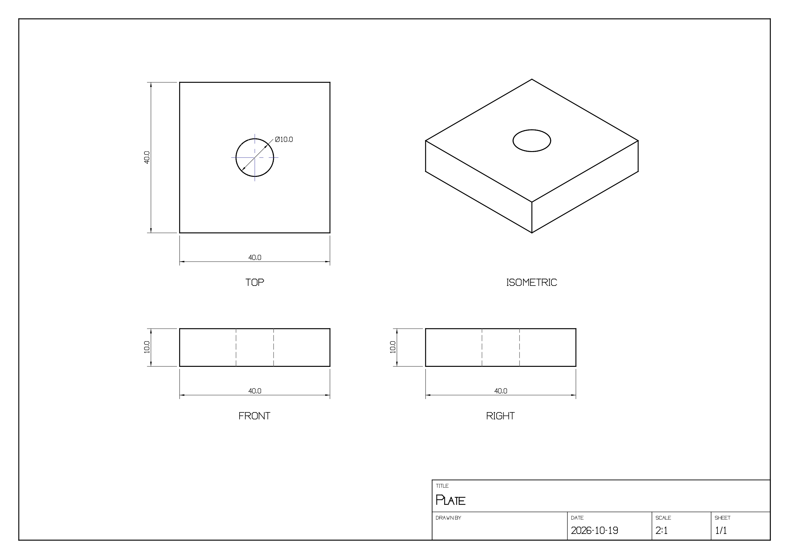

# cad tutorial: precise parametric parts

`cad` is the suite's parametric CAD tool, in the spirit of Onshape, SolidWorks
or FreeCAD's Part Design, built headless first: constrained sketches, extrude,
revolve, loft, sweep, draft, rib, threads, assemblies with mates and technical
drawings. A part is a list of named
**parameters** (`width = 40`, `margin = width/5`) and an ordered **feature
tree** (an extruded profile, a hole, a pattern of that hole, ...). Every number
in every feature can be an expression over the parameters, and the solid is
rebuilt from the tree whenever anything changes. Change `width` and the plate,
the hole spacing and the rib all follow.

Everything is a command, so the same part can be built three ways: typed at the
shell, written as a batch script, or described to Claude, which calls the same
commands over MCP and sees a picture after each step. Every example in this
tutorial was run against the real `wetwaresuite` binary, and the outputs shown are
what it printed (long outputs are shortened with `...`).

## contents

1. [the ideas you need](#1-the-ideas-you-need)
2. [setting up](#2-setting-up)
3. [task: a parametric mounting bracket](#3-task-a-parametric-mounting-bracket)
4. [task: change one parameter to resize everything](#4-task-change-one-parameter-to-resize-everything)
5. [task: export for 3D printing](#5-task-export-for-3d-printing)
6. [task: measure a part](#6-task-measure-a-part)
7. [task: a flange with a circular bolt pattern](#7-task-a-flange-with-a-circular-bolt-pattern)
8. [task: round, bevel and hollow a part](#8-task-round-bevel-and-hollow-a-part)
9. [task: STEP files in and out](#9-task-step-files-in-and-out)
10. [editing the tree: suppress, rename, delete, undo](#10-editing-the-tree-suppress-rename-delete-undo)
11. [expressions](#11-expressions)
12. [how features combine](#12-how-features-combine)
13. [task: sketch with constraints, then extrude](#13-task-sketch-with-constraints-then-extrude)
14. [task: revolve, loft, sweep, draft, rib, thread and reference geometry](#14-task-revolve-loft-sweep-draft-rib-thread-and-reference-geometry)
15. [task: an assembly with mates](#15-task-an-assembly-with-mates)
16. [task: a technical drawing](#16-task-a-technical-drawing)
17. [how sketch features fit the tree](#17-how-sketch-features-fit-the-tree)
18. [command reference](#18-command-reference)
19. [limits and troubleshooting](#19-limits-and-troubleshooting)

## 1. the ideas you need

**A part is a document.** `cad.new` (or `cad.open`) gives back an id like
`cad1`; every other command names it with `doc=cad1`. Several parts can be open
at once.

**Units are millimetres unless you say otherwise.** `cad.new units=in` (or
`cm`, `m`) only changes the label and the mass calculation; numbers are used as
you type them. STL and 3MF files are read by slicers as millimetres.

**Z is up.** The XY plane is the floor. A box's `width` runs along X, `depth`
along Y and `height` along Z.

**Parameters are named numbers.** `cad.param_set name=width value=40`. A value
can use other parameters: `value=width/5`. Parameters are evaluated every time
the part regenerates, so changing one updates everything that uses it.

**Features are the steps that build the solid.** Each has a name (you pick it
with `name=`, or you get `box1`, `hole2`, ...). Primitive and sketch features
(box, cylinder, extrude, ...) make new bodies. Operations (boolean, hole,
pattern, mirror, transform) take earlier features by name and replace them with
their result. Whatever is left unconsumed at the end of the tree is a *body*;
the bodies together are the part you preview and export.

**Every numeric field takes an expression.** `x=(foot+t+gusset)/2`,
`dy=width-2*margin`, `countersink_diameter=bolt*2`. Point lists too:
`points="0,0, foot,0, foot,t, t,t, t,rise, 0,rise"`. Quote a value that contains
spaces.

**Every edit is one undo step**, and an edit that would break the part (a
negative size, an unknown name, a hole that can't be cut) is refused with the
reason and changes nothing. Reading commands (`cad.info`, `cad.preview`,
`cad.measure_*`) never touch the history.

**The tree is saved, not just the mesh.** `.wwcad` files keep the parameters
and features, so you can reopen a part next month and change one number. Mesh
formats (STL, OBJ, PLY, OFF, glTF, 3MF) and images are exports. Parts saved
before the rename (`.achcad`) still open with `cad.open`.

## 2. setting up

Build the suite once (see the README for compilers):

```sh
cmake -S . -B build -DCMAKE_BUILD_TYPE=Release
cmake --build build --config Release
alias wetwaresuite="$PWD/build/apps/wetwaresuite/wetwaresuite"
```

See the cad commands and the parameters of one:

```sh
wetwaresuite list cad
wetwaresuite help cad.hole
```

```
cad.hole: Hole
Drill a round hole into a feature: diameter, depth (0 = through all), along axis (-z drills downwards). x/y/z is the entry point (0 if left out), except that the coordinate along the axis defaults to the entry face of the target. ...

usage: cad.hole doc=<string> target=<string> diameter=<string> [depth=<string>] [axis=-z|z|-x|x|-y|y] [x=<string>] ...
  doc (string, required)  id of an open cad document, e.g. cad1
  target (string, required)  feature to drill (name of an earlier feature)
  diameter (string, required)  hole diameter (number or expression)
  depth (string)  hole depth, 0 = through all (number or expression) (default 0)
  ...
```

Numeric fields are typed `string` because they accept expressions; a plain
number like `40` is fine everywhere.

### three ways to drive it

- **CLI**: `wetwaresuite <command> key=value ...` runs one command in a fresh
  process. Open documents live only inside one process, so a one-shot command
  can create or inspect a part (`wetwaresuite cad.open path=bracket.wwcad`) but
  can't keep editing it. For edits, pipe a few lines into `wetwaresuite batch` from
  the shell (shown in every task below) or use a script file.
- **Batch script**: a text file with one command per line, run with
  `wetwaresuite batch part.txt`. `-> name` at the end of a line saves the result
  (here the document id) and `$name` reuses it. `#` starts a comment. `undo` and
  `redo` work as lines. The script stops at the first failing line unless you
  add `--keep-going`.
- **Claude over MCP**: `wetwaresuite mcp` (or `wetwaresuite mcp --tools cad`) serves
  every command as a tool named with `_` instead of `.` (`cad_hole`). Connect
  it once (see [mcp.md](mcp.md)):

  ```sh
  claude mcp add wetwaresuite -- /path/to/wetwaresuite/build/apps/wetwaresuite/wetwaresuite mcp --tools cad
  ```

  Every edit tool takes `preview=true` (and `view=iso|front|top|...`), which
  attaches a PNG render of the part to the result, so Claude sees what it
  built after each step.

## 3. task: a parametric mounting bracket

The goal: an L-shaped bracket, 40 mm wide, with a 50 mm foot and a 45 mm
upright, 5 mm thick, a triangular rib for stiffness, two M5 clearance holes in
the foot and two countersunk M5 holes in the upright. Every dimension is a
parameter, so the same file makes the next size up.

### as a batch script

Save this as `bracket.txt`:

```text
# bracket.txt: a parametric L-shaped mounting bracket
cad.new units=mm -> part

# the numbers that define the part
cad.param_set doc=$part name=width value=40      # along Y
cad.param_set doc=$part name=foot value=50       # base length along X
cad.param_set doc=$part name=rise value=45       # upright height along Z
cad.param_set doc=$part name=t value=5           # wall thickness
cad.param_set doc=$part name=bolt value=5.5      # M5 clearance hole
cad.param_set doc=$part name=margin value=width/5
cad.param_set doc=$part name=gusset value=min(foot,rise)/2

# the L profile, drawn in the XZ plane and extruded along +Y
cad.extrude doc=$part name=body plane=xz points="0,0, foot,0, foot,t, t,t, t,rise, 0,rise" height=width
# a triangular rib in the middle, overlapping both walls a little
cad.extrude doc=$part name=rib plane=xz points="t/2,t/2, t+gusset,t/2, t/2,t+gusset" height=t y=(width-t)/2
cad.boolean doc=$part name=bracket op=union a=body b=rib

# two bolt holes through the foot, then two countersunk ones through the upright
cad.hole doc=$part name=foot_hole target=bracket diameter=bolt x=(foot+t+gusset)/2 y=margin
cad.pattern_linear doc=$part name=foot_holes target=foot_hole count=2 dy=width-2*margin
cad.hole doc=$part name=wall_hole target=foot_holes diameter=bolt axis=x y=margin z=rise-margin countersink_diameter=bolt*2
cad.pattern_linear doc=$part name=wall_holes target=wall_hole count=2 dy=width-2*margin

cad.info doc=$part
cad.save doc=$part path=bracket.wwcad
cad.save doc=$part path=bracket.stl
cad.save doc=$part path=bracket.png size=800
```

```sh
wetwaresuite batch bracket.txt
```

Each edit prints what it did and the state of the model:

```
created cad1 (0 features, 0 params, 0 bodies, mm)
...
added extrude body (1 body, volume 18000 mm^3)
added extrude rib (2 bodies, volume 19562.5 mm^3)
added boolean bracket (1 body, volume 19000 mm^3)
added hole foot_hole (1 body, volume 18881.4 mm^3)
added pattern_linear foot_holes (1 body, volume 18762.8 mm^3)
added hole wall_hole (1 body, volume 18557.2 mm^3)
added pattern_linear wall_holes (1 body, volume 18351.6 mm^3)
```

and `cad.info` describes the whole part:

```
cad1: mm, 7 params, 7 features, 1 bodies
parameters:
  width = 40
  foot = 50
  rise = 45
  t = 5
  bolt = 5.5
  margin = width/5 (=8)
  gusset = min(foot,rise)/2 (=22.5)
features:
  body extrude [used by bracket] height=width (=40) plane=xz points=0,0, foot,0, foot,t, t,t, t,rise, 0,rise bounds=(0,0,0)-(50,40,45)
  rib extrude [used by bracket] height=t (=5) plane=xz points=t/2,t/2, t+gusset,t/2, t/2,t+gusset y=(width-t)/2 (=17.5) bounds=(2.5,17.5,2.5)-(27.5,22.5,27.5)
  bracket boolean [used by foot_hole] a=body b=rib op=union bounds=(0,0,0)-(50,40,45)
  foot_hole hole [used by foot_holes] diameter=bolt (=5.5) target=bracket x=(foot+t+gusset)/2 (=38.75) y=margin (=8) bounds=(0,0,0)-(50,40,45)
  foot_holes pattern_linear [used by wall_hole] count=2 dy=width-2*margin (=24) target=foot_hole bounds=(0,0,0)-(50,40,45)
  wall_hole hole [used by wall_holes] axis=x countersink_diameter=bolt*2 (=11) diameter=bolt (=5.5) target=foot_holes y=margin (=8) z=rise-margin (=37) bounds=(0,0,0)-(50,40,45)
  wall_holes pattern_linear [body] count=2 dy=width-2*margin (=24) target=wall_hole bounds=(0,0,0)-(50,40,45)
bodies:
  wall_holes: volume 18351.6, 1328 triangles, 658 vertices, size 50 x 40 x 45 at (0, 0, 0), watertight
model: size 50 x 40 x 45 mm, min (0, 0, 0), max (50, 40, 45), volume 18351.6 mm^3, area 8961.17 mm^2, watertight
```

What each step did:

1. **The profile.** `plane=xz` draws the sketch with sketch x along X and sketch
   y along Z, and extrudes it along +Y by `height=width`. The six points walk
   round the L: along the floor, up the end of the foot, back to the inside
   corner, up the upright and down its back.
2. **The rib** is a triangle in the same plane, `t` thick, centred on the width
   with `y=(width-t)/2`. Its corner starts at `t/2,t/2`, inside the walls, so
   the union below welds it in rather than just touching.
3. **`cad.boolean op=union`** joins `body` and `rib` into one body called
   `bracket`. Both inputs are now "used by bracket".
4. **The first foot hole.** `cad.hole` drills along `axis=-z` (the default:
   downwards) from the entry point. Only `x` and `y` are given; `z` defaults to
   the top face of the target. `depth` defaults to 0, meaning through all.
5. **`cad.pattern_linear` on a hole repeats the hole**, not the whole bracket:
   two copies, `dy=width-2*margin` apart.
6. **The upright holes** drill along `+x` from the back face (`x` is left out,
   so it starts at the face the drill enters: the back of the upright at x=0),
   with a 90 degree countersink of twice the bolt diameter on that side.
7. **`cad.save`** writes the tree to `bracket.wwcad`, the solid to
   `bracket.stl`, and an 800x800 iso render to `bracket.png`.

### from the shell

The same thing without a script file: pipe the lines into `batch`.

```sh
wetwaresuite batch <<'EOF'
cad.new -> p
cad.param_set doc=$p name=width value=40
cad.param_set doc=$p name=t value=5
cad.extrude doc=$p name=body plane=xz points="0,0, 50,0, 50,t, t,t, t,45, 0,45" height=width
cad.hole doc=$p name=foot_hole target=body diameter=5.5 x=38 y=8
cad.pattern_linear doc=$p target=foot_hole count=2 dy=width-16
cad.save doc=$p path=quick-bracket.wwcad
EOF
```

Single commands are for things that fit in one step. Open a saved part and
print its summary:

```sh
wetwaresuite cad.open path=bracket.wwcad
```

```
opened cad1 (7 features, 7 params, 1 bodies, mm, 1328 triangles, 658 vertices, size 50 x 40 x 45 at (0, 0, 0), watertight, bracket.wwcad)
cad1
doc: cad1
units: mm
features: 7
bodies: 1
```

### asking Claude

With the MCP server connected, describe the part:

> Design a parametric L mounting bracket in cad: 40 mm wide, 50 mm foot, 45 mm
> upright, 5 mm walls, a triangular rib in the middle, two M5 clearance holes
> in the foot and two countersunk M5 holes in the upright, 8 mm from the edges.
> Make every dimension a parameter. Show me a preview, then save it as
> bracket.wwcad and bracket.stl.

Claude works through the same commands, roughly:

1. `cad_new` with `units: "mm"` gets `cad1`.
2. `cad_param_set` once per parameter (`width`, `foot`, `rise`, `t`, `bolt`,
   `margin`, ...).
3. `cad_extrude` with `plane: "xz"`, the L `points` and `height: "width"`,
   then `cad_extrude` for the rib and `cad_boolean` to join them, passing
   `preview: true` to check the shape.
4. `cad_hole` and `cad_pattern_linear` for each pair of holes
   (`countersink_diameter` on the upright).
5. `cad_info` to confirm one watertight body, `cad_preview` with
   `view: "front"` or `"top"` to check the hole positions.
6. `cad_save` twice.

Numeric arguments can be sent as numbers (`"width": 40`) or as expression
strings (`"width": "foot-10"`).

## 4. task: change one parameter to resize everything

The bracket needs to be 60 mm wide and 6 mm thick, with three foot holes.
Nothing else needs touching: the margin is `width/5`, the hole spacing is
`width-2*margin`, the rib follows `t`.

### as a batch script

```text
# resize.txt: make the bracket wider and thicker, with three foot holes
cad.open path=bracket.wwcad -> part
cad.param_set doc=$part name=width value=60
cad.param_set doc=$part name=t value=6
cad.feature_set doc=$part feature=foot_holes values="count=3; dy=(width-2*margin)/2"
cad.info doc=$part
cad.save doc=$part path=bracket-wide.wwcad
cad.save doc=$part path=bracket-wide.stl
```

```
opened cad1 (7 features, 7 params, 1 bodies, mm, 1328 triangles, 658 vertices, size 50 x 40 x 45 at (0, 0, 0), watertight, bracket.wwcad)
width = 60 (1 body, volume 27351.6 mm^3)
t = 6 (1 body, volume 32437.5 mm^3)
set foot_holes count=3, dy=(width-2*margin)/2 (1 body, volume 32295.2 mm^3)
...
model: size 50 x 60 x 45 mm, min (0, 0, 0), max (50, 60, 45), volume 32295.2 mm^3, area 13024.7 mm^2, watertight
saved bracket-wide.wwcad
saved bracket-wide.stl
```

`cad.feature_set` changes fields of an existing feature. `param=count
value=3` changes one; `values="count=3; dy=..."` changes several in one undo
step. Only the features after the change are rebuilt: results are cached by
their inputs, so the profile and rib aren't recomputed when only a hole moves.

### from the shell

A whole family of sizes in one loop, each exported to its own STL, with the
mass of each (the default density is PLA, 1.25 g/cm^3):

```sh
for w in 30 40 60; do
  wetwaresuite batch <<EOF | grep '^mass_g'
cad.open path=bracket.wwcad -> p
cad.param_set doc=\$p name=width value=$w
cad.save doc=\$p path=bracket-$w.stl
cad.measure_mass doc=\$p
EOF
done
```

```
mass_g: 17.3146
mass_g: 22.9396
mass_g: 34.1896
```

(The `$p` is escaped because this heredoc is unquoted so the shell can fill in
`$w`.)

### asking Claude

> Open bracket.wwcad, make it 60 mm wide and 6 mm thick, and put three holes
> in the foot instead of two, evenly spaced. Show me the top view and save it
> as bracket-wide.stl.

Claude calls `cad_open`, `cad_param_list` (to see the names), `cad_param_set`
for `width` and `t`, `cad_feature_set` on `foot_holes` with
`values: "count=3; dy=(width-2*margin)/2"`, `cad_preview` with `view: "top"`
and `cad_save`. If a change breaks the part, the tool result says why (for
example `feature body: extrude height must be positive`) and nothing changes,
so Claude can correct it.

## 5. task: export for 3D printing

STL is what every slicer reads; 3MF is the newer format that keeps units. The
extension picks the format:

```text
cad.save doc=$part path=bracket.stl            # binary STL
cad.save doc=$part path=bracket.stl ascii=true # text STL
cad.save doc=$part path=bracket.3mf
cad.save doc=$part path=bracket.obj
cad.save doc=$part path=bracket.glb            # glTF binary, for viewers and game engines
cad.save doc=$part path=bracket.png size=1024 view=iso
```

A mesh export reports whether the solid is watertight, which slicers need:

```
saved bracket.stl
bracket.stl
path: bracket.stl
triangles: 1328
watertight: true
```

Before printing, check the part's size and that it's one closed body
(`cad.info`), and estimate the filament with `cad.measure_mass` (section 6).

From the shell, export and render a preview of the export in one go (the
`convert` tool renders any mesh to an image):

```sh
wetwaresuite batch <<'EOF'
cad.open path=bracket.wwcad -> p
cad.param_set doc=$p name=width value=80
cad.save doc=$p path=bracket-80.stl
EOF
wetwaresuite convert.file input=bracket-80.stl output=bracket-80.png
```

```
...
saved bracket-80.stl
bracket-80.stl
path: bracket-80.stl
triangles: 1328
watertight: true
rendered bracket-80.stl to bracket-80.png
...
```

Asking Claude: *"Export the bracket as STL for printing and tell me how much
PETG it takes."* Claude calls `cad_info` (checks `watertight: true`),
`cad_save` with `path: "bracket.stl"` and `cad_measure_mass` with
`density: "1.27"`.

## 6. task: measure a part

### as a batch script

```text
# measure.txt: check the bracket before printing it
cad.open path=bracket.wwcad -> part
cad.measure_bounds doc=$part
cad.measure_mass doc=$part density=1.27
cad.measure_section doc=$part z=t/2
cad.measure_section doc=$part z=rise-margin
cad.measure_distance doc=$part from="(foot+t+gusset)/2, margin, t" to="(foot+t+gusset)/2, width-margin, t"
cad.measure_distance doc=$part from=body to=rib
cad.measure_bounds doc=$part feature=rib
```

```
size 50 x 40 x 45 mm, min (0, 0, 0), max (50, 40, 45), centre (25, 20, 22.5)
...
volume 18351.6 mm^3 (18.3516 cm^3), area 8961.17 mm^2, mass 23.3066 g at 1.27 g/cm^3
...
section at z=2.5: area 1952.56 mm^2, 3 loops, perimeter 214.544 mm
...
section at z=37: area 129.875 mm^2, 3 loops, perimeter 81.5563 mm
...
distance 24 mm (dx 0, dy 24, dz 0)
...
distance 12.5 mm (dx -10, dy 0, dz -7.5)
...
size 25 x 5 x 25 mm, min (2.5, 17.5, 2.5), max (27.5, 22.5, 27.5), centre (15, 20, 15)
```

Reading the results:

- **Bounds**: the whole part fits in 50 x 40 x 45 mm.
- **Mass**: 18.35 cm^3 of PETG (1.27 g/cm^3) is about 23.3 g at 100% infill.
  Common densities: PLA 1.25, PETG 1.27, ABS 1.04, aluminium 2.70, steel 7.85.
- **Sections** cut the part with a horizontal plane. Through the foot
  (`z=t/2`) the cross-section is the 50 x 40 plate minus the two holes: 3 loops
  (the outline and two holes) and 1952.56 mm^2, which is 2000 minus two 5.5 mm
  holes. Through the upright at the hole height, the two holes cut the wall
  into 3 separate pieces.
- **Distances** take two `x,y,z` points (expressions allowed) or feature names,
  which measure between the centres of their bounding boxes. The foot holes
  are 24 mm apart, centre to centre.
- **`feature=`** measures one feature's own result instead of the whole part:
  here the rib before it was joined.

Measurements change nothing and never enter the undo history, so they're safe
to run any time.

### from the shell

```sh
wetwaresuite batch <<'EOF' | grep '^volume\|^mass_g'
cad.open path=bracket.wwcad -> p
cad.measure_mass doc=$p density=1.27
EOF
```

```
volume 18351.6 mm^3 (18.3516 cm^3), area 8961.17 mm^2, mass 23.3066 g at 1.27 g/cm^3
volume: 18351.6
volume_cm3: 18.3516
mass_g: 23.3066
```

### asking Claude

> How heavy is bracket.wwcad in aluminium, what's the cross-section area of
> the foot, and how far apart are the foot holes?

Claude calls `cad_open`, `cad_measure_mass` with `density: "2.70"`,
`cad_measure_section` with `z: "t/2"` and `cad_measure_distance` between the
two hole centres. The numbers come back as structured fields (`mass_g`,
`area`, `distance`), so it can quote or compare them exactly.

## 7. task: a flange with a circular bolt pattern

A pipe flange: a 90 mm ring with a 40 mm bore, 8 mm thick, and six
counterbored M6 holes on a bolt circle halfway between the bore and the rim.

```text
# flange.txt: a round pipe flange with a circular bolt pattern
cad.new -> f
cad.param_set doc=$f name=od value=90          # outside diameter
cad.param_set doc=$f name=bore value=40        # pipe bore
cad.param_set doc=$f name=thick value=8
cad.param_set doc=$f name=pcd value=(od+bore)/2  # bolt circle diameter
cad.param_set doc=$f name=bolts value=6
cad.param_set doc=$f name=bolt value=6.6       # M6 clearance

cad.extrude_circle doc=$f name=disc diameter=od inner_diameter=bore height=thick segments=96
cad.hole doc=$f name=bolt_hole target=disc diameter=bolt x=pcd/2 counterbore_diameter=11 counterbore_depth=3
cad.pattern_circular doc=$f name=bolt_circle target=bolt_hole count=bolts
cad.measure_section doc=$f z=1
cad.measure_mass doc=$f density=2.70
cad.save doc=$f path=flange.wwcad
cad.save doc=$f path=flange.3mf
cad.save doc=$f path=flange.png view=top size=600
```

```
added extrude_circle disc (1 body, volume 40811.6 mm^3)
added hole bolt_hole (1 body, volume 40356.1 mm^3)
added pattern_circular bolt_circle (1 body, volume 38079 mm^3)
section at z=1: area 4896.5 mm^2, 8 loops, perimeter 532.691 mm
volume 38079 mm^3 (38.079 cm^3), area 14303.2 mm^2, mass 102.813 g at 2.7 g/cm^3
saved flange.wwcad
saved flange.3mf
saved flange.png
```

The section has 8 loops: the rim, the bore and six holes. `count=bolts` is an
expression too, so `cad.param_set doc=$f name=bolts value=8` re-spaces the
pattern to eight holes at 45 degrees. `pattern_circular` turns about Z through
the origin by default (`axis`, `cx`, `cy`, `cz` move it), and `angle` smaller
than 360 spreads the copies over an arc instead.

Asking Claude: *"Make a 90 mm aluminium flange for a 40 mm pipe, 8 mm thick,
six counterbored M6 holes on the bolt circle; tell me its weight."* It calls
`cad_new`, `cad_param_set` for each dimension, `cad_extrude_circle`,
`cad_hole`, `cad_pattern_circular` with `preview: true` and `view: "top"`, then
`cad_measure_mass` with `density: "2.70"`.

## 8. task: round, bevel and hollow a part

A storage tray: a 60 x 40 x 25 mm block with rounded corners, hollowed to
2 mm walls with the top open, a small bevel round the foot and a soft lip.

```text
# tray.txt: fillet, shell and chamfer
cad.new -> t
cad.param_set doc=$t name=wall value=2
cad.extrude_rect doc=$t name=block width=60 depth=40 height=25
cad.edges doc=$t feature=block
cad.fillet doc=$t name=round target=block radius=4 edges=vertical
cad.shell doc=$t name=tray target=round thickness=wall open=top
cad.chamfer doc=$t name=bevel target=tray distance=1 edges=bottom
cad.fillet doc=$t name=lip target=bevel radius=0.8 edges=top
cad.measure_mass doc=$t
cad.save doc=$t path=tray.step
cad.save doc=$t path=tray.png size=500
```

```
added extrude_rect block (1 body, volume 60000 mm^3)
12 sharp edges (12 outer, 0 inner)
  1: 30,0,0  length 60, along x, outer, 90 deg
  2: 0,20,0  length 40, along y, outer, 90 deg
  ...
  5: 0,0,12.5  length 25, along z, outer, 90 deg
  ...
added fillet round (1 body, volume 59648.6 mm^3)
added shell tray (1 body, volume 13364.3 mm^3)
added chamfer bevel (1 body, volume 13268.8 mm^3)
added fillet lip (1 body, volume 13216.5 mm^3)
volume 13216.5 mm^3 (13.2165 cm^3), area 13507.2 mm^2, mass 16.5206 g at 1.25 g/cm^3
saved tray.step
saved tray.png
```

How the edges are picked:

- `edges=` names kinds of edge, comma-separated and combined: `all` (the
  default), `outer` (convex, cut away), `inner` (concave, filled in), `top`
  and `bottom` (edges lying on the highest or lowest Z), `vertical`,
  `horizontal`, `x`, `y`, `z`.
- `near=x,y,z,...` picks the edge closest to each point instead. `cad.edges`
  lists every sharp edge with its midpoint, so copy a midpoint from there:
  `cad.chamfer doc=$t target=block distance=2 near=30,0,25` bevels just the
  front top edge.
- `angle` (30 degrees by default) is how sharply two faces have to meet to
  count as an edge, so the facets of a cylinder aren't rounded one by one but
  its rim is.

A round rim (like the tray's foot after the corners were rounded) is swept as
one piece, and where three rounded outer edges meet at a corner the corner
becomes a ball. Inner edges (an L-bracket's inside corner) are filled with a
round instead of cut.

`cad.shell` moves every face inwards by `thickness` and keeps the skin. `open`
names the outermost faces to remove, `top bottom front back left right` or
`+x -x +y -y +z -z`, comma-separated; leave it out for a closed hollow part.
Order matters: shell before small chamfers. A wall thicker than a narrow face
(here the 1 mm chamfer) would turn that face inside out, and the shell stops
with "thickness is too large for this shape".

Asking Claude: *"Make a 60 by 40 by 25 mm tray with 2 mm walls, rounded
corners and a soft top edge, and save it as STEP."* It calls `cad_new`,
`cad_extrude_rect`, `cad_fillet` with `edges: "vertical"`, `cad_shell` with
`open: "top"`, another `cad_fillet` with `edges: "top"`, then `cad_save` with
`path: "tray.step"`.

## 9. task: STEP files in and out

STEP (`.step`, `.stp`) is what other CAD programs (FreeCAD, Fusion, SolidWorks,
Onshape) trade solids in.

**Export.** `cad.save path=part.step` writes an AP214 file. Each flat region
becomes one planar face (with its holes), and a closed part becomes a solid,
so the tray above opens in FreeCAD as one solid of 13216.5 mm^3. Curved faces
(fillets, cylinders) go out as the flat facets you see on screen, so raise
`segments` before exporting if the other program needs them smoother.

**Import.** `cad.open path=part.step` opens a STEP file as a new part with one
fixed imported feature; `cad.import doc=$t path=part.step` adds one to the
part you have open, so you can drill, cut and fillet it like anything else.
Planes, cylinders, cones, spheres, tori and B-spline surfaces are read and
turned into triangles that stay within about 0.05% of the model's size of the
true surface, assemblies are placed, and units are converted to millimetres.

```sh
wetwaresuite batch <<'EOF'
cad.open path=tray.step -> b
cad.measure_mass doc=$b density=2.70
cad.hole doc=$b target=imported1 diameter=5 x=30 y=20
cad.save doc=$b path=tray-drilled.step
EOF
```

```
opened cad1 (1 features, 0 params, 1 bodies, mm, 1652 triangles, 828 vertices, size 60 x 40 x 25 at (0, 0, 0), watertight, tray.step)
volume 13216.5 mm^3 (13.2165 cm^3), area 13507.2 mm^2, mass 35.6846 g at 2.7 g/cm^3
added hole hole1 (1 body, volume 13177.3 mm^3)
saved tray-drilled.step
```

The imported feature is called `imported1` (`cad.info` lists it).

`convert`, `slicer`, `sculpt`, `library` and `fit` read STEP the same way, and
opening a `.step` file in the cad app's window opens it as a part.

## 10. editing the tree: suppress, rename, delete, undo

```text
# edit.txt: change the tree, see what is refused, undo
cad.open path=bracket.wwcad -> p
cad.param_set doc=$p name=t value=-2
cad.param_delete doc=$p name=bolt
cad.feature_delete doc=$p feature=rib
cad.feature_suppress doc=$p feature=rib
cad.feature_list doc=$p
undo
cad.rename doc=$p feature=wall_holes to=finished
cad.feature_set doc=$p feature=wall_hole param=countersink_diameter value=
cad.feature_set doc=$p feature=wall_hole values="counterbore_diameter=10; counterbore_depth=2"
undo
undo
cad.param_list doc=$p
```

```sh
wetwaresuite batch --keep-going edit.txt
```

```
line 3: feature rib: extrude height must be positive
line 4: can't delete bolt: used by feature foot_hole, feature wall_hole
line 5: can't delete rib: used by bracket
suppressed rib (1 body, volume 17351.6 mm^3)
...
rib extrude [suppressed] height=t (=5) plane=xz points=t/2,t/2, t+gusset,t/2, t/2,t+gusset y=(width-t)/2 (=17.5)
...
undone
renamed wall_holes to finished (1 body, volume 18351.6 mm^3)
set wall_hole countersink_diameter=(default) (1 body, volume 18525.6 mm^3)
set wall_hole counterbore_diameter=10, counterbore_depth=2 (1 body, volume 18306.8 mm^3)
undone
undone
width = 40
...
```

The three refused lines are on purpose, so the script exits with status 1
(any failed line does, which is what lets shell scripts and CI notice).

- A **negative thickness** is refused: the rib's extrusion height is `t`. The
  part is left exactly as it was.
- A **parameter in use** can't be deleted, and neither can a **feature that a
  later feature uses**. Delete or change the user first.
- **Suppressing** a feature switches it off without deleting it. The union that
  used the rib now passes the body straight through, so the bracket has no rib
  (1000 mm^3 lighter). A suppressed hole leaves its target undrilled; a
  suppressed boolean leaves both inputs as separate bodies.
- **Renaming** updates every feature that refers to the old name.
- **An empty value** (`value=`) resets a field to its default: no countersink.
- `undo` and `redo` step through every edit, including closing a part.

Asking Claude: *"Take the rib off the bracket for now and switch the upright
holes to 10 mm counterbores, 2 mm deep."* Claude calls `cad_feature_suppress`
with `feature: "rib"` and `cad_feature_set` with `feature: "wall_hole"`,
`values: "countersink_diameter=; counterbore_diameter=10; counterbore_depth=2"`.
To go back it calls `undo`.

## 11. expressions

Every numeric field and every parameter value is an expression:

| syntax | meaning |
|---|---|
| `40`, `2.5`, `.5`, `1e3` | numbers |
| `width`, `hole_d` | a parameter (letters, digits and `_`, starting with a letter) |
| `+ - * /` | arithmetic; `%` is the remainder |
| `^` | power, right-associative: `2^3^2` = 512; `-2^2` = -4 |
| `( )` | grouping |
| `pi` | 3.14159... |
| `sin cos tan` | trig in **degrees**: `sin(30)` = 0.5 |
| `asin acos atan atan2(y, x)` | inverse trig, answering in degrees |
| `sqrt abs floor ceil round` | one argument |
| `min(a, b, ...)`, `max(a, b, ...)` | any number of arguments |
| `pow(a, b)` | same as `a^b` |

A parameter can use any parameter that already exists (`margin = width/5`
once `width` is set), and is re-evaluated whenever that one changes; a loop
(`a = b+1` then `b = a`) is refused. Division by zero, unknown
names and anything that isn't a finite number are errors that name the field,
e.g. `feature plate: width: bad expression 'wdth': unknown name 'wdth' (define
it with cad.param_set)`.

Point lists (`points`, `hole_points`) are comma-separated expressions, read as
x,y pairs: `points="0,0, w,0, w,h, 0,h"`. Commas inside function calls don't
split: `points="0,0, min(a,b),0, 0,5"`.

## 12. how features combine

- **Order matters.** Operations can only use features earlier in the tree.
  The tree is rebuilt from the top whenever something changes.
- **Consumed features stop being bodies.** After `cad.boolean a=body b=rib`,
  `body` and `rib` are "used by" the boolean, and only the boolean is a body.
  Their own results are still there for `cad.measure_* feature=...` and
  `cad.preview feature=...`.
- **Holes are cuts on a body.** `target` is the feature to drill. Patterns and
  mirrors of a hole repeat the cut on the same body, which is how you make bolt
  patterns. Patterns and mirrors of anything else copy the body (copies that
  touch or overlap are unioned into one solid).
- **Through holes** (`depth=0`) go through everything in the target along the
  axis. Blind holes have flat bottoms. The hole's entry point defaults to the
  target's face on the side the drill comes from, so `axis=-z` starts at the
  top and `axis=x` at the -X face.
- **Round things are polygons.** Cylinders, holes and arcs have `segments`
  sides (64 by default) with their corners exactly on the radius, so a hole's
  area is slightly smaller than the true circle (0.16% at 64 segments). Raise
  `segments` for more accuracy, lower it for speed.
- **Sketch planes.** `plane=xy` (default) draws on the floor and extrudes up;
  `plane=xz` maps sketch x to X and y to Z and extrudes along +Y; `plane=yz`
  maps sketch x to Y and y to Z and extrudes along +X. `x y z rx ry rz` then
  move and rotate the result (rotation about X, then Y, then Z).
- **Imported meshes** (`cad.open` of an STL, or `cad.import`) become a fixed
  `imported` feature that you can drill, pattern or combine with booleans like
  any other.
- **The regenerated solid is a mesh.** A cad document is also a mesh
  document, so tools that read meshes can take `doc=cad1` and see the current
  solid (edits they make to the mesh are replaced at the next regeneration).

## 13. task: sketch with constraints, then extrude

This is the Onshape / SolidWorks way to make a part: draw a rough 2D sketch,
tell it what must be true (this line is horizontal, these circles are equal,
this edge is `w` long), and let the solver put every point where it belongs.
The sketch then drives a feature such as an extrude. Change a dimension and the
sketch and the solid both update.

### the ideas

- **A sketch is a feature** (`cad.sketch`). It sits on a plane: a standard
  plane (`plane=xy|xz|yz`, moved by `offset`), a flat face of a body
  (`on=pad face=top`) or a datum plane (`on=slope`, section 14). Sketch x/y follow the
  world axes the plane is closest to, so on a top face sketch x is X and
  sketch y is Y.
- **Geometry** is points (`p1`, `p2`, ...), lines (`l1`), circles (`c1`), arcs
  (`a1`) and splines (`s1`). Each command prints the ids it made.
  `cad.sketch_info` lists them all with their solved positions.
- **References** in constraints: a point `p3`, an entity `l1`, an end
  `l1.start` / `l1.end`, a centre `c1.center` / `a1.center`, the sketch
  `origin`, and its axes `xaxis` / `yaxis`.
- **Relations** (`cad.sketch_constrain type=...`): coincident, horizontal,
  vertical, parallel, perpendicular, collinear, tangent, equal, fixed,
  midpoint, concentric, symmetric.
- **Dimensions** (`cad.sketch_dimension type=... value=...`): distance,
  hdistance, vdistance, length, radius, diameter, angle. A value can be an
  expression over the part's parameters (`value=h/2`). Change one later with
  `cad.sketch_set`.
- **Degrees of freedom.** After every sketch edit the result says how defined
  the sketch is: `under defined (3 degrees of freedom)` with the points that
  can still move, `fully defined`, or a refusal naming the constraints that
  conflict (`constraints conflict: k2 (length), k4 (vertical)`). An over
  defined edit is refused and changes nothing. Only fully defined sketches are
  guaranteed to keep their shape when you change a value, but any closed
  profile can be extruded.
- **Profiles.** Closed loops of non-construction geometry become regions.
  A loop inside another one is a hole. An open loop or a branch can't be
  extruded, and `cad.sketch_info` says where it's open.
  `construction=true` geometry (centre lines, reference circles) is never part
  of a profile.
- **Helpers apply the obvious relations for you.** A line drawn exactly level
  gets `horizontal`, and one drawn exactly upright gets `vertical`. An end that
  lands on an existing point joins it, and a point at 0,0 is tied to the
  origin. `sketch_rect` keeps its sides square, and `dims=true` adds its size
  as dimensions.

### as a batch script

`plate.txt`: a plate with two equal holes ten millimetres from each end,
fully defined, extruded, then a pocket sketched on its top face:

```text
# plate.txt: a sketched plate, fully defined, extruded, then pocketed from its top face
cad.new -> part
cad.param_set doc=$part name=w value=60
cad.param_set doc=$part name=h value=30
cad.sketch doc=$part name=base plane=xy
cad.sketch_rect doc=$part sketch=base width=w height=h dims=true
cad.sketch_circle doc=$part sketch=base cx=10 cy=15 diameter=6
cad.sketch_circle doc=$part sketch=base cx=50 cy=15 diameter=6
cad.sketch_constrain doc=$part sketch=base type=equal refs=c1,c2
cad.sketch_constrain doc=$part sketch=base type=horizontal refs=c1.center,c2.center
cad.sketch_dimension doc=$part sketch=base type=diameter refs=c1 value=6
cad.sketch_dimension doc=$part sketch=base type=hdistance refs=p1,c1.center value=10
cad.sketch_dimension doc=$part sketch=base type=vdistance refs=p1,c1.center value=h/2
cad.sketch_dimension doc=$part sketch=base type=hdistance refs=c2.center,p2 value=10
cad.sketch_info doc=$part sketch=base
cad.sketch_extrude doc=$part name=pad sketch=base depth=8
cad.sketch doc=$part name=top on=pad face=top
cad.sketch_rect doc=$part sketch=top x=20 y=8 width=20 height=14
cad.sketch_extrude doc=$part name=pocket sketch=top depth=3 operation=cut
cad.info doc=$part
cad.param_set doc=$part name=w value=80
cad.info doc=$part
cad.save doc=$part path=plate.wwcad
```

```sh
wetwaresuite batch plate.txt
```

Each step reports how defined the sketch is now:

```
rectangle l1,l2,l3,l4 (base: fully defined)
circle c1 (base: under defined (3 degrees of freedom))
circle c2 (base: under defined (6 degrees of freedom))
equal k6 (base: under defined (5 degrees of freedom))
horizontal k7 (base: under defined (4 degrees of freedom))
diameter k8 = 6 (base: under defined (3 degrees of freedom))
hdistance k9 = 10 (base: under defined (2 degrees of freedom))
vdistance k10 = h/2 (base: under defined (1 degree of freedom))
hdistance k11 = 10 (base: fully defined)
base: fully defined; plane origin 0,0,0, x 1,0,0, y 0,1,0, normal 0,0,1
points:
  p1 (0, 0)
  p2 (60, 0)
  ...
constraints:
  k1 coincident p1 origin
  k2 horizontal l1 l3
  k3 vertical l2 l4
  k4 length l1 = w (now 60)
  ...
profile: 1 region
  1: area 1743.54, 2 holes
added sketch_extrude pad (1 body, volume 13948.3 mm^3)
...
added sketch_extrude pocket (1 body, volume 13108.3 mm^3)
...
w = 80 (1 body, volume 17908.3 mm^3)
```

Setting `w = 80` moved the right edge, and the right hole moved with it. It
stays 10 mm from that edge because `k11` measures from `p2`. The left hole
stays put.

### extrude options

`cad.sketch_extrude` takes:

- `end`: `blind` (the default, `depth`), `symmetric` (half the depth each
  way), `through_all`, or `up_to_face` (`up_to=top` of the target, or a point
  `x,y,z` on any face).
- `depth2`: a second blind direction.
- `reverse=true`: flips the direction.
- `draft`: tapers the walls inwards, in degrees.
- `regions`: picks profiles by number (from `cad.sketch_info`).
- `operation`: `join` (default), `cut`, `intersect` or `new` (its own body).
  `target` is the body to join, cut or intersect, and defaults to the last
  body.

A cut sketched on a face goes into the body. A sketch extrude is a feature like
any other, so `cad.feature_set feature=pad param=end value=symmetric` changes
it later, and patterns and mirrors of a sketch cut repeat the cut.

### editing a sketch

- `cad.sketch_move sketch=base point=p3 x=70 y=40` drags a point. The solver
  keeps every constraint and moves only what is free to move, the same as
  dragging in Onshape.
- `cad.sketch_set sketch=base constraint=k4 value=75` changes a dimension.
  `cad.sketch_delete item=k7` removes a constraint. Deleting a point or entity
  also removes everything attached to it.
- `cad.sketch_construction entity=l5` toggles construction geometry.
- `cad.sketch_fillet sketch=f point=p3 radius=3` rounds a corner with a
  tangent arc.
- `cad.sketch_polygon`, `cad.sketch_slot`, `cad.sketch_spline` and
  `cad.sketch_arc mode=three_point` cover the other common shapes.
- `cad.sketch_arc tangent=l2` makes an arc tangent to a line where it starts.

### from the shell

One-shot commands don't keep documents open, so pipe the lines in:

```sh
wetwaresuite batch <<'EOF'
cad.new -> p
cad.sketch doc=$p name=s
cad.sketch_polygon doc=$p sketch=s sides=6 radius=10 dims=true
cad.sketch_constrain doc=$p sketch=s type=horizontal refs=l1
cad.sketch_extrude doc=$p sketch=s depth=5
cad.save doc=$p path=hex.stl
EOF
```

### asking Claude

With the MCP server connected (section 2), say for example:

> Make a 60 x 30 mm plate, 8 mm thick, from a fully defined sketch. Put two
> 6 mm holes 10 mm in from each end on the centre line, then sketch a 20 x 14 mm
> pocket 3 mm deep on the top face. Make the width a parameter.

Claude calls `cad_sketch`, `cad_sketch_rect`, `cad_sketch_circle`,
`cad_sketch_constrain` and `cad_sketch_dimension`, and reads the degrees of
freedom after each step until the sketch is fully defined. Then it calls
`cad_sketch_extrude`. Every sketch tool takes `preview=true`, which attaches a
picture of the sketch (dimensions included, under-defined points marked), so
Claude can check its work.

### in the window

Open the cad app (`wetwaresuite-cad`), press **Ctrl+K** and type *sketch*. Each
sketch command opens as a form, the same fields as above. Fill in the
document and the sketch, then press **Run**. The 3D view updates, and the
result line shows the degrees of freedom. Ctrl+Z takes back exactly one sketch
edit. Tick **preview** to see the sketch itself, with its dimensions and the
points that can still move marked.

### in the window: work right on the part

You don't need the forms for everyday modelling. In the 3D view:

- **Hover** over the part: the face under the mouse lights up. **Click** a face
  to pick it (Esc lets it go). The bar over the view says which body and face it is.
- **Push/Pull**: a picked flat face gets an arrow. Drag it out to add material,
  in to cut. A ghost shows where the face goes, with the distance next to the
  arrow; it snaps to round numbers (hold **Alt** for free). Hold the mouse
  still for a moment and the real result appears on the part. Let go to keep
  it: that's one `cad.push_pull`, so one Ctrl+Z takes it back, and the tree
  gets an editable sketch plus extrude.
- **Move**: switch the picked face to **Move** and drag the red, green or blue
  arrow to slide the whole body along X, Y or Z (a `cad.transform`).
- **Sketch on it**: starts a sketch right on the picked face. **New sketch**
  starts one on the clicked face or on the top, front or right plane.
  While you sketch, the view looks straight at the sketch with the part drawn
  behind it, and the face's edges are traced so your lines snap to its corners.
- **Extrude...** from a sketch opens the extrude settings with a live preview:
  the solid shows on the part at once, and an arrow on it sets the depth as you
  drag. Change the operation (join, cut, new) or any other setting and the
  preview follows. **Apply** keeps it, Ctrl+Z or closing the form drops it.
- **Fillet...** opens the fillet settings for the picked body, previewed live too.

Every form that changes the part previews like that (tick **Live preview** off
to stop it). Slow ones, like a big fillet, get a **Preview** button instead of
running on every change. The view holds still while previews come and go, so
the part doesn't jump around; **Fit** or a double-click shows everything again.

The same works headless: `cad.pick` says what is under a point of a view (or
along a ray), and `cad.push_pull face=x,y,z distance=5` pulls a face:

```
cad.new
cad.box width=40 depth=30 height=10
cad.pick ray=20,15,100,0,0,-1        # the top face: flat, area 1200, its outline
cad.push_pull face=20,15,10 distance=5
cad.push_pull face=20,15,15 distance=-2
```

## 14. task: revolve, loft, sweep, draft, rib, thread and reference geometry

Every feature below is parametric: it reads its sketches, parameters and
targets every time the tree rebuilds.

```text
# features.txt: revolve, loft, sweep, draft, rib, thread and datums
cad.new -> part
# a stepped shaft: half its section on the xz plane, revolved about the sketch's y axis (world Z)
cad.sketch doc=$part name=section plane=xz
cad.sketch_polyline doc=$part sketch=section points="0,0, 12,0, 12,20, 8,20, 8,50, 0,50"
cad.sketch_revolve doc=$part name=shaft sketch=section axis=y
# an M16 thread on the thin end
cad.thread doc=$part name=m16 target=shaft diameter=16 pitch=2 length=20 z=30
cad.new -> duct
# a loft from a square to a circle, 30 above it
cad.sketch doc=$duct name=bottom
cad.sketch_rect doc=$duct sketch=bottom width=40 height=40 center=true
cad.sketch doc=$duct name=up offset=30
cad.sketch_circle doc=$duct sketch=up cx=0 cy=0 diameter=24
cad.loft doc=$duct name=transition sections=bottom,up
cad.new -> rail
# a sweep: a 6 mm circle along an L-shaped path with a rounded corner
cad.sketch doc=$rail name=profile
cad.sketch_circle doc=$rail sketch=profile cx=0 cy=0 diameter=6
cad.sketch doc=$rail name=path plane=xz
cad.sketch_polyline doc=$rail sketch=path points="0,0, 0,40, 30,40" closed=false
cad.sketch_fillet doc=$rail sketch=path point=p2 radius=10
cad.sweep doc=$rail name=rod profile=profile path=path
```

```
added sketch_revolve shaft (1 body, volume 15055.4 mm^3)
added thread m16 (1 body, volume 14494.3 mm^3)
  m16: volume 14494.3, 19300 triangles, 9652 vertices, size 24 x 24 x 50 at (-12, -12, 0), watertight
added loft transition (1 body, volume 29152.7 mm^3)
fillet a1 between l1 and l2 (path: under defined (2 degrees of freedom))
added sweep rod (1 body, volume 1854.69 mm^3)
```

- **`cad.sketch_revolve`** turns the sketch's closed profiles about
  `axis=x|y` (the sketch's own axes) or a line of the sketch, usually a
  construction centre line (`axis=l1`). `angle` below 360 leaves flat ends.
  `symmetric` spreads the angle both ways. Holes in the profile stay hollow.
- **`cad.loft`** blends between two or more sketches with one closed outline
  each (`sections=bottom,mid,up`). It is straight between two sections and
  smooth through three or more, unless `ruled=true`. Sharp corners are kept.
- **`cad.sweep`** moves a closed profile along a path drawn in another sketch:
  a chain of lines, arcs and splines, open or closed. The profile keeps its
  angle to the path. `twist` turns it along the way. Sharp path corners are
  mitred and rounded ones are smooth.
- **`cad.draft`** tilts the walls of a body, so a moulded part releases. The
  walls are the faces parallel to `pull` (default `+z`). Outer walls lean in
  going along the pull, holes open up, and `neutral` is the height that keeps
  its size. Draft first and then shell: drafting a shelled cup thins its walls
  until they cross, and the command refuses.
- **`cad.rib`** turns an open line in a sketch into a web `thickness` thick.
  The web is filled from the line towards the body until it meets it.
  `flip=true` fills the other way.
- **`cad.thread`** cuts a metric 60° thread (`diameter`, `pitch`, `length`,
  from `x y z` along `axis`) into a shaft, or into a hole with
  `internal=true`. `left=true` makes it left-handed. A thread that reaches an
  end of the body runs out past it. `cosmetic=true` leaves the solid plain
  and only keeps the callout (`M16x2` on drawings) and the axis. That is fast,
  and it is what you want for a part that will be tapped or bought as a bolt.
- **`cad.datum_plane`** makes a reference plane:
  - a standard plane or a face (`on=pad face=top`), moved by `offset`;
  - tilted by `angle` about its own `u` or `v` axis;
  - or through three points (`points="0,0,0, 10,0,0, 0,10,5"`).

  Sketch on it with `cad.sketch on=<datum>`, or mate to it in an assembly.
- **`cad.datum_axis`** makes a reference axis:
  - through `cx cy cz` along `axis`;
  - through two points;
  - or the axis of a hole, cylinder, revolve or thread (`on=m16`).

### asking Claude

> Revolve a stepped shaft: 24 mm diameter for the first 20 mm, then 16 mm up
> to 50 mm. Put an M16x2 thread on the last 20 mm.

> Loft a 40 mm square into a 24 mm circle 30 mm above it, then shell it
> 2 mm open at both ends.

### in the window

Ctrl+K, then *revolve*, *loft*, *sweep*, *draft*, *rib*, *thread* or
*datum*. Each opens as a form with the fields above, and Ctrl+Z takes the
feature back.

## 15. task: an assembly with mates

An assembly (`cad.assembly_new`, id `asm1`) holds **components**: placed
copies of parts. **Mates** say how the components sit against each other, and
the solver moves the free components until every mate holds. As with sketches,
each edit reports the degrees of freedom left and the components that can
still move.

- **Parts** come from an open cad document (`part=cad1`, which copies its
  tree; `cad.assembly_update` pulls in later changes) or from a file
  (`.wwcad`, STEP or a mesh). Inserting the same part twice gives two
  components of one part, and the BOM counts it twice.
- **The first component is fixed.** Others are free unless `fixed=true`.
  `x y z rx ry rz` give the starting place.
- **Mate references** are `component/selector`. The selector is one of:
  - a face: `top`, `bottom`, `front`, `back`, `left`, `right`, or a point
    `x,y,z` on it;
  - a feature with an axis or a plane: a hole, cylinder, revolve, thread,
    datum plane or datum axis (`h1`, `pin`; `h1#2` is the second copy in a
    pattern);
  - the part's own planes `xy`, `xz`, `yz`, its axes `x`, `y`, `z`, its
    `origin`, or a point `@x,y,z`.
- **Mate types:**
  - `coincident`: plane on plane, facing each other unless `flip=true`;
    point on point; point on a plane or an axis; axis on axis; axis in a
    plane.
  - `concentric`: axis on axis.
  - `distance`: planes or points, `value` apart (negative sinks one into the
    other).
  - `angle`: between planes or axes, in degrees.
  - `parallel` and `perpendicular`.
  - `fastened`: locks two components together.

  Values can be assembly parameters (`cad.assembly_param name=gap value=2`,
  then `value=gap`).

### as a batch script

```text
# asm.txt: a plate with a peg in its hole, mated, checked and documented
cad.new -> plate
cad.box doc=$plate name=plate width=40 depth=40 height=10
cad.hole doc=$plate name=h1 target=plate diameter=10 x=20 y=20
cad.save doc=$plate path=plate.wwcad
cad.new -> peg
cad.cylinder doc=$peg name=pin diameter=10 height=30
cad.save doc=$peg path=peg.wwcad
cad.assembly_new -> asm
cad.assembly_insert doc=$asm part=$plate name=base
cad.assembly_insert doc=$asm part=$peg name=peg x=80
cad.mate doc=$asm type=concentric a=base/h1 b=peg/pin
cad.mate doc=$asm type=distance a=base/top b=peg/bottom value=-5
cad.assembly_info doc=$asm
cad.assembly_interference doc=$asm
cad.assembly_bom doc=$asm path=bom.csv
cad.assembly_save doc=$asm path=pegged.wwasm
cad.assembly_explode doc=$asm factor=1 axis=+z
cad.assembly_save doc=$asm path=exploded.png size=256
cad.assembly_explode doc=$asm factor=0
cad.drawing doc=$plate path=plate.pdf title="Plate" author=me
cad.drawing doc=$asm path=pegged.svg
```

```
inserted base (plate, fixed) (fully defined)
inserted peg (peg) (6 degrees of freedom left: peg)
concentric mate mate1 (base/h1, peg/pin) (2 degrees of freedom left: peg)
distance mate mate2 (base/top, peg/bottom) (1 degree of freedom left: peg)
parts:
  plate (plate.wwcad), volume 15215.9
  peg (peg.wwcad), volume 2352.41
components:
  base (plate) at 0,0,0 fixed
  peg (peg) at 20,20,5 free
mates:
  mate1 concentric base/h1 peg/pin
  mate2 distance base/top peg/bottom = -5
no interference
2 parts, 2 components, 21.9603 g
  1. plate x1, 19.0198 g each
  2. peg x1, 2.94051 g each
saved pegged.wwasm
exploded view (+z, x1) (1 degree of freedom left: peg)
drawing bp1: 4 views at 2:1, 165 visible and 11 hidden lines, 7 dimensions, saved plate.pdf
drawing bp2: 4 views at 1:1, 260 visible and 135 hidden lines, 6 dimensions, saved pegged.svg
```

The one degree of freedom left is the peg spinning in its hole. Add an
`angle` or `fastened` mate to pin it.

- **`cad.assembly_move`** places a component by hand, absolute or with
  `relative=true`. The mates still hold, so it ends up as close as they
  allow. `fixed=true|false` pins or frees it.
- **`cad.mate_set`** changes a value or flips a mate. **`cad.mate_delete`**
  and **`cad.assembly_remove`** take mates or components out.
- **`cad.assembly_interference`** lists overlapping pairs and the shared
  volume. Faces that only touch don't count.
- **`cad.assembly_bom`** lists the parts with their quantity, volume and mass
  (`density` in g/cm³, default 1.25 for PLA), and `path=` writes it as CSV.
- **`cad.assembly_explode`** pulls the components apart, radially or along an
  axis, for pictures, exports and drawings. The mates don't change, and
  `factor=0` puts it back together.
- **`cad.assembly_save`** writes `.wwasm` (parts, components and mates, with
  the parts' trees inside, so the file travels alone), a mesh (STL, 3MF, OBJ,
  glTF, ... of the assembled or exploded model) or a picture. Reopen a
  `.wwasm` file with `cad.assembly_open`, or double-click it.
- Every edit is one undo step.

### asking Claude

> Put the peg from peg.wwcad into the hole of plate.wwcad, sitting 5 mm deep.
> Check that nothing overlaps, then give me a BOM as CSV and an exploded
> picture.

Claude calls `cad_assembly_new`, `cad_assembly_insert`, `cad_mate`,
`cad_assembly_interference`, `cad_assembly_bom` and `cad_assembly_explode`,
and every edit can return a picture (`preview=true`) with each component in its
own colour.

### in the window

Ctrl+K, then *assembly* or *mate*. The assembly shows in the 3D view, with each
component in its own colour. Ctrl+Z undoes one insert, mate or move.

## 16. task: a technical drawing

`cad.drawing doc=<part or assembly>` lays out projected views on a sheet:

- **Views:** front, top and right in third-angle projection, plus an
  isometric view. Pick others with `views=front,left,iso`, and use
  `projection=first` for first-angle.
- **Edges:** visible edges are solid. Hidden edges are dashed, and
  `hidden=false` leaves them out.
- **Annotations:**
  - overall dimensions;
  - diameters of holes and circles seen face on, with centre marks
    (`4x Ø6` when several are the same);
  - thread callouts (`M16x2`);
  - for an assembly, a parts list.
- **Title block:** `title`, `author`, the date, the scale and the sheet.
  `scale=auto` picks a standard scale that fits the `paper` (A4 to A0, letter,
  tabloid). `scale=1:2` fixes one.

It makes a blueprint document (`bp1`) that stays open, so blueprint commands
can add notes or more dimensions to it. With `path=`, it also writes `.pdf`,
`.svg`, `.dxf` (layers VISIBLE, HIDDEN, CENTER and DIMS, for CAD programs and
laser cutters) or `.png`. Drawings are made from the current model, so make a
new one after a change.

```sh
wetwaresuite batch <<'EOF'
cad.open path=plate.wwcad -> p
cad.drawing doc=$p path=plate.dxf scale=1:1 paper=A4 title="Plate" author="me"
EOF
```



### asking Claude

> Make an A3 PDF drawing of bracket.wwcad with hidden lines, titled
> "Bracket rev B".

### in the window

Ctrl+K, then *drawing*. The drawing opens in its own blueprint tab, and the
export path is optional.

## 17. how sketch features fit the tree

- A sketch's own **output** is its solved geometry. Features that use it
  rebuild when that geometry changes, and not after an edit that leaves the
  shape the same (adding the constraint that fully defines it, for example).
- A face sketch (`on=pad face=top`) follows the face. If the pad gets
  taller, the sketch moves up with it.
- `operation=cut` and `join` consume their target, just as `cad.boolean`
  does. `operation=new` leaves other bodies alone.
- Circles in sketches, holes, cylinders, revolves and threads have axes. Mates,
  `cad.datum_axis on=...` and drawings' centre marks use them.
- Every new feature is saved in `.wwcad`, so sketches keep their
  constraints and dimensions when you reopen the file.

## 18. command reference

Every edit command also takes `preview=true` (attach a PNG render) and
`view=iso|front|back|left|right|top|bottom`. Primitive and sketch features take
the placement fields `x y z` (move, default 0) and `rx ry rz` (rotate in
degrees about the feature's own origin, X first, then Y, then Z). Fields marked
required must be given; every other field has the default shown or is optional.

### Documents

#### `cad.new`: New Part

Create an empty parametric part and return its id (e.g. cad1). Then define parameters with cad.param_set and add features (cad.box, cad.extrude_rect, cad.hole, ...). Z is up.

| param | required | default | meaning |
|---|---|---|---|
| `units` |  | `mm` | length unit, used for mass [mm\|cm\|m\|in] |

#### `cad.open`: Open Part

Open a .wwcad part (parameters and feature tree), or import a STEP or mesh file (step, stl, obj, ply, off, glb, gltf, 3mf, fbx) as a new part with one fixed 'imported' feature. STEP faces (planes, cylinders, cones, spheres, tori, B-splines) are turned into fine triangles. Returns the document id.

| param | required | default | meaning |
|---|---|---|---|
| `path` | yes |  | path to a .wwcad, .step or mesh file |

#### `cad.import`: Import Mesh

Add a mesh or STEP file (stl, obj, ply, off, glb, gltf, 3mf, fbx, step) to a part as a fixed 'imported' feature, which booleans, holes and patterns can use like any other.

| param | required | default | meaning |
|---|---|---|---|
| `path` | yes |  | mesh file |
| `scale` |  | `1` | uniform scale |
| `name` |  | `imported1, ...` | feature name |
| `x` `y` `z` `rx` `ry` `rz` | | `0` | placement (see above) |

#### `cad.save`: Save Part

Save a part. .wwcad keeps the parameters and feature tree (reopen with cad.open); step exports a solid B-rep for other CAD programs (flat faces; curved ones as facets); stl, obj, ply, off, glb, gltf, 3mf or fbx export the mesh; png, jpg, bmp, tga or ppm render a picture (view, size).

| param | required | default | meaning |
|---|---|---|---|
| `path` | yes |  | output file; the extension picks the format |
| `ascii` |  | `false` | STL/PLY: write text instead of binary |
| `size` |  | `1024` | image exports: width and height in px |

#### `cad.close`: Close Part

Close a part (undo reopens it).


#### `cad.info`: Part Info

Describe a part: units, every parameter with its value, every feature in order with its status (body, used by another feature, suppressed), the resulting bodies and the whole model's bounding box, volume, surface area and whether it is watertight.


#### `cad.preview`: Preview Part

Render the part (or one feature's own result) to a PNG so you can see it: view iso, front, back, left, right (or side), top, bottom.

| param | required | default | meaning |
|---|---|---|---|
| `size` |  | `512` | image width and height in px |
| `feature` |  |  | render only this feature's result |

### Parameters

#### `cad.param_set`: Set Parameter

Create or change a named parameter. value is a number or an expression over other parameters (e.g. width/2+3, sqrt(a^2+b^2), min(w,h)). Every feature using it regenerates; if the new value breaks a feature the change is refused with the reason.

| param | required | default | meaning |
|---|---|---|---|
| `name` | yes |  | parameter name: letters, digits, _ (e.g. width) |
| `value` | yes |  | number or expression |

#### `cad.param_list`: List Parameters

List every parameter with its expression and current value.


#### `cad.param_delete`: Delete Parameter

Delete a parameter. Refused while any feature or parameter uses it.

| param | required | default | meaning |
|---|---|---|---|
| `name` | yes |  | parameter name |

### Primitive features

#### `cad.box`: Box

Add a box (cuboid) with exact sizes: width along X, depth along Y, height along Z. By default its min corner sits at x/y/z; center=true centres it there instead. Placed by x/y/z and rotated by rx/ry/rz (degrees, about its own origin). Returns the feature name.

| param | required | default | meaning |
|---|---|---|---|
| `width` | yes |  | size along X |
| `depth` | yes |  | size along Y |
| `height` | yes |  | size along Z |
| `center` |  | `false` | centre the box on x/y/z |
| `name` |  |  | name for the feature (default: type + number, e.g. box1) |
| `x` `y` `z` `rx` `ry` `rz` | | `0` | placement (see above) |

#### `cad.cylinder`: Cylinder

Add a cylinder along Z. Give diameter or radius. Its base circle is centred on x/y/z (center=true centres it in height too). Placed by x/y/z and rotated by rx/ry/rz (degrees, about its own origin). Returns the feature name.

| param | required | default | meaning |
|---|---|---|---|
| `diameter` |  |  | diameter (or give radius) |
| `radius` |  |  | radius (or give diameter) |
| `height` | yes |  | height along Z |
| `segments` |  | `64` | sides of the polygon |
| `center` |  | `false` | centre in height as well |
| `name` |  |  | name for the feature (default: type + number, e.g. cylinder1) |
| `x` `y` `z` `rx` `ry` `rz` | | `0` | placement (see above) |

#### `cad.cone`: Cone

Add a cone or frustum along Z from bottom diameter d1 to top diameter d2 (either may be 0; or give r1/r2). Base centred on x/y/z. Placed by x/y/z and rotated by rx/ry/rz (degrees, about its own origin). Returns the feature name.

| param | required | default | meaning |
|---|---|---|---|
| `d1` |  |  | bottom diameter |
| `d2` |  |  | top diameter |
| `r1` |  |  | bottom radius (instead of d1) |
| `r2` |  |  | top radius (instead of d2) |
| `height` | yes |  | height along Z |
| `segments` |  | `64` | sides of the polygon |
| `center` |  | `false` | centre in height as well |
| `name` |  |  | name for the feature (default: type + number, e.g. cone1) |
| `x` `y` `z` `rx` `ry` `rz` | | `0` | placement (see above) |

#### `cad.sphere`: Sphere

Add a sphere centred on x/y/z. Give diameter or radius. Placed by x/y/z and rotated by rx/ry/rz (degrees, about its own origin). Returns the feature name.

| param | required | default | meaning |
|---|---|---|---|
| `diameter` |  |  | diameter (or give radius) |
| `radius` |  |  | radius (or give diameter) |
| `segments` |  | `64` | segments around Z |
| `rings` |  | `32` | rings from pole to pole |
| `name` |  |  | name for the feature (default: type + number, e.g. sphere1) |
| `x` `y` `z` `rx` `ry` `rz` | | `0` | placement (see above) |

#### `cad.torus`: Torus

Add a torus (ring) around Z centred on x/y/z: major = distance to the tube centre, minor = tube radius. Placed by x/y/z and rotated by rx/ry/rz (degrees, about its own origin). Returns the feature name.

| param | required | default | meaning |
|---|---|---|---|
| `major` | yes |  | ring radius to the tube centre |
| `minor` | yes |  | tube radius |
| `segments` |  | `64` | segments around the ring |
| `tube_segments` |  | `24` | segments around the tube |
| `name` |  |  | name for the feature (default: type + number, e.g. torus1) |
| `x` `y` `z` `rx` `ry` `rz` | | `0` | placement (see above) |

### Sketch features

#### `cad.extrude`: Extrude Sketch

Extrude a 2D polygon sketch by height. points is x,y,x,y,... (each may be an expression, e.g. "0,0, w,0, w,h, 0,h"); hole_points cuts one hole, cad.add_hole adds more. Placed by x/y/z and rotated by rx/ry/rz (degrees, about its own origin). Returns the feature name.

| param | required | default | meaning |
|---|---|---|---|
| `points` | yes |  | outer outline x,y,x,y,... (at least 3 points) |
| `height` | yes |  | extrusion distance |
| `hole_points` |  |  | optional hole outline x,y,x,y,... |
| `plane` |  | `xy` | sketch plane: xy extrudes along +Z, xz (x->X, y->Z) along +Y, yz (x->Y, y->Z) along +X [xy\|xz\|yz] |
| `name` |  |  | name for the feature (default: type + number, e.g. extrude1) |
| `x` `y` `z` `rx` `ry` `rz` | | `0` | placement (see above) |

#### `cad.add_hole`: Add Sketch Hole

Add another hole outline to an extrude feature's sketch (the first can be given as hole_points).

| param | required | default | meaning |
|---|---|---|---|
| `feature` | yes |  | an extrude feature |
| `points` | yes |  | hole outline x,y,x,y,... (numbers or expressions) |

#### `cad.revolve`: Revolve Sketch

Revolve a closed 2D profile about the Z axis: points are r,z pairs (r >= 0 is the distance from the axis). angle < 360 gives a partial revolve with flat ends. Placed by x/y/z and rotated by rx/ry/rz (degrees, about its own origin). Returns the feature name.

| param | required | default | meaning |
|---|---|---|---|
| `points` | yes |  | profile r,z,r,z,... (at least 3 points) |
| `angle` |  | `360` | sweep in degrees, (0, 360] |
| `segments` |  | `64` | segments for a full turn |
| `name` |  |  | name for the feature (default: type + number, e.g. revolve1) |
| `x` `y` `z` `rx` `ry` `rz` | | `0` | placement (see above) |

#### `cad.extrude_rect`: Extrude Rectangle

Extrude a rectangle (radius > 0 rounds its corners) by height. Its min corner sits at x/y (or its centre with center=true). Placed by x/y/z and rotated by rx/ry/rz (degrees, about its own origin). Returns the feature name.

| param | required | default | meaning |
|---|---|---|---|
| `width` | yes |  | size along sketch x |
| `depth` | yes |  | size along sketch y |
| `height` | yes |  | extrusion distance |
| `radius` |  | `0` | corner radius, 0 = sharp |
| `segments` |  | `8` | segments per rounded corner |
| `center` |  | `false` | centre the rectangle on x/y |
| `plane` |  | `xy` | sketch plane: xy extrudes along +Z, xz (x->X, y->Z) along +Y, yz (x->Y, y->Z) along +X [xy\|xz\|yz] |
| `name` |  |  | name for the feature (default: type + number, e.g. extrude_rect1) |
| `x` `y` `z` `rx` `ry` `rz` | | `0` | placement (see above) |

#### `cad.extrude_circle`: Extrude Circle

Extrude a circle (or a ring with inner_diameter) centred on x/y by height. Placed by x/y/z and rotated by rx/ry/rz (degrees, about its own origin). Returns the feature name.

| param | required | default | meaning |
|---|---|---|---|
| `diameter` |  |  | outer diameter (or give radius) |
| `radius` |  |  | outer radius (or give diameter) |
| `height` | yes |  | extrusion distance |
| `inner_diameter` |  | `0` | makes a tube; 0 = solid |
| `segments` |  | `64` | sides of the polygon |
| `plane` |  | `xy` | sketch plane: xy extrudes along +Z, xz (x->X, y->Z) along +Y, yz (x->Y, y->Z) along +X [xy\|xz\|yz] |
| `name` |  |  | name for the feature (default: type + number, e.g. extrude_circle1) |
| `x` `y` `z` `rx` `ry` `rz` | | `0` | placement (see above) |

#### `cad.extrude_slot`: Extrude Slot

Extrude a slot (stadium: a rectangle with round ends) centred on x/y, long along sketch x, by height. length is the overall length, width the slot width. Placed by x/y/z and rotated by rx/ry/rz (degrees, about its own origin). Returns the feature name.

| param | required | default | meaning |
|---|---|---|---|
| `length` | yes |  | overall length along sketch x |
| `width` | yes |  | slot width |
| `height` | yes |  | extrusion distance |
| `segments` |  | `32` | segments per round end |
| `plane` |  | `xy` | sketch plane: xy extrudes along +Z, xz (x->X, y->Z) along +Y, yz (x->Y, y->Z) along +X [xy\|xz\|yz] |
| `name` |  |  | name for the feature (default: type + number, e.g. extrude_slot1) |
| `x` `y` `z` `rx` `ry` `rz` | | `0` | placement (see above) |

### Operations

#### `cad.boolean`: Boolean

Combine two earlier features into one body: union, difference (a minus b) or intersection. Both inputs stop being separate bodies. Returns the feature name.

| param | required | default | meaning |
|---|---|---|---|
| `op` |  | `union` | union, difference (a - b) or intersection [union\|difference\|intersection] |
| `a` | yes |  | first feature (the one kept for difference) |
| `b` | yes |  | second feature (the cutter for difference) |
| `name` |  |  | name for the feature (default: type + number, e.g. boolean1) |

#### `cad.hole`: Hole

Drill a round hole into a feature: diameter, depth (0 = through all), along axis (-z drills downwards). x/y/z is the entry point (0 if left out), except that the coordinate along the axis defaults to the entry face of the target. Optional countersink (countersink_diameter, countersink_angle) or counterbore (counterbore_diameter, counterbore_depth). Patterning or mirroring a hole repeats the hole. Returns the feature name.

| param | required | default | meaning |
|---|---|---|---|
| `target` | yes |  | feature to drill |
| `diameter` | yes |  | hole diameter |
| `depth` |  | `0` | hole depth, 0 = through all |
| `axis` |  | `-z` | drilling direction [-z\|z\|-x\|x\|-y\|y] |
| `x` |  |  | entry point X |
| `y` |  |  | entry point Y |
| `z` |  |  | entry point Z |
| `countersink_diameter` |  | `0` | countersink top diameter, 0 = none |
| `countersink_angle` |  | `90` | countersink included angle in degrees |
| `counterbore_diameter` |  | `0` | counterbore diameter, 0 = none |
| `counterbore_depth` |  | `0` | counterbore depth |
| `segments` |  | `64` | sides of the hole polygon |
| `name` |  |  | name for the feature (default: type + number, e.g. hole1) |

#### `cad.pattern_linear`: Linear Pattern

Repeat a feature count times, each copy offset by dx/dy/dz; count2 with dx2/dy2/dz2 makes a grid. On a hole feature it repeats the hole. Returns the feature name.

| param | required | default | meaning |
|---|---|---|---|
| `target` | yes |  | feature to repeat |
| `count` | yes |  | number of copies including the original |
| `dx` |  | `0` | step along X |
| `dy` |  | `0` | step along Y |
| `dz` |  | `0` | step along Z |
| `count2` |  | `1` | copies in the second direction (grid) |
| `dx2` |  | `0` | second step X |
| `dy2` |  | `0` | second step Y |
| `dz2` |  | `0` | second step Z |
| `name` |  |  | name for the feature (default: type + number, e.g. pattern_linear1) |

#### `cad.pattern_circular`: Circular Pattern

Repeat a feature count times around an axis through cx/cy/cz. angle=360 spaces them evenly; a smaller angle spreads them from the original to angle. On a hole feature it repeats the hole. Returns the feature name.

| param | required | default | meaning |
|---|---|---|---|
| `target` | yes |  | feature to repeat |
| `count` | yes |  | number of copies including the original |
| `angle` |  | `360` | total sweep in degrees |
| `axis` |  | `z` | rotation axis [z\|x\|y] |
| `cx` |  | `0` | axis point X |
| `cy` |  | `0` | axis point Y |
| `cz` |  | `0` | axis point Z |
| `name` |  |  | name for the feature (default: type + number, e.g. pattern_circular1) |

#### `cad.mirror`: Mirror

Mirror a feature across a plane (yz flips X, xz flips Y, xy flips Z) at offset along its normal. keep=true keeps the original too and joins them. On a hole feature it mirrors the hole. Returns the feature name.

| param | required | default | meaning |
|---|---|---|---|
| `target` | yes |  | feature to mirror |
| `plane` |  | `yz` | mirror plane [yz\|xz\|xy] |
| `offset` |  | `0` | plane position along its normal |
| `keep` |  | `true` | keep the original as well |
| `name` |  |  | name for the feature (default: type + number, e.g. mirror1) |

#### `cad.fillet`: Fillet

Round the sharp edges of a feature with radius: outer edges are cut round, inner edges filled round. Pick edges by kind (edges=top,vertical) or by points near them (near=0,0,5). Where three rounded outer edges meet, the corner becomes a ball. Returns the feature name.

| param | required | default | meaning |
|---|---|---|---|
| `target` | yes |  | feature to round |
| `radius` | yes |  | fillet radius |
| `edges` |  | `all` | which edges: all, outer, inner, top, bottom, vertical, horizontal, x, y, z (comma-separated, combined) |
| `near` |  |  | instead of edges: points x,y,z,x,y,z,... picking the edge closest to each (cad.edges lists them) |
| `angle` |  | `30` | only edges whose faces meet at this many degrees or more |
| `segments` |  | `8` | segments per quarter circle |
| `name` |  |  | name for the feature (default: type + number, e.g. fillet1) |

#### `cad.chamfer`: Chamfer

Bevel the sharp edges of a feature: distance is measured along both faces from the edge. Outer edges are cut, inner edges filled. Pick edges like fillet does. Returns the feature name.

| param | required | default | meaning |
|---|---|---|---|
| `target` | yes |  | feature to bevel |
| `distance` | yes |  | chamfer size along each face |
| `edges` |  | `all` | which edges, as for fillet |
| `near` |  |  | instead of edges: points near the edges, as for fillet |
| `angle` |  | `30` | only edges whose faces meet at this many degrees or more |
| `name` |  |  | name for the feature (default: type + number, e.g. chamfer1) |

#### `cad.shell`: Shell

Hollow a feature out, leaving walls of thickness. open removes the outermost faces facing those ways (top, bottom, front, back, left, right or +x -x +y -y +z -z; comma-separated), e.g. open=top makes a box into a tray. Returns the feature name.

| param | required | default | meaning |
|---|---|---|---|
| `target` | yes |  | feature to hollow |
| `thickness` | yes |  | wall thickness |
| `open` |  |  | faces to remove: top, bottom, front, back, left, right, +x, -x, ... |
| `name` |  |  | name for the feature (default: type + number, e.g. shell1) |

#### `cad.transform`: Transform

Move, rotate and scale an earlier feature's body: scale and rotate (rx, ry, rz degrees) about the pivot cx/cy/cz, then move by x/y/z. Returns the feature name.

| param | required | default | meaning |
|---|---|---|---|
| `target` | yes |  | feature to transform |
| `scale` |  | `1` | uniform scale |
| `cx` |  | `0` | pivot X |
| `cy` |  | `0` | pivot Y |
| `cz` |  | `0` | pivot Z |
| `name` |  |  | name for the feature (default: type + number, e.g. transform1) |
| `x` `y` `z` `rx` `ry` `rz` | | `0` | placement (see above) |

### Editing the tree

#### `cad.feature_set`: Edit Feature

Change parameters of an existing feature, then regenerate everything after it: param=width value=60, or several at once with values="width=60; height=5". An empty value resets a field to its default. Refused (and rolled back) if the tree no longer builds.

| param | required | default | meaning |
|---|---|---|---|
| `feature` | yes |  | feature name, e.g. plate or hole1 (cad.feature_list shows them) |
| `param` |  |  | field to change, e.g. width, diameter, count |
| `value` |  |  | new value: number, expression, feature name or choice |
| `values` |  |  | several changes: key=value pairs separated by ';' |

#### `cad.feature_delete`: Delete Feature

Remove a feature. Refused while a later feature uses it (delete that first).

| param | required | default | meaning |
|---|---|---|---|
| `feature` | yes |  | feature name, e.g. plate or hole1 (cad.feature_list shows them) |

#### `cad.feature_suppress`: Suppress Feature

Turn a feature off without deleting it: it produces nothing, operations on it are skipped, and a boolean whose cutter is suppressed keeps its first input.

| param | required | default | meaning |
|---|---|---|---|
| `feature` | yes |  | feature name, e.g. plate or hole1 (cad.feature_list shows them) |

#### `cad.feature_unsuppress`: Unsuppress Feature

Turn a suppressed feature back on.

| param | required | default | meaning |
|---|---|---|---|
| `feature` | yes |  | feature name, e.g. plate or hole1 (cad.feature_list shows them) |

#### `cad.rename`: Rename Feature

Rename a feature; features that refer to it follow.

| param | required | default | meaning |
|---|---|---|---|
| `feature` | yes |  | feature name, e.g. plate or hole1 (cad.feature_list shows them) |
| `to` | yes |  | new name (letters, digits, _ and -) |

#### `cad.pick`: Pick Face

Say what is at a point of the 3D view: the body, the face (point, normal, `flat`, `side`, its outline
loops as a count then x,y,z points, `area`, `centre`) and the body's `bounds`. Pass the returned
`face` to `cad.sketch on=<body> face=...` or `cad.push_pull`.

| param | required | default | meaning |
|---|---|---|---|
| `doc` | yes |  | id of an open cad document, e.g. cad1 |
| `u` `v` |  | `0.5` | 0..1 across and down the view |
| `yaw` `pitch` `zoom` `pan_x` `pan_y` `width` `height` |  | iso, 800 x 600 | the view, as `app.view` |
| `ray` |  |  | instead of the view: a ray start and direction x,y,z,dx,dy,dz |

#### `cad.push_pull`: Push/Pull Face

Pull a flat face out by `distance` (or push it in with a negative one): it sketches the face's outline
on it and extrudes that, joined to the body or cut into it, as one undo step.

| param | required | default | meaning |
|---|---|---|---|
| `doc` | yes |  | id of an open cad document |
| `face` | yes |  | a point x,y,z on the face |
| `distance` | yes |  | positive pulls out, negative pushes in |
| `target` |  |  | the body (default: the one whose face is nearest the point) |
| `name` |  |  | name for the extrude |

#### `cad.feature_list`: List Features

List the feature tree in order: name, type, status, every set field (with evaluated values) and bounds.


### Measuring

#### `cad.measure_distance`: Measure Distance

Distance between two points. Each end is an x,y,z point (numbers or expressions) or a feature name, which means the centre of its bounding box.

| param | required | default | meaning |
|---|---|---|---|
| `from` | yes |  | x,y,z or a feature name |
| `to` | yes |  | x,y,z or a feature name |

#### `cad.measure_bounds`: Measure Bounds

Bounding box of the model or of one feature: min, max, size and centre.

| param | required | default | meaning |
|---|---|---|---|
| `feature` |  |  | measure just this feature's own result (default: the whole model) |

#### `cad.measure_mass`: Measure Mass

Volume, surface area and mass of the model or one feature. density is in g/cm^3 (default 1.25, PLA; PETG 1.27, ABS 1.04, aluminium 2.70, steel 7.85) and may be an expression.

| param | required | default | meaning |
|---|---|---|---|
| `feature` |  |  | measure just this feature's own result (default: the whole model) |
| `density` |  | `1.25` | g/cm^3, number or expression |

#### `cad.measure_section`: Measure Section

Cut the model (or one feature) with the horizontal plane Z = z and report the cross-section: area (holes subtracted), number of loops and perimeter.

| param | required | default | meaning |
|---|---|---|---|
| `z` | yes |  | height of the cut, number or expression |
| `feature` |  |  | measure just this feature's own result (default: the whole model) |

#### `cad.edges`: List Edges

List the sharp edges of the model or of one feature (where flat faces meet at angle degrees or more): midpoint, length, direction and outer/inner. Pass a midpoint to cad.fillet or cad.chamfer as near=x,y,z. Returns count and midpoints.

| param | required | default | meaning |
|---|---|---|---|
| `feature` |  |  | list just this feature's own result (default: the whole model) |
| `angle` |  | `30` | smallest angle between the faces, degrees |

### Sketches

#### `cad.sketch`: Sketch

Start a 2D sketch: on a standard plane (xy, xz, yz) shifted by offset, on a flat face of a body (on=body face=top) or on a datum plane (on=datum_plane1). Add geometry with cad.sketch_line, sketch_rect, sketch_circle, sketch_arc, sketch_polygon, sketch_spline; constrain it with cad.sketch_constrain and cad.sketch_dimension. Sketch x/y follow the world axes the plane is closest to (top face: X and Y). Then cad.sketch_extrude, sketch_revolve, loft or sweep it. Returns the feature name.

| param | required | default | meaning |
|---|---|---|---|
| `plane` |  | `xy` | standard plane: xy (normal +Z), xz (x->X, y->Z, normal +Y), yz (x->Y, y->Z, normal +X) [xy\|xz\|yz] |
| `offset` |  | `0` | shift the plane along its normal (number or expression) |
| `on` |  |  | sketch on a flat face of this body, or on this datum plane (name of an earlier feature) |
| `face` |  | `top` | which flat face of on: top, bottom, front, back, left, right (+x -x +y -y +z -z), or x,y,z near it |
| `segments` |  | `64` | segments per full circle when arcs and circles become profiles (whole number or expression) |
| `name` |  |  | name for the feature (default: type + number, e.g. sketch1) |

#### `cad.sketch_point`: Sketch Point

Add a point to a sketch (for constraints, hole centres, ...). Returns its id.

| param | required | default | meaning |
|---|---|---|---|
| `sketch` | yes |  | name of a sketch feature, e.g. sketch1 (cad.sketch makes one) |
| `x` | yes |  | x in sketch coordinates (number or expression) |
| `y` | yes |  | y |

#### `cad.sketch_line`: Sketch Line

Add a line from x1,y1 to x2,y2 (or from / to existing points: p3, l1.end, ...). Ends that land on an existing point join it; a line drawn exactly level or upright gets horizontal / vertical.

| param | required | default | meaning |
|---|---|---|---|
| `sketch` | yes |  | name of a sketch feature, e.g. sketch1 (cad.sketch makes one) |
| `x1` |  |  | start x |
| `y1` |  |  | start y |
| `x2` |  |  | end x |
| `y2` |  |  | end y |
| `from` |  |  | start at this existing point instead |
| `to` |  |  | end at this existing point instead |
| `construction` |  | `false` | construction geometry (not part of the profile) |

#### `cad.sketch_polyline`: Sketch Polyline

Add connected lines through points x,y,x,y,... (expressions allowed); closed joins the last to the first, which makes a profile in one go. Level and upright segments get horizontal / vertical.

| param | required | default | meaning |
|---|---|---|---|
| `sketch` | yes |  | name of a sketch feature, e.g. sketch1 (cad.sketch makes one) |
| `points` | yes |  | x,y,x,y,... at least 2 points |
| `closed` |  | `true` | join the last point to the first |
| `construction` |  | `false` | construction geometry |

#### `cad.sketch_rect`: Sketch Rectangle

Add a rectangle: four lines joined at the corners, kept horizontal and vertical. x,y is its lower-left corner, or its centre with center=true (a construction diagonal holds the centre). dims=true also adds width and height dimensions using the expressions you gave (e.g. width=w).

| param | required | default | meaning |
|---|---|---|---|
| `sketch` | yes |  | name of a sketch feature, e.g. sketch1 (cad.sketch makes one) |
| `x` |  | `0` | corner (or centre) x |
| `y` |  | `0` | corner (or centre) y |
| `width` | yes |  | width along sketch x |
| `height` | yes |  | height along sketch y |
| `center` |  | `false` | x,y is the centre |
| `dims` |  | `false` | add width and height dimensions |
| `construction` |  | `false` | construction geometry |

#### `cad.sketch_circle`: Sketch Circle

Add a circle centred on cx,cy. dims=true adds its diameter (or radius) dimension with your expression.

| param | required | default | meaning |
|---|---|---|---|
| `sketch` | yes |  | name of a sketch feature, e.g. sketch1 (cad.sketch makes one) |
| `cx` |  | `0` | centre x |
| `cy` |  | `0` | centre y |
| `diameter` |  |  | diameter (or give radius) |
| `radius` |  |  | radius |
| `dims` |  | `false` | add the diameter / radius dimension |
| `construction` |  | `false` | construction geometry |

#### `cad.sketch_arc`: Sketch Arc

Add an arc. mode=center: centre cx,cy, radius, from start_angle to end_angle (degrees, counter-clockwise). mode=three_point: from x1,y1 through x2,y2 to x3,y3. Ends that land on existing points join them; tangent adds a tangent constraint to that line or arc.

| param | required | default | meaning |
|---|---|---|---|
| `sketch` | yes |  | name of a sketch feature, e.g. sketch1 (cad.sketch makes one) |
| `mode` |  | `center` | how the arc is given [center\|three_point] |
| `cx` |  |  | centre x |
| `cy` |  |  | centre y |
| `radius` |  |  | radius |
| `start_angle` |  | `0` | degrees |
| `end_angle` |  | `90` | degrees |
| `x1` |  |  | start x |
| `y1` |  |  | start y |
| `x2` |  |  | through x |
| `y2` |  |  | through y |
| `x3` |  |  | end x |
| `y3` |  |  | end y |
| `tangent` |  |  | make it tangent to this line or arc |
| `construction` |  | `false` | construction geometry |

#### `cad.sketch_polygon`: Sketch Polygon

Add a regular polygon with its corners on a construction circle (centre cx,cy, radius to the corners), first corner at angle degrees. Its sides stay equal. dims=true adds the circle's diameter dimension.

| param | required | default | meaning |
|---|---|---|---|
| `sketch` | yes |  | name of a sketch feature, e.g. sketch1 (cad.sketch makes one) |
| `cx` |  | `0` | centre x |
| `cy` |  | `0` | centre y |
| `sides` | yes |  | number of sides |
| `radius` | yes |  | centre to corner |
| `angle` |  | `0` | angle of the first corner, degrees |
| `dims` |  | `false` | add a diameter dimension on the circle |

#### `cad.sketch_slot`: Sketch Slot

Add a straight slot: two half circles joined by tangent lines. cx,cy is its middle, length the distance between the two arc centres, width the slot width, angle its direction. dims=true adds length and width.

| param | required | default | meaning |
|---|---|---|---|
| `sketch` | yes |  | name of a sketch feature, e.g. sketch1 (cad.sketch makes one) |
| `cx` |  | `0` | middle x |
| `cy` |  | `0` | middle y |
| `length` | yes |  | centre to centre |
| `width` | yes |  | slot width |
| `angle` |  | `0` | direction, degrees |
| `dims` |  | `false` | add the length and width dimensions |

#### `cad.sketch_spline`: Sketch Spline

Add a smooth spline passing through points x,y,x,y,... (each through point can be constrained like any other point). closed makes a smooth loop.

| param | required | default | meaning |
|---|---|---|---|
| `sketch` | yes |  | name of a sketch feature, e.g. sketch1 (cad.sketch makes one) |
| `points` | yes |  | x,y,x,y,... at least 2 points |
| `closed` |  | `false` | a closed loop |
| `construction` |  | `false` | construction geometry |

#### `cad.sketch_fillet`: Sketch Fillet

Round the corner where two lines meet at a point with an arc of radius: the lines are trimmed back, the arc is tangent to both and gets a radius dimension.

| param | required | default | meaning |
|---|---|---|---|
| `sketch` | yes |  | name of a sketch feature, e.g. sketch1 (cad.sketch makes one) |
| `point` | yes |  | the corner point (e.g. p3 or l1.end) |
| `radius` | yes |  | fillet radius |

#### `cad.sketch_move`: Move Sketch Point

Drag a point to x,y: it goes there if its constraints let it, and the rest of the sketch follows (what's fixed or dimensioned stays). A point that can't move stays where it is.

| param | required | default | meaning |
|---|---|---|---|
| `sketch` | yes |  | name of a sketch feature, e.g. sketch1 (cad.sketch makes one) |
| `point` | yes |  | point to move (p3, l1.end, c1.center, ...) |
| `x` | yes |  | new x |
| `y` | yes |  | new y |

#### `cad.sketch_constrain`: Add Sketch Relation

Add a geometric constraint between sketch items (refs, comma-separated: points p1, l1.start, c1.center, origin; entities l1, c1, a1; the axes xaxis, yaxis). coincident (points, or a point on a line/circle), horizontal / vertical (lines or two points), parallel, perpendicular, collinear (lines), tangent (line and arc/circle, or two arcs/circles), equal (lines, or circles/arcs), fixed (pins a point or entity where it is), midpoint (point, line), concentric (circles/arcs), symmetric (two points about a line).

| param | required | default | meaning |
|---|---|---|---|
| `sketch` | yes |  | name of a sketch feature, e.g. sketch1 (cad.sketch makes one) |
| `type` | yes |  | which constraint [coincident\|horizontal\|vertical\|parallel\|perpendicular\|tangent\|equal\|fixed\|midpoint\|concentric\|symmetric\|collinear] |
| `refs` | yes |  | the items it ties together, comma-separated, e.g. l1,l2 or p3,origin |

#### `cad.sketch_dimension`: Add Sketch Dimension

Add a driving dimension; value is a number or an expression over the part's parameters, so the sketch follows them. distance (two points or circle centres, a point and a line, or two parallel lines), hdistance / vdistance (along sketch x / y: two points, or one line), length (a line), radius / diameter (circle or arc), angle (two lines, degrees; or one line from the x axis).

| param | required | default | meaning |
|---|---|---|---|
| `sketch` | yes |  | name of a sketch feature, e.g. sketch1 (cad.sketch makes one) |
| `type` | yes |  | which dimension [distance\|hdistance\|vdistance\|length\|radius\|diameter\|angle] |
| `refs` | yes |  | what it measures, comma-separated, e.g. l1 or p1,p2 |
| `value` | yes |  | the value or expression |

#### `cad.sketch_set`: Edit Sketch Dimension

Change a dimension's value (or a fixed constraint's x,y); the sketch and everything built on it follow.

| param | required | default | meaning |
|---|---|---|---|
| `sketch` | yes |  | name of a sketch feature, e.g. sketch1 (cad.sketch makes one) |
| `constraint` | yes |  | constraint id, e.g. k4 (cad.sketch_info lists them) |
| `value` | yes |  | new value or expression |

#### `cad.sketch_delete`: Delete Sketch Item

Delete a constraint, an entity (with the constraints on it and points nothing else uses) or a lone point.

| param | required | default | meaning |
|---|---|---|---|
| `sketch` | yes |  | name of a sketch feature, e.g. sketch1 (cad.sketch makes one) |
| `item` | yes |  | constraint, entity or point id |

#### `cad.sketch_construction`: Construction Geometry

Turn an entity into construction geometry (kept for constraints and revolve axes, left out of profiles) or back.

| param | required | default | meaning |
|---|---|---|---|
| `sketch` | yes |  | name of a sketch feature, e.g. sketch1 (cad.sketch makes one) |
| `entity` | yes |  | entity id |
| `on` |  | `true` | construction (true) or normal (false) |

#### `cad.sketch_info`: Sketch Info

Show a sketch: its plane, how defined it is (degrees of freedom, points that can still move), every point with its solved position, every entity, every constraint (dimensions with their value now), and the closed profiles it makes (regions with their area and holes) or why it doesn't.

| param | required | default | meaning |
|---|---|---|---|
| `sketch` | yes |  | name of a sketch feature, e.g. sketch1 (cad.sketch makes one) |

### Features from sketches

#### `cad.sketch_extrude`: Extrude Sketch Profile

Extrude a sketch's closed profiles (inner loops become holes) as a new body, or join, cut or intersect it with a body. end: blind (depth), symmetric (depth split across the plane), through_all, up_to_face (the plane of a face of the target, up_to). depth2 adds a second direction; draft tapers the walls; reverse flips the direction. A cut on a face sketch goes into the body. Returns the feature name.

| param | required | default | meaning |
|---|---|---|---|
| `sketch` | yes |  | the sketch to extrude (name of an earlier feature) |
| `depth` |  | `10` | extrusion distance (number or expression) |
| `end` |  | `blind` | end condition [blind\|symmetric\|through_all\|up_to_face] |
| `depth2` |  | `0` | blind: also extrude this far the other way (number or expression) |
| `up_to` |  | `top` | up_to_face: face of the target (top, bottom, ..., or x,y,z) to stop at |
| `reverse` |  | `false` | extrude the other way |
| `draft` |  | `0` | taper angle in degrees (inwards) (number or expression) |
| `regions` |  |  | which profile regions, 1,2,... (cad.sketch_info lists them; empty = all) |
| `operation` |  | `join` | new body, join (add to target), cut (remove from target) or intersect (keep the overlap) [join\|cut\|new\|intersect] |
| `target` |  |  | body to join, cut or intersect (default: the last body in the tree) (name of an earlier feature) |
| `name` |  |  | name for the feature (default: type + number, e.g. sketch_extrude1) |

#### `cad.sketch_revolve`: Revolve Sketch Profile

Revolve a sketch's closed profiles about an axis in the sketch: a line of the sketch (often a construction centerline) or the sketch's own x or y axis. angle < 360 leaves flat ends; symmetric spreads it both ways. Returns the feature name.

| param | required | default | meaning |
|---|---|---|---|
| `sketch` | yes |  | the sketch to revolve (name of an earlier feature) |
| `axis` |  | `y` | a line id in the sketch (e.g. l5), or x / y for the sketch's axes |
| `angle` |  | `360` | degrees, (0, 360] (number or expression) |
| `symmetric` |  | `false` | spread the angle both ways |
| `reverse` |  | `false` | revolve the other way |
| `segments` |  | `64` | segments for a full turn (whole number or expression) |
| `operation` |  | `join` | new body, join (add to target), cut (remove from target) or intersect (keep the overlap) [join\|cut\|new\|intersect] |
| `target` |  |  | body to join, cut or intersect (default: the last body in the tree) (name of an earlier feature) |
| `name` |  |  | name for the feature (default: type + number, e.g. sketch_revolve1) |

#### `cad.loft`: Loft

Blend between two or more sketch profiles (one closed outline each) in order: straight between two, smooth through three or more. The outlines are matched point by point from where they are closest. Returns the feature name.

| param | required | default | meaning |
|---|---|---|---|
| `sections` | yes |  | sketches in order, comma-separated (at least 2) (names of earlier features, comma-separated) |
| `ruled` |  | `false` | straight between every pair of sections |
| `samples` |  | `0` | points around each section, 0 = automatic (whole number or expression) |
| `operation` |  | `join` | new body, join (add to target), cut (remove from target) or intersect (keep the overlap) [join\|cut\|new\|intersect] |
| `target` |  |  | body to join, cut or intersect (default: the last body in the tree) (name of an earlier feature) |
| `name` |  |  | name for the feature (default: type + number, e.g. loft1) |

#### `cad.sweep`: Sweep

Sweep a sketch's closed profile along the path drawn in another sketch (one chain of lines, arcs and splines, open or closed). The profile keeps its angle to the path; twist turns it along the way. Returns the feature name.

| param | required | default | meaning |
|---|---|---|---|
| `profile` | yes |  | sketch with the closed profile (name of an earlier feature) |
| `path` | yes |  | sketch with the path (name of an earlier feature) |
| `twist` |  | `0` | total twist in degrees (number or expression) |
| `operation` |  | `join` | new body, join (add to target), cut (remove from target) or intersect (keep the overlap) [join\|cut\|new\|intersect] |
| `target` |  |  | body to join, cut or intersect (default: the last body in the tree) (name of an earlier feature) |
| `name` |  |  | name for the feature (default: type + number, e.g. sweep1) |

#### `cad.draft`: Draft

Tilt the walls of a body (faces parallel to the pull direction) by angle, so it releases from a mould: walls lean in going along pull, holes open up. neutral is where the walls keep their size (default: the body's start along pull). Returns the feature name.

| param | required | default | meaning |
|---|---|---|---|
| `target` | yes |  | body to draft (name of an earlier feature) |
| `angle` | yes |  | draft angle in degrees (number or expression) |
| `pull` |  | `+z` | pull direction [+z\|-z\|+x\|-x\|+y\|-y] |
| `neutral` |  |  | position of the neutral plane along pull (default: the body's start) (number or expression) |
| `name` |  |  | name for the feature (default: type + number, e.g. draft1) |

#### `cad.rib`: Rib

Add a rib (gusset) to a body from an open line in a sketch: the line is thickened across the sketch plane and filled towards the body until it meets it. flip fills to the other side of the line. Returns the feature name.

| param | required | default | meaning |
|---|---|---|---|
| `sketch` | yes |  | sketch with one open chain of lines (name of an earlier feature) |
| `target` | yes |  | body the rib joins (name of an earlier feature) |
| `thickness` | yes |  | rib thickness (number or expression) |
| `flip` |  | `false` | fill to the other side of the line |
| `name` |  |  | name for the feature (default: type + number, e.g. rib1) |

#### `cad.thread`: Thread

Cut a modeled thread into a body along an axis: external (on a shaft: cuts the grooves) or internal (in a hole: the hole should be the minor diameter). Metric 60 degree profile. Drawings show it as a callout (M8x1.25); cosmetic=true only adds the callout and axis and leaves the solid plain (fast, and what most printed and machined parts want). Returns the feature name.

| param | required | default | meaning |
|---|---|---|---|
| `target` | yes |  | body to thread (name of an earlier feature) |
| `diameter` | yes |  | major (nominal) diameter (number or expression) |
| `pitch` | yes |  | distance per turn (number or expression) |
| `length` | yes |  | threaded length (number or expression) |
| `x` |  | `0` | start of the thread on its axis: X (number or expression) |
| `y` |  | `0` | Y (number or expression) |
| `z` |  | `0` | Z (number or expression) |
| `axis` |  | `z` | direction the thread runs from the start point [z\|-z\|x\|-x\|y\|-y] |
| `internal` |  | `false` | an internal thread (in a hole) |
| `left` |  | `false` | left-handed |
| `cosmetic` |  | `false` | callout only: don't cut the thread into the solid |
| `segments` |  | `32` | segments per turn (whole number or expression) |
| `name` |  |  | name for the feature (default: type + number, e.g. thread1) |

### Reference geometry

#### `cad.datum_plane`: Datum Plane

A reference plane for sketches and mates: a standard plane or a face of a body (on, face), shifted by offset along its normal and tilted by angle about its own u or v axis; or through three points. Returns the feature name.

| param | required | default | meaning |
|---|---|---|---|
| `plane` |  | `xy` | standard plane to start from [xy\|xz\|yz] |
| `offset` |  | `0` | shift along the normal (number or expression) |
| `on` |  |  | start from a flat face of this body (or another datum plane) (name of an earlier feature) |
| `face` |  | `top` | which flat face of on: top, bottom, front, back, left, right (+x -x +y -y +z -z), or x,y,z near it |
| `angle` |  | `0` | tilt in degrees about the axis below, through the plane's origin (number or expression) |
| `axis` |  | `u` | tilt axis: the plane's own u (sketch x) or v (sketch y) [u\|v] |
| `points` |  |  | instead: three points x,y,z,x,y,z,x,y,z the plane passes through |
| `name` |  |  | name for the feature (default: type + number, e.g. datum_plane1) |

#### `cad.datum_axis`: Datum Axis

A reference axis for revolves, patterns and concentric mates: through cx/cy/cz along x, y or z; through two points; or the axis of a hole, cylinder or revolve (on, index). Returns the feature name.

| param | required | default | meaning |
|---|---|---|---|
| `axis` |  | `z` | direction [z\|x\|y] |
| `cx` |  | `0` | a point on it: X (number or expression) |
| `cy` |  | `0` | Y (number or expression) |
| `cz` |  | `0` | Z (number or expression) |
| `points` |  |  | instead: two points x,y,z,x,y,z |
| `on` |  |  | instead: take the axis of this feature (hole, cylinder, revolve, sketch circle) (name of an earlier feature) |
| `index` |  | `1` | which of its axes (patterns of holes have several) (whole number or expression) |
| `name` |  |  | name for the feature (default: type + number, e.g. datum_axis1) |

### Assemblies

#### `cad.assembly_new`: New Assembly

Create an empty assembly and return its id (asm1). Insert parts with cad.assembly_insert, then hold them together with cad.mate.

| param | required | default | meaning |
|---|---|---|---|
| `units` |  | `mm` | length unit [mm\|cm\|m\|in] |

#### `cad.assembly_open`: Open Assembly

Open a .wwasm assembly (its parts are stored inside it).

| param | required | default | meaning |
|---|---|---|---|
| `path` | yes |  | .wwasm file |

#### `cad.assembly_insert`: Insert Component

Insert a part as a component: an open cad document (part=cad1, its tree is copied; cad.assembly_update pulls later changes) or a file (.wwcad, STEP or a mesh). Inserting the same part again adds another instance. The first component is fixed in place; the others move to satisfy mates. x y z rx ry rz place it.

| param | required | default | meaning |
|---|---|---|---|
| `part` | yes |  | an open cad document id (cad1) or a file path |
| `name` |  |  | component name (default: the part name + a number) |
| `fixed` |  | `false` | fix it in place (default: only the first component is) |
| `x` |  |  | move along X |
| `y` |  |  | Y |
| `z` |  |  | Z |
| `rx` |  |  | rotate about X, degrees |
| `ry` |  |  | about Y |
| `rz` |  |  | about Z |

#### `cad.mate`: Add Mate

Hold two components together. a and b are component/reference: a face (bracket1/top, or bracket1/10,5,0 for the face nearest that point), a part plane (xy, xz, yz), axis (x, y, z), origin, a point (@x,y,z) or a feature of the part (datum plane or axis, sketch plane, hole or cylinder axis; hole1#2 = the second hole of a pattern). coincident: faces meet (facing each other; flip for the same way), axes line up, points meet. concentric: two axes line up. distance: planes face each other value apart (also points, axes). angle between planes or axes; parallel; perpendicular; fastened locks b to a where it is now.

| param | required | default | meaning |
|---|---|---|---|
| `type` | yes |  | kind of mate [coincident\|concentric\|distance\|angle\|parallel\|perpendicular\|fastened] |
| `a` | yes |  | first reference, e.g. base1/top |
| `b` | yes |  | second reference, e.g. peg1/bottom |
| `value` |  |  | distance or angle (degrees): number or expression |
| `flip` |  | `false` | planes face the same way (or the other angle branch) |
| `name` |  | `mate1, ...` | mate name |

#### `cad.mate_set`: Edit Mate

Change a mate's value (distance or angle) or flip it.

| param | required | default | meaning |
|---|---|---|---|
| `mate` | yes |  | mate name |
| `value` |  |  | new value or expression |
| `flip` |  |  | flip it |

#### `cad.mate_delete`: Delete Mate

Remove a mate; its components are free to move again.

| param | required | default | meaning |
|---|---|---|---|
| `mate` | yes |  | mate name |

#### `cad.assembly_move`: Move Component

Place a component (x y z rx ry rz; absolute, or relative=true to move it from where it is). Mates still hold: it ends up as close as they allow. fixed=true/false pins or frees it.

| param | required | default | meaning |
|---|---|---|---|
| `component` | yes |  | component name |
| `relative` |  | `false` | move from where it is |
| `fixed` |  |  | pin it in place (or free it) |
| `x` |  |  | move along X |
| `y` |  |  | Y |
| `z` |  |  | Z |
| `rx` |  |  | rotate about X, degrees |
| `ry` |  |  | about Y |
| `rz` |  |  | about Z |

#### `cad.assembly_remove`: Remove Component

Remove a component and the mates on it.

| param | required | default | meaning |
|---|---|---|---|
| `component` | yes |  | component name |

#### `cad.assembly_param`: Assembly Parameter

Set a named parameter that mate values can use (gap = 2, then value=gap).

| param | required | default | meaning |
|---|---|---|---|
| `name` | yes |  | parameter name |
| `value` | yes |  | number or expression |

#### `cad.assembly_update`: Update Parts

Pull the latest version of every part: from the open cad document it was inserted from, or its file. Mates are solved again on the new geometry.

#### `cad.assembly_explode`: Explode Assembly

Show the assembly pulled apart (for pictures, exports and drawings; mates are unchanged): factor 0 puts it back. axis=radial moves each component away from the centre by factor x its size; +z, -x, ... spread them along that direction in the order they sit on it.

| param | required | default | meaning |
|---|---|---|---|
| `factor` | yes | `1` | how far apart, 0 = assembled |
| `axis` |  | `radial` | direction [radial\|+z\|-z\|+x\|-x\|+y\|-y] |

#### `cad.assembly_info`: Assembly Info

List the parts, components (part, position, fixed or free) and mates, and how defined the assembly is.

#### `cad.assembly_interference`: Check Interference

Find components that overlap each other (solid volume shared, not just touching faces) and how much.

#### `cad.assembly_bom`: Bill of Materials

List the parts with their quantities, volume and mass (density in g/cm^3, default 1.25); path= also writes it as CSV.

| param | required | default | meaning |
|---|---|---|---|
| `density` |  | `1.25` | g/cm^3 |
| `path` |  |  | write a .csv here |

#### `cad.assembly_save`: Save Assembly

Save an assembly: .wwasm keeps parts, components and mates (reopen with cad.assembly_open); step, stl, obj, 3mf, glb, ... export the assembled (or exploded) model; png/jpg render it.

| param | required | default | meaning |
|---|---|---|---|
| `path` | yes |  | output file; the extension picks the format |
| `size` |  | `1024` | image size |

#### `cad.assembly_preview`: Preview Assembly

Render the assembly (each component in its own colour) to a PNG.

| param | required | default | meaning |
|---|---|---|---|
| `size` |  | `512` | image size |

### Drawings

#### `cad.drawing`: Make Drawing

Make an engineering drawing of a part or assembly: standard views projected from the model (views=front,top,right,iso; also left, back, bottom) with hidden lines dashed, laid out in third-angle (US) or first-angle (ISO) projection, overall dimensions, hole and circle diameters with centre marks, thread callouts, a parts list for assemblies and a title block, on a sheet at a standard scale. It opens as a blueprint drawing (edit it with blueprint.*) and path= exports .pdf, .svg, .dxf or .png.

| param | required | default | meaning |
|---|---|---|---|
| `path` |  |  | export to this file: .pdf, .svg, .dxf or .png (optional) |
| `views` |  | `front,top,right,iso` | comma-separated views |
| `projection` |  | `third` | view layout [third\|first] |
| `scale` |  | `auto` | drawing scale like 1:2, or auto to fit the sheet |
| `paper` |  | `A3` | sheet size: A4, A3, A2, A1, A0, letter, tabloid |
| `title` |  |  | title block title |
| `author` |  |  | drawn by |
| `hidden` |  | `true` | draw hidden lines (dashed) |
| `dims` |  | `true` | add dimensions, centre marks and callouts |

## 19. limits and troubleshooting

**Not there yet.** There is no sheet metal, no drill-point cone at the
bottom of blind holes, and sketch points can't be dragged with the mouse in
the window yet (use `cad.sketch_move`). Push/pull works on flat faces only, and
the 3D view picks faces, not single edges (fillet edges by kind or `near=`). Drawings show projected views. There are no section
views or detail views yet, and dimensions are the overall sizes and
diameters; add more to the blueprint document by hand. Assemblies solve rigid
mates only: no gears, cams or limits.

**"the sketch can't be solved: constraints conflict: k2 (length), k4
(vertical)"**: the new relation or dimension contradicts the ones listed.
The edit is refused and nothing changed. Delete or change one of them. A
sketch that solves but reports "redundant" has a relation that repeats others
(two lines both horizontal *and* parallel). It works, but changing a value can
then over define it.

**"the outline is open: a free end at (10, 10)"** or **"the outline branches
at (0, 5)"**: extrude, revolve
and sweep need closed loops that don't cross. `cad.sketch_info` shows the
loops, and you can join ends with `cad.sketch_constrain type=coincident
refs=p4,p1` or mark the extra line `construction`.

**Threads are slow to cut.** A modeled thread has thousands of triangles. Use
`cosmetic=true` while designing, or for anything you will tap, and keep
`segments` low.

**Mates pull the wrong way**: a coincident plane mate makes the two faces
face each other, and `cad.mate_set flip=true` makes them face the same way.
An angle mate has two solutions; `flip=true` picks the other.

**Solids are meshes.** Booleans are BSP-tree CSG on the triangles; results are
checked to be closed and watertight, flat faces are re-triangulated cleanly,
and a cut that comes out open is retried with the cutter nudged by a millionth
of the part's size. Round features are polygons (section 12). If `cad.info`
ever reports "not watertight" after a boolean of exactly coincident faces,
change one value by a hair (0.01 mm) or let the two solids overlap a little
instead of meeting face to face, as the bracket's rib does.

**Fillets, chamfers and shells.** Edges are found where flat faces meet, so a
fillet rounds the rim of a cylinder but not the seam along its side. A corner
becomes a ball only where exactly three rounded outer edges meet; other corners
are where the rounds cross. "radius is too large for the edge at ..." means the
round would run off one of the faces; make it smaller or round fewer edges. A
shell offsets every face, so its walls can't be thicker than the narrowest
face is wide (shell first, then add small chamfers and fillets).

**STEP.** Import turns curved faces into triangles (within about 0.05% of the
part's size), so a cylinder comes in as a fine polygon, not a true circle.
Export writes curved faces as their facets; flat faces stay one face each.
Parts made of only free surfaces with no edges (some sculpted shapes) may not
import; save them as STL or 3MF from the other program instead.

**"no open cad document called 'cad1'"**: each `wetwaresuite <command>` run is a
new process with nothing open. Use a batch script or the MCP server for
anything with more than one step.

**"bad expression ..."**: the message names the feature and field. Quote
expressions that contain spaces: `x="(a + b) / 2"`.

**"... refers to 'name', which comes later in the tree"**: operations can only
use features defined before them. Delete the operation and add it again after
its inputs.

**"can't delete ...: used by ..."**: delete or change the features (or
parameters) listed first, or suppress the feature instead.

**A hole doesn't appear**: check `axis` (the default `-z` drills down from
the top face) and that `x y z` are inside the target; `cad.measure_section` at
the hole's height shows how many loops the cut made, and `cad.preview
view=top` shows where it went.

**Big parts are slow to regenerate**: lower `segments` on cylinders and holes
while designing (e.g. 24), then raise them for the final export. Only features
after a change are recomputed.
