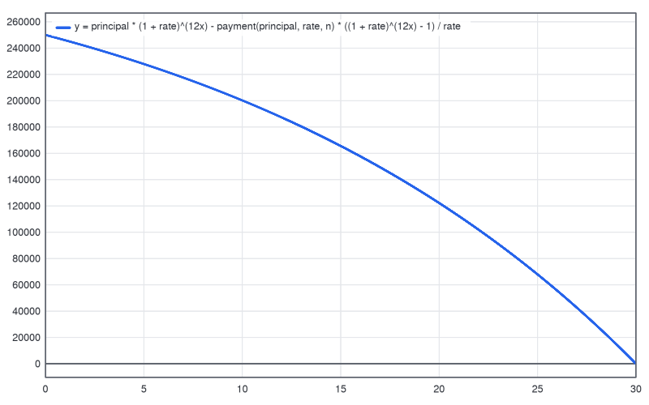

# Calc: a calculator that does it all

`calc` is one calculator for everyday sums and for the hard stuff. It does:

- plain arithmetic, with exact fractions (`3/4 + 1/6` is `11/12`);
- big whole numbers (`2^100` to the last digit, `17!`);
- percentages, scientific functions and degrees or radians;
- a programmer mode with hex, binary and octal, bit operators and a fixed word size;
- unit conversion (`5 km to mi`, `20 degC to degF`, `1 TiB to GB`);
- statistics and a line of best fit;
- solving equations and systems, derivatives, integrals and tables of values;
- graphs drawn as PNG pictures;
- variables, your own functions, a memory key and a history.

Everything is worked out on your computer. Nothing goes online, and no AI is used.

`calc` is part of the system app (`wetwaresuite-system`) and the all-in-one `wetwaresuite`. Both binaries have the same commands. Each task below is shown up to four ways:

- **Window**: the Calculator panel in the desktop window (see [the window](gui.md)).
- **CLI**: single `wetwaresuite calc.*` commands.
- **Batch**: scripts that use `-> name` captures and `$name` reuse (see [headless and batch](headless-and-batch.md)).
- **Claude**: a prompt for Claude over MCP and the tools it calls (see [mcp.md](mcp.md)). `wetwaresuite mcp --tools calc` serves just this tool.

Every output below was copied from a real run.

## The Calculator window

Start the window with `wetwaresuite-system` (or `wetwaresuite`). Click **Open** on the **Calculator** card on the home screen. You can also open straight to the graph:

```sh
wetwaresuite-system gui --action calc.graph
```

The left half is the calculator:

- **The display.** Type a calculation into the box at the top and press **Enter**. The answer shows large underneath, with what you asked shown small above it. Below the answer is a line with its other forms: the exact fraction, hex, or the unit.
- **The keys.** In the simple view there are digits, `+ - * /`, brackets, `sqrt(`, `^`, `%`, `ans`, `pi`, **C** (clear), **Back** and **=**.
- **Carrying on.** After an answer, a calculation that starts with an operator carries on from it. Type `* 2` and press Enter: you get `ans * 2`.
- **Mistakes.** Mistakes are explained in plain words, for example *can't divide by zero*.

The advanced view (View > Show advanced options) adds:

- four more rows of keys: `sin cos tan ln log asin acos atan exp !`, the memory keys **MC MR M+ M- MS**, and `e x abs( mod ,`;
- an **Angles** picker (deg, rad, grad);
- an **Exact fractions** switch;
- the memory value (`M = 100`) beside them.

The right half has tabs:

- **History**: every calculation so far. Click one to use it again. **Clear history** empties it.
- **Graph**: type `y = ...` (several curves separated by `;`), set **from x** and **to x**, and press **Draw** or Enter. **Zoom in** and **Zoom out** halve or double the range. The picture redraws itself to fit when you resize the window, and follows the light or dark theme.
- **Convert**: pick a kind (Length, Weight, Temperature, Volume, Speed, Area, Time, Data, Energy, Pressure). Type an amount and pick or type both units; the answer updates as you type. **Swap** turns the conversion around.
- **Stats** (advanced view): paste numbers separated by commas, spaces or new lines and press **Describe**.
- **Solve** (advanced view): type an equation or a system like `2x + 3y = 7; x - y = 1` and press **Solve**.
- **Bases** (advanced view): type a number (`0xff`, `0b1010` or an expression). It shows the number in decimal, hex, binary and octal as you type.

Every key press that calculates runs `calc.eval`, so the history in the window is the same one scripts and Claude see.

## Task 1: everyday sums

```
$ wetwaresuite calc.eval expression="3/4 + 1/6"
0.916666666667
text: 0.916666666667
value: 0.916667
exact: 11/12

$ wetwaresuite calc.eval expression="200 + 15%"
230

$ wetwaresuite calc.eval expression="sin(30) + sqrt(2)"
1.91421356237

$ wetwaresuite calc.eval expression="17!"
355687428096000
hex: 0x1437eeecd8000
```

How it reads what you type:

- **Percentages** work like a desk calculator. `200 + 15%` adds 15% of 200, and `15% of 80` is 12.
- **Angles** are in degrees until you change them with `calc.settings angle=rad`.
- **Whole numbers** never round. `2^100` is `1267650600228229401496703205376`, with its hex and binary forms.
- **Fractions** stay exact while they can. The `exact` field shows them when they are short enough to read (40 characters or less).
- **Several calculations at once**: separate them with `;` or new lines, and they run in order.
- **`ans`** is the last answer.

When something can't be worked out, the message says why:

```
$ wetwaresuite calc.eval expression="1/0"
can't divide by zero
$ wetwaresuite calc.eval expression="sqrt(-4)"
the square root of a negative number isn't real
$ wetwaresuite calc.eval expression="5 kg to m"
can't convert a mass to a length (m)
```

`calc.functions` lists every built-in function and constant.

## Task 2: convert units

Put a unit after a number and `to` before the unit you want:

```
$ wetwaresuite calc.eval expression="5 km to mi"
3.10685596119 mi
unit: mi

$ wetwaresuite calc.eval expression="1 TiB to GB"
1099.51162778 GB

$ wetwaresuite calc.convert value=72 from=degF to=degC
72 degF = 22.2222222222 degC

$ wetwaresuite calc.convert value=60 from=mph to=km/h
60 mph = 96.56064 km/h
```

`calc.units` lists them all by kind: length, mass, time, frequency, area, volume, speed, temperature, angle, force, pressure, energy, power, data and more. `calc.units category=speed` shows one kind. Units with prefixes (`km`, `MB`, `GiB`, `mL`) and combined units (`km/h`, `m^2`, `m/s`) work too.

Currency is not included, because rates change daily and the calculator stays offline.

## Task 3: programmer mode

`calc.settings` picks how whole numbers are shown:

- `base=` is `dec`, `hex`, `bin` or `oct`;
- `bits=` sets the word size (8, 16, 32, 64, or 0 for unlimited). The word size controls how negative numbers and `~` look.

```
# prog.txt: 8-bit words shown in hex
calc.settings base=hex bits=8
calc.eval expression="~5"
calc.eval expression="0x0f << 2 | 1"
calc.eval expression="-1"
calc.settings base=dec bits=64
```

```
$ wetwaresuite batch prog.txt
angle deg, 12 digits, base hex, 8 bits, exact fractions
0xfa
dec: -6
bin: 0b11111010
0x3d
dec: 61
0xff
dec: -1
...
```

Numbers can be typed as `0xff`, `0b1010` or `0o17`. The operators are `& | xor ~ << >>` and `mod`. `255 to hex` converts in the middle of an expression. `calc.base` shows one number every way, and counts its bits:

```
$ wetwaresuite calc.base value=-42
dec -42
hex 0xffffffffffffffd6
bin 0b1111111111111111111111111111111111111111111111111111111111010110
oct 0o1777777777777777777726
bits_used: 64
ones: 61
```

`calc.factor` splits a number into primes:

```
$ wetwaresuite calc.factor value="2^32+1"
4294967297 = 641 * 6700417
prime: false
```

## Task 4: variables, your own functions, memory and history (a loan)

```
# loan.txt: monthly payment, total paid, and a graph of the balance
calc.let name=principal value=250000
calc.let name=rate value="4.5% / 12"
calc.let name=n value="30 * 12"
calc.define function="payment(p, r, n)" body="p * r / (1 - (1 + r)^-n)"
calc.eval expression="payment(principal, rate, n)" -> monthly
calc.eval expression="ans * n"
calc.eval expression="ans - principal"
calc.graph expressions="principal * (1 + rate)^(12x) - payment(principal, rate, n) * ((1 + rate)^(12x) - 1) / rate" xmin=0 xmax=30 output=balance.png
echo monthly payment: $monthly
```

```
$ wetwaresuite batch loan.txt
principal = 250000
rate = 0.00375
exact: 3/800
n = 360
defined payment(p, r, n) = p * r / (1 - (1 + r)^-n)
1266.71327456
456016.778843
206016.778843
saved the graph to balance.png
monthly payment: 1266.71
```

So the payment is 1,266.71 a month, 456,016.78 is paid in all, and 206,016.78 of that is interest. Here is `balance.png`:



Variables and functions last for the session: one batch script, one MCP connection, or one window.

- **Shortcut forms.** `x = 5` and `f(x) = x^2 + 1` typed into `calc.eval` do the same as `calc.let` and `calc.define`.
- **Seeing and forgetting.** `calc.vars` lists your variables and functions. `calc.forget name=x` forgets one, and `name=all` forgets them all.
- **Undo.** `undo` takes back a `let`, `define`, `forget`, settings change or memory change.

The memory key works like a desk calculator's:

```
calc.eval expression="12 * 7"
calc.memory action=store         -> memory = 84
calc.eval expression="mem / 4"   -> 21
calc.memory action=add value=16  -> memory = 100
calc.history limit=3
```

```
-1  =  0xff
12 * 7  =  84
mem / 4  =  21
count: 5
```

## Task 5: statistics and a line of best fit

```
$ wetwaresuite calc.stats values="4 8 15 16 23 42"
count 6
sum 108
mean 18
median 15.5
mode none
min 4
max 42
range 38
stdev 13.4907375632 (sample)
pstdev 12.3153021346 (population)
variance 182
q1 9.75
q3 21.25
iqr 11.5
geomean 13.9654968462
skewness 0.907474624144
```

```
$ wetwaresuite calc.regression x_data="1 2 3 4" y_data="2.1 3.9 6.2 7.8" predict=5
y = 1.94x + 0.15
r = 0.997828329755, r^2 = 0.995661375661
at x = 5, y = 9.85
```

Over MCP, `xs` and `ys` take JSON arrays instead.

## Task 6: solve, differentiate, integrate

```
$ wetwaresuite calc.solve equation="x^2 - 5x + 6 = 0"
x = 2
x = 3

$ wetwaresuite calc.solve equation="2x + 3y = 7; x - y = 1"
x = 2, y = 1

$ wetwaresuite calc.solve equation="cos(x) = x"
x = 0.999847741531

$ wetwaresuite calc.derivative expression="x^3 + sin(x)" at=0
derivative = 1

$ wetwaresuite calc.integrate expression="x^2" from=0 to=3
integral = 9

$ wetwaresuite calc.table expression="x^2" from=0 to=4 step=1
x = 0  ->  0
x = 1  ->  1
x = 2  ->  4
x = 3  ->  9
x = 4  ->  16
```

How the solver works:

- **One unknown.** It finds every real root between `from` and `to` (default -1000 to 1000).
- **Systems.** Equations separated by `;` are solved with Newton's method from several starting points. Unknowns are found by themselves, or you can name them with `vars=x,y`.
- **Answers are numbers.** Answers are decimals, not symbolic formulas.
- **Trig units.** Trig in the solver and in graphs uses radians unless the angle setting is `grad`. That way `cos(x) = x` means what a maths book means.

## Task 7: graphs

```sh
wetwaresuite calc.graph expressions="sin(x); x^2/10" xmin=-6 xmax=6 output=waves.png
```

The command draws one or more curves with axes, a grid, numbers and a legend. Its options:

- `ymin` and `ymax` fix the height (by default it fits the curves);
- `width` and `height` set the size in pixels;
- `dark=true` draws on a dark background.

Without `output=` the PNG comes back as an attachment, which is what the window and Claude use. `calc.sample` gives the points as numbers instead of a picture.

## Claude

Serve the calculator to Claude:

```sh
claude mcp add wetwaresuite-calc -s user -- wetwaresuite-system mcp --tools calc
```

Example prompts and the tools Claude calls:

- *"What's 18% tip on 64.50, split three ways?"*: `calc_eval` with `64.50 * 18% / 3`. The answer is exact, so no rounding surprises.
- *"Convert my recipe: 2 cups of flour and 350 degF to metric"*: `calc_convert` twice.
- *"Plot the loan balance for a 250k mortgage at 4.5% over 30 years"*: `calc_let` and `calc_define` as in Task 4, then `calc_graph`. Claude receives the PNG and can look at it.
- *"Is 2^61 - 1 prime?"*: `calc_factor`, which answers `prime: true`.

Each answer comes back as text plus structured fields (`value`, `exact`, `hex`, `unit` and so on), so Claude reads exact numbers rather than parsing them from text.

## Parameter reference

| Command | What it does | Main parameters |
|---|---|---|
| `calc.eval` | work out an expression | `expression` |
| `calc.convert` | convert a unit | `value`, `from`, `to` |
| `calc.units` | list units | `category` |
| `calc.functions` | list functions and constants | |
| `calc.base` | a number in every base | `value` |
| `calc.factor` | prime factors | `value` |
| `calc.settings` | angle, precision, base, bits, exact | `angle`, `precision`, `base`, `bits`, `exact` |
| `calc.let`, `calc.define`, `calc.forget`, `calc.vars` | variables and functions | `name`, `value`, `function`, `body` |
| `calc.memory` | MS, M+, M-, MR, MC | `action`, `value` |
| `calc.history`, `calc.clear_history` | past calculations | `limit` |
| `calc.stats` | describe numbers | `values` |
| `calc.regression` | line of best fit | `x_data`/`xs`, `y_data`/`ys`, `predict` |
| `calc.solve` | equations and systems | `equation`, `vars`, `from`, `to` |
| `calc.derivative`, `calc.integrate` | calculus at a point or over a range | `expression`, `at`, `from`, `to` |
| `calc.table`, `calc.sample` | values of an expression | `expression(s)`, ranges |
| `calc.graph` | draw curves as PNG | `expressions`, `xmin`, `xmax`, `ymin`, `ymax`, `width`, `height`, `dark`, `output` |

`wetwaresuite help calc.<name>` shows every parameter.

## Limitations

- No currency conversion (it needs live rates).
- No symbolic algebra. Solving and calculus give numbers, not formulas.
- Complex numbers are not supported. `sqrt(-4)` is an error.
- Graphs are y = f(x) only. There are no parametric or polar plots.
- Decimals are 64-bit floating point. Whole numbers and fractions are exact at any size.
