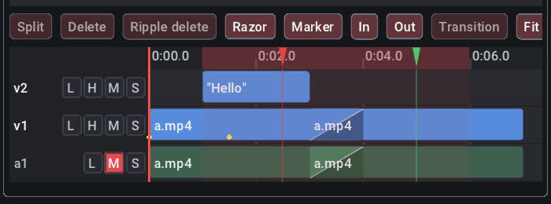

# Cut: edit video

`cut` is a video editor that works the way Premiere or Resolve do: tracks of linked picture and sound, ripple, roll, slip and slide trims, a razor across tracks, insert and overwrite at the playhead, markers, in/out points, nested sequences, speed ramps and freeze frames, keyframed transforms, colour wheels and curves, chroma key, titles, lower thirds and captions, a sound mix with crossfades and a loudness target, and export presets. Everything is a command, so the same edit can be made in the window, from a batch script, or by Claude over MCP. For quick jobs on one file (trim it, join two, make a GIF, burn in subtitles) there are one-shot commands that need no timeline at all:

```sh
wetwaresuite cut.gif input=interview.mp4 output=wave.gif start=3 duration=2.5
```

The video app (`wetwaresuite-video`) opens a timeline in a window, with the preview on top and the tracks below ([the window](#the-window)). Each task below shows the batch-script way, the CLI way and the "ask Claude" way. Every CLI and batch example here was run against the real binary (outputs are copied from those runs; long `key: value` lists are shortened with `...`).

## What you need: ffmpeg (for video files)

Pictures are drawn and sound is mixed by `cut` itself. [ffmpeg](https://ffmpeg.org) is only used to read video files and to encode video, MP3 or AAC files, so it must be installed and on your `PATH` for those:

| System | Install |
| --- | --- |
| Debian, Ubuntu | `sudo apt install ffmpeg` |
| Fedora | `sudo dnf install ffmpeg` (from RPM Fusion) |
| macOS (Homebrew) | `brew install ffmpeg` |
| Windows | `winget install ffmpeg` |

It doesn't have to be on the `PATH` the app sees: an app started from the Dock, Start menu or a desktop icon often gets a shorter `PATH` than your terminal, so the suite also looks where Homebrew (`/opt/homebrew/bin`, `/usr/local/bin`), MacPorts, winget, Chocolatey and Scoop put it, in `C:\ffmpeg\bin`, and in its own tools folder (`%LOCALAPPDATA%\wetwaresuite\tools`, `~/Library/Application Support/wetwaresuite/tools` or `~/.local/share/wetwaresuite/tools`, or `WETWARESUITE_TOOLS_DIR`), where you can drop `ffmpeg` and `ffprobe` yourself. No restart is needed after installing it.

Without ffmpeg you can still build and edit timelines of images, colour mattes, titles, captions and WAV, MP3, FLAC or Ogg sound, look at frames (`cut.preview`, `cut.export_frame`) and export the mix as `.wav`. The commands that need ffmpeg fail with this advice instead of doing something half-way:

```sh
$ wetwaresuite cut.gif input=interview.mp4 output=x.gif
video editing needs ffmpeg, which isn't installed (or isn't on PATH). Install it, it's free: Debian/Ubuntu `sudo apt install ffmpeg`, macOS `brew install ffmpeg`, Windows `winget install ffmpeg`.
```

## How it works

- **A timeline** is a document with an id like `cut1`. It has a frame size (default 1920x1080), a frame rate (default 30), a background colour and a master volume, set with `cut.new` or later with `cut.settings`. Its length is wherever the last clip ends.
- **Tracks.** Video tracks are `v1`, `v2`, ...: `v1` is the bottom layer and every higher track is drawn on top of it, which is how picture-in-picture, logos and titles work. Audio tracks are `a1`, `a2`, ...; everything on every track is mixed. Tracks appear when you first put something on them. `cut.set_track` locks a track (edits that would change it are refused), hides its picture, mutes it, solos it or sets its volume.
- **Clips** have ids `c1`, `c2`, ... (one counter per timeline, whatever the kind):
  - `video`: a part of a video file, from source time `in` to `out` (seconds), placed at `start` on the timeline.
  - `audio`: a part of a sound file, or a video's sound.
  - `image`: a still for `duration` seconds (PNG transparency is kept).
  - `color`: a solid colour matte.
  - `title`: text drawn over everything below it (plain, a lower third, or a caption).
  - `nest`: a nested sequence of other clips, edited as one.
- **Linked sound.** A video's sound goes on its own audio clip on the first free audio track, **linked** to the picture: moving, trimming, cutting, deleting or speeding one changes both. `linked=false` on an edit changes one side only (that's how J and L cuts are made), and `cut.unlink` separates them for good. `audio_track=embedded` keeps the sound inside the video clip instead, `audio_track=none` drops it.
- **Times are seconds.** `start` is timeline time, `in`/`out` are source time. With `speed=2` a clip plays its source twice as fast, so 10 s of source fills 5 s of timeline.
- **The playhead** (`cut.set_cursor`) is where the razor cuts, markers and titles go, inserts and overwrites land and freeze frames are taken, unless a command is given a time. **Markers** (`cut.add_marker`) flag moments; **in and out points** (`cut.set_in_out`) mark a range to lift, extract or export.
- **The picture box.** A clip fills the whole frame unless you give it a `width` (and/or `height`), which makes it a box at `x`,`y` (pixels from the top-left). `fit` says how the picture fills its box: `fit` letterboxes it (the default), `fill` crops it to fill, `stretch` distorts it. `crop=x,y,w,h` cuts the source first. `scale`, `rotation`, the edge crops and `opacity` work around the box's centre, and all of them can be **keyframed**.
- **Transitions** blend a clip into the one before it on the same track. The later clip slides back so the two overlap by the transition's length (later clips move with it), and the linked sound crossfades (equal power) too.
- **Every edit is undoable** with `undo` (in batch scripts and over MCP), one step per command. Opening, previewing, moving the playhead, rendering and the one-shot file commands don't change the timeline and stay out of the history.
- **Rendering.** Each frame is composited by `cut` itself (layers, boxes, blend modes, keyframes, colour, effects, keys, titles, transitions) and piped to ffmpeg to encode; the sound is mixed by `cut` (volume, pan, fades, crossfades, speed with the pitch kept). If the timeline is nothing but back-to-back cuts of the same kind of file at the timeline's size, it is joined by **stream copy** instead: no re-encoding, so it is instant and lossless.
- **Previews** draw one frame. Only the clips on screen at that moment are decoded, so a preview of minute 40 is as quick as one of second 1.

Clip ids and timelines live as long as the process: for the CLI that's one command, so editing a timeline step by step happens in a batch script, over MCP, in the window, or by saving it with `cut.save` (a `.wwcut` file) and reopening it later with `cut.open`.

The sample files in the tasks are `interview.mp4` (40 s, 1920x1080, with sound), `broll.mp4` (10 s of cutaway footage, with sound), `screen.mp4` (a 20 s screen recording, no sound), `webcam.mp4` (20 s, 640x480, with sound), `greenscreen.mp4` (8 s of a presenter in front of a green screen), `music.mp3` (60 s), `logo.png` (400x400), `warm.cube` (a LUT) and `interview.srt` (subtitles).

### Look at a file first

```sh
$ wetwaresuite cut.probe path=interview.mp4
interview.mp4: mov,mp4,m4a,3gp,3g2,mj2, 40s
  stream 0: video h264 1920x1080 30fps
  stream 1: audio aac 44100Hz 1ch
path: interview.mp4
duration: 40
format: mov,mp4,m4a,3gp,3g2,mj2
has_video: true
has_audio: true
still: false
width: 1920
height: 1080
fps: 30
video_codec: h264
audio_codec: aac
streams: 2
```

## Task 1: a talking-head video into a short, with a title and music

You have a 40 s landscape interview and want a vertical 1080x1920 short of the two best moments (2-9 s and 15-22 s), with a crossfade between them, a title at the top for the first three seconds and quiet music underneath.

**Batch.** This is the natural way: one script, one process, the timeline built step by step. `-> short` stores the new timeline's id (`cut1`) and `$short` uses it; `-> part2` stores a clip id.

```text
# short.txt: a 1080x1920 short from a landscape interview
cut.new width=1080 height=1920 fps=30 -> short
# the good bits: 2-9s and 15-22s, cropped to fill the tall frame
cut.add_clip doc=$short path=interview.mp4 in=2 out=9 fit=fill -> part1
cut.add_clip doc=$short path=interview.mp4 in=15 out=22 fit=fill -> part2
cut.transition doc=$short clip=$part2 type=crossfade duration=0.5
# a title for the first few seconds
cut.add_title doc=$short text="3 ways to edit faster" start=0.3 duration=3 position=top font_size=90 box=true fade_in=0.3 fade_out=0.3
# music under the voice on its own track, faded in and out
cut.add_audio doc=$short path=music.mp3 track=a2 start=0 volume=0.25 fade_in=1 fade_out=2 duration=13.5
cut.info doc=$short
cut.render doc=$short output=short-frame.png at=1.5 width=540
cut.render doc=$short output=short.mp4
cut.save doc=$short path=short.wwcut
```

```sh
$ wetwaresuite batch short.txt
created cut1 (1080x1920 30fps, 0 tracks, 0 clips, 0.00s)
...
added clip c1 on v1 at 0s with its sound linked as c2 on a1 (timeline 7s)
...
added clip c3 on v1 at 7s with its sound linked as c4 on a1 (timeline 14s)
...
crossfade into c3 over 0.5s (c3 now starts at 6.5s)
...
added title c5 on v2 at 0.3s (timeline 13.5s)
...
added audio c6 on a2 at 0s (timeline 13.5s)
...
cut1: 1080x1920 30fps, background black, 13.5s, playhead 0s
v1 (video)
  c1 video interview.mp4 at 0-7s (7s) source 2-9 linked(L1) fit=fill
  c3 video interview.mp4 at 6.5-13.5s (7s) source 15-22 linked(L2) fit=fill transition=crossfade 0.5s from c1
v2 (video)
  c5 title "3 ways to edit faster" at 0.3-3.3s (3s) fade_in=0.3 fade_out=0.3 size=90 color=white position=top box=black@0.5
a1 (audio)
  c2 audio interview.mp4 at 0-7s (7s) source 2-9 linked(L1)
  c4 audio interview.mp4 at 6.5-13.5s (7s) source 15-22 linked(L2) transition=crossfade 0.5s from c2
a2 (audio)
  c6 audio music.mp3 at 0-13.5s (13.5s) source 0-13.5 volume=0.25 fade_in=1 fade_out=2
...
saved the frame at 1.5s to short-frame.png (540x960)
...
exported short.mp4
short.mp4
output: short.mp4
bytes: 3728894
duration: 13.5
width: 1080
height: 1920
mode: encode
frames: 405
saved short.wwcut
```

What happened:

- Each `cut.add_clip` put the picture on `v1` and its sound, linked, on `a1` (`c2`, `c4`). A clip without `start` goes at the end of its track, so `c3` landed at 7 s; the crossfade then pulled it (and its sound) back to 6.5 s so the two overlap by half a second, and the two sound clips crossfade there too. The timeline got 0.5 s shorter.
- The music goes on its own track, `a2`, from 0 s: `a1` already holds the interview's sound, and a clip added without `start` would go after it.
- `fit=fill` scales the landscape picture up until it covers the tall frame and crops the sides. Use `fit=fit` (the default) to see the whole picture with bars above and below, or `crop=` to choose which part to keep.
- `cut.add_title` without `track` puts titles on a track above everything else (here `v2`). `box=true` draws a half-transparent box behind the text so it reads on any background.
- `cut.render` writing a `.png` saves one frame (`at=1.5`), handy to check the layout before encoding.
- `short.wwcut` is a small JSON file. It points at the media by absolute path; it doesn't copy them. Timelines saved before the rename (`.achcut`) still open with `cut.open`.

**CLI.** A timeline only lives inside one process, so from the shell you pipe the lines into `wetwaresuite batch` (or keep them in a file as above). Re-rendering the saved project in another format is two lines:

```sh
$ printf '%s\n' 'cut.open path=short.wwcut -> s' 'cut.render doc=$s output=short.webm quality=draft' | wetwaresuite batch
opened cut1 (1080x1920 30fps, 4 tracks, 6 clips, 13.50s, short.wwcut)
...
exported short.webm
...
```

**Claude.**

> Make a vertical short (1080x1920) from ~/talks/interview.mp4: keep 2-9 s and 15-22 s with a quick crossfade, put "3 ways to edit faster" at the top for the first 3 seconds, and add ~/music/music.mp3 quietly underneath. Show me a frame before you render.

Claude calls `cut_probe` to see the file, `cut_new` with `width=1080 height=1920`, `cut_add_clip` twice (`in`/`out`, `fit=fill`), `cut_transition` on the second clip, `cut_add_title`, `cut_add_audio` on `a2` with `volume` around 0.25, then `cut_preview` at a few times (it gets the frames as images, so it can check that the title fits and the crop keeps the face), and finally `cut_render`. If something looks off it fixes it with `cut_set_clip` or `undo` and looks again.

**The window.** In the video app: **New Timeline** (size 1080x1920), then **Add Clip** twice with `in`/`out` and `fit=fill`, **Add Title**, **Add Audio** with `track=a2`; the clips appear on the timeline under the preview as you go. Select the second clip and press **T** for a crossfade, drag a clip to move it, drag an edge to trim it, and **Export** when the preview looks right.

## Task 2: picture-in-picture

A screen recording with the presenter's webcam in the bottom-right corner, cropped square, with a thin orange frame around it.

**Batch.**

```text
# pip.txt: a screen recording with the presenter's webcam in the corner
cut.new -> tut
cut.add_clip doc=$tut path=screen.mp4 out=12 -> screen
# the webcam on v2: crop it square, shrink it to 360x360, bottom right, fade it in
cut.add_clip doc=$tut path=webcam.mp4 track=v2 start=0 out=12 crop=80,0,480,480 width=360 x=1520 y=680 fade_in=0.5 -> cam
# a thin frame around it: an orange square one layer below
cut.add_image doc=$tut path=logo.png track=v2 start=0 duration=12 x=1510 y=670 width=380 height=380 fit=stretch
cut.move_clip doc=$tut clip=$cam track=v3
cut.info doc=$tut
cut.render doc=$tut output=pip-frame.png at=4 width=960
cut.render doc=$tut output=pip.mp4
```

```sh
$ wetwaresuite batch pip.txt
...
moved c2 to v3 at 0s (timeline 12s)
...
cut1: 1920x1080 30fps, background black, 12s, playhead 0s
v1 (video)
  c1 video screen.mp4 at 0-12s (12s) source 0-12 (no sound)
v2 (video)
  c4 image logo.png at 0-12s (12s) box=1510,670 380x380 fit=stretch
v3 (video)
  c2 video webcam.mp4 at 0-12s (12s) source 0-12 linked(L1) fade_in=0.5 box=1520,680 360x0 crop=80,0,480,480
a1 (audio)
  c3 audio webcam.mp4 at 0-12s (12s) source 0-12 linked(L1) fade_in=0.5
...
exported pip.mp4
```

- `width=360` alone keeps the picture's shape: the crop is 480x480, so the box is 360x360 (`info` shows `360x0` because only the width was given).
- `crop` is in the source's pixels, applied before scaling: `80,0,480,480` keeps a square from the middle of the 640x480 webcam.
- Layers are tracks: the frame is on `v2`, so the webcam had to move above it to `v3` (`cut.move_clip ... track=v3`). The webcam's sound moved with nothing to do: it is on `a1`, linked. The screen recording has none.
- `opacity=0.8` would make the webcam see-through; `fade_out` fades it away at the end.
- **The quick way:** `cut.transform clip=$cam pip=bottom-right size=0.25 margin=40` places a clip in a corner at a quarter of the frame's width, keeping its shape; `pip=full` puts it back. Task 11 animates a box with keyframes.

**CLI.** The same thing without the frame, piped in one go:

```sh
$ printf '%s\n' 'cut.new -> t' \
  'cut.add_clip doc=$t path=screen.mp4 out=12' \
  'cut.add_clip doc=$t path=webcam.mp4 track=v2 start=0 out=12 -> cam' \
  'cut.transform doc=$t clip=$cam pip=bottom-right size=0.25' \
  'cut.render doc=$t output=pip-quick.mp4' | wetwaresuite batch
...
exported pip-quick.mp4
...
mode: encode
```

**Claude.**

> Put ~/rec/webcam.mp4 in the bottom-right corner of ~/rec/screen.mp4, about a fifth of the width, cropped to a square, and render the first 12 seconds.

Claude uses `cut_add_clip` twice (the second with `track=v2`), `cut_transform` with `pip=bottom-right size=0.2` (or `width`, `x`, `y`, `crop` for exact placement), checks the corner with `cut_preview`, and adjusts the position if the webcam covers something important.

**The window.** **Add Clip** for the screen recording, **Add Clip** again with `track=v2` for the webcam, then **Transform** with `pip=bottom-right`. The preview updates after each action.

## Task 3: crossfades and other transitions

Three shots and a closing logo, each joined differently.

**Batch.**

```text
# xfade.txt: three shots joined by different transitions
cut.new -> tl
cut.add_clip doc=$tl path=interview.mp4 in=0 out=5 -> a
cut.add_clip doc=$tl path=broll.mp4 in=0 out=5 -> b
cut.add_clip doc=$tl path=interview.mp4 in=20 out=25 -> c
cut.add_image doc=$tl path=logo.png duration=3 -> d
cut.transition doc=$tl clip=$b type=crossfade duration=1
cut.transition doc=$tl clip=$c type=wipeleft duration=0.75
cut.transition doc=$tl clip=$d type=fadeblack duration=1
cut.info doc=$tl
cut.render doc=$tl output=xfade-frame.png at=4.5 width=640
cut.render doc=$tl output=transitions.mp4
```

```sh
$ wetwaresuite batch xfade.txt
...
crossfade into c3 over 1s (c3 now starts at 4s)
...
wipeleft into c5 over 0.75s (c5 now starts at 8.25s)
...
fadeblack into c7 over 1s (c7 now starts at 12.25s)
...
cut1: 1920x1080 30fps, background black, 15.25s, playhead 0s
v1 (video)
  c1 video interview.mp4 at 0-5s (5s) source 0-5 linked(L1)
  c3 video broll.mp4 at 4-9s (5s) source 0-5 linked(L2) transition=crossfade 1s from c1
  c5 video interview.mp4 at 8.25-13.25s (5s) source 20-25 linked(L3) transition=wipeleft 0.75s from c3
  c7 image logo.png at 12.25-15.25s (3s) transition=fadeblack 1s from c5
a1 (audio)
  c2 audio interview.mp4 at 0-5s (5s) source 0-5 linked(L1)
  c4 audio broll.mp4 at 4-9s (5s) source 0-5 linked(L2) transition=crossfade 1s from c2
  c6 audio interview.mp4 at 8.25-13.25s (5s) source 20-25 linked(L3) transition=crossfade 0.75s from c4
...
exported transitions.mp4
```

- Each `cut.transition` names the **later** clip. It moves that clip back to overlap the one before by `duration`, and everything after it on the track moves too: 18 s of clips became 15.25 s. The linked sound moves with it and crossfades over the same time.
- The frame at 4.5 s is halfway through the crossfade. To check a whole render at a glance, make a contact sheet of it (task 6):

```sh
$ wetwaresuite cut.thumbnails input=transitions.mp4 output=transitions-sheet.jpg columns=6 rows=3 width=200
contact sheet of transitions.mp4: 6x3 frames in transitions-sheet.jpg
transitions-sheet.jpg
output: transitions-sheet.jpg
bytes: 66956
width: 1228
height: 352
```

- Transitions available: `crossfade`, `dissolve` (a grainy dissolve), `fadeblack` (dip to black), `fadewhite`, `wipeleft`, `wiperight`, `wipeup`, `wipedown`, `slideleft`, `slideright`, `slideup`, `slidedown`, `pushleft`, `pushright`, `pushup`, `pushdown`, `zoomin`, `zoomout`, `circleopen`, `circleclose`, `radial`, `pixelize`, `smoothleft`, `smoothright`. `type=none` removes one (the clip moves back to where the other one ends).
- On an audio track a transition is always an equal-power crossfade. `linked=false` makes a transition on the picture only (or, named on a sound clip, on the sound only).
- A transition can't be longer than either clip. If you later move a clip so the two no longer overlap, `info` shows the transition as `inactive` and the render just cuts.
- To fade the very first clip in from black or the last out to black, use `fade_in`/`fade_out` on the clip (they fade the sound too): `cut.set_clip doc=$tl clip=$a fade_in=1`.

**CLI.** Two files with a crossfade, piped:

```sh
printf '%s\n' 'cut.new -> t' 'cut.add_clip doc=$t path=intro.mp4' 'cut.add_clip doc=$t path=broll.mp4 -> b' \
  'cut.transition doc=$t clip=$b duration=1' 'cut.render doc=$t output=intro-broll.mp4' | wetwaresuite batch
```

(Without a transition, `cut.concat_files` joins files in one command; see task 6.)

**Claude.**

> Join clip1.mp4, clip2.mp4 and clip3.mp4 with one-second crossfades and fade the end to black.

Claude adds the three clips with `cut_add_clip`, calls `cut_transition` on the second and third, sets `fade_out=1` on the last with `cut_set_clip`, looks at a frame inside each transition with `cut_preview`, and renders with `cut_render`.

**The window.** Click the later clip and press **T** (or the **Transition** button) for a one-second crossfade; the overlap shows as a wedge over the clip's start. For another type or length use the **Transition** action on the right.

## Task 4: make a GIF

**CLI.** The one-shot `cut.gif` takes a piece of any video and makes a GIF with a proper palette (good colours, small file):

```sh
$ wetwaresuite cut.gif input=interview.mp4 output=wave.gif start=3 duration=2.5 fps=12 width=480
made wave.gif from 3-5.5s of interview.mp4
wave.gif
output: wave.gif
bytes: 415660
duration: 2.5
width: 480
height: 270
```

**Batch.** For a GIF with a caption, build a small timeline and render it to `.gif` (or use `preset=gif`):

```text
# gif.txt: a captioned reaction GIF: 2.5 seconds of the interview with a title
cut.new width=640 height=360 fps=15 -> g
cut.add_clip doc=$g path=interview.mp4 in=3 out=5.5
cut.add_title doc=$g text="wait for it..." start=0 duration=2.5 position=bottom font_size=40 color=yellow outline=3
cut.render doc=$g output=reaction.gif gif_fps=12 gif_width=480
```

```sh
$ wetwaresuite batch gif.txt
...
exported reaction.gif
reaction.gif
output: reaction.gif
bytes: 342004
duration: 2.5
width: 480
height: 270
mode: encode
frames: 30
```

GIFs get big fast: keep them short, small (`width`/`gif_width` 320 to 480) and at 10 to 15 frames per second. They have no sound.

**Claude.**

> Make a 480 px wide GIF of 0:03 to 0:05.5 of interview.mp4 with "wait for it..." in yellow at the bottom.

Claude uses `cut_gif` for a plain GIF; for the caption it builds a timeline (`cut_new`, `cut_add_clip`, `cut_add_title`) and calls `cut_render` with a `.gif` output.

## Task 5: burn in subtitles

"Burning in" draws the subtitles into the picture, so they show on every player and site (unlike a separate `.srt`).

**CLI.**

```sh
$ wetwaresuite cut.subtitles input=interview.mp4 subtitles=interview.srt output=captioned.mp4 font_size=24
burned interview.srt into captioned.mp4
captioned.mp4
output: captioned.mp4
bytes: 25865806
duration: 40
width: 1920
height: 1080
```

- This one-shot command hands the file to ffmpeg's libass: `font_size` is in libass units (about pixels on a 288-line-high canvas, scaled to the video), so 24 is large and 16 is the usual size. `color=#ffff00` makes `.srt` text yellow. `.ass` files keep their own styling.
- The sound is copied, the picture is re-encoded (H.264, `quality=draft|good|best`).

**Batch.** Any timeline render can burn subtitles over the finished edit with `subtitles=`. The times in the file are then **timeline** times, not the source's. To restyle, fix or add lines first, import them as caption clips instead (task 12).

```text
cut.open path=short.wwcut -> s
cut.render doc=$s output=short-captioned.mp4 subtitles=interview.srt
```

```sh
$ printf '%s\n' 'cut.open path=short.wwcut -> s' 'cut.render doc=$s output=short-captioned.mp4 subtitles=interview.srt' | wetwaresuite batch
opened cut1 (1080x1920 30fps, 4 tracks, 6 clips, 13.50s, short.wwcut)
...
exported short-captioned.mp4
...
duration: 13.5
```

**Claude.**

> Burn interview.srt into interview.mp4, a bit bigger than normal and in yellow.

Claude calls `cut_subtitles` with `font_size` and `color=#ffff00`, then `cut_thumbnails` with `preview=true` on the result to see a few frames with the captions.

## Task 6: quick jobs on single files

These take files and write files; no timeline needed. Outputs that exist are refused unless you pass `overwrite=true`:

```sh
$ wetwaresuite cut.trim_file input=interview.mp4 output=intro.mp4 start=2 end=9
intro.mp4 already exists (pass overwrite=true to replace it)
```

**Trim.** Frame-exact by default (re-encodes); `copy=true` is instant and lossless but starts at the keyframe before `start`, so the piece can be a little longer:

```sh
$ wetwaresuite cut.trim_file input=interview.mp4 output=intro.mp4 start=2 end=9
trimmed 2-9s of interview.mp4 into intro.mp4
intro.mp4
output: intro.mp4
bytes: 4496736
duration: 7
...
$ wetwaresuite cut.trim_file input=interview.mp4 output=intro-fast.mp4 start=2 end=9 copy=true
trimmed 2-9s of interview.mp4 into intro-fast.mp4
...
duration: 7.13867
```

**Join.** Files with the same codecs, size and frame rate are joined by stream copy; anything else is re-encoded to the first file's size and frame rate, letterboxed:

```sh
$ wetwaresuite cut.concat_files inputs=intro.mp4,broll.mp4 output=joined.mp4
joined 2 files into joined.mp4 by stream copy
...
duration: 17.0232
mode: copy
$ wetwaresuite cut.concat_files inputs=interview.mp4,webcam.mp4 output=mixed.mp4 quality=draft
joined 2 files into mixed.mp4 (re-encoded)
...
duration: 60
mode: encode
```

Separate the files with commas; if a name contains a comma, separate them with `|` or new lines instead.

**Sound.** Take the sound out (copied without re-encoding when the format allows, e.g. AAC into `.m4a`), or remove it:

```sh
$ wetwaresuite cut.extract_audio input=interview.mp4 output=voice.m4a
extracted the sound of interview.mp4 to voice.m4a
...
duration: 40
$ wetwaresuite cut.extract_audio input=interview.mp4 output=voice.mp3
extracted the sound of interview.mp4 to voice.mp3
...
$ wetwaresuite cut.mute input=broll.mp4 output=broll-silent.mp4
copied broll.mp4 without sound to broll-silent.mp4
...
```

**Speed.** The sound speeds up or slows down without changing pitch:

```sh
$ wetwaresuite cut.speed input=screen.mp4 output=screen-4x.mp4 factor=4
changed the speed of screen.mp4 by 4x into screen-4x.mp4
...
duration: 5
```

**Contact sheet.** A grid of frames spread evenly through a video, to see what's in it:

```sh
$ wetwaresuite cut.thumbnails input=interview.mp4 output=sheet.jpg columns=5 rows=4 width=240
contact sheet of interview.mp4: 5x4 frames in sheet.jpg
sheet.jpg
output: sheet.jpg
bytes: 100962
width: 1224
height: 564
```

**Batch.** The same commands work in scripts, e.g. a folder's worth of intros and contact sheets:

```text
# quick.txt
cut.trim_file input=day1.mp4 output=out/day1-intro.mp4 start=0 duration=15
cut.thumbnails input=day1.mp4 output=out/day1-sheet.jpg
cut.trim_file input=day2.mp4 output=out/day2-intro.mp4 start=0 duration=15
cut.thumbnails input=day2.mp4 output=out/day2-sheet.jpg
```

or a shell loop over files: `for f in *.mp4; do wetwaresuite cut.thumbnails input="$f" output="sheets/${f%.mp4}.jpg"; done`.

**Claude.**

> What's in ~/Videos/day1.mp4? Then cut 0:42 to 1:30 out of it into highlight.mp4.

Claude calls `cut_probe`, then `cut_thumbnails` with `preview=true` (it sees the sheet), then `cut_trim_file` with `start=42 end=90`.

## Task 7: colour

`cut.filter` is the colour panel: exposure, white balance (`temperature`, `tint`), lift/gamma/gain colour wheels, brightness, contrast, saturation, gamma, tone curves (master and per channel), black and white, and `.cube` LUT colour grades. Without `clip` it changes every picture clip.

**Batch.**

```text
# colour.txt: grade a whole edit, then make one shot black and white
cut.new -> tl
cut.add_clip doc=$tl path=interview.mp4 out=6 -> a
cut.add_clip doc=$tl path=broll.mp4 out=4 -> b
cut.filter doc=$tl brightness=0.05 contrast=1.15 saturation=1.2
cut.filter doc=$tl clip=$b grayscale=true
cut.filter doc=$tl clip=$a lut=warm.cube
cut.info doc=$tl
cut.preview doc=$tl t=2
cut.render doc=$tl output=graded-a.png at=2 width=640
cut.render doc=$tl output=graded-b.png at=8 width=640
cut.filter doc=$tl clip=$a reset=true
cut.render doc=$tl output=ungraded-a.png at=2 width=640
undo
cut.render doc=$tl output=graded.mp4 quality=draft
```

```sh
$ wetwaresuite batch colour.txt
...
graded 2 clips (timeline 10s)
...
cut1: 1920x1080 30fps, background black, 10s, playhead 0s
v1 (video)
  c1 video interview.mp4 at 0-6s (6s) source 0-6 linked(L1) brightness=0.05 contrast=1.15 saturation=1.2 lut=warm.cube
  c3 video broll.mp4 at 6-10s (4s) source 0-4 linked(L2) brightness=0.05 contrast=1.15 saturation=1.2 grayscale
a1 (audio)
...
frame at 2s of cut1
t: 2
attachment: cut1-2s.png (...)
...
undone
exported graded.mp4
```

- Filters add up: a second `cut.filter` changes only what it names. `reset=true` clears a clip's colour first (and `undo` brings it back).
- `cut.preview` attaches a PNG, which Claude sees over MCP; from the command line it just reports the attachment, so render a `.png` (or `cut.export_frame`) to look yourself.
- LUTs are the `.cube` files colourists and cameras share (1D or 3D); `cut` reads and applies them itself.
- The wheels take `r,g,b` (and an optional master) offsets: `wheel_lift=0,0,0.05` puts a little blue in the shadows, `wheel_gain=0.1,0.05,0` warms the highlights. Curves are `x,y` pairs from 0 to 1: `curve=0,0,0.25,0.2,0.75,0.82,1,1` is a gentle S. `exposure` is in stops, `temperature` and `tint` go from -100 to 100. The numbers can be keyframed (task 11).

**CLI.** A one-off grade of a single file, piped:

```sh
printf '%s\n' 'cut.new -> t' 'cut.add_clip doc=$t path=interview.mp4' 'cut.filter doc=$t lut=warm.cube' \
  'cut.render doc=$t output=interview-warm.mp4' | wetwaresuite batch
```

**Claude.**

> The b-roll looks washed out next to the interview. Make it punchier, then show me both.

Claude calls `cut_filter` on the b-roll clip (contrast and saturation up a little, maybe `exposure` or a wheel), `cut_preview` at a time in each clip, and tweaks until they match.

**The window.** **Colour Correction** on the right takes the clip's id (shown on the timeline and by **Timeline Info**); leave `clip` empty to grade everything.

## Task 8: trim like an editor: ripple, roll, slip, slide, J and L cuts

Three shots in a row, tightened without opening gaps.

**Batch.**

```text
# edit.txt: a rough cut of three shots, then tightened with the trim tools
cut.new -> e
cut.add_clip doc=$e path=interview.mp4 in=0 out=8 -> a
cut.add_clip doc=$e path=broll.mp4 in=0 out=6 -> b
cut.add_clip doc=$e path=interview.mp4 in=20 out=28 -> c
cut.info doc=$e
# ripple: the first shot loses its last 2 s and everything after moves up
cut.ripple_trim doc=$e clip=$a edge=end delta=-2
# roll: the cut between the b-roll and the last shot moves 1 s later
cut.roll doc=$e clip=$b edge=end delta=1
# slip: the b-roll shows 2 s later in its source, same place and length
cut.slip doc=$e clip=$b delta=2
# slide: the b-roll moves 0.5 s earlier between its neighbours
cut.slide doc=$e clip=$b delta=-0.5
# J cut: the last shot's sound starts 1 s before its picture
cut.roll doc=$e clip=c6 edge=start delta=-1 linked=false
cut.info doc=$e
```

```sh
$ wetwaresuite batch edit.txt
...
cut1: 1920x1080 30fps, background black, 22s, playhead 0s
v1 (video)
  c1 video interview.mp4 at 0-8s (8s) source 0-8 linked(L1)
  c3 video broll.mp4 at 8-14s (6s) source 0-6 linked(L2)
  c5 video interview.mp4 at 14-22s (8s) source 20-28 linked(L3)
a1 (audio)
  c2 audio interview.mp4 at 0-8s (8s) source 0-8 linked(L1)
  c4 audio broll.mp4 at 8-14s (6s) source 0-6 linked(L2)
  c6 audio interview.mp4 at 14-22s (8s) source 20-28 linked(L3)
...
ripple-trimmed the end of c1 by -2s (timeline 20s)
...
rolled the cut after c3 by 1s on 2 tracks (timeline 20s)
...
slipped c3 by 2s: it now shows 2-9s of its source (timeline 20s)
...
slid c3 by -0.5s (timeline 20s)
...
rolled the cut before c6 by -1s (timeline 20s)
...
cut1: 1920x1080 30fps, background black, 20s, playhead 0s
v1 (video)
  c1 video interview.mp4 at 0-5.5s (5.5s) source 0-5.5 linked(L1)
  c3 video broll.mp4 at 5.5-12.5s (7s) source 2-9 linked(L2)
  c5 video interview.mp4 at 12.5-20s (7.5s) source 20.5-28 linked(L3)
a1 (audio)
  c2 audio interview.mp4 at 0-5.5s (5.5s) source 0-5.5 linked(L1)
  c4 audio broll.mp4 at 5.5-11.5s (6s) source 2-8 linked(L2)
  c6 audio interview.mp4 at 11.5-20s (8.5s) source 19.5-28 linked(L3)
```

What each one did:

| Edit | Changes | Stays the same |
| --- | --- | --- |
| `cut.ripple_trim` | one edge of a clip; everything after it on the track moves by as much | no gap opens, nothing is covered |
| `cut.roll` | the cut point between two neighbours: one gets longer, the other shorter | the total length |
| `cut.slip` | which part of the source the clip shows | its place and length |
| `cut.slide` | where the clip sits between its neighbours (they get longer/shorter) | the total length |

- Each takes `delta` (seconds, positive = later) or `to` (a timeline time for the edge). `edge=start` or `edge=end` picks the edge for ripple and roll.
- Linked sound follows by default. With `linked=false` only that clip's cut moves: rolling the **sound** of the next shot earlier is a **J cut** (you hear it before you see it); rolling it later is an **L cut** (the sound of the shot before carries on over the next picture).
- Edits that would need more source than there is, or would cover another clip, are refused and change nothing.

**CLI.** Once the edit is saved (`cut.save doc=$e path=edit.wwcut` at the end of the script), one more change is a pipe away: `printf '%s\n' 'cut.open path=edit.wwcut -> e' 'cut.slip doc=$e clip=c3 delta=-1' 'cut.save doc=$e path=edit.wwcut' | wetwaresuite batch`.

**Claude.**

> The b-roll in my edit starts a second too early in its source and the cut into the last shot is late. Fix both without changing the length, and let the last shot's sound come in a beat before its picture.

Claude reads the edit with `cut_info`, uses `cut_slip` on the b-roll, `cut_roll` on the cut, and `cut_roll` with `linked=false` on the sound for the J cut, then checks the cut points with `cut_preview`.

**The window.** Dragging a clip's edge trims it (and its linked sound). The trim commands above are actions on the right (switch to Advanced mode to see them all).

## Task 9: the playhead, markers, insert and overwrite, razor, lift and extract

**Batch.**

```text
# assemble.txt: build an edit at the playhead, like a three-point editor
cut.new -> e
cut.add_clip doc=$e path=interview.mp4 in=0 out=12
# a marker where the b-roll should go, then jump the playhead to it
cut.add_marker doc=$e t=4 name="cover the jump cut" color=red
cut.set_cursor doc=$e to=next_marker
# overwrite: 2 s of b-roll over the interview's picture, nothing moves
cut.overwrite doc=$e path=broll.mp4 in=3 out=5 track=v2 audio_track=none
# insert: a 3 s webcam shot at 8 s pushes everything later on every track
cut.insert doc=$e path=webcam.mp4 at=8 in=0 out=3
cut.info doc=$e
# razor through every track at 2 s, then ripple delete the first piece
cut.razor doc=$e at=2
cut.delete_clip doc=$e clip=c1 ripple=true sync=true
# take 9-10 s out between in and out points and close the gap
cut.set_in_out doc=$e in=9 out=10
cut.extract doc=$e
# lock the sound, then a razor only cuts the picture
cut.set_track doc=$e track=a1 locked=true
cut.razor doc=$e at=1
cut.set_track doc=$e track=a1 locked=false
cut.markers doc=$e
cut.info doc=$e
```

```sh
$ wetwaresuite batch assemble.txt
...
marker m1 at 4s "cover the jump cut"
...
playhead at 4s
...
overwrote with clip c3 on v2 at 4s (timeline 12s)
...
inserted clip c6 on v1 at 8s with its sound linked as c7 on a1 (timeline 15s)
...
cut1: 1920x1080 30fps, background black, 15s, playhead 11s
v1 (video)
  c1 video interview.mp4 at 0-8s (8s) source 0-8 linked(L1)
  c6 video webcam.mp4 at 8-11s (3s) source 0-3 linked(L3)
  c4 video interview.mp4 at 11-15s (4s) source 8-12 linked(L2)
v2 (video)
  c3 video broll.mp4 at 4-6s (2s) source 3-5 (sound removed)
a1 (audio)
  c2 audio interview.mp4 at 0-8s (8s) source 0-8 linked(L1)
  c7 audio webcam.mp4 at 8-11s (3s) source 0-3 linked(L3)
  c5 audio interview.mp4 at 11-15s (4s) source 8-12 linked(L2)
markers:
  m1 at 4s red "cover the jump cut"
...
cut 2 clips at 2s; the right-hand parts are c8,c9
...
deleted c1 and 1 linked, closing the gap (timeline 13s)
...
extracted 9-10s from 3 tracks and closed the gap (timeline 12s)
...
a1 (audio, locked)
...
cut 1 clip at 1s; the right-hand parts are c12
...
m1 4s red cover the jump cut
...
cut1: 1920x1080 30fps, background black, 12s, playhead 9s, in 9s out 10s
v1 (video)
  c8 video interview.mp4 at 0-1s (1s) source 2-3 linked(L4)
  c12 video interview.mp4 at 1-6s (5s) source 3-8 (sound removed)
  c6 video webcam.mp4 at 6-9s (3s) source 0-3 linked(L3)
  c10 video interview.mp4 at 9-12s (3s) source 9-12 linked(L5)
v2 (video)
  c3 video broll.mp4 at 2-4s (2s) source 3-5 (sound removed)
a1 (audio)
  c9 audio interview.mp4 at 0-6s (6s) source 2-8 linked(L4)
  c7 audio webcam.mp4 at 6-9s (3s) source 0-3 linked(L3)
  c11 audio interview.mp4 at 9-12s (3s) source 9-12 linked(L5)
...
```

- **The playhead.** `cut.set_cursor` takes `t=`, `frames=` (a step, e.g. `frames=-1`) or `to=start|end|next_edit|prev_edit|next_marker|prev_marker|in|out`. Commands that take `at` (razor, insert, overwrite, freeze frame, markers, titles) use the playhead when it's left out. Insert and overwrite leave the playhead at the end of the new clip, ready for the next one.
- **Overwrite** replaces whatever is under the new clip on its track (and its sound's track) and moves nothing; **insert** splits what's under the playhead and pushes everything later on every unlocked track, so sync is kept. Both take `in`/`out` (or `duration`) for the source range, so with the in point on the source, the playhead on the timeline and the length you have a three-point edit.
- **Razor** (`cut.razor`) cuts every unlocked track (or `tracks=v1,a1`) at one time; the result names the new right-hand pieces. **Ripple delete** is `cut.delete_clip ... ripple=true`; `sync=true` closes the gap on the other tracks too. `cut.delete_gap` closes an empty gap at a time.
- **Lift** (`cut.lift`) clears the range between the in and out points (or `from`/`to`) and leaves a gap; **extract** (`cut.extract`) clears it and closes the gap.
- **Locked tracks** are left alone by razor, insert, extract and the like; an edit aimed straight at a locked track is refused. Here the picture was cut at 1 s while its sound (locked) stayed whole.
- Markers have a name, a colour (`green`, `red`, `blue`, `yellow`, `orange`, `purple`, `cyan`, `pink`, `white`) and an optional `duration`; `cut.set_marker` changes one, `cut.remove_marker` removes one (or `all=true`), `cut.markers` lists them. They don't move when clips do.
- `cut.link clips=c8,c12` links clips; `cut.unlink clip=...` separates a picture from its sound.

**Claude.**

> Put a red marker wherever I say "um" in the first minute, then cut those bits out with half a second either side.

Claude can't hear the sound, so it works from a transcript or the times you give it: `cut_add_marker` for each, then for each marker (latest first, so the earlier ones don't move) `cut_set_in_out` around it and `cut_extract`, checking `cut_info` as it goes.

**The window.** Click the ruler to move the playhead, then **Razor** (**Ctrl+K**), **Marker** (**M**), **In** (**I**), **Out** (**O**); select a clip and **Ripple delete** (**Shift+Delete**). The track switches **L** lock, **H** hide, **M** mute and **S** solo. **Insert Edit** and **Overwrite Edit** are actions on the right; they use the playhead.

## Task 10: speed, reverse, freeze frames and nested sequences

**Batch.**

```text
# speed.txt: slow motion, a rewind, a freeze frame and a nested sequence
cut.new -> s
cut.add_clip doc=$s path=broll.mp4 in=0 out=4 -> a
cut.add_clip doc=$s path=interview.mp4 in=10 out=14 -> b
cut.add_clip doc=$s path=broll.mp4 in=4 out=6 -> c
# half speed: 4 s of source fills 8 s, the sound keeps its pitch
cut.clip_speed doc=$s clip=$a speed=0.5
# the last shot backwards, stretched to exactly 3 s
cut.clip_speed doc=$s clip=$c reverse=true duration=3
# hold the interview's frame at 9 s for 1.5 s
cut.freeze_frame doc=$s clip=$b at=9 duration=1.5
cut.info doc=$s
# put the first two shots in a nest and fade it in as one clip
cut.nest doc=$s clips=$a,$b name=opening -> n
cut.set_clip doc=$s clip=$n fade_in=1
cut.info doc=$s
cut.render doc=$s output=speed.mp4 quality=draft
```

```sh
$ wetwaresuite batch speed.txt
...
c1 now plays at 50%, 8s long (timeline 14s)
...
c5 now plays at 66.667% in reverse, 3s long (timeline 15s)
...
froze the frame at 11s of the source for 1.5s as c9 (timeline 16.5s)
...
cut1: 1920x1080 30fps, background black, 16.5s, playhead 0s
v1 (video)
  c1 video broll.mp4 at 0-8s (8s) source 0-4 speed=0.5 linked(L1)
  c3 video interview.mp4 at 8-9s (1s) source 10-11 linked(L2)
  c9 video interview.mp4 at 9-10.5s (1.5s) source 11-12.5 freeze-frame (sound removed)
  c8 video interview.mp4 at 10.5-13.5s (3s) source 11-14 linked(L4)
  c5 video broll.mp4 at 13.5-16.5s (3s) source 4-6 speed=0.667 reversed linked(L3)
a1 (audio)
  c2 audio broll.mp4 at 0-8s (8s) source 0-4 speed=0.5 linked(L1)
  c4 audio interview.mp4 at 8-9s (1s) source 10-11 linked(L2)
  c7 audio interview.mp4 at 10.5-13.5s (3s) source 11-14 linked(L4)
  c6 audio broll.mp4 at 13.5-16.5s (3s) source 4-6 speed=0.667 reversed linked(L3)
nested 4 clips as c10 on v1 (timeline 16.5s)
...
cut1: 1920x1080 30fps, background black, 16.5s, playhead 0s
v1 (video)
  c10 nest (2 tracks inside) at 0-9s (9s) source 0-9 fade_in=1
  c9 video interview.mp4 at 9-10.5s (1.5s) source 11-12.5 freeze-frame (sound removed)
  c8 video interview.mp4 at 10.5-13.5s (3s) source 11-14 linked(L4)
  c5 video broll.mp4 at 13.5-16.5s (3s) source 4-6 speed=0.667 reversed linked(L3)
a1 (audio)
  c7 audio interview.mp4 at 10.5-13.5s (3s) source 11-14 linked(L4)
  c6 audio broll.mp4 at 13.5-16.5s (3s) source 4-6 speed=0.667 reversed linked(L3)
exported speed.mp4
```

- `cut.clip_speed` changes a clip and its linked sound together: `speed=` (0.05 to 20), or `duration=` to stretch it to a length (rate stretch). `reverse=true` plays it backwards (the sound too). The sound keeps its pitch. With `ripple=true` (the default) the rest of the track moves to fit.
- `cut.freeze_frame` cuts the clip at `at` (default the playhead), puts in a still of that frame for `duration` seconds and pushes the rest of the clip (and the track, and its sound) later. The held frame is silent.
- `cut.nest` gathers clips (and their linked sound) into a **nested sequence**: one `nest` clip that holds its own tracks. Move, trim, fade, grade or speed it like any clip; `cut.unnest` puts the clips back where the nest is.

**Claude.**

> Slow the b-roll at the start to half speed, and freeze on the interview at 0:09 for a beat.

Claude uses `cut_clip_speed` with `speed=0.5`, `cut_freeze_frame` with `at=9`, and `cut_preview` around the freeze to check it.

## Task 11: effects, keyframes, green screen and lower thirds

A presenter filmed in front of a green screen, keyed over b-roll that slowly pushes in, with a webcam corner, a grade, a glow and a name strap.

**Batch.**

```text
# fx.txt: a presenter keyed over b-roll, a webcam corner, a graded and animated edit
cut.new -> f
cut.add_clip doc=$f path=broll.mp4 out=8 -> bg
# green screen on v2: key out the green and the green glow on the edges
cut.add_clip doc=$f path=greenscreen.mp4 track=v2 start=0 out=8 audio_track=none -> host
cut.chroma_key doc=$f clip=$host color=#00d040 similarity=0.35 softness=0.1 spill=0.6
# the webcam as a picture-in-picture, top right, a quarter of the width
cut.add_clip doc=$f path=webcam.mp4 track=v3 start=0 out=8 -> cam
cut.transform doc=$f clip=$cam pip=top-right size=0.25 margin=32
# a slow push in on the background: scale 1 -> 1.15 with an ease
cut.keyframe doc=$f clip=$bg property=scale t=0 value=1 ease=ease_in_out
cut.keyframe doc=$f clip=$bg property=scale t=8 value=1.15
# grade: warmer, lifted shadows, an S curve, then soften it a touch and darken the corners
cut.filter doc=$f clip=$bg temperature=25 exposure=0.2 wheel_lift=0,0,0.05 curve=0,0,0.25,0.2,0.75,0.82,1,1
cut.effect doc=$f clip=$bg blur=3 vignette=0.4
cut.effect doc=$f clip=$cam sharpen=1
# a warm glow blended over the picture, then a name strap on top
cut.add_color doc=$f color=#ff9a30 track=v4 start=0 duration=8 opacity=0.25 blend=screen
cut.add_lower_third doc=$f text="Ada Lovelace" subtitle="Analyst, Engine Co." start=1 duration=5 accent_color=#ff7a00
cut.keyframes doc=$f clip=$bg
cut.info doc=$f
cut.export_frame doc=$f output=fx-frame.png t=3 width=960
```

```sh
$ wetwaresuite batch fx.txt
...
keyed #00d040 out of c3 (timeline 8s)
...
transformed c4 (timeline 8s)
...
scale of c1 is 1 at 0s (1 keyframes) (timeline 8s)
...
scale of c1 is 1.15 at 8s (2 keyframes) (timeline 8s)
...
added matte c6 on v4 at 0s (timeline 8s)
...
added lower third c7 on v5 at 1s (timeline 8s)
...
scale 0s (at 0s) = 1 ease_in_out
scale 8s (at 8s) = 1.15
...
cut1: 1920x1080 30fps, background black, 8s, playhead 0s
v1 (video)
  c1 video broll.mp4 at 0-8s (8s) source 0-8 linked(L1) exposure=0.2 temperature=25 wheel_lift=0,0,0.05,0 curves blur=3 vignette=0.4 keyframes: scale(2)
v2 (video)
  c3 video greenscreen.mp4 at 0-8s (8s) source 0-8 key=#00d040 (no sound)
v3 (video)
  c4 video webcam.mp4 at 0-8s (8s) source 0-8 linked(L2) box=1408,32 480x360 sharpen=1
v4 (video)
  c6 color #ff9a30 at 0-8s (8s) opacity=0.25 blend=screen
v5 (video)
  c7 title "Ada Lovelace" at 1-6s (5s) size=54 color=white position=lower-third box=black@0.65 in=slide_right out=fade lower_third
a1 (audio)
  c2 audio broll.mp4 at 0-8s (8s) source 0-8 linked(L1)
a2 (audio)
  c5 audio webcam.mp4 at 0-8s (8s) source 0-8 linked(L2)
saved the frame at 3s to fx-frame.png (960x540)
```

- **Keyframes.** `cut.keyframe` sets a property's value at a moment: `t` is seconds into the clip (or `at`, timeline time, default the playhead). Between keyframes the value moves smoothly; `ease` shapes the way to the next one (`linear`, `ease_in`, `ease_out`, `ease_in_out`, or `hold` to jump). Keyframable: `x`, `y`, `width`, `height`, `scale`, `rotation`, `opacity`, `volume`, `pan`, the four edge crops, `blur`, `sharpen`, `vignette`, `brightness`, `contrast`, `saturation`, `gamma`, `exposure`, `temperature`, `tint`. `cut.keyframes` lists a clip's; `cut.remove_keyframe` removes one (or `all=true`).
- **Transform.** `cut.transform` sets the box, `scale`, `rotation` (degrees clockwise), edge crops in %, `opacity`, `flip_h`/`flip_v` and the **blend mode**: `normal`, `multiply`, `screen`, `overlay`, `add`, `subtract`, `darken`, `lighten`, `difference`, `exclusion`, `soft_light`, `hard_light`, `color_dodge`, `color_burn`, `hue`, `saturation`, `color`, `luminosity`. `pip=` places a picture-in-picture in one step (the box keeps the clip's shape).
- **Chroma key.** `color` is the screen's colour (pick it from a frame), `similarity` how close a colour must be to vanish, `softness` the edge, `spill` how much of the green glow on hair and edges to take out. `off=true` removes the key.
- **Effects.** `cut.effect` sets `blur` (radius in px), `sharpen` (0 to 5) and `vignette` (0 to 1); `reset=true` clears them.
- **Mattes and titles.** `cut.add_color` is a solid colour (a slate, a background, a tinted glow with a blend mode). `cut.add_lower_third` is a name strap with a second line and an accent bar that slides in and fades out. `cut.add_title` has `outline`, `shadow`, `bold`, `italic`, `align`, multi-line text (`\n`) and `anim_in`/`anim_out` (`fade`, `slide_up`, `slide_down`, `slide_left`, `slide_right`, `zoom`, `typewriter`, `wipe`).
- `cut.export_frame` saves any frame as `.png`, `.jpg`, `.webp`, `.bmp`, `.tga` or `.tiff`; `transparent=true` leaves the background out (task 14).

**Claude.**

> Key out the green screen in host.mp4 over the b-roll, put my webcam in the top right corner, and add a lower third "Ada Lovelace, Analyst" for the first five seconds. Slowly zoom the background in.

Claude uses `cut_add_clip` for each layer, `cut_chroma_key` (looking at `cut_preview` frames to tune `similarity` and `spill`), `cut_transform` with `pip=top-right`, `cut_add_lower_third`, and `cut_keyframe` on `scale` with an ease.

**The window.** The actions are on the right (**Effects**, **Chroma Key**, **Transform**, **Add Keyframe**, **Add Lower Third**). Keyframes show as yellow diamonds along a clip on the timeline; to set one, move the playhead there, select the clip and run **Add Keyframe** (it uses the playhead).

## Task 12: captions

Caption clips are titles marked as captions, on their own track. They can be imported from `.srt`/`.vtt`, typed in, moved and restyled like any clip, burned in (every export shows them) and written back out.

**Batch.**

```text
# captions.txt: subtitles in, fixed up, burned in and written out again
cut.new width=1280 height=720 -> c
cut.add_clip doc=$c path=interview.mp4 out=14
cut.import_captions doc=$c path=interview.srt font_size=40 outline=2
cut.add_caption doc=$c text="Second, use the razor." start=12.2 duration=1.8
cut.info doc=$c
cut.export_captions doc=$c output=fixed.srt
cut.export_captions doc=$c output=fixed.vtt
cut.export_frame doc=$c output=caption-frame.png t=5 width=640
cut.render doc=$c output=captioned.mp4 quality=draft
```

```sh
$ wetwaresuite batch captions.txt
...
imported 3 captions from interview.srt onto v2 (timeline 14s)
...
added caption c6 on v2 at 12.2s (timeline 14s)
...
v2 (video)
  c3 title "Hi, and welcome back." at 0.5-3s (2.5s) size=40 color=white position=bottom box=black@0.6 outline=2 caption
  c4 title "Today: three ways to edit faster." at 3.5-7s (3.5s) size=40 color=white position=bottom box=black@0.6 outline=2 caption
  c5 title "First, learn the keyboard." at 8-12s (4s) size=40 color=white position=bottom box=black@0.6 outline=2 caption
  c6 title "Second, use the razor." at 12.2-14s (1.8s) size=40 color=white position=bottom box=black@0.6 caption
...
wrote 4 captions to fixed.srt
...
wrote 4 captions to fixed.vtt
...
exported captioned.mp4
$ cat fixed.srt
1
00:00:00,500 --> 00:00:03,000
Hi, and welcome back.
...
4
00:00:12,200 --> 00:00:14,000
Second, use the razor.
```

- `cut.import_captions` takes `offset` (shift every cue), `replace=true` (drop the captions already there) and any title styling (`font_size`, `color`, `box`, `outline`, `position`...). A caption added later with `cut.add_caption` gets the default style unless you give one.
- Fix a line's text or timing with `cut.set_clip clip=c4 text="..."` or by moving and trimming it like any clip.
- `cut.render ... subtitles=file.srt` burns a file's captions over the edit without putting them on the timeline (task 5).

**Claude.**

> Import interview.srt, fix "three ways" to "3 ways", add a last line "Second, use the razor." at 12.2 s, then give me the corrected .srt and a burned-in copy.

Claude uses `cut_import_captions`, `cut_set_clip` with `text`, `cut_add_caption`, `cut_export_captions` and `cut_render`.

## Task 13: sound: clip gain, fades, keyframed volume, crossfades and loudness

**Batch.**

```text
# sound.txt: a voice, music ducked under it, a crossfade and a loudness target
cut.new -> m
cut.add_clip doc=$m path=interview.mp4 in=0 out=6 -> v1
cut.add_clip doc=$m path=interview.mp4 in=20 out=26 -> v2
# a 0.5 s sound crossfade between the two takes, with no picture transition
cut.transition doc=$m clip=c4 duration=0.5 linked=false
# music on a2, faded in and out, ducked to 20% while the second take talks
cut.add_audio doc=$m path=music.mp3 track=a2 start=0 duration=12 fade_in=1 fade_out=2 volume=0.5 -> mus
cut.keyframe doc=$m clip=$mus property=volume t=5 value=0.5 ease=ease_out
cut.keyframe doc=$m clip=$mus property=volume t=6 value=0.2
# both takes peak at -3 dBFS, then the whole mix goes to -16 LUFS for a podcast
cut.normalize doc=$m clip=c2 peak=-3
cut.normalize doc=$m clip=c4 peak=-3
cut.loudness doc=$m measure_only=true
cut.loudness doc=$m target=-16
cut.info doc=$m
cut.render doc=$m output=mix.wav
```

```sh
$ wetwaresuite batch sound.txt
...
crossfade into c4 over 0.5s (c4 now starts at 5.5s)
...
normalized to -3 dBFS: c2 gain 12.287 dB
...
normalized to -3 dBFS: c4 gain 18.054 dB
...
the mix is -5.817 LUFS, peak -1.767 dBFS
...
the mix is -5.817 LUFS, peak -1.767 dBFS; master volume -10.183 dB -> -16 LUFS
...
cut1: 1920x1080 30fps, background black, 12s, playhead 0s, master volume 0.31
v1 (video)
  c1 video interview.mp4 at 0-6s (6s) source 0-6 linked(L1)
  c3 video interview.mp4 at 6-12s (6s) source 20-26 linked(L2)
a1 (audio)
  c2 audio interview.mp4 at 0-6s (6s) source 0-6 linked(L1) volume=4.115
  c4 audio interview.mp4 at 5.5-11.5s (6s) source 20-26 linked(L2) volume=7.993 transition=crossfade 0.5s from c2
a2 (audio)
  c5 audio music.mp3 at 0-12s (12s) source 0-12 volume=0.5 fade_in=1 fade_out=2 keyframes: volume(2)
...
exported the sound of 0-12s to mix.wav
```

- **Clip gain** is `volume` (1 = as recorded, 0.5 = about -6 dB, up to 10) on any clip, set with `cut.set_clip`; `pan` (-1 left to 1 right) places it. Track `volume` and the timeline's `master_volume` sit on top.
- **Fades** (`fade_in`, `fade_out`) and **keyframed volume** shape a clip's level; the music above holds 0.5 until 5 s, then eases down to 0.2 by 6 s.
- **Crossfades.** A transition on a sound clip is an equal-power crossfade. Here `linked=false` crossfaded the sound alone, so the second take's sound now starts half a second before its picture: a J cut made with a crossfade.
- `cut.normalize` sets a clip's gain so its peak hits `peak` dBFS (without `clip`, every clip with sound, each on its own). `cut.loudness` measures the whole mix (integrated LUFS, ITU-R BS.1770) and sets the master volume to reach `target`: -14 for YouTube and Spotify, -16 for podcasts, -23 for broadcast. It won't push the peak past `ceiling` (-1 dBFS); the result says `limited: true` when that held it back. `measure_only=true` just reports. With `clip` it levels that one clip instead.
- `.wav` exports are mixed and written by `cut` alone, no ffmpeg needed. `cut.play` plays the same mix through the speakers from the playhead.

**Claude.**

> Make the two takes equally loud, put music.mp3 under them at about a quarter volume dipping when the second take starts, and get the whole thing to -14 LUFS for YouTube.

Claude uses `cut_normalize`, `cut_add_audio`, `cut_keyframe` on `volume`, `cut_loudness` with `target=-14`, and plays it back with `cut_play` for you to listen.

## Task 14: export: presets, a range, frames and the sound alone

**Batch.**

```text
# export.txt: one edit, several deliveries
cut.open path=short.wwcut -> s
cut.presets
# the whole thing for YouTube, a 720p draft of 2-6 s, and the sound as WAV
cut.render doc=$s output=short-yt.mp4 preset=youtube_1080p reframe=fit
cut.set_in_out doc=$s in=2 out=6
cut.render doc=$s output=short-part.mp4 preset=draft range=in_out
cut.render doc=$s output=short.wav preset=audio_wav
# a thumbnail at the playhead, and the title alone on a transparent background
cut.set_cursor doc=$s t=1.5
cut.export_frame doc=$s output=thumb.jpg width=720
cut.set_track doc=$s track=v1 hidden=true
cut.export_frame doc=$s output=title.png transparent=true
```

```sh
$ wetwaresuite batch export.txt
opened cut1 (1080x1920 30fps, 4 tracks, 6 clips, 13.50s, short.wwcut)
...
youtube_1080p (.mp4): YouTube / Vimeo 1080p: H.264 + AAC, 1920x1080
youtube_4k (.mp4): YouTube 4K: H.264 + AAC, 3840x2160
youtube_720p (.mp4): 720p for quick uploads: H.264 + AAC, 1280x720
youtube_shorts (.mp4): YouTube Shorts: 1080x1920 (9:16), a landscape edit is cropped to fill [up to 3:00, 60 fps]
tiktok (.mp4): TikTok: 1080x1920 (9:16), cropped to fill [up to 10:00, 287 MB, 60 fps]
instagram_reels (.mp4): Instagram Reels: 1080x1920 (9:16), cropped to fill [up to 3:00, 30 fps]
instagram_story (.mp4): Instagram / Facebook Stories: 1080x1920 (9:16), cropped to fill [up to 1:00, 30 fps]
instagram_feed (.mp4): Instagram feed post: 1080x1350 (4:5), cropped to fill [up to 60:00, 30 fps]
facebook (.mp4): Facebook feed: 1080x1080 square, cropped to fill [up to 240:00, 30 fps]
x (.mp4): X (Twitter): 1280x720 H.264 + AAC [up to 2:20, 512 MB, 40 fps]
linkedin (.mp4): LinkedIn: 1920x1080 H.264 + AAC [up to 15:00, 5000 MB, 30 fps]
discord (.mp4): Discord without Nitro: 1280x720, squeezed under the 10 MB upload limit [10 MB, 30 fps]
whatsapp (.mp4): WhatsApp: 1280x720, squeezed under the 16 MB limit for videos [16 MB, 30 fps]
email (.mp4): Email attachment: 1280x720, under 25 MB (Gmail, Outlook) [25 MB, 30 fps]
vertical (.mp4): Any 9:16 phone video: 1080x1920, a landscape edit is cropped to fill
square (.mp4): Square 1080x1080 for feeds, cropped to fill
high_quality (.mp4): Master copy: H.264 at near-lossless quality (big files), the timeline's size
prores (.mov): ProRes 422 HQ in .mov with uncompressed sound, for handing to other editors
webm (.webm): WebM for the web: VP9 + Opus
gif (.gif): Animated GIF, 480 px wide at 15 fps, no sound
gif_discord (.gif): GIF for Discord, Slack or GitHub: 480 px wide, made smaller until it's under 10 MB [10 MB]
gif_x (.gif): GIF for X (Twitter): 640 px wide, under 15 MB [15 MB]
gif_small (.gif): Small reaction GIF: 320 px wide at 12 fps, under 2 MB [2 MB]
draft (.mp4): Quick review copy: 640 px wide, fast and small
audio_wav (.wav): Sound only: 16-bit WAV (no ffmpeg needed)
audio_mp3 (.mp3): Sound only: MP3
audio_m4a (.m4a): Sound only: AAC in .m4a
...
exported short-yt.mp4
...
width: 1920
height: 1080
...
exported short-part.mp4
...
duration: 4
width: 640
height: 1138
...
exported the sound of 0-13.5s to short.wav
...
saved the frame at 1.5s to thumb.jpg (720x1280)
...
saved the frame at 1.5s to title.png (1080x1920)
```

- A preset picks the size, codecs and quality; the output's extension still picks the container (`.mp4`, `.mov`...). `width`/`height` override the size. When the preset's shape differs from the timeline's, `reframe=fit` letterboxes and `reframe=fill` crops (the default for `vertical` and `square`). Here the tall short became a 1920x1080 video with bars at the sides.
- **Platform presets** carry each site's limits, shown in `[...]` by `cut.presets`: the size and shape, the longest video it takes, the biggest file and the highest frame rate. An edit longer than the limit stops with a message saying how long it may be (export a part with `range=` or `start=`/`end=`). A file-size limit (`discord`, `whatsapp`, `email`, `gif_discord`, `gif_small`...) is turned into a bitrate from the edit's length, lowering the size when the bitrate gets small; if the file still comes out too big it's made again a little smaller, up to 4 times, and the result says how big it is (`exported clip.mp4 (8.6 MB, under the 10 MB limit)`). A GIF gets smaller by losing width and frames per second. `shorts`, `reels` and `twitter` are short names for `youtube_shorts`, `instagram_reels` and `x`.

  | Preset | Size | Longest | Biggest file | fps up to |
  | --- | --- | --- | --- | --- |
  | `youtube_shorts` | 1080x1920 | 3:00 | | 60 |
  | `tiktok` | 1080x1920 | 10:00 | 287 MB | 60 |
  | `instagram_reels` | 1080x1920 | 3:00 | | 30 |
  | `instagram_story` | 1080x1920 | 1:00 | | 30 |
  | `instagram_feed` | 1080x1350 | 60:00 | | 30 |
  | `facebook` | 1080x1080 | 240:00 | | 30 |
  | `x` | 1280x720 | 2:20 | 512 MB | 40 |
  | `linkedin` | 1920x1080 | 15:00 | 5000 MB | 30 |
  | `discord` | 1280x720 | | 10 MB | 30 |
  | `whatsapp` | 1280x720 | | 16 MB | 30 |
  | `email` | 1280x720 | | 25 MB | 30 |
  | `gif_discord` | 480 wide | | 10 MB | 15 |
  | `gif_x` | 640 wide | | 15 MB | 15 |
  | `gif_small` | 320 wide | | 2 MB | 12 |

- **Exporting in the background.** `cut.render ... background=true` returns at once with a job id (`export1`); `cut.export_status` gives its progress (0-1) and the result when it's done, and `cut.export_cancel` stops it and removes the half-written file. The window always exports this way, so it keeps working while the video is made. A job lives in the program that started it: from a one-shot `wetwaresuite run`, leave `background` off.
- `range=in_out` exports between the in and out points; `start=`/`end=` give the range directly.
- `cut.export_frame` saves the frame at the playhead (or `t=`). With `transparent=true` the timeline's background is left out, so a title or logo exported alone keeps its transparency in `.png` or `.webp`.
- Proxies: there are none. Previews decode only the frames they need, at preview size, and `preset=draft` makes a fast, small review copy.

**Claude.**

> Export the short for YouTube, a square version for Instagram, and a thumbnail from 1.5 s.

Claude calls `cut_presets` to see the names, `cut_render` with `preset=youtube_1080p` and `preset=square`, and `cut_export_frame` with `t=1.5`.

**The window.** **Export** on the right takes the same `preset`, `range` and `output` (the preset list shows each platform's limits). While it runs, a progress bar with **Cancel** shows under the form and over the timeline, and you can keep editing. **Export Frame** saves the frame at the playhead.

## The window

`wetwaresuite-video` (or `wetwaresuite-video edit.wwcut`) opens the video app: the actions on the left, the preview in the middle with the timeline under it, and the selected action's form on the right.

- **Open a video, picture or sound file** straight away (`wetwaresuite-video clip.mp4`, **Open**, or drop it on the window): it becomes a new timeline the size and frame rate of the file, with the file on it. Drop more files, or click **+ Media** over the tracks, to add them at the end of their track (pictures and videos on a video track, sounds on an audio track).
- Video clips show **thumbnails** along them and sound shows its **waveform**. They're read in the background the first time, so they appear a moment after the clip does.



- **Drag a clip** to move it (onto another track of the same kind, too); its linked sound moves with it. **Drag an edge** to trim. Clips snap to the playhead, markers and other clips' edges.
- **Click the ruler** to move the playhead. The preview shows that frame and the playhead is the document's own, so a command run from the right (Razor, Insert Edit, Add Title...) uses the same spot.
- The buttons over the tracks: **Split** (**S**), **Delete**, **Ripple delete** (**Shift+Delete**), **Razor** (**Ctrl+K**), **Marker** (**M**), **In** (**I**), **Out** (**O**), **Transition** (**T**, a one-second crossfade into the selected clip), **Fit**.
- Each track's head has **L** (lock), **H** (hide picture), **M** (mute) and **S** (solo) switches.
- The ruler shows markers as flags (hover for the name) and the in/out range shaded. Transitions show as a wedge over a clip's start, keyframes as yellow diamonds.
- **Play** (**Space**) plays the edit from the playhead: the preview shows the video live, as fast as your computer draws it (frames are skipped to keep up with the sound), and a white line follows along the timeline. Pause leaves the playhead where the picture stopped. Every click is one command, so **Undo** takes it back and the history lists it.

See [the window](gui.md#the-timeline) for the parts every app shares.

## Checking and fixing an edit

Reopen the short from task 1 and work on it. Each line is one undo step (batch scripts take `#` comments only on their own lines):

```text
# fix.txt
cut.open path=short.wwcut -> s
cut.info doc=$s
# one frame, attached as a PNG (width=640 by default); render a .png to get it as a file
cut.preview doc=$s t=12.5
cut.render doc=$s output=f.png at=12.5
# cut c3 (and its sound c4) in two at 9 s: the second halves get new ids (c7, c8)
cut.split_clip doc=$s clip=c3 at=9
# play a different part of the source, or just make it shorter
cut.trim_clip doc=$s clip=c7 in=19 out=22
cut.trim_clip doc=$s clip=c7 duration=2
cut.move_clip doc=$s clip=c5 start=1 track=v3
# ripple closes the gap the clip leaves
cut.delete_clip doc=$s clip=c7 ripple=true
cut.set_clip doc=$s clip=c2 volume=0.5 fade_in=1
cut.set_clip doc=$s clip=c1 lut=warm.cube crop=0,0,1080,1080
# empty and zero values take things off again
cut.set_clip doc=$s clip=c1 lut="" crop=0,0,0,0
# silence all the music at once
cut.set_track doc=$s track=a2 muted=true
undo
redo
cut.info doc=$s
```

```sh
$ wetwaresuite batch fix.txt
opened cut1 (1080x1920 30fps, 4 tracks, 6 clips, 13.50s, short.wwcut)
...
frame at 12.5s of cut1
...
saved the frame at 12.5s to f.png (1080x1920)
...
split c3 at 9s into c3 and c7 (and 1 linked) (timeline 13.5s)
...
trimmed c7 to 3s (timeline 13.5s)
...
trimmed c7 to 2s (timeline 13.5s)
...
moved c5 to v3 at 1s (timeline 13.5s)
...
deleted c7 and 1 linked, closing the gap (timeline 13.5s)
...
a2 (audio, muted)
...
undone
redone
cut1: 1080x1920 30fps, background black, 13.5s, playhead 0s
v1 (video)
  c1 video interview.mp4 at 0-7s (7s) source 2-9 linked(L1) fit=fill
  c3 video interview.mp4 at 6.5-9s (2.5s) source 15-17.5 linked(L2) fit=fill transition=crossfade 0.5s from c1
v2 (video): empty
v3 (video)
  c5 title "3 ways to edit faster" at 1-4s (3s) fade_in=0.3 fade_out=0.3 size=90 color=white position=top box=black@0.5
a1 (audio)
  c2 audio interview.mp4 at 0-7s (7s) source 2-9 linked(L1) volume=0.5 fade_in=1
  c4 audio interview.mp4 at 6.5-9s (2.5s) source 15-17.5 linked(L2) transition=crossfade 0.5s from c2
a2 (audio, muted)
  c6 audio music.mp3 at 0-13.5s (13.5s) source 0-13.5 volume=0.25 fade_in=1 fade_out=2
```

Every edit command also takes `preview=true`, which attaches the frame in the middle of the edited clip, so Claude sees the effect of each change without a separate call. Edits that would break a clip are refused and change nothing:

```text
cut.set_clip doc=cut1 clip=c1 fade_in=3 fade_out=3     -> fade_in + fade_out is longer than the clip (4s)
cut.add_clip doc=cut1 path=a.mp4 out=9                 -> out (9s) is past the end of the source, which is 3s long
cut.split_clip doc=cut1 clip=c1 at=4                   -> at must be inside the clip, between 1 and 3s
```

## Formats and quality

`cut.render` picks the format from the output's extension (or the `preset`):

| Extension | What you get |
| --- | --- |
| `.mp4`, `.mov`, `.mkv`, `.m4v` | H.264 video (yuv420p) + AAC sound, `+faststart` for the web (`preset=prores`: ProRes 422 HQ in `.mov`) |
| `.webm` | VP9 video + Opus sound |
| `.gif` | animated GIF (palette per file), `gif_fps`, `gif_width`, no sound |
| `.wav` | the mixed sound, 16-bit, written without ffmpeg |
| `.mp3`, `.m4a`, `.aac`, `.flac`, `.ogg`, `.opus` | the mixed sound, encoded by ffmpeg |
| `.png`, `.jpg` | one frame at `at` seconds, `width` to scale it (`cut.export_frame` also writes `.webp`, `.bmp`, `.tga`, `.tiff`) |

| `quality` | H.264 | VP9 | sound |
| --- | --- | --- | --- |
| `draft` | ultrafast, CRF 28 | CRF 42, realtime | 128 kb/s |
| `good` (default) | veryfast, CRF 22 | CRF 33 | 192 kb/s |
| `best` | slow, CRF 18 | CRF 24, slower | 256 kb/s |

`mode=auto` (default) stream-copies when it can; `mode=copy` fails with the reason when it can't (`can't stream-copy: it has more than one track with clips (use mode=encode or auto)`), `mode=encode` always re-encodes. Stream copy needs: only video clips on one track (their linked sound counts with them), all from sources with the same codecs, size and frame rate as the timeline, back to back from 0 s, at normal speed and volume, with no fades, boxes, crops, colour, effects, keyframes, transitions or titles, and an output of the same kind as the sources (`.mp4`/`.mov`/`.m4v` count as one kind). Its cuts land on keyframes.

## Command reference

### Timelines

| Command | What it does | Main parameters |
| --- | --- | --- |
| `cut.new` | new timeline, returns `cut1` | `width` (1920), `height` (1080), `fps` (30), `background` (black) |
| `cut.open` | open a `.wwcut` | `path` |
| `cut.save` | save as `.wwcut` | `doc`, `path` |
| `cut.close` | close (undo reopens) | `doc` |
| `cut.info` | describe tracks, clips, markers, playhead | `doc` |
| `cut.settings` | change size, fps, background, master volume | `doc`, `width`, `height`, `fps`, `background`, `master_volume` |
| `cut.set_track` | lock, mute, hide, solo, track volume | `doc`, `track`, `locked`, `muted`, `hidden`, `solo`, `volume` |
| `cut.set_cursor` | move the playhead | `doc`, `t`, `frames`, `to` (start, end, next_edit, prev_edit, next_marker, prev_marker, in, out) |
| `cut.add_marker`, `cut.set_marker`, `cut.remove_marker`, `cut.markers` | markers | `doc`, `t`, `name`, `color`, `duration`, `marker`, `all` |
| `cut.set_in_out` | in and out points | `doc`, `in`, `out`, `clear` |
| `cut.probe` | what ffprobe says about a file | `path` |

### Adding clips

| Command | What it does | Main parameters |
| --- | --- | --- |
| `cut.add_clip` | a video file (sound linked on an audio track) | `doc`, `path`, `track` (v1), `audio_track` (auto), `start`, `in`, `out`, `duration`, `speed`, `reverse`, `volume`, `mute`, picture properties, `preview` |
| `cut.add_image` | a still | `doc`, `path`, `duration` (5), `track`, `start`, picture properties |
| `cut.add_color` | a colour matte | `doc`, `color`, `track`, `start`, `duration` (3), `opacity`, `blend`, box |
| `cut.add_title` | text over the video | `doc`, `text`, `start` (playhead), `duration` (3), `position`, `font_size`, `color`, `font`, `bold`, `italic`, `align`, `box`, `box_color`, `outline`, `shadow`, `anim_in`, `anim_out`, `x`, `y`, `fade_in`, `fade_out`, `opacity` |
| `cut.add_lower_third` | a name strap | `doc`, `text`, `subtitle`, `start`, `duration` (5), `accent_color`, `color`, `box_color`, `anim_in`, `anim_out` |
| `cut.add_audio` | music, voice-over, effects | `doc`, `path`, `track` (a1), `start`, `in`, `out`, `duration`, `volume`, `pan`, `fade_in`, `fade_out`, `speed`, `reverse` |
| `cut.insert` | insert at the playhead, pushing every track later | `doc`, `path`, `track`, `at`, `audio_track`, `in`, `out`, `duration`, `speed` |
| `cut.overwrite` | overwrite at the playhead | same as `cut.insert` |

### Editing

| Command | What it does | Main parameters |
| --- | --- | --- |
| `cut.move_clip` | new start and/or track | `doc`, `clip`, `start`, `track`, `linked` |
| `cut.trim_clip` | change the source range | `doc`, `clip`, `in`, `out`, `duration`, `linked` |
| `cut.split_clip` | cut one clip (and its sound) in two | `doc`, `clip`, `at` (playhead), `linked` |
| `cut.razor` | cut every unlocked track at a time | `doc`, `at` (playhead), `tracks` |
| `cut.delete_clip` | remove; ripple delete | `doc`, `clip`, `ripple`, `sync`, `linked` |
| `cut.delete_gap` | close an empty gap | `doc`, `track`, `at`, `all_tracks` |
| `cut.ripple_trim` | trim an edge and move the rest | `doc`, `clip`, `edge`, `delta` or `to`, `linked` |
| `cut.roll` | move a cut between neighbours | `doc`, `clip`, `edge`, `delta` or `to`, `linked` |
| `cut.slip` | show another part of the source | `doc`, `clip`, `delta`, `linked` |
| `cut.slide` | move a clip between neighbours | `doc`, `clip`, `delta` or `to`, `linked` |
| `cut.lift`, `cut.extract` | clear in-out (or from-to), leaving / closing the gap | `doc`, `from`, `to`, `tracks` |
| `cut.link`, `cut.unlink` | link clips / separate picture and sound | `doc`, `clips` / `clip` |
| `cut.clip_speed` | speed, rate stretch, reverse | `doc`, `clip`, `speed`, `duration`, `reverse`, `ripple`, `linked` |
| `cut.freeze_frame` | hold a frame | `doc`, `clip`, `at` (playhead), `duration` (2) |
| `cut.nest`, `cut.unnest` | nested sequences | `doc`, `clips`, `name` / `clip` |
| `cut.set_clip` | change any property | `doc`, `clip`, any property below |

### Effects and sound

| Command | What it does | Main parameters |
| --- | --- | --- |
| `cut.transition` | blend with the clip before | `doc`, `clip`, `type` (crossfade), `duration` (1), `linked` |
| `cut.transform` | box, scale, rotation, crops, opacity, blend, picture-in-picture | `doc`, `clip`, `pip`, `size`, `margin`, `x`, `y`, `width`, `height`, `scale`, `rotation`, `crop_*`, `opacity`, `blend`, `flip_h`, `flip_v` |
| `cut.keyframe`, `cut.remove_keyframe`, `cut.keyframes` | animate a property | `doc`, `clip`, `property`, `value`, `t` or `at`, `ease`, `all` |
| `cut.filter` | colour | `doc`, `clip` (all if left out), `exposure`, `temperature`, `tint`, `wheel_lift`, `wheel_gamma`, `wheel_gain`, `brightness`, `contrast`, `saturation`, `gamma`, `grayscale`, `curve`, `curve_r`, `curve_g`, `curve_b`, `lut`, `reset` |
| `cut.effect` | blur, sharpen, vignette, mirror | `doc`, `clip`, `blur`, `sharpen`, `vignette`, `flip_h`, `flip_v`, `reset` |
| `cut.chroma_key` | green screen | `doc`, `clip`, `color`, `similarity`, `softness`, `spill`, `off` |
| `cut.add_caption`, `cut.import_captions`, `cut.export_captions` | captions | `doc`, `text`, `start`, `duration` / `path`, `offset`, `replace`, styling / `output` |
| `cut.normalize` | clip gain to a peak | `doc`, `clip`, `peak` (-1) |
| `cut.loudness` | measure / reach a LUFS target | `doc`, `target` (-14), `clip`, `ceiling` (-1), `measure_only` |
| `cut.play`, `cut.pause`, `cut.resume`, `cut.stop`, `cut.seek`, `cut.playhead` | listen to the mix | `doc`, `start`, `end`, `loop` (see [playback](playback.md)) |

### Export

| Command | What it does | Main parameters |
| --- | --- | --- |
| `cut.preview` | one frame as an attached PNG | `doc`, `t`, `width` (640) |
| `cut.export_frame` | one frame as an image file | `doc`, `output`, `t` (playhead), `width`, `transparent` |
| `cut.presets` | list the export presets | |
| `cut.render` | export | `doc`, `output`, `preset`, `quality`, `mode`, `range`, `start`, `end`, `width`, `height`, `reframe`, `at`, `subtitles`, `gif_fps`, `gif_width`, `overwrite` |

### Clip properties

| Property | Applies to | Meaning |
| --- | --- | --- |
| `start` | all | timeline time where the clip begins (s) |
| `in`, `out` | video, audio | source range (s) |
| `duration` | all | timeline length (s); sets `out = in + duration x speed` |
| `speed`, `reverse` | video, audio | 0.05 to 20; sound keeps its pitch |
| `volume`, `mute`, `pan` | video, audio | 1 = as recorded, 0.3 = quiet, up to 10; pan -1 to 1 |
| `fade_in`, `fade_out` | all | seconds; pictures fade from/to transparent, sound from/to silence |
| `opacity`, `blend` | pictures, titles | 0 to 1; blend modes as in task 11 |
| `x`, `y`, `width`, `height` | pictures, titles (`x`,`y`) | the picture box in pixels; `width` 0 = full frame |
| `fit` | pictures | `fit` (letterbox), `fill` (crop to fill), `stretch` |
| `crop` | pictures | `x,y,w,h` in source pixels; `0,0,0,0` removes it |
| `scale`, `rotation` | pictures, titles | around the box centre; 1 = 100%; degrees clockwise |
| `crop_left`, `crop_right`, `crop_top`, `crop_bottom` | pictures | % cut off each edge |
| `flip_h`, `flip_v` | pictures | mirror |
| `exposure`, `temperature`, `tint`, `brightness`, `contrast`, `saturation`, `gamma`, `grayscale`, `wheel_*`, `curve*`, `lut` | pictures | colour (task 7) |
| `blur`, `sharpen`, `vignette` | pictures | effects |
| `key_color`, `key_similarity`, `key_softness`, `key_spill` | pictures | chroma key |
| `text`, `font_size`, `color`, `font`, `bold`, `italic`, `align` | titles | `color` is a name, `#rrggbb` or `white@0.8`; `font` is a `.ttf`/`.otf` file or a family name |
| `position` | titles | `center`, `top`, `bottom`, `lower-third`, `top-left`, `top-right`, `bottom-left`, `bottom-right`, `custom` (uses `x`,`y`; giving `x` or `y` sets it) |
| `box`, `box_color`, `outline`, `outline_color`, `shadow`, `shadow_color` | titles | readability |
| `anim_in`, `anim_out`, `anim_duration` | titles | `fade`, `slide_*`, `zoom`, `typewriter`, `wipe` |
| `style`, `subtitle`, `accent_color`, `caption` | titles | lower thirds and captions |

### One-shot file commands

| Command | What it does | Parameters |
| --- | --- | --- |
| `cut.trim_file` | cut a piece out | `input`, `output`, `start`, `end` or `duration`, `copy` |
| `cut.concat_files` | join files end to end | `inputs` (comma-separated), `output`, `mode`, `quality` |
| `cut.extract_audio` | save the sound | `input`, `output` (.mp3 .wav .flac .m4a .aac .ogg .opus .mka) |
| `cut.mute` | remove the sound | `input`, `output` |
| `cut.speed` | speed up / slow down | `input`, `output`, `factor`, `quality` |
| `cut.thumbnails` | contact sheet | `input`, `output`, `columns` (4), `rows` (3), `width` (320), `preview` |
| `cut.gif` | GIF of a range | `input`, `output`, `start`, `duration` (3), `fps` (12), `width` (480) |
| `cut.subtitles` | burn in .srt/.ass | `input`, `subtitles`, `output`, `font_size`, `color`, `quality` |

All of them take `overwrite=true` to replace an existing output. Run `wetwaresuite help <command>` for every parameter with its default.

## Limitations

- Live playback draws each frame on the CPU at preview size: smooth for simple HD edits, choppy on heavy effects or 4K, where it skips frames to keep up with the sound.
- Rendering draws every frame on the CPU and pipes it to ffmpeg: fine for HD edits of minutes, slow for long 4K ones. There are no proxies; use `preset=draft` while you iterate.
- Nested sequences are edited as a whole; to change what's inside, `cut.unnest`, edit, and nest again.
- Markers stay where they are when clips move around them.
- Sound is mixed at the levels you set; there's no automatic ducking or noise reduction (the sound app has those).
- Stream-copy cuts (`mode=copy`, `cut.trim_file copy=true`, `cut.concat_files` of identical files) start on keyframes, so they can begin a little before the time you asked for.
- `.wwcut` files store absolute paths to the media; moving the media breaks the project (edit the paths in the JSON, or relative paths are read relative to the `.wwcut` file).
- Frame rates are constant: variable-frame-rate phone footage is converted to the timeline's rate.
