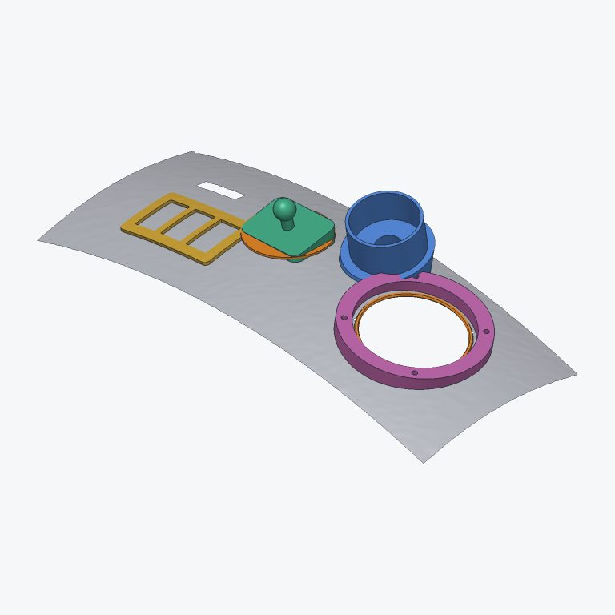
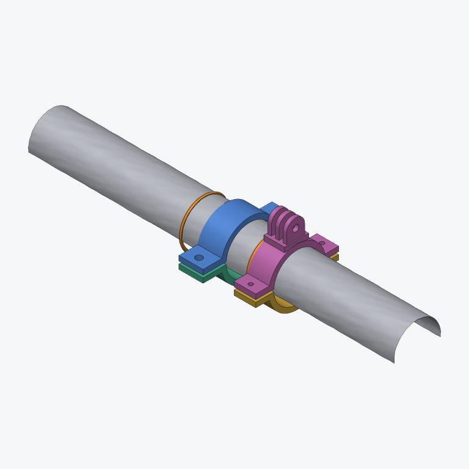

# Scan fit: car parts and mounts that fit a phone 3D scan

`fit` takes a 3D scan from a phone app (Polycam, Scaniverse, KIRI Engine, 3D Scanner App, Luma and the like) of part of a car, a dash, a door card, a roll bar, a mirror stem, a cup holder, and makes printable parts that fit it: phone mounts, gauge pods, switch panels, speaker rings, clamps, camera mounts, trim strips, cup holder inserts, or any plate or block you outline yourself.

Phone scans are never perfect. They're noisy, have holes where the light was bad, pick up the floor and loose bits, and the scale is a few percent off. So fit never builds straight on the raw triangles. You put **references** on the scan instead: planes, cylinders, circles, curves and points fitted robustly to a patch of it (outliers and holes ignored), and parts are built on those and on a smoothed, hole-filled copy of the surface underneath. Every part keeps the gap you ask for (0.4 mm by default) to the real surface, and `fit.check` measures how well it fits before you print.

fit lives in the **cad** app (`wetwaresuite-cad`) and the all-in-one `wetwaresuite`. Each task below is shown three ways:

- **CLI**: fit commands work on an open scan, and documents only live inside one process, so from a shell you put them in a batch script and run `wetwaresuite-cad batch dash.txt` (see [headless and batch](headless-and-batch.md)). `fit.open` on its own works as a one-shot to look at a scan: `wetwaresuite-cad fit.open path=dash_scan.obj`.
- **Batch**: the script itself, with `-> name` captures and `$name` reuse.
- **Claude**: a prompt for Claude over MCP and the tools it calls (see [mcp.md](mcp.md)). `wetwaresuite mcp --tools fit` serves just fit; the tools are named `fit_open`, `fit_plane` and so on.

Every example below was run against the real binary on two test scans saved the way phone apps save them (metres, Y up, a floor, loose bits and holes): `dash_scan.obj`, a curved dash 400 mm wide with a round speaker opening, and `roll_bar.obj`, one side of a 38 mm bar. Outputs are copied from those runs, shortened where marked with `...`.

## How fit works

**Opening a scan.** `fit.open` reads OBJ, PLY, STL, GLB/glTF, OFF and 3MF meshes, and XYZ/PTS point clouds (turned into a surface). It fixes the two things phone apps get "wrong" for printing:

- **Units.** Apps save metres; printers want millimetres. Anything under 10 units across is taken as metres and scaled by 1000. Override with `units=mm|cm|m|in`.
- **Up.** Apps save Y up; fit (like the rest of the suite) uses Z up. OBJ, PLY and point files are turned from Y up; STL and 3MF are left as they are; glTF is handled. Override with `up=y|z`.

Big scans are simplified to `budget=` triangles (300 000 by default) so everything stays quick. The message tells you what it did and what to try next:

```text
$ wetwaresuite-cad fit.open path=dash_scan.obj
opened fit1: 19440 triangles, 10120 vertices, size 520 x 360 x 67.96 at (-260, -180, -20.49), open
2 pieces, 45 open edge loops (41 small holes), noise about 0.1244 mm, edges about 3.855 mm
next: fit.keep_largest drops the 1 loose bits, fit.fill_holes patches the small holes
file was in m, scaled x1000 to mm
turned from Y-up to Z-up
```

**Documents.** A fit document (`fit1`) holds the scan, its references and its parts. Every change is one undo step (`undo`, `redo`), and every change is written to the document's log, which is what projects and `fit.rebuild` replay.

**Placing things.** Most builders take `at=x,y,z`: a point near the scan (it's snapped onto it). The part sits on the surface there, facing the way the surface faces, averaged over the part's footprint so a bump under the point doesn't tip it. `plane=plane1` places it on a fitted plane instead, `angle=` turns it about the surface direction, and `flip=true` builds on the other side (inside a door pocket, say).

To find coordinates: `fit.info` gives the scan's size and position, `fit.section` cuts it and lists points along the cut, and `fit.pick u=0.4 v=0.6` turns a spot on any preview picture into a point on the scan (u from 0 at the left to 1 at the right, v from 0 at the top to 1 at the bottom, same `view`, `yaw` and `pitch` as the picture). Claude uses `fit.pick` to aim at what it sees.

**Conforming.** Plates, blocks, pads, pods and panels "hug" the scan: fit casts rays down onto the scan under the whole footprint, fills spots that fell in holes from their neighbours, smooths away the scan noise (`smooth=`, 2 passes by default), lifts the result by the gap, and builds the part's underside from it. The message says how much the surface varied under the part and how many samples fell in holes.

**Pictures.** Add `preview=true` to any command for a picture of the scan (grey), references (orange) and parts (in colour). `fit.preview heat=phone1` colours the scan by its gap to a part: blue where the part is too far, green at the gap you asked for, red where it touches or pokes in.

## Task 1: clean up a phone scan

Scans come with the floor, a loose bit or two, small holes and noise. Clean them first; references and parts then come out more accurate.

**Batch.**

```text
# clean.txt
fit.open path=dash_scan.obj -> s
fit.remove_floor doc=$s
fit.keep_largest doc=$s
fit.fill_holes doc=$s max_size=20
fit.smooth doc=$s iterations=3
fit.info doc=$s
fit.export doc=$s path=out/scan.png size=768
```

Output:

```text
removed the floor at z = -19.98 (936 triangles)
kept 1 of 1 pieces, removed 0 triangles
filled 41 holes (largest 3.312 mm), left 3 bigger ones
smoothed: noise 0.1215 -> 0.03856 mm (moved up to 0.2944 mm)
18668 triangles, 9648 vertices, size 400 x 160 x 45.93 at (-200, -80, 1.377), open
1 piece, 3 open edge loops (0 small holes), noise about 0.03856 mm, edges about 2.884 mm
wrote a picture to out/scan.png
```

The three bigger holes it left are the speaker opening and the scan's outer edge: `fill_holes` only patches holes smaller than `max_size=` so real openings stay open. Other cleanup commands:

- `fit.crop min=x,y,z max=x,y,z` keeps what's inside a box; `fit.crop point= normal=` keeps one side of a plane.
- `fit.simplify triangles=50000` makes a huge scan lighter.
- `fit.scale from= to= length=` fixes the scale from a real measurement: pick two points on the scan and type what a tape measure says between them on the car. Do this when the scan's size is a few percent off (common with photo-based apps); parts come out the right size afterwards.
- `fit.align mode=auto` squares the scan to the axes; `fit.align mode=plane plane=plane1 face=up origin=true` makes a fitted plane the floor at z = 0.
- `fit.move`, `fit.rotate` and `fit.mirror` move the whole document (scan, references and parts together). `fit.mirror` is handy for making a left-hand part from a scan of the right side.

**Claude.**

> Open dash_scan.obj from my phone, clean it up and show me what it looks like.

Claude calls `fit_open` (`preview=true`), reads the "next:" hint, calls `fit_remove_floor`, `fit_keep_largest`, `fit_fill_holes` and `fit_smooth`, and shows you the final preview.

## Task 2: measure the scan

Before making anything, measure. Every measuring command is read-only.

**Batch.**

```text
# measure.txt
fit.open path=dash_scan.obj -> s
fit.remove_floor doc=$s
fit.radius doc=$s at=-30,10,48
fit.distance doc=$s from=-150,0,40 to=150,0,40 snap=false
fit.section doc=$s axis=x at=0 path=out/dash_section.svg
```

Output:

```text
curve radius about 90.42 mm here (flatness 0.2941 mm)
distance 300 mm (dx 300, dy 0, dz 0)
1 line; line 1: 162.9 mm long, open, 160 x 12.57 mm in the plane
points: 0,80,33.442,0,77.5,33.981,0,75,34.689, ...
wrote out/dash_section.svg
```

- `fit.radius` says how curved the scan is at a spot (a sphere fitted to the patch). Big numbers mean nearly flat.
- `fit.distance` measures between two points, snapped onto the scan unless `snap=false`.
- `fit.section` cuts the scan with a plane (`axis=x at=0`, or `point=` and `normal=`, or `plane=plane1`) and measures the curve. The SVG is 1:1 in millimetres: print it at 100% and you have a paper template to hold against the car. A `.png` path writes a picture instead.
- `fit.snap at=x,y,z` gives the nearest point on the scan and which way the surface faces there.

**Claude.**

> How curved is the dash where the phone would go, around -30, 10, 48? And print me a cross-section template through the middle.

Claude calls `fit_radius` and `fit_section` with `path=dash_section.svg`.

## Task 3: a phone mount, switch panel, speaker ring and gauge pod on a curved dash

This is what fit is for. Each of these presets is a whole part from one command: the base hugs the scan, and the useful bit (the ball, the cutouts, the cup) sits on a flat face on top.



**Batch.**

```text
# dash.txt: phone mount, switch panel, speaker ring and gauge pod
fit.open path=dash_scan.obj -> s
fit.remove_floor doc=$s
fit.keep_largest doc=$s
fit.fill_holes doc=$s max_size=20
fit.smooth doc=$s iterations=3
# references: where the phone goes, and the round speaker opening
fit.plane doc=$s at=-30,10,48 radius=20
fit.circle doc=$s at=110,0,40
# the parts
fit.phone_mount doc=$s at=-30,10,48 tilt=12,0
fit.switch_panel doc=$s at=-100,-25,45 switches=3
fit.speaker_ring doc=$s circle=circle1 speaker=4
fit.gauge_pod doc=$s at=40,40,40 gauge=52 tilt=20,0
# check and export
fit.check doc=$s part=phone1
fit.printability doc=$s part=phone1
fit.export doc=$s path=out/parts.png size=768
fit.export doc=$s path=out/parts.3mf
fit.save_project doc=$s path=out/dash.wwfit
```

Output (the cleanup lines are as in task 1):

```text
plane1: plane through (-29.93, 9.95, 46.29) facing (-0.04565, 0.03106, 0.9985), fit error 0.4131 mm
fit error 0.4131 mm using 92.31% of 195 points, worst bump 0.8077 mm
circle1: circle diameter 84.47 at (109.9, 0.02015, 32.97) facing (0.1736, 0.001233, 0.9848), fit error 1.065 mm
phone1: phone mount, 60.63 x 45.67 x 36.73 mm, 11478 triangles, closed (ready to print)
sampled the scan every 0.6667 mm; surface varies 3.863 mm under it; 4 to 14.72 mm thick
surface fitted within 36 mm, flatness 0.8418 mm
gap to scan 0.359 to 0.4252 mm, 100% within gap + 0.5 mm
switches1: switch panel, 92.55 x 56.14 x 22.8 mm, 8000 triangles, closed (ready to print)
3 cutouts 21.1 x 36.8 mm, panel 93.1 x 54.8 mm
...
speaker1: speaker ring, 116.8 x 117 x 29.21 mm, 15822 triangles, closed (ready to print)
ring 117 mm across with a 93 mm cutout over a 84.47 mm opening
...
gauge1: gauge pod, 68.4 x 70.87 x 55.89 mm, 12938 triangles, closed (ready to print)
cup 52.6 mm inside for a 52 mm gauge, wire hole 20.8 mm
...
phone1: gap 0.359 to 0.4252 mm (mean 0.3935, built with 0.4); 100% of the facing side sits within gap + 0.5 mm; looks like a good fit
phone1: closed, 24.29 cm3, 60.63 x 45.67 x 36.73 mm, thinnest wall about 4.056 mm; print with the -y side down (3.099% overhang)
saved gauge1, phone1, speaker1, switches1 to out/parts.3mf
saved the project (10 steps) to out/dash.wwfit
```

What the numbers mean:

- **fit error** on a reference is how far the scan strays from it (RMS, after dropping outliers). "using 92% of points" means 8% were bumps, noise or edges that were ignored. A plane's "worst bump" is the biggest thing it ignored.
- **surface varies** is how far the dash curves under the part, so you know the part really follows it and isn't just flat.
- **gap to scan** comes from measuring the finished part against the cleaned scan. "100% within gap + 0.5 mm" means the whole underside sits close.

The presets and their main settings:

| command | makes | main settings |
| --- | --- | --- |
| `fit.phone_mount` | a pad with a 17 mm ball for standard phone clamps | `width`, `height`, `tilt=u,v` (a wedge to angle the phone), `ball`, `screws=true` (two countersunk M4 holes instead of tape) |
| `fit.gauge_pod` | a pod with a cup for a round gauge and a wire hole | `gauge=52` (or 60, or any size), `tilt`, `depth`, `wall` |
| `fit.switch_panel` | a panel with rocker switch cutouts in a row | `switches`, `cutout=21,37`, `pitch`, `margin` |
| `fit.speaker_ring` | an adapter ring from a round opening to a speaker | `circle=` (from `fit.circle`), `speaker=` in inches (3.5, 4, 5.25, 6.5, 6.75, 8; or `cutout=` in mm), `flange` |
| `fit.mirror_mount` | a camera clamp for a mirror stem or bar (task 4) | `cylinder=`, `mount=gopro|camera|ball` |
| `fit.cupholder` | an insert for a round cup holder | `cylinder=` (fitted inside the holder), `wall`, `depth`, `floor` |

All of them take `gap=` (clearance to the scan) and `thickness=`. For tape-on parts 0.4 mm is right; go to 0.6 or more if your printer prints big.

**Claude.**

> I scanned my dash with Polycam (dash_scan.obj). Make me a phone mount on the flat bit left of centre, angled 12 degrees toward me, a panel for three rocker switches below it, a gauge pod for a 52 mm boost gauge on the right, and an adapter ring for 4" speakers in the round speaker hole. Check they all fit, then give me a 3MF for printing.

Claude opens and cleans the scan, calls `fit_preview` to see it, uses `fit_pick` on the picture to turn "the flat bit left of centre" into coordinates, and checks the spot with `fit_plane` (a low fit error means it's flat enough). Then it calls `fit_circle` on the speaker hole and the four presets with `preview=true`, looking at each picture, then `fit_check` on each part, and `fit_export` to `parts.3mf`. If a check reports contact under 90% or parts poking in, it moves the part or raises the gap with `fit_rebuild`.

## Task 4: a clamp and a camera mount on a roll bar

Round things (bars, pipes, headrest posts, the rear-view mirror stem, grab handles) get a fitted **cylinder**. It works from one side of the bar too, which is all a phone sees when the bar is against the roof.



**Batch.**

```text
# bar.txt
fit.open path=roll_bar.obj -> b
fit.cylinder doc=$b at=0,0,300 radius=30
fit.clamp doc=$b cylinder=cylinder1 pieces=2 bolt=M5 width=20
fit.mirror_mount doc=$b cylinder=cylinder1 offset=40 mount=gopro
fit.check doc=$b part=clamp1a
fit.export doc=$b path=out/bar.png size=768
fit.export doc=$b path=out/bar.stl separate=true
```

Output:

```text
cylinder1: cylinder radius 18.89 (diameter 37.78), axis (1, 0.001465, 0.002182) through (-2.514, -0.1055, 300.1), 55.04 long, fit error 0.1187 mm
fit error 0.1187 mm using 100% of 176 points
clamp1a: clamp, 20.12 x 76.41 x 22.23 mm, 1572 triangles, closed (ready to print)
inner diameter 38.38 mm for a 37.78 mm cylinder; parts: clamp1a, clamp1b
mirror1a: mirror mount, 18.11 x 68 x 40.43 mm, 4360 triangles, closed (ready to print)
clamp for a 37.78 mm stem with a gopro mount
clamp1a: gap 0.1438 to 0.454 mm (mean 0.3022, built with 0.3); 100% of the facing side sits within gap + 0.5 mm; looks like a good fit
```

The scanned diameter is 37.78 mm on a 38 mm bar: about as close as a phone gets. If you know the real size, trust the tape measure: `fit.scale` the scan from a measurement, or raise the clamp's `gap=` a little.

- `fit.clamp pieces=1` is one ring with a slot and a bolt; `pieces=2` is two bolted halves (named `clamp1a` and `clamp1b`). `angle=` turns the tabs round the bar, `offset=` slides the clamp along it.
- `fit.mirror_mount` is a two-piece clamp with a GoPro three-prong, a 1/4" camera nut trap (`mount=camera`) or a 17 mm ball (`mount=ball`) on top.
- `fit.insert` makes a sleeve that sits inside a fitted cylinder; `fit.cupholder` is the same with cup holder defaults.

**Claude.**

> Here's a scan of my roll bar. Make a two-piece clamp for it with M5 bolts and a GoPro mount next to it.

Claude calls `fit_open`, `fit_preview`, `fit_pick` on the bar, `fit_cylinder` there (and reads back the diameter to you), `fit_clamp` with `pieces=2 bolt=M5`, `fit_mirror_mount`, `fit_check` and `fit_export` with `separate=true`.

## Task 5: your own shapes: plates, blocks, holes and mounts

The presets are built from a few general builders you can use directly:

- `fit.plate`: a plate that hugs the scan, any outline: `shape=rounded|rect|circle|oval`, or `shape=outline outline=x1,y1,x2,y2,...` (millimetres across the surface around `at=`). `hole_diameter=` cuts a hole in the middle.
- `fit.block`: hugs the scan underneath and is **flat on top**, for spacers, wedges and level pads; `tilt=u,v` tips the top.
- `fit.hole`: drills a screw hole into a part (`screw=M4` picks the clearance size, `countersink=true` for flat heads, `depth=` for blind holes).
- `fit.mount`: adds a standard mount on a part's surface: `type=ball`, `camera`, `gopro`, `magnet` (a pocket), `ziptie` (two slots) or `amps` (a 30 x 38 mm four-hole pattern for AMPS phone and tablet holders).
- `fit.combine parts=a,b` joins parts into one body.

**Batch.**

```text
# plate.txt: a plate with a countersunk screw hole, then made thicker with more gap
fit.open path=dash_scan.obj -> s
fit.remove_floor doc=$s
fit.keep_largest doc=$s
fit.plate doc=$s at=-30,10,48 width=60 height=40
fit.hole doc=$s part=plate1 screw=M4 countersink=true
fit.rebuild doc=$s part=plate1 gap=0.6 thickness=5
fit.save_project doc=$s path=out/plate.wwfit
```

Output:

```text
plate1: plate, 60.15 x 40.28 x 8.789 mm, 8000 triangles, closed (ready to print)
sampled the scan every 0.6667 mm (16 of 5631 points fell in holes and were filled in); surface varies 3.851 mm under it
plate1: plate, 60.15 x 40.28 x 8.789 mm, 12036 triangles, closed (ready to print)
4.5 mm hole at (-30.21, 10.11, 50.32), countersunk 8.4 mm
plate1: plate, 60.24 x 40.38 x 10.78 mm, 11846 triangles, closed (ready to print)
rebuilt with gap=0.6, thickness=5
saved the project (4 steps) to out/plate.wwfit
```

This scan wasn't hole-filled, and the plate still came out whole: 16 samples fell in holes and were filled in from around them.

**`fit.rebuild`** is the "change one number" button. It changes the settings of the step that built the part and replays everything done after it, so the countersunk hole above comes back in the thicker plate. It takes `gap`, `thickness`, `width`, `height`, `diameter`, `corner`, `angle`, `tilt`, `smooth`, `wall`, `depth`, `floor` and `at`.

**Claude.**

> Make a 60 by 40 plate on the dash at -30, 10, 48 with a countersunk M4 hole in the middle. Actually, make it 5 mm thick with 0.6 mm gap.

Claude calls `fit_plate`, `fit_hole`, then `fit_rebuild` with `gap=0.6 thickness=5` rather than starting again.

## Task 6: a trim strip along an edge

`fit.curve` follows an edge (a door card lip, a dash edge, a panel gap) by cutting the scan with a plane and smoothing the cut. `fit.strip` then builds a strip along it.

**Batch.**

```text
# trim.txt
fit.open path=dash_scan.obj -> s
fit.remove_floor doc=$s
fit.keep_largest doc=$s
fit.curve doc=$s at=0,-78,30 axis=x length=120
fit.strip doc=$s curve=curve1 width=12 thickness=2
fit.export doc=$s part=strip1 path=out/strip.stl
```

Output:

```text
curve1: curve of 65 points, 63.15 mm long
strip1: strip, 12 x 62.55 x 13.18 mm, 516 triangles, closed (ready to print)
```

`axis=x` cuts across X (or give the plane's `normal=`); `length=` keeps that much of the cut around the point (here the cut ran off the end of the scan after 63 mm). `flip=true` puts the strip on the other side of the curve. Print it in TPU and it follows a slightly different curve too.

**Claude.**

> Make a 12 mm trim strip along the front edge of the dash in the middle.

Claude calls `fit_preview`, `fit_pick` on the edge, `fit_curve` there and `fit_strip`, then shows the result.

## Task 7: check the fit and print a test slice first

Big parts take hours to print. Check first, then print a thin slice of just the fitting surface (ten minutes) and try it on the car.

**Batch.**

```text
fit.check doc=$s part=phone1
fit.preview doc=$s heat=phone1 size=768
fit.printability doc=$s part=phone1
fit.export doc=$s part=phone1 path=out/phone_test.stl test_slice=1.2
fit.export doc=$s part=phone1 path=out/phone.stl shrink=petg
```

Output:

```text
phone1: gap 0.359 to 0.4252 mm (mean 0.3935, built with 0.4); 100% of the facing side sits within gap + 0.5 mm; looks like a good fit
phone1: closed, 24.29 cm3, 60.63 x 45.67 x 36.73 mm, thinnest wall about 4.056 mm; print with the -y side down (3.099% overhang)
saved phone1 (test slice 1.2 mm) to out/phone_test.stl
```

- `fit.check` measures the gap from the part's underside to the scan everywhere. It warns when parts poke into the scan ("inside" above 0) or sit far off. The heat map makes it obvious where.
- `fit.printability` says whether the part is closed (watertight, so any slicer takes it), its volume and thinnest wall, and which side to put on the bed.
- `test_slice=1.2` saves only a 1.2 mm thick layer of the surface that touches the car, in the part's outline. The preset commands also take `test_slice=` to build just that.
- `shrink=pla|petg|asa|abs|nylon|tpu` or a percent scales the part up for the material's shrinkage. ABS and ASA (good for hot dashboards) shrink the most.
- Formats: STL, 3MF (several parts in one file), OBJ, PLY, GLB. `separate=true` writes one file per part; `scan=true` includes the scan, for checking in another program (not for printing).

To print straight away, send a part on to the slicer: in the GUI, use Send to; from a script, export an STL and `slicer.load path=out/phone.stl` (see [slicer.md](slicer.md)).

**Claude.**

> Does the phone mount fit well? Give me a test piece to try on the car before I print the whole thing in PETG.

Claude calls `fit_check` (and looks at the heat map it attaches), `fit_export` with `test_slice=1.2`, and once you say it fits, `fit_export` with `shrink=petg`.

## Projects: saving and picking up later

`fit.save_project path=dash.wwfit` saves a small project: the path to the scan (relative, if it's next to the project) and every step you took. `fit.open path=dash.wwfit` opens the scan again and replays the steps:

```text
$ wetwaresuite-cad fit.open path=out/plate.wwfit
opened fit1: 18504 triangles, 9607 vertices, size 400 x 160 x 46.09 at (-200, -80, 1.377), open
...
replayed 4 steps: 0 references, 1 parts
```

Because the project is steps rather than triangles, it stays tiny, and you can rescan the car and point the project at the new scan: the parts are rebuilt on it. In the cad app's window, double-clicking a `.wwfit` file opens it.

## In the window

In the cad app's window (`wetwaresuite-cad` with no arguments), search for **Open Scan** and pick your scan file with **Browse...** (an `.obj` opened with File > Open goes to the model app's sculpting instead, so use Open Scan for scans). Opening a `.wwfit` project with File > Open goes straight to fit. Then search for what you want ("phone mount", "clamp", "check fit") to get its form, fill in the boxes and press **Run**; the picture of the scan and parts updates, and the numbers (gaps, sizes, coordinates from `fit.info`, `fit.section` or `fit.pick`) show under the form. See [gui.md](gui.md).

## Tips for scanning

- Scan more than you need: 10 cm past the part on every side gives the references room.
- Matte beats shiny. Black glossy trim scans badly; a light dusting of dry shampoo or painter's tape on the spot helps a lot.
- LiDAR modes (iPhone Pro) are quicker; photo modes are more detailed but may be a few percent off in scale: measure one long distance on the car and use `fit.scale`.
- Export as OBJ or PLY (metres, as the app saves it) and let `fit.open` sort out the units.

## All fit commands

| group | commands |
| --- | --- |
| open and save | `fit.open`, `fit.info`, `fit.save_project`, `fit.close` |
| clean up | `fit.remove_floor`, `fit.keep_largest`, `fit.fill_holes`, `fit.smooth`, `fit.simplify`, `fit.crop` |
| size and position | `fit.scale`, `fit.align`, `fit.move`, `fit.rotate`, `fit.mirror` |
| measure | `fit.distance`, `fit.radius`, `fit.section`, `fit.snap`, `fit.pick` |
| references | `fit.plane`, `fit.cylinder`, `fit.sphere`, `fit.circle`, `fit.curve`, `fit.point`, `fit.refs`, `fit.delete` |
| build | `fit.plate`, `fit.block`, `fit.clamp`, `fit.insert`, `fit.strip`, `fit.hole`, `fit.mount`, `fit.combine`, `fit.rebuild` |
| presets | `fit.phone_mount`, `fit.gauge_pod`, `fit.switch_panel`, `fit.speaker_ring`, `fit.mirror_mount`, `fit.cupholder` |
| check and export | `fit.check`, `fit.printability`, `fit.preview`, `fit.export` |

`wetwaresuite-cad help fit.<name>` lists every setting of a command.
