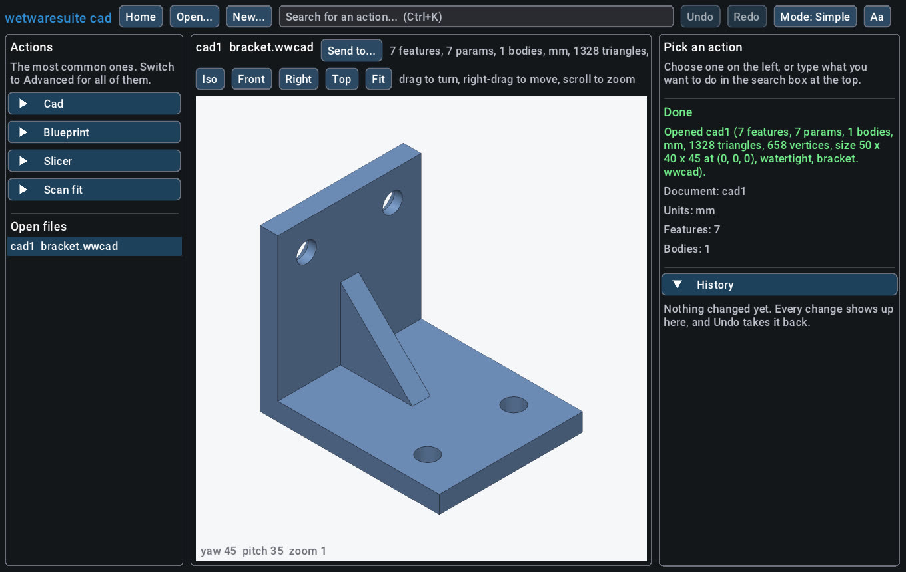
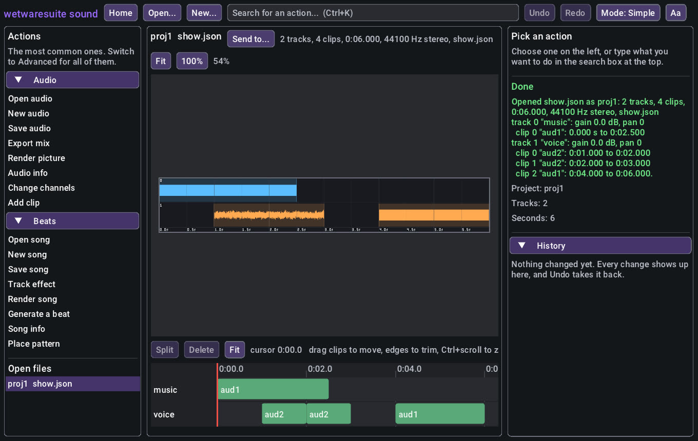
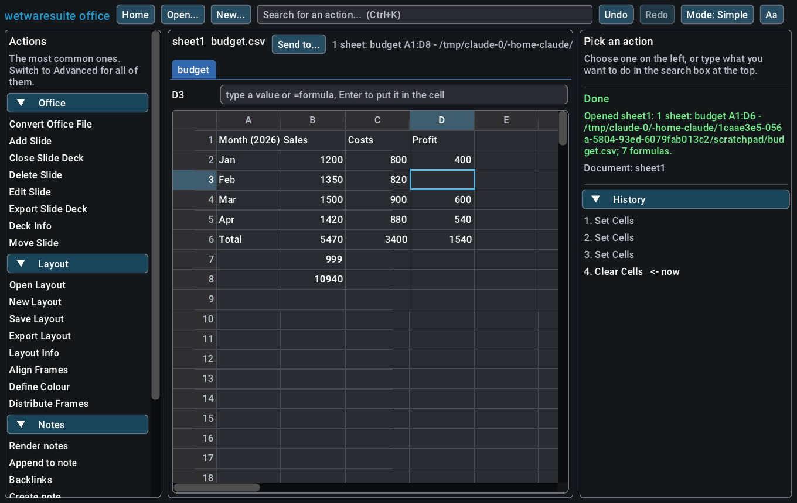

# The wetwaresuite window

wetwaresuite has a desktop window for people who would rather click than type. It sits on top of the
same commands the command line, batch scripts and Claude use, so anything you do in the window can
also be done in a script, and every change you make can be undone.

The window works completely offline. It needs no internet connection, no account and no AI. It also
needs no graphics card: on a computer without one it draws in software.


## 1. Start it

Every app is its own program with its own window, its own icon (the logo in the app's colour) and
its own entry in the start menu, the dock or Launchpad. Opening one never opens the others, and you
can have several open side by side, like Photoshop next to Blender.

**The launcher.** The plain "wetwaresuite" entry in the start menu (on a Mac, `wetwaresuite.app` in
the wetwaresuite folder) opens a small window with a tile for every app. Click a tile and that app
starts in its own window; the launcher stays open so you can start another, and closing it closes
nothing else. **Open a file...** (or dropping files on the launcher) hands each file to the app made
for it. An app that isn't installed yet shows "not installed": add it with the hub.

**Straight to an app.** Each app is in the start menu as "wetwaresuite image", "wetwaresuite cad"
and so on, and the installers add every app to the "Open with" menu of the files it opens
(Explorer, Finder and Linux file managers), so you can right-click a `.stl` and open it in cad. Files
in wetwaresuite's own formats (`.wwcad`, `.wwcut`, `.wwlay`, `.wwmap`, `.wwfit`) open in their app
with a double-click.

In a file manager (Explorer, Finder, Files) you can also **double-click** an app's program:

| program | what its window is for |
|---------|------------------------|
| `wetwaresuite-image` | photo editing and painting, textures |
| `wetwaresuite-draw` | vector art, logos, fonts, whiteboards and diagrams |
| `wetwaresuite-model` | 3D modeling and sculpting, rendered pictures, animation |
| `wetwaresuite-game` | game assets and game levels |
| `wetwaresuite-cad` | precise parts, technical drawings and floor plans, 3D printing |
| `wetwaresuite-electronics` | circuit diagrams and circuit boards |
| `wetwaresuite-sound` | sound editing and music |
| `wetwaresuite-video` | video editing and screen recording |
| `wetwaresuite-office` | documents, spreadsheets, slides, print layouts and notes |
| `wetwaresuite-maps` | maps, GPS tracks and map data |
| `wetwaresuite-system` | calculator, code editor, file manager, terminal, system monitor and clock |
| `wetwaresuite-files` | converting, finding and batch-processing files |
| `wetwaresuite-gui`, `wetwaresuite` | the launcher (`gui --all`: every tool in one window) |

Each app has its own colour, so you can tell the windows apart at a glance. If you installed the
apps with the hub they are in your personal wetwaresuite `bin` folder (see [the apps](apps.md));
if you built them yourself they are in `build/bin/`.

To open a file straight away, **drag it onto the app's icon**, or give it after the name:

```sh
wetwaresuite-image holiday.jpg            # the window, with holiday.jpg open
wetwaresuite-image open a.png b.png       # the same, saying "open" out loud
wetwaresuite-image gui                    # just the window
```

You can also drag a file onto the open window.

Anything else after the name is the command line, exactly as before, and never opens a window:
`wetwaresuite-image list`, `help`, `run`, `batch`, `mcp`, or a command such as
`wetwaresuite-image photo.resize ...`. So scripts and Claude keep working the same way.

If the computer has no screen (a server, or a remote terminal), or the program was built without
the window, starting it with no arguments prints the usual help and one line saying why there is no
window, for example `No window: there is no screen to show it on`. Everything still works from the
command line.

**On Windows** the apps are ordinary console programs, so they work in a terminal. When you
double-click one in Explorer, Windows briefly makes a black console box for it; the app notices that
the box belongs to it alone and closes it, so only the window stays. Started from a terminal
(PowerShell or Command Prompt) it keeps the terminal, so any messages still show there.

### The launcher from the command line

`wetwaresuite-gui` is built into `build/bin/` next to the apps, so it finds them:

```sh
wetwaresuite-gui                       # the launcher: every app starts in its own window
wetwaresuite-gui a.png song.wav        # a.png opens in image, song.wav in sound, each in its own window
wetwaresuite open part.step            # the all-in-one does the same
wetwaresuite-gui --app all             # every tool in one window, the way it used to be
wetwaresuite gui --all                 # the same from the all-in-one
wetwaresuite-gui --app image           # the same window wetwaresuite-image opens
wetwaresuite-gui --app image a.jpg     # and open a picture straight away
wetwaresuite-gui --tools photo,convert # or name the tools yourself
wetwaresuite-gui --list-apps           # the app names
```

When no app is installed next to it (say you copied just the `wetwaresuite` program somewhere),
the launcher has nothing to start, so it opens every tool in one window instead.

The AppImage on Linux runs everything from inside its one file, which unmounts when the program
you started it with closes, so keep the launcher open while you use apps you started from it (or
start each app with `--run image`, or install the `.deb`).

## 2. The home screen

When the window opens you see the home screen:

- **Open a file** shows your computer's normal "open" window. Pick a picture (or any file the app
  understands) and it opens.
- **Start something new** lists the things you can create, such as a blank canvas to paint on.
- **Find an action** jumps to the search box (see below).
- **Recent files** lists what you opened before. Click one to open it again.
- One **card per tool** says in a sentence what it does, with buttons for its most common actions.
- When another app has **sent you a file**, a banner at the top says what is waiting, with an
  **Open it** button (see [Sending your work to another app](#8-sending-your-work-to-another-app)).

You can always get back here with the **Home** button at the top left.

## 3. Find any action by typing

Click the search box at the top, or press **Ctrl+K** (Cmd+K on a Mac), and type what you want to do
in your own words: `resize`, `brightness`, `crop`, `blur`, `layer`. Matching actions appear as you
type. You don't have to spell them exactly: `brsh` finds "Brush stroke". Use the arrow keys and
**Enter**, or click one.

## 4. Fill in the form and press Run

Picking an action, from search, the list on the left or a card, shows its form on the right. Every
box is already filled with a sensible value, so often you only press **Run** (or **Ctrl+Enter**).

- **Numbers with a known range** (like opacity 0 to 100) are sliders. Drag them, or Ctrl+click one
  to type a value.
- **Optional numbers** start ticked as **Automatic**: the tool chooses. Untick it to choose yourself.
- **Yes/no** settings are tick boxes, and **choices** are drop-down lists.
- **Colours** have a colour swatch: click it to pick a colour. You can also type `#ff0000` or a name
  like `red`.
- **Files and folders** have a **Browse...** button that shows your computer's normal file window. You
  can also type or paste a path.
- **Document** picks which open file the action works on. It starts on the file you are looking at.

After you press Run, the result shows under the form: **Done** in green with what happened, or
**That didn't work** in red with the reason in plain words, for example *Please fill in "Height".*
Nothing changes when an action fails.

## 5. Simple and Advanced

The left side lists actions for each tool. In **Simple** mode (the default) it shows only the most
common ones, about eight per tool, and every box in a form has a short explanation under it.

Press **Mode: Simple** at the top to switch to **Advanced**: every action of every tool is listed, and
the explanations move into tooltips (hover over a box's name to read it).
Both modes are free and can do the same things; Advanced just shows more at once.

## 6. Looking at your picture

When a file is open, the middle of the window shows it.

- **Scroll** the mouse wheel to zoom in and out around the mouse pointer.
- **Drag** with the right or middle mouse button (or hold the **Space** bar and drag) to move around.
- **Fit** shows the whole picture, **100%** shows it at its real size.
- The list of **Open files** on the left switches between files.

3D files (cad parts, models, sculpts, scan fits, prints) open in a **3D view** you can turn around:

- **Drag** with the left button to turn the model, **right- or middle-drag** (or Shift+drag) to move it, **scroll** to zoom.
- **Iso**, **Front**, **Right** and **Top** jump to those angles; **Fit** (or a double-click) shows the whole model again.
- The angle shows in the bottom-left corner. It stays put while you edit, so you can watch a change from the side you care about.



It draws in software, so it works on any computer, GPU or not. While you drag it skips the smoothing for speed and redraws sharp when you let go. The same view is `app.view` from the command line and for Claude (see [3D view](3d-view.md)).

Other files that aren't pictures (a song, a map) show their preview picture if the tool has one,
or a one-line summary. Sound files get a play bar too (see [playback](playback.md)).

### The timeline

Video edits (the video app) and multitrack audio projects (the sound app) get a **timeline** under the preview, one row per track:



- **Drag a clip** to move it in time. Drag it up or down onto another track of the same kind (video onto video, sound onto sound) to move it there. While you drag, an outline shows where it will land and its new start time.
- **Drag a clip's left or right edge** to trim it. Trimming never throws audio or video away: drag the edge back out and the rest comes back (as far as the source goes).
- Clips **snap** to the start, the red cursor and the edges of other clips.
- **Click the ruler** or an empty part of a track to put the **cursor** there. **Split** (or **S**) cuts the selected clip at the cursor; **Delete** (or the Delete key) removes it.
- **Scroll** to move along the timeline, **Ctrl+scroll** to zoom, **Fit** to see all of it.

Video edits add an editor's tools:


- Each track has switches at its head: **L** locks it (edits leave it alone), **H** hides its picture, **M** mutes its sound, **S** solos it. A lit switch is on; muted, hidden and locked tracks are drawn dimmer.
- The **cursor is the edit's playhead** (`cut.set_cursor`): the razor, markers, in/out, inserts and freeze frames all work at it, and the preview shows its frame.
- **Razor** (**Ctrl+K**) cuts every unlocked track at the cursor. **Ripple delete** (**Shift+Delete**) removes the selected clip and closes the gap.
- **Marker** (**M**) drops a marker at the cursor: a flag on the ruler (hover it for its name). **In** (**I**) and **Out** (**O**) mark a range, shaded on the ruler, for `cut.extract`, `cut.lift` and `cut.render range=in_out`.
- **Transition** (**T**) crossfades the selected clip with the one before it; a transition shows as a wedge over the start of the later clip.
- Small yellow diamonds along a clip are its **keyframes**. Clicking a clip outlines the clips linked to it (its sound) too, and they move and trim together.

Every drag is one ordinary command (`cut.move_clip`, `cut.trim_clip`, `audio.clip_set`, `audio.clip_trim`, `audio.clip_split`...), so it shows in the history and **Undo** takes it back, and a script or Claude can do exactly the same.

### Spreadsheets: type into the cells

A spreadsheet (in the office app) opens as a grid of cells instead of a picture, with a tab for each
sheet above it.



- **Click** a cell to pick it. Its name (like `B7`) and what's in it show in the **formula bar** at the
  top; type there and press **Enter** to change it.
- **Just start typing** to replace the cell, or **double-click** (or press **F2**) to change what's
  already there. Start with `=` for a formula, like `=SUM(B2:B5)`.
- **Enter** puts it in and moves down, **Tab** moves right (hold **Shift** to go back), **Esc** cancels.
  Clicking another cell keeps what you typed.
- The **arrow keys**, **Page Up/Down** and **Home** move around; **Delete** empties the cell.
- **Ctrl+C**, **Ctrl+X** and **Ctrl+V** copy, cut and paste a cell. Pasting rows copied from another
  spreadsheet fills a block of cells from the one you picked.

Every cell you change is one step in the history, the same `office.sheet_set` or `office.sheet_clear`
command a script would run, so Ctrl+Z takes back exactly one cell. Formulas that depend on it update
at once, and cells with errors (`#DIV/0!`, `#NAME?`) show in red.

Cells look the way the file says: fill and font colours, bold, underline, alignment, merged cells,
and conditional formats with their data bars, which change as soon as the numbers do. To style cells,
merge them, freeze the top rows, add a dropdown, a conditional format, a chart or a pivot table,
press **Ctrl+K** and type `style`, `merge`, `freeze`, `validate`, `conditional`, `chart` or `pivot`.
The [office tutorial](office.md#task-7-a-sales-tracker-the-excel-way) has an example of each.

## 7. Painting

In the image app (or any app with the paint tool), pictures get painting tools above the canvas:

1. Choose **Brush**.
2. Click the colour swatch next to it and pick a colour.
3. Pick a **Brush** style (pen, pencil, ink, marker, airbrush, soft, round), a **Size** and an
   **Opacity**.
4. Draw on the picture with the mouse. You see the line while you draw; when you let go it is painted
   for real.

With a **drawing tablet or pen screen**, pressing harder paints thicker or darker lines (depending on
the brush), and flipping the pen over to its eraser end rubs out. **Eraser** rubs out with the mouse.
**Fill** fills the area you click with the colour, like a paint bucket.

Each stroke is one step in the history, so Ctrl+Z takes back exactly one stroke.

### Retouching: Heal and Remove

Two more tools sit next to Fill in the image app. They fix pictures by painting, with no numbers to type,
and work with the mouse or a pen just like the Brush.

- **Heal** makes spots, pimples, dust and scratches disappear. Pick a **Size** a bit bigger than the
  spot and paint over it; when you let go it blends away. To copy texture from a clean area (grass,
  fabric, skin with pores), first hold **Alt** (**Option** on a Mac) and click that clean area, or press
  **Pick source** and then click or tap it. A white circle shows where it copies from. **Forget source**
  goes back to smooth filling.
- **Remove** makes a whole object disappear. Paint over it (it turns see-through red), then press
  **Remove**. Tick **Remove when I let go** to do it straight away. **Clear** throws the red area away.
  Very big areas are refused with a message saying so: remove the object in a few parts.

While it works the picture shows **Working...**; a moment later it is redrawn. Each heal stroke and each
Remove is one step in the history, so Ctrl+Z takes back exactly one. The
[photo tutorial](photo.md#task-7-retouching-remove-spots-blend-in-erase-objects) has more tips.

To start a fresh canvas: **Start something new**, then **New canvas (Paint)**, set the width and
height, and press Run. To keep your work, search for **save**, pick **Save image**, press
**Browse...** to choose where, and Run. Saving as `.ora` keeps the layers.

### Selecting part of the picture

In the image app, the **Select** tool chooses the part of the picture your next edits change. Pick
**Box**, **Oval** or **Lasso** and drag, or **Wand** and click a colour to take the area like it. Hold
**Shift** to add more and **Alt** to take some away; a click on the picture selects nothing again. The
selection shows as a moving dashed outline ("marching ants").

While something is selected, painting, filling and every action on the left (Adjust colours, Curves,
Effects...) only change the inside. **Deselect** (Ctrl+D), **Invert** (Ctrl+Shift+I), **All**
(Ctrl+A) and **Delete** sit next to the shapes. Selecting is a step in the history like any edit, so
Ctrl+Z brings back the previous selection. See [the photo tutorial](photo.md#task-8-selections-masks-curves-and-free-transform)
for masks, curves and free transform.

### Circuits: click on the schematic and the board

In the electronics app a circuit (`.circuit.json`, or a KiCad `.kicad_sch`, `.kicad_pcb` or `.kicad_pro`)
gets its own row above the picture:

1. **Show** picks **Schematic**, **Board** or **3D** (the assembled board; drag to look around).
2. **Tool** on the schematic: **Select** (click anything to hear what it is: a pin and its net, a wire,
   a label, a part), **Place** (choose the part in the list beside it, type a value if you like, then
   click where it goes), **Wire** (click where the wire starts, then at each corner; it ends on a pin,
   or press Esc or right-click), **Move** (click a part, then where it goes) and **Delete**.
3. **Tool** on the board: **Select**, **Move** (footprints), **Trace** (pick the copper layer; clicks on
   a pad snap to its centre) and **Via**. **Place parts**, **Route** and **Check** are one click each;
   on the schematic, **Check** runs the electrical check.

Each click is one step in the history (Ctrl+Z takes it back) and runs the same `circuit.*` command a
script or Claude would, so you can mix clicking, forms and batch scripts on one design. The
[circuit tutorial](circuit.md#task-10-draw-in-the-window) has the whole list.

## 8. Sending your work to another app

The apps are separate programs, but you can hand work from one to the next without hunting for
files. For example: paint a texture in **image**, then put it on a model in **model**.

1. With your picture open, press **Send to...** next to the file's name at the top of the picture.
2. A list of the apps that can use this kind of file appears. Apps you haven't installed are greyed
   out and marked *not installed*.
3. Click one, for example **Model**. The app saves the picture in the format that app wants (here a
   PNG texture) into the shared handoff folder. The result on the right says **Sent to Model**.
4. If that app is installed as its own program, an **Open Model now** button appears under the
   result. Press it to start Model (or start it yourself any way you like).


5. In Model's window, the home screen shows a banner: *A texture from Image is waiting: crate.png.*
   Press **Open it**. The file opens if Model can open that kind of file; otherwise (as with a
   texture) the result says what to do with it next, for example which action puts it on a model.
   **Not now** hides the banner until the next time the window comes to the front.

The banner checks for new files whenever you switch to the window, so you can keep both apps open
side by side and send back and forth.

In the all-in-one `wetwaresuite` window every app is already there, so **Send to...** converts the
file and opens the result in the same window straight away.

### Files that belong to another app

If you open or drop a file that another app is made for, for example a 3D model (`.obj`) on the
image app, a banner says so: *This app can't open head.obj: it's a file for the Model app.* Press
**Open in Model** to start Model with the file open. If Model isn't installed yet the button is
greyed out and the banner says so; install it with the hub (see [the apps](apps.md)).

Every one of these buttons runs a command you can also type, so nothing here needs the window:

| button | command |
|--------|---------|
| Send to... (the list) | `app.targets doc=img1` |
| Send to... > Model | `app.send doc=img1 to=model` |
| Open it | `app.receive` |
| the banner's check | `app.inbox` |
| Open in Model | `app.open_with path=head.obj`, then `app.launch app=model path=head.obj` |

More on handoffs, with whole walkthroughs: [Workflows](workflows.md).

## 9. Undo, redo and history

- **Undo** (Ctrl+Z) takes back the last change. **Redo** (Ctrl+Y or Ctrl+Shift+Z) puts it back.
- The **History** list on the right shows every change in order; the last one is marked `<- now`.

Opening, looking and saving are not changes, so they don't appear in the history.

## 10. Text size and colours

Press **Aa** at the top right:

- **Text size** makes everything bigger or smaller (the window already follows your screen's scale
  setting).
- **Dark** or **Light**: the app's own colours on dark or light panels. Both are high contrast.

### Your own colours, in every app at once

Under **Colours** you can pick three colours. They are shared: every wetwaresuite app (and the
`wetwaresuite-gui` launcher) uses them, so the whole suite looks the same.

| in the menu | also called | what it colours |
|-------------|-------------|-----------------|
| **Main colour** | primary | buttons like **Run** and **Open a file**, the app's name, headings and highlights |
| **Panels** | secondary | the boxes and panels. A dark colour gives a dark look, a pale one a light look |
| **Details** | tertiary | links, borders, selected text and the keyboard focus |

1. Press **Aa**.
2. Click the colour swatch next to **Main colour** and pick a colour (or type its code, like
   `#ff8800`). The window changes as you go.
3. Do the same for **Panels** and **Details** if you like.
4. Let go of the mouse: the colours are saved. Other open apps change when you click back into
   their window; apps you start later begin with them.

You don't have to worry about picking colours that clash with the text: the window works out the
text colour (black or white), the lighter and darker shades for hovering and pressing, and nudges
any colour that would be hard to read until it reads well (at least the WCAG AA contrast levels).

**Ready-made** sets, one click each:

| button | name for commands | what it is |
|--------|-------------------|------------|
| High contrast | `high-contrast` | yellow and cyan on black: the easiest to read, for low vision or bright rooms |
| Light | `light` | dark text on pale grey panels with a blue main colour |
| Colour-blind friendly | `colour-blind` | orange and sky blue (the Okabe-Ito colours), which stay apart with every common kind of colour blindness |
| Warm | `warm` | coral and gold on dark brown, easy on the eyes at night |

**Reset to this app's own colours** forgets your colours: every app goes back to its own colour
(image pink, model orange, cad blue and so on) on the standard panels. That is also how every app looks
until you pick something, so nothing changes for anyone who never opens this menu.

The colours are kept in one small text file, `palette.txt`, in your personal wetwaresuite folder
(the same folder as `bin/` and `handoff/`):

| system | file |
|--------|------|
| Linux | `~/.local/share/wetwaresuite/palette.txt` (or `$XDG_DATA_HOME/wetwaresuite/`) |
| macOS | `~/Library/Application Support/wetwaresuite/palette.txt` |
| Windows | `%APPDATA%\wetwaresuite\palette.txt` |

`$WETWARESUITE_HOME` moves the whole folder. The file is three lines you can edit by hand:

```
primary=#ff8800
secondary=#1d2733
tertiary=#56b4e9
```

#### The same from the command line, batch scripts and Claude

Every button is a command, so the colours can be set without the window (any app works, they all
share the file):

```sh
wetwaresuite-image app.palette_get                                  # what's in use now
wetwaresuite-image app.palette_set primary=#ff8800 secondary=#1d2733 tertiary=#56b4e9
wetwaresuite-image app.palette_set primary=orange                   # just one; plain names work too
wetwaresuite-image app.palette_preset name=high-contrast            # or default, light, colour-blind, warm
wetwaresuite-image app.palette_reset                                # back to each app's own colours
```

Colours are `#rrggbb`, the short `#rgb`, or a plain name (`black`, `white`, `grey`, `red`,
`orange`, `yellow`, `green`, `teal`, `blue`, `navy`, `purple`, `pink`, `brown`). A typo gets a plain
answer and changes nothing, for example *The primary colour "#12345" isn't a colour. Write # and six
digits or letters a-f, like #3d7eff, or a plain name such as blue.*

In a [batch script](headless-and-batch.md) (`#` right after `=` is a colour, not a comment):

```
# colours.txt: run with  wetwaresuite batch colours.txt
app.palette_preset name=light
app.palette_set primary=#c2410c
app.palette_get
```

Over MCP the tools are `app_palette_get`, `app_palette_set`, `app_palette_preset` and
`app_palette_reset`, so you can ask Claude, for example, "make all my wetwaresuite apps high
contrast" or "use a dark green main colour".

## 11. Doing the same thing without the window

Every button runs a command, and the same command works from the command line. For example,
painting a stroke in the window does what this does:

```sh
wetwaresuite run paint.stroke doc=img1 points="[10,10, 50,40, 90,10]" color="#ff0000" size=12
```

The action's name is shown next to it in the search results (for example `photo.resize`), so
you can find it in `wetwaresuite help photo.resize` and use it in [batch scripts](headless-and-batch.md).

The window program can also serve its tools to Claude, just like `wetwaresuite mcp`:

```sh
wetwaresuite-gui mcp --app image
```

This is optional: nothing in the window needs it.

## 12. When something goes wrong

- **"Couldn't show a file window"**: on Linux the Browse button uses your desktop's file window
  (through the desktop portal or `zenity`). If neither is installed, type or paste the path into
  the box instead.
- **"No window: there is no screen to show it on"**, **"Couldn't start the window"** or **"built
  without the window"**: the computer has no screen (a server), or wetwaresuite was built without the
  window (`-DWETWARESUITE_GUI=OFF`, or SDL3 couldn't be downloaded when it was built). Everything
  still works from the command line.
- **"Open in ..." is greyed out**: that app isn't installed next to this one, in your personal
  wetwaresuite `bin` folder, or on your PATH. Install it with `hub install <app>`.
- On Linux, building the window needs the X11 or Wayland development files (`libx11-dev` on
  Debian/Ubuntu). Without them it still builds, but can only draw offscreen.

## For builders

- `cmake -S . -B build` builds the window by default. `-DWETWARESUITE_GUI=OFF` leaves it out.
- SDL3 (zlib license) is used from your system if CMake finds it, else the pinned SDL3 3.2.24 release
  is downloaded once while configuring. With no network, set
  `-DFETCHCONTENT_SOURCE_DIR_SDL3=/path/to/SDL3-3.2.24` to an unpacked copy, or the window is
  skipped and a stub is built in its place. Nothing is downloaded when the program runs.
- Dear ImGui (MIT) is vendored in `third_party/imgui`.
- `wetwaresuite-gui --screenshot shot.bmp` draws a few frames, saves them and quits. With
  `SDL_VIDEO_DRIVER=offscreen` it works on a machine with no screen, which is how the picture above
  was made.
- Every app binary (and the all-in-one `wetwaresuite`) links `wetwaresuite_gui` through
  `apps/common`. Which way a start goes, window or command line, is decided by
  `apps::decideLaunch` (`apps/common/launch.hpp`, unit tested in `test_apps`); the window then opens
  through `apps::runGui` with the name, tools and accent colour from the app table
  (`apps/common/apps.cpp`). `wetwaresuite-gui` goes through the same `runGui`.
- `wetwaresuite-image gui --screenshot shot.bmp` works on every app, like the launcher's.
  `--action settings` starts with the **Aa** menu open (handy for screenshots of the colours).
- The palette logic (parsing colours, the file, contrast and shades) is window-free in
  `gui/include/wetwaresuite/gui/palette.hpp`, tested by `test_gui_palette`; the `app.palette_*`
  commands are in `apps/common/palette_commands.cpp`, tested in `test_apps`. The window reads the
  palette through `app.palette_get` when it starts and whenever it gets the focus.
- With `-DWETWARESUITE_GUI=OFF` the apps link a small stub instead: no SDL3 is needed or downloaded,
  and starting an app with no arguments prints the help and says the window was left out.
- On Windows the apps stay console-subsystem programs so the command line works. Before opening the
  window they call `GetConsoleProcessList`; when it reports only this process (Explorer started it
  and Windows made a console just for it) they call `FreeConsole`, so the console box disappears.
