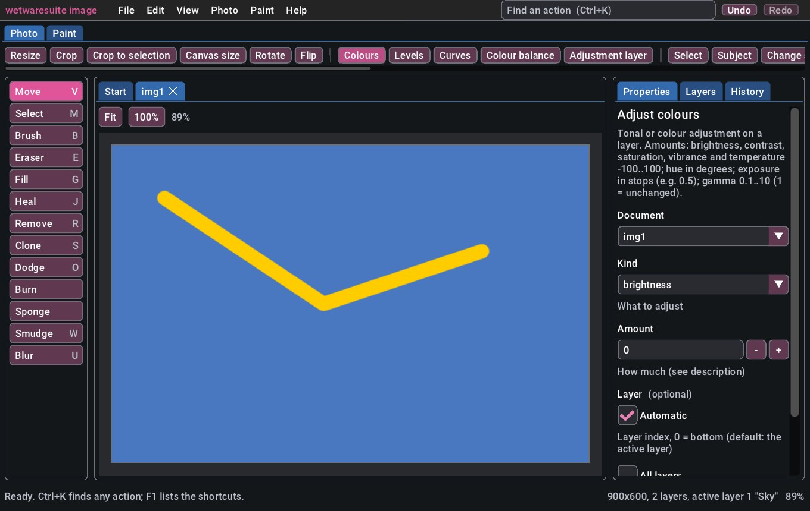
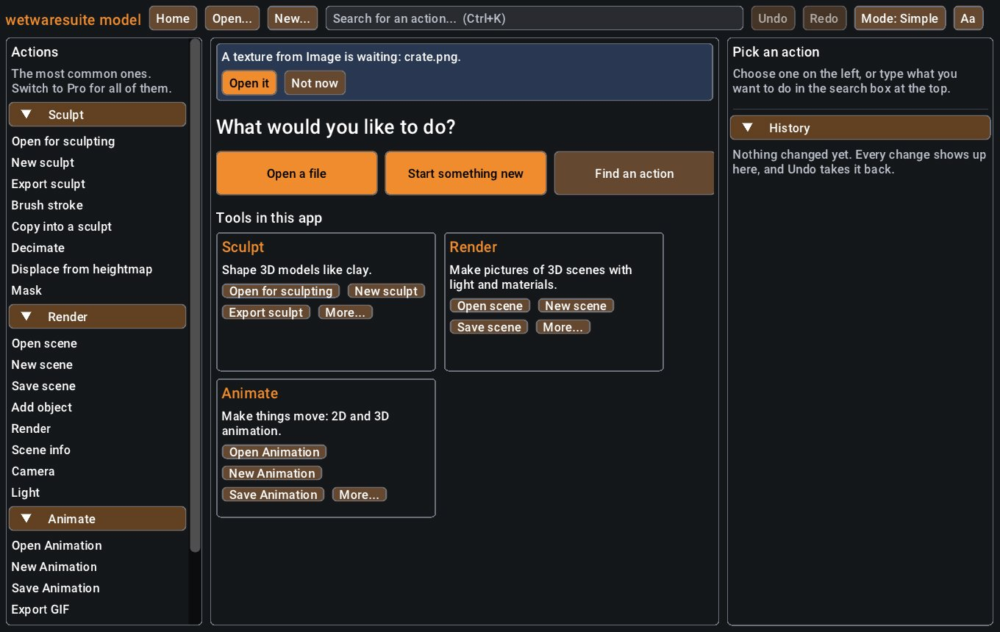

# The wetwaresuite window

wetwaresuite has a desktop window for people who would rather click than type. It sits on top of the
same commands the command line, batch scripts and Claude use, so anything you do in the window can
also be done in a script, and every change you make can be undone.

The window works completely offline. It needs no internet connection, no account and no AI. It also
needs no graphics card: on a computer without one it draws in software.



## 1. Start it

Every app opens its window when you start it without typing anything after its name. In a file
manager (Explorer, Finder, Files), **double-click** the app's program:

| program | what its window is for |
|---------|------------------------|
| `wetwaresuite-image` | photo editing and painting, textures |
| `wetwaresuite-draw` | vector art, logos, fonts, whiteboards and diagrams |
| `wetwaresuite-model` | 3D modeling and sculpting, rendered pictures, animation |
| `wetwaresuite-game` | game assets and game levels |
| `wetwaresuite-cad` | precise parts, technical drawings and floor plans, 3D printing |
| `wetwaresuite-electronics` | circuit diagrams and circuit boards |
| `wetwaresuite-sound` | sound editing and music |
| `wetwaresuite-video` | video editing and screen recording |
| `wetwaresuite-office` | documents, spreadsheets, slides, print layouts and notes |
| `wetwaresuite-maps` | maps, GPS tracks and map data |
| `wetwaresuite-files` | converting, finding and batch-processing files |
| `wetwaresuite` | every tool in one window |

Each app has its own colour, so you can tell the windows apart at a glance. If you installed the
apps with the hub they are in your personal wetwaresuite `bin` folder (see [the apps](apps.md));
if you built them yourself they are in `build/bin/`.

To open a file straight away, **drag it onto the app's icon**, or give it after the name:

```sh
wetwaresuite-image holiday.jpg            # the window, with holiday.jpg open
wetwaresuite-image open a.png b.png       # the same, saying "open" out loud
wetwaresuite-image gui                    # just the window
```

You can also drag a file onto the open window.

Anything else after the name is the command line, exactly as before, and never opens a window:
`wetwaresuite-image list`, `help`, `run`, `batch`, `mcp`, or a command such as
`wetwaresuite-image photo.resize ...`. So scripts and Claude keep working the same way.

If the computer has no screen (a server, or a remote terminal), or the program was built without
the window, starting it with no arguments prints the usual help and one line saying why there is no
window, for example `No window: there is no screen to show it on`. Everything still works from the
command line.

**On Windows** the apps are ordinary console programs, so they work in a terminal. When you
double-click one in Explorer, Windows briefly makes a black console box for it; the app notices that
the box belongs to it alone and closes it, so only the window stays. Started from a terminal
(PowerShell or Command Prompt) it keeps the terminal, so any messages still show there.

### The all-tools launcher

`wetwaresuite-gui` is the same window with a choice of tools. It is built next to the all-in-one
`wetwaresuite` (`build/apps/wetwaresuite/`):

```sh
wetwaresuite-gui                       # every tool
wetwaresuite-gui --app image           # the same window wetwaresuite-image opens
wetwaresuite-gui --app image a.jpg     # and open a picture straight away
wetwaresuite-gui --tools photo,convert # or name the tools yourself
wetwaresuite-gui --list-apps           # the app names
```

## 2. The home screen

When the window opens you see the home screen:

- **Open a file** shows your computer's normal "open" window. Pick a picture (or any file the app
  understands) and it opens.
- **Start something new** lists the things you can create, such as a blank canvas to paint on.
- **Find an action** jumps to the search box (see below).
- **Recent files** lists what you opened before. Click one to open it again.
- One **card per tool** says in a sentence what it does, with buttons for its most common actions.
- When another app has **sent you a file**, a banner at the top says what is waiting, with an
  **Open it** button (see [Sending your work to another app](#8-sending-your-work-to-another-app)).

You can always get back here with the **Home** button at the top left.

## 3. Find any action by typing

Click the search box at the top, or press **Ctrl+K** (Cmd+K on a Mac), and type what you want to do
in your own words: `resize`, `brightness`, `crop`, `blur`, `layer`. Matching actions appear as you
type. You don't have to spell them exactly: `brsh` finds "Brush stroke". Use the arrow keys and
**Enter**, or click one.

## 4. Fill in the form and press Run

Picking an action, from search, the list on the left or a card, shows its form on the right. Every
box is already filled with a sensible value, so often you only press **Run** (or **Ctrl+Enter**).

- **Numbers with a known range** (like opacity 0 to 100) are sliders. Drag them, or Ctrl+click one
  to type a value.
- **Optional numbers** start ticked as **Automatic**: the tool chooses. Untick it to choose yourself.
- **Yes/no** settings are tick boxes, and **choices** are drop-down lists.
- **Colours** have a colour swatch: click it to pick a colour. You can also type `#ff0000` or a name
  like `red`.
- **Files and folders** have a **Browse...** button that shows your computer's normal file window. You
  can also type or paste a path.
- **Document** picks which open file the action works on. It starts on the file you are looking at.

After you press Run, the result shows under the form: **Done** in green with what happened, or
**That didn't work** in red with the reason in plain words, for example *Please fill in "Height".*
Nothing changes when an action fails.

## 5. Simple and Pro

The left side lists actions for each tool. In **Simple** mode (the default) it shows only the most
common ones, about eight per tool, and every box in a form has a short explanation under it.

Press **Mode: Simple** at the top to switch to **Pro**: every action of every tool is listed, and
the explanations move into tooltips (hover over a box's name to read it).

## 6. Looking at your picture

When a file is open, the middle of the window shows it.

- **Scroll** the mouse wheel to zoom in and out around the mouse pointer.
- **Drag** with the right or middle mouse button (or hold the **Space** bar and drag) to move around.
- **Fit** shows the whole picture, **100%** shows it at its real size.
- The list of **Open files** on the left switches between files.

Files that aren't pictures (a 3D model, a song, a map) show their preview picture if the tool has one,
or a one-line summary.

## 7. Painting

In the image app (or any app with the paint tool), pictures get painting tools above the canvas:

1. Choose **Brush**.
2. Click the colour swatch next to it and pick a colour.
3. Pick a **Brush** style (pen, pencil, ink, marker, airbrush, soft, round), a **Size** and an
   **Opacity**.
4. Draw on the picture with the mouse. You see the line while you draw; when you let go it is painted
   for real.

With a **drawing tablet or pen screen**, pressing harder paints thicker or darker lines (depending on
the brush), and flipping the pen over to its eraser end rubs out. **Eraser** rubs out with the mouse.
**Fill** fills the area you click with the colour, like a paint bucket.

Each stroke is one step in the history, so Ctrl+Z takes back exactly one stroke.

### Retouching: Heal and Remove

Two more tools sit next to Fill in the image app. They fix pictures by painting, with no numbers to type,
and work with the mouse or a pen just like the Brush.

- **Heal** makes spots, pimples, dust and scratches disappear. Pick a **Size** a bit bigger than the
  spot and paint over it; when you let go it blends away. To copy texture from a clean area (grass,
  fabric, skin with pores), first hold **Alt** (**Option** on a Mac) and click that clean area, or press
  **Pick source** and then click or tap it. A white circle shows where it copies from. **Forget source**
  goes back to smooth filling.
- **Remove** makes a whole object disappear. Paint over it (it turns see-through red), then press
  **Remove**. Tick **Remove when I let go** to do it straight away. **Clear** throws the red area away.
  Very big areas are refused with a message saying so: remove the object in a few parts.

While it works the picture shows **Working...**; a moment later it is redrawn. Each heal stroke and each
Remove is one step in the history, so Ctrl+Z takes back exactly one. The
[photo tutorial](photo.md#task-7-retouching-remove-spots-blend-in-erase-objects) has more tips.

To start a fresh canvas: **Start something new**, then **New canvas (Paint)**, set the width and
height, and press Run. To keep your work, search for **save**, pick **Save image**, press
**Browse...** to choose where, and Run. Saving as `.ora` keeps the layers.

## 8. Sending your work to another app

The apps are separate programs, but you can hand work from one to the next without hunting for
files. For example: paint a texture in **image**, then put it on a model in **model**.

1. With your picture open, press **Send to...** next to the file's name at the top of the picture.
2. A list of the apps that can use this kind of file appears. Apps you haven't installed are greyed
   out and marked *not installed*.
3. Click one, for example **Model**. The app saves the picture in the format that app wants (here a
   PNG texture) into the shared handoff folder. The result on the right says **Sent to Model**.
4. If that app is installed as its own program, an **Open Model now** button appears under the
   result. Press it to start Model (or start it yourself any way you like).


5. In Model's window, the home screen shows a banner: *A texture from Image is waiting: crate.png.*
   Press **Open it**. The file opens if Model can open that kind of file; otherwise (as with a
   texture) the result says what to do with it next, for example which action puts it on a model.
   **Not now** hides the banner until the next time the window comes to the front.

The banner checks for new files whenever you switch to the window, so you can keep both apps open
side by side and send back and forth.

In the all-in-one `wetwaresuite` window every app is already there, so **Send to...** converts the
file and opens the result in the same window straight away.

### Files that belong to another app

If you open or drop a file that another app is made for, for example a 3D model (`.obj`) on the
image app, a banner says so: *This app can't open head.obj: it's a file for the Model app.* Press
**Open in Model** to start Model with the file open. If Model isn't installed yet the button is
greyed out and the banner says so; install it with the hub (see [the apps](apps.md)).

Every one of these buttons runs a command you can also type, so nothing here needs the window:

| button | command |
|--------|---------|
| Send to... (the list) | `app.targets doc=img1` |
| Send to... > Model | `app.send doc=img1 to=model` |
| Open it | `app.receive` |
| the banner's check | `app.inbox` |
| Open in Model | `app.open_with path=head.obj`, then `app.launch app=model path=head.obj` |

More on handoffs, with whole walkthroughs: [Workflows](workflows.md).

## 9. Undo, redo and history

- **Undo** (Ctrl+Z) takes back the last change. **Redo** (Ctrl+Y or Ctrl+Shift+Z) puts it back.
- The **History** list on the right shows every change in order; the last one is marked `<- now`.

Opening, looking and saving are not changes, so they don't appear in the history.

## 10. Text size and colours

Press **Aa** at the top right:

- **Text size** makes everything bigger or smaller (the window already follows your screen's scale
  setting).
- **Dark** or **Light** colours. Both are high contrast.

## 11. Doing the same thing without the window

Every button runs a command, and the same command works from the command line. For example,
painting a stroke in the window does what this does:

```sh
wetwaresuite run paint.stroke doc=img1 points="[10,10, 50,40, 90,10]" color="#ff0000" size=12
```

The action's name is shown next to it in the search results (for example `photo.resize`), so
you can find it in `wetwaresuite help photo.resize` and use it in [batch scripts](headless-and-batch.md).

The window program can also serve its tools to Claude, just like `wetwaresuite mcp`:

```sh
wetwaresuite-gui mcp --app image
```

This is optional: nothing in the window needs it.

## 12. When something goes wrong

- **"Couldn't show a file window"**: on Linux the Browse button uses your desktop's file window
  (through the desktop portal or `zenity`). If neither is installed, type or paste the path into
  the box instead.
- **"No window: there is no screen to show it on"**, **"Couldn't start the window"** or **"built
  without the window"**: the computer has no screen (a server), or wetwaresuite was built without the
  window (`-DWETWARESUITE_GUI=OFF`, or SDL3 couldn't be downloaded when it was built). Everything
  still works from the command line.
- **"Open in ..." is greyed out**: that app isn't installed next to this one, in your personal
  wetwaresuite `bin` folder, or on your PATH. Install it with `hub install <app>`.
- On Linux, building the window needs the X11 or Wayland development files (`libx11-dev` on
  Debian/Ubuntu). Without them it still builds, but can only draw offscreen.

## For builders

- `cmake -S . -B build` builds the window by default. `-DWETWARESUITE_GUI=OFF` leaves it out.
- SDL3 (zlib license) is used from your system if CMake finds it, else the pinned SDL3 3.2.24 release
  is downloaded once while configuring. With no network, set
  `-DFETCHCONTENT_SOURCE_DIR_SDL3=/path/to/SDL3-3.2.24` to an unpacked copy, or the window is
  skipped and a stub is built in its place. Nothing is downloaded when the program runs.
- Dear ImGui (MIT) is vendored in `third_party/imgui`.
- `wetwaresuite-gui --screenshot shot.bmp` draws a few frames, saves them and quits. With
  `SDL_VIDEO_DRIVER=offscreen` it works on a machine with no screen, which is how the picture above
  was made.
- Every app binary (and the all-in-one `wetwaresuite`) links `wetwaresuite_gui` through
  `apps/common`. Which way a start goes, window or command line, is decided by
  `apps::decideLaunch` (`apps/common/launch.hpp`, unit tested in `test_apps`); the window then opens
  through `apps::runGui` with the name, tools and accent colour from the app table
  (`apps/common/apps.cpp`). `wetwaresuite-gui` goes through the same `runGui`.
- `wetwaresuite-image gui --screenshot shot.bmp` works on every app, like the launcher's.
- With `-DWETWARESUITE_GUI=OFF` the apps link a small stub instead: no SDL3 is needed or downloaded,
  and starting an app with no arguments prints the help and says the window was left out.
- On Windows the apps stay console-subsystem programs so the command line works. Before opening the
  window they call `GetConsoleProcessList`; when it reports only this process (Explorer started it
  and Windows made a console just for it) they call `FreeConsole`, so the console box disappears.
