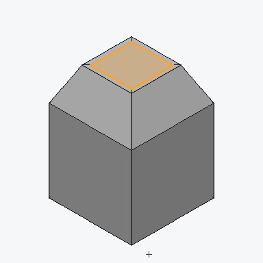
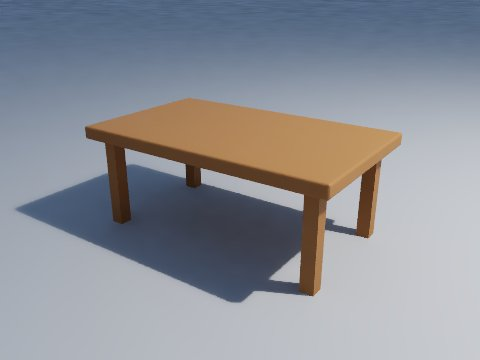
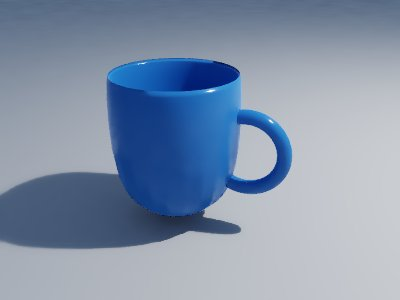

# Model: polygon modeling like Blender

`model` builds 3D models out of boxes, loops and faces, the way Blender does. A model is a **scene** of objects (meshes, lights, cameras and empties) that you place, parent and group into collections. Each mesh is made of quads and n-gons (not just triangles), and you change it in **edit mode** by selecting vertices, edges or faces and running operators: extrude, inset, bevel, loop cut, knife, bisect, subdivide, merge, dissolve, delete, bridge, fill, spin, mirror, symmetrize and more. On top of the mesh sits a **modifier stack**: mirror, array, subdivision surface, solidify, bevel, boolean, decimate, smooth, displace, weld and triangulate, which you can tweak, reorder, apply or remove at any time. Models get UVs (smart, cube, cylinder and sphere projection, seams), materials per face with image textures, vertex colours, and keyframed animation. They render with the [render](render.md) path tracer and export to OBJ, glTF/GLB, FBX and STL.

It is in the **model** app (`wetwaresuite-model`) together with [sculpt](sculpt.md), [render](render.md) and [animate](animate.md), and in the all-in-one `wetwaresuite`.

Each task below is shown up to three ways:

- **Batch**: a script of commands with `-> name` captures and `$name` reuse (see [headless and batch](headless-and-batch.md)). A model only lives inside one process, so building a model is a batch job, or done in the window, or by Claude.
- **CLI**: single commands for finding your way (`list model`, `help model.bevel`) and for one-shot conversions.
- **Claude**: a prompt for Claude over MCP (see [mcp.md](mcp.md)). Every command is a tool named `model_<command>` (`model_extrude`, `model_modifier_add` ...). `wetwaresuite-model mcp` serves the whole app; `wetwaresuite mcp --tools model` serves just this tool.

Every example below was run against the real binary; outputs are copied from those runs, shortened where marked with `...`.

## How model works

**Documents and objects.** `model.new` makes a document with an id like `model1` holding Blender's start-up scene: a 2 m `Cube`, a `Light` and a `Camera`. `model.new empty=true` gives just the light and camera. `model.open` reads a `.wwmodel` file (the native format, which keeps everything), or imports an OBJ (with its `.mtl`), glTF/GLB, FBX, STL or PLY as new objects. Every other command takes `doc=model1`. You can leave `doc=` out when only one model is open. Every change is one undo step (`undo`, `redo`).

**The active object.** Commands work on the active object unless you pass `object=Name`. `model.add` makes the new object active and selected. `model.select_object objects=Leg,Top active=Top` picks several, as clicking with Shift does in Blender. Names are unique: a second `Cube` becomes `Cube.001`.

**Object mode and edit mode.** `model.mode mode=edit` enters edit mode on the active mesh, and `select_mode=vert|edge|face` picks what you select (1, 2, 3 in Blender). Edit operators work on the selection, so a typical step is *select, then operate*. In edit mode, `model.add` adds the new shape into the mesh being edited instead of making a new object, as Blender does.

**Selecting.** `model.select type=` takes `all`, `none`, `invert`, `index` (by number, see `model.elements`), `box` (a world-space box), `rect` (a screen rectangle on a view, visible elements only, like box select), `normal` (faces facing a direction), `material`, `non_manifold`, `sharp` (edges sharper than an angle) and `random`. Add `extend=true` to add to the selection or `deselect=true` to take away. `model.select_loop`, `model.select_grow` (Ctrl+Numpad+) and `model.select_linked` (L) work like Blender's. `model.pick u= v=` selects whatever is under a point on a view, which is how a click in the window selects.

**Space.** Z is up and the front is -Y, as in Blender. Rotations are in degrees, applied X then Y then Z. Edit-mode transforms take a `pivot=` of `median`, `bounds`, `cursor` or `origin`, and `proportional=` for a soft falloff radius; the 3D cursor is set with `model.cursor`.

**Modifiers are non-destructive.** The mesh stays as you built it. The viewport, renders and exports show the result of the stack. `model.info` prints both counts (`8 verts, 6 faces, 50 after modifiers`). `model.modifier_apply` bakes one modifier (or `all`) into the mesh.

**Linked duplicates.** `model.duplicate_object linked=true` (Alt+D) shares one mesh between objects: edit one and they all change. Commands that must change one object only (applying its transform or a modifier, joining into it) first give it its own copy of the mesh.

**Previews.** Every command takes `preview=true` and attaches a PNG of the viewport, with the edit-mode overlay (selected faces in orange, edges and vertex dots) drawn on top, from `view=iso|front|top|...` or `yaw=`/`pitch=`/`zoom=`. This is how Claude sees what it is doing.

**Limits.** A modifier result is capped at 1 000 000 faces, so a command that would pass it (subsurf level 6 on a big mesh) fails up front instead of filling memory.

## Finding your way (CLI)

```text
$ wetwaresuite-model list model
model
  model.add  Add object
  model.apply_transform  Apply transform
  model.bevel  Bevel
  model.bisect  Bisect
  model.bridge  Bridge edge loops
  ...
$ wetwaresuite-model help model.bevel
model.bevel: Bevel
Bevel the selected edges (Ctrl+B) with width offset along each face and segments rounded steps, or the selected vertices with vertices=true (Ctrl+Shift+B).

usage: model.bevel [doc=<string>] [object=<string>] [width=<number>] [segments=<integer>] [vertices=<boolean>] [preview=<boolean>] ...
  width (number)  offset (default 0.1)
  segments (integer)  steps in the rounding (default 1)
  vertices (boolean)  bevel vertices instead of edges (default false)
  ...
```

There are 67 commands:

| What | Commands |
| --- | --- |
| Files | `new`, `open`, `import`, `save`, `export`, `close`, `info`, `elements` |
| Objects | `add`, `object_set`, `select_object`, `duplicate_object`, `delete_object`, `parent`, `join`, `separate`, `origin`, `apply_transform`, `collection`, `shade`, `cursor`, `mode` |
| Selecting | `select`, `select_loop`, `select_grow`, `select_linked`, `pick`, `mark` (seams, sharp edges) |
| Editing | `transform`, `extrude`, `inset`, `bevel`, `loop_cut`, `bisect`, `knife`, `subdivide`, `merge`, `dissolve`, `delete`, `bridge`, `fill`, `spin`, `mirror`, `symmetrize`, `duplicate`, `normals`, `triangulate`, `tris_to_quads`, `smooth_vertices`, `shrink_fatten`, `vertex_color` |
| Modifiers | `modifier_add`, `modifier_set`, `modifier_move`, `modifier_remove`, `modifier_apply` |
| UVs and materials | `uv_unwrap`, `uv_pack`, `uv_export`, `material`, `material_assign` |
| Render and animation | `render`, `to_render`, `keyframe`, `frame`, `render_animation` |

A one-shot conversion is one batch line per step:

```sh
printf 'model.open path=chair.fbx\nmodel.export path=chair.glb\n' | wetwaresuite-model batch
```

## Task 1: edit-mode basics on the default cube

Extrude the top face, taper it, add loop cuts round the sides and bevel the hard edges.

**Batch.**

```text
# edit.txt: edit-mode basics on the default cube
model.new -> m
model.mode doc=$m mode=edit select_mode=face
model.select doc=$m type=normal normal=0,0,1 angle=10
model.extrude doc=$m offset=1
model.transform doc=$m scale=0.5
model.mode doc=$m select_mode=edge
model.elements doc=$m what=edges max=6
model.loop_cut doc=$m edge=0,1 cuts=2
model.select doc=$m type=sharp angle=60
model.bevel doc=$m width=0.08 segments=2
model.select doc=$m mode=vert type=rect rect=0,0,1,0.3 view=front
model.mode doc=$m select_mode=face
model.pick doc=$m u=0.5 v=0.5 view=front
model.export doc=$m path=out/edit_view.png size=512 view=iso
```

```sh
wetwaresuite-model batch < edit.txt
```

```text
new model as model1: 3 objects (1 mesh): 8 vertices, 6 faces; active Cube
edit mode (face)
selected 4 vertices, 4 edges, 1 face
extruded: 4 new elements
transformed 4 vertices
edit mode (edge)
Cube edges: 20 (first 6 shown)
 0-1
 0-2
 ...
loop cut: 12 new edges
selected 20 vertices, 24 edges, 0 faces
bevelled: 56 new faces
selected 18 vertices, 25 edges, 8 faces
edit mode (face)
picked face 20
wrote out/edit_view.png
```

Each command also prints the counts after it (`verts: 88`, `edges: 164`, `faces: 78`, `selected_faces: ...`), shortened above.

- `select type=normal normal=0,0,1` picks faces that point up, so you don't need face numbers.
- `extrude offset=1` pushes the selected faces out along their normal by 1 (E in Blender); the new region stays selected, so `transform scale=0.5` (S) shrinks it.
- `loop_cut edge=0,1 cuts=2` (Ctrl+R) cuts two rings across the loop of quads that edge 0-1 belongs to. `model.elements what=edges` lists the edges to choose from.
- `select type=rect rect=0,0,1,0.3 view=front` is box select on the front view: it only takes vertices you can actually see from there.



**Other edit operators**, all on the current selection:

| Command | Blender | What it does |
| --- | --- | --- |
| `inset thickness=0.1 depth=0` | I | a smaller copy of each face inside it (`individual=true` per face) |
| `bevel width=0.1 segments=3` | Ctrl+B | rounds edges (or vertices with `vertices=true`) |
| `knife points=x,y,z,...` or `knife line=u1,v1,u2,v2 view=top` | K | cuts across faces along a path |
| `bisect point=0,0,0 normal=0,0,1 clear_outer=true fill=true` | | cuts the mesh with a plane, optionally removing one side |
| `subdivide cuts=1 smooth=0` | | splits faces into a grid |
| `merge mode=center\|first\|last\|cursor\|collapse\|distance` | M | joins vertices into one |
| `dissolve` | Ctrl+X | removes vertices/edges/faces but keeps the hole filled |
| `delete type=verts\|edges\|faces\|only_faces` | X | removes elements |
| `bridge` | | joins two selected edge loops with faces |
| `fill` | F | makes a face from the selected border |
| `spin angle=360 steps=16 axis=0,0,1 center=0,0,0` | | sweeps the selection round an axis (lathe) |
| `mirror axis=x` / `symmetrize side=-x` | Ctrl+M | flips, or copies one half onto the other |
| `duplicate offset=0,0,1` | Shift+D | copies the selection |
| `normals action=recalc\|flip` | Shift+N | fixes faces pointing inwards |
| `shrink_fatten offset=0.1` | Alt+S | moves vertices along their normals |
| `smooth_vertices factor=0.5 repeat=2` | | relaxes the selection |
| `triangulate` / `tris_to_quads` | Ctrl+T / Alt+J | |
| `vertex_color color=#ff0000` | | paints the selection |
| `separate type=selected\|loose\|material` | P | splits into new objects |

## Task 2: a table from the default cube, with modifiers

The cube becomes the table top; one leg in the corner is mirrored to all four corners by a mirror modifier, so changing the one leg changes them all.

**Batch.**

```text
# table.txt: a table from the default cube, legs by mirror modifier
model.new -> m
# the cube becomes the top: 2 x 1.2 x 0.1, at table height
model.object_set doc=$m object=Cube scale=1,0.6,0.05 location=0,0,0.75
model.apply_transform doc=$m object=Cube
model.modifier_add doc=$m object=Cube type=bevel width=0.02 segments=3
# one leg, moved into the corner in edit mode, mirrored to all four corners
model.add doc=$m type=cube size=0.1 name=Leg
model.mode doc=$m mode=edit
model.select doc=$m type=all
model.transform doc=$m scale=1,1,7.0 translate=0.85,0.45,0.35
model.mode doc=$m mode=object
model.modifier_add doc=$m object=Leg type=mirror axis=xy
model.material doc=$m name=Wood color=#9a6b3f roughness=0.55 object=Leg
model.material_assign doc=$m object=Cube material=Wood
model.info doc=$m
model.render doc=$m path=out/table.png width=480 height=360 samples=24 camera=view yaw=35 pitch=22 ground=true
model.export doc=$m path=out/table_view.png size=512 view=iso
model.export doc=$m path=out/table.obj
model.export doc=$m path=out/table.glb
model.save doc=$m path=out/table.wwmodel
```

```text
new model as model1: 3 objects (1 mesh): 8 vertices, 6 faces; active Cube
updated 1 object
applied the transform of 1 object
added Bevel — Cube: Bevel
added Leg
edit mode (vertex)
selected 8 vertices, 12 edges, 6 faces
transformed 8 vertices
object mode
added Mirror — Leg: Mirror
material Wood #9a6b3f on Leg
assigned Wood to 6 faces of Cube
4 objects (2 meshes): 16 vertices, 12 faces; active Leg
  Cube (mesh Cube: 8 verts, 6 faces, 50 after modifiers) at 0,0,0.75, materials Material Wood, modifiers Bevel
  Light (light point 1000) at 4.076,1.005,5.904 rot 37.3,3.16,106.9
  Camera (camera) at 7.359,-6.926,4.958 rot 63.56,0,46.69
  Leg (mesh Leg: 8 verts, 6 faces, 24 after modifiers) at 0,0,0, materials Wood, modifiers Mirror, selected, active
materials: Material(#cccccc) Wood(#9a6b3f)
collections: Collection
cursor 0,0,0; frame 1 of 1..48 at 24 fps
rendered 480x360, 190 triangles in 1.698 s
wrote out/table_view.png
wrote out/table.obj: 2 objects, 74 polygons
wrote out/table.glb: 2 objects, 188 triangles
saved out/table.wwmodel
```



- `apply_transform` (Ctrl+A) bakes the scale into the mesh so the bevel is even on every edge.
- The mirror modifier mirrors across the object's own origin: the leg's origin is still at 0,0,0, which is why the leg was moved in edit mode rather than with `object_set location=`.
- Now change the legs: `model.modifier_set object=Leg modifier=Mirror axis=x` gives only two, `model.modifier_remove` drops it, `model.modifier_move modifier=Bevel to=0` (or `direction=up`) reorders a stack, and `model.modifier_apply object=Leg` turns it into four real legs.
- OBJ keeps the quads, materials (in `table.mtl`), UVs and smoothing; glTF, FBX and STL are triangulated. Exports take `modifiers=false` (the bare meshes), `selected=true` or `objects=Leg,Cube`.

**Other modifiers.** `array count=5 relative=1.1,0,0` (or `constant=` in units), `subsurf levels=2` (Catmull-Clark), `solidify thickness=0.05` (gives a sheet thickness), `bevel width= segments= angle=30`, `boolean cutter=Name operation=difference|union|intersect`, `decimate ratio=0.3` (or `decimate=planar angle=5`), `smooth factor=0.5 repeat=5`, `displace strength=0.2 scale=1` (noise, or `texture=height.png`), `weld distance=0.001` and `triangulate`.

## Task 3: a mug by box modeling

Inset and extrude the top of a cylinder to hollow it, join a torus as the handle, then smooth it all with a subdivision surface.

**Batch.**

```text
# mug.txt: box-modelled mug: inset and extrude a cylinder, add a handle, smooth it
model.new empty=true -> m
model.add doc=$m type=cylinder vertices=24 radius=0.5 depth=1.2 location=0,0,0.6 name=Mug
model.mode doc=$m mode=edit select_mode=face
model.select doc=$m type=normal normal=0,0,1 angle=10
model.inset doc=$m thickness=0.06
model.extrude doc=$m offset=-1.05
model.mode doc=$m mode=object
model.add doc=$m type=torus major_radius=0.28 minor_radius=0.06 major_segments=24 minor_segments=8 location=0.55,0,0.62 rotation=90,0,0 name=Handle
model.select_object doc=$m objects=Handle,Mug active=Mug
model.join doc=$m
model.modifier_add doc=$m type=subsurf levels=2
model.shade doc=$m type=smooth
model.material doc=$m name=Glaze color=#2f6fb0 roughness=0.15
model.info doc=$m
model.export doc=$m path=out/mug_view.png size=512 view=iso
model.render doc=$m path=out/mug.png width=400 height=300 samples=24 camera=view yaw=20 pitch=25 ground=true
model.export doc=$m path=out/mug.fbx
model.export doc=$m path=out/mug.stl
```

```text
new model as model1: 2 objects (0 meshes): 0 vertices, 0 faces
added Mug
edit mode (face)
selected 24 vertices, 24 edges, 1 face
inset: 24 new faces
extruded: 24 new elements
object mode
added Handle
2 objects selected
joined 1 object into Mug
added Subsurf — Mug: Subsurf
shaded 266 faces smooth
material Glaze #2f6fb0 on Mug
3 objects (1 mesh): 288 vertices, 266 faces; active Mug
  ...
  Mug (mesh Mug: 288 verts, 266 faces, 4416 after modifiers) at 0,0,0.6, materials Glaze, modifiers Subsurf, selected, active
...
wrote out/mug_view.png
rendered 400x300, 8834 triangles in 2.031 s
wrote out/mug.fbx: 1 object, 8832 triangles
wrote out/mug.stl: 1 object, 8832 triangles
```



- Entering edit mode selects everything, as in Blender, so `select type=normal` replaces the selection with just the top.
- A negative `extrude offset` pushes the inset face down into the cylinder, leaving a 6 cm wall.
- `model.add type=` takes `cube`, `plane`, `circle`, `grid`, `cylinder`, `cone`, `uv_sphere`, `ico_sphere`, `torus`, plus `empty`, `light` and `camera`.
- `join` (Ctrl+J) merges the selected objects into the active one; `separate type=loose` splits them apart again.

## Task 4: windows cut with a boolean, then UVs and a texture

**Batch.**

```text
# wall.txt: cut three windows with one boolean, then UV-unwrap and texture it
model.new -> m
model.object_set doc=$m object=Cube name=Wall scale=2,0.1,1 location=0,0,1
model.apply_transform doc=$m object=Wall
# one window cutter, repeated by an array modifier
model.add doc=$m type=cube size=0.5 location=-1.2,0,1.1 scale=1,1,1.6 name=Window
model.modifier_add doc=$m object=Window type=array count=3 relative=2.4,0,0
model.modifier_add doc=$m object=Wall type=boolean cutter=Window operation=difference
model.info doc=$m
model.modifier_apply doc=$m object=Wall
model.uv_unwrap doc=$m object=Wall method=smart
model.uv_export doc=$m object=Wall path=out/wall_uv.png size=512
model.material doc=$m name=Bricks texture=out/wall_uv.png roughness=0.8 object=Wall
model.render doc=$m path=out/wall.png width=480 height=300 samples=16 camera=view yaw=20 pitch=10
```

```text
...
added Array — Window: Array
added Boolean — Wall: Boolean
4 objects (2 meshes): 16 vertices, 12 faces; active Window
  Wall (mesh Cube: 8 verts, 6 faces, 21 after modifiers) at 0,0,1, materials Material, modifiers Boolean
  ...
  Window (mesh Window: 8 verts, 6 faces, 18 after modifiers) at -1.2,0,1.1 scale 1,1,1.6, modifiers Array, hidden, selected, active
...
applied Boolean
unwrapped into 18 islands
wrote out/wall_uv.png
material Bricks #cccccc on Wall
rendered 480x300, 112 triangles in 0.1882 s
```

- The boolean uses the cutter **with its own modifiers**, so the array's three boxes cut three windows. The cutter is hidden (`hide=false` keeps it shown). Move the `Window` object and the holes move, until you apply.
- The result is cleaned up into n-gons (21 faces here, not hundreds of triangles), so it stays easy to edit.
- `uv_unwrap method=smart` splits by angle; `cube`, `cylinder` and `sphere` project, `planar` projects along an `axis=`, and `unwrap` cuts along seams you marked with `model.mark type=seam` (or `mark type=seam angle=60` to mark every sharp edge). `uv_pack margin=0.02` repacks the islands.
- `uv_export` draws the layout as a PNG you can paint over in [paint](paint.md), then use as `texture=`. Materials take `color`, `roughness`, `metallic`, `emission`, `transmission`, `ior`, `alpha`, `texture` (with `texture_scale`) and `preset=` (any [render](render.md) preset such as `gold` or `glass`); `model.material_assign` puts one on the selected faces in edit mode, or on a whole object.

Booleans and decimate rebuild the mesh, so UVs and per-face materials on the result are lost: unwrap after applying, as here.

## Task 5: animate a bouncing cube

**Batch.**

```text
# bounce.txt: key a jump and a spin, then render a GIF
model.new -> m
model.material doc=$m name=Material color=#e0662e roughness=0.4
model.modifier_add doc=$m object=Cube type=bevel width=0.15 segments=3
model.keyframe doc=$m object=Cube frame=1 location=0,0,1 rotation=0,0,0
model.keyframe doc=$m object=Cube frame=13 location=0,0,3 rotation=0,0,90
model.keyframe doc=$m object=Cube frame=25 location=0,0,1 rotation=0,0,180
model.frame doc=$m start=1 end=25 fps=24 frame=7
model.render_animation doc=$m path=out/bounce.gif width=240 height=180 step=2 camera=view yaw=30 pitch=15 ground=true
model.render_animation doc=$m path=out/frames/bounce.png width=160 height=120 start=1 end=3
```

```text
...
keyed 6 channels at frame 1
keyed 6 channels at frame 13
keyed 6 channels at frame 25
frame 7 of 1..25
rendered 13 frames to out/bounce.gif
rendered 3 frames to out/frames/bounce.png
```

- `keyframe` keys whatever you pass (`location=`, `rotation=`, `scale=` set the values first; `channels=location.z` keys just one) and eases between keys, or `interp=linear|constant`. `delete=true` removes the keys at a frame. `model.frame frame=7` moves the scene to that frame, so `info`, `render` and exports show the object where it is then.
- `render_animation` writes a GIF, or numbered PNGs (`bounce_0001.png` ...) for any other name. With `camera=view` (or no camera object) the camera is fitted once over all frames, so the cube moves inside a still shot. Use [cut](cut.md) to turn PNG frames into an MP4.

## Rendering

`model.render path=out.png` renders with the path tracer: `width`, `height`, `samples`, `ground=true`, `denoise=`, `frame=`, or `mode=preview` for a fast rasterized picture. It looks through the scene's `Camera` object unless you pass `camera=view` (with `yaw`/`pitch`/`zoom`), and uses the scene's lights, or a sun when there are none. `model.to_render` copies the scene into a [render](render.md) document for staging with more lights and materials. `model.export path=view.png` is the fast viewport picture instead (no lighting, edit overlay included).

## Sending a model to other apps

`app.send doc=model1 to=game` sends a GLB to asset forge, `to=cad` an STL to the slicer, and `to=image` a rendered PNG to photo. Files the model app receives open by type: `.obj`, `.fbx` and `.wwmodel` with `model.open`, meshes such as `.glb` and `.ply` in sculpt; `model.import path=FILE` brings any of them into an open model as new objects. See [workflows](workflows.md).

## The window

Open the model app (or a `.wwmodel`, `.obj` or `.fbx` file) and the model shows in the 3D view:

1. **Look around**: drag to turn, right-drag to move, scroll to zoom, double-click to fit (see [3D view](3d-view.md)).
2. **Click to select**: in object mode a click selects the object under the mouse; in edit mode it selects the vertex, edge or face under it, depending on the select mode. Hold **Ctrl** to toggle what you click in or out of the selection. Clicking empty space clears it.
3. **Move it**: whatever is selected gets red, green and blue arrows. Drag one to slide the selection along X, Y or Z, or press **G** (move), **R** (rotate) or **S** (scale) and move the mouse; X, Y or Z then locks an axis, a click keeps it and Esc puts it back. Both run `model.drag`; `model.pivot` says where the arrows go.
4. **Run an operator**: press **Ctrl+K** and type what you want: "extrude", "loop cut", "bevel", "add modifier", "edit mode". The form shows the same parameters as `help model.extrude`, and the model shows the result live while you change them (untick **Live preview** to stop); the button keeps it. Selected faces show in orange.
5. **Undo** with Ctrl+Z as usual: every operator is one step.

## Claude

Connect `wetwaresuite-model mcp` (see [mcp.md](mcp.md)). Claude calls `model_new`, `model_mode`, `model_select`, `model_extrude` and the rest, and passes `preview=true` to see the viewport with the selection overlay after each step. Example prompts:

> Make a low-poly wooden stool: a round seat, three splayed legs, keep it under 200 faces, and export it as stool.glb.

> Open chair.fbx, add a bevel modifier to the frame with 2 segments, render it from the front three-quarters on a ground plane, and save chair.wwmodel.

> In the open model, select the top face of the cube, inset it by 0.1, extrude it up by 0.5 and show me a preview.

> Unwrap the wall with smart UVs, export the layout as wall_uv.png so I can paint it, then use it as the texture.

Claude finds faces by direction (`model_select type=normal`), by screen position on a preview (`type=rect`, `model_pick`), or by number from `model_elements`.
