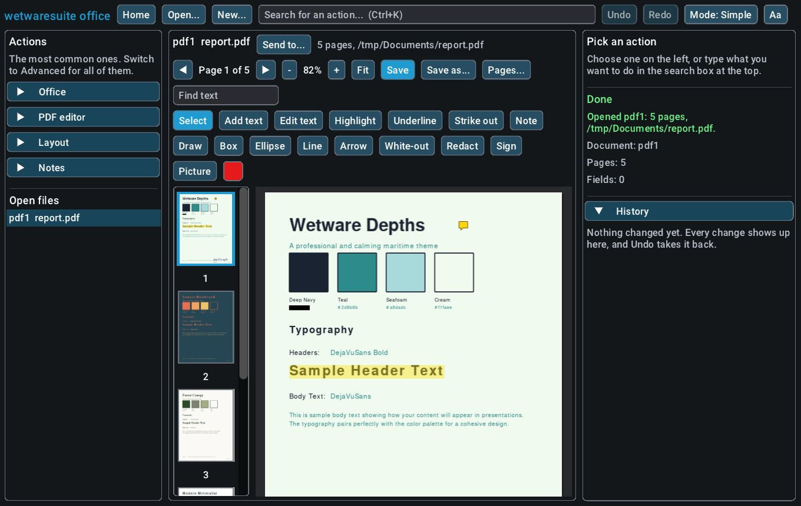

# PDF editor: view, mark up, edit, redact, fill in and sign PDFs

`pdf` is an Acrobat-style editor for any PDF. You can:

- read a PDF and search its text
- change the PDF's own text and add new text
- highlight, underline and strike out text, and pin sticky notes
- draw freehand, add boxes, ellipses, lines and arrows
- white out an area, or redact text so it is really removed from the file
- place pictures and signatures, and fill in forms
- turn, delete, move, insert and extract pages, and set the document info

It ships in the **office** app (`wetwaresuite-office`) and in the all-in-one `wetwaresuite`. Everything you do in the window is a `pdf.*` command, so the same steps work from the command line, in batch scripts and for Claude over MCP.

Nothing changes on disk until `pdf.save`. Every edit can be undone, and the edits you make here stay editable until you save.

## In the window



Open a PDF with **Open...**, by dropping it on the window, or with `wetwaresuite-office report.pdf`. The page fills the middle of the window, with thumbnails of every page beside it.

- **Moving around.** The arrows or PageUp/PageDown change the page. Clicking a thumbnail goes to that page. The mouse wheel scrolls and turns the page at the end, and Ctrl+wheel zooms at the mouse. **Fit** fits the page width. Right-drag, middle-drag or Space+drag pans the page.
- **Find text.** Type in the box and press Enter. Matches get an outline and **Next match** steps through them. **Highlight all** marks every match, and **Redact all** removes every match from the file.
- **Pages...** turns the current page left or right, adds a blank page after it, inserts pages from another PDF, moves it up or down, or deletes it. **Save some pages as a new PDF** extracts a page range.
- **Save** writes over the file you opened. **Save as...** asks for a new path. It also has *flatten*, which burns comments into the pages so every viewer shows them the same way, and *pages*, which saves only some pages.

The tools:

| Tool | How to use it |
| --- | --- |
| Select | Click an edit to pick it. Drag it to move it. Delete removes it, and **Recolour** gives it the current colour. Double-click a text edit or note to change its words. Click a form box to fill it in (a checkbox flips with one click). |
| Add text | Click where the text starts and type. Ctrl+Enter finishes. The size slider sets the point size. |
| Edit text | Point at a line of the PDF's own text (it gets an outline), click and change it. The old words are taken out of the page and the new ones are written in their place. |
| Highlight, Underline, Strike out | Drag over text. These become real PDF comments that Acrobat, Preview and browsers show and can edit. |
| Note | Click to pin a sticky-note comment. |
| Draw | Draw freehand with the mouse or a pen. Set the line width with the slider. |
| Box, Ellipse, Line, Arrow | Drag the shape. |
| White-out | Drag to cover something in white (or the picked colour). The text under it is still in the file. |
| Redact | Drag over what must go. A black box is drawn, and the text under it is removed from the page when you save. Copying, searching or opening the file in another editor won't bring it back. |
| Sign | Drag a box (or click) and type your name to make a handwriting-style signature. Use **Draw** to sign by hand. |
| Picture | Click where it goes, then pick the file in the form on the right. |

The colour square picks the colour for the next edit. Ctrl+Z and Ctrl+Y undo and redo any step, including page changes. Every action is also listed on the left under **PDF editor**, with a form for its full set of options.

## From the command line and batch scripts

Single commands open the file on their own, so use a batch script (see [headless and batch](headless-and-batch.md)) to do several things to one PDF. Coordinates are in points (1/72 inch) from the page's top-left corner, as the page is shown, so a turned page is measured the way it looks. `pdf.view` gives the page size in points, and `pdf.find` and `pdf.text` give the boxes of text.

For example, `wetwaresuite batch edit.txt` with this `edit.txt`:

```
pdf.open path=report.pdf
pdf.find text="Sample Header"
pdf.replace_text find="Ocean Depths" replace="Wetware Depths"
pdf.highlight text="Sample Header Text" page=1
pdf.note page=1 x=400 y=60 text="love this header"
pdf.redact text="#1a2332" page=0
pdf.sign page=1 x=380 y=700 name="Ann Example" date=true
pdf.marks
pdf.page_delete pages=6-10
pdf.save path=report-edited.pdf
```

Output, shortened:

```
opened pdf1: 10 pages, report.pdf
10 matches for "Sample Header"
  page 1 at 50, 355.73 (240.78 x 28)
  page 2 at 50, 355.73 (240.32 x 28)
  ...
replaced 1 place
highlight x1 (last edit 2 on page 1)
added a note on page 1 (edit 3)
redacted 1 place
signed on page 1 (edit 5)
6 edit(s)
  1: page 1 text at 50, 51.2 "Wetware Depths"
  2: page 1 highlight at 50, 355.73
  3: page 1 note at 400, 60 "love this header"
  4: page 1 redact at 49.5, 232.66
  5: page 1 signature at 380, 700 "Ann Example"
  6: page 1 text at 380, 752 "2026-10-18"
```

With `text=`, `pdf.highlight` and `pdf.redact` work on the matches of that text. `page=0` means every page, and `page=N` means that page only. Without `text=`, they take an area as `x y w h`.

### The commands

| Command | What it does |
| --- | --- |
| `pdf.open path=` / `pdf.new pages= size= landscape=` | Open a PDF, or start blank pages (a4, letter, legal, a3, a5). |
| `pdf.save path= flatten= pages=` | Write the PDF. `flatten=true` burns comments into the pages. `pages=2-4` saves only those pages. |
| `pdf.info`, `pdf.metadata title= author= subject= keywords=` | Pages, sizes, fields and edits; set the document info. |
| `pdf.view page= dpi= output=` | A PNG of a page with every edit (attached for Claude, and written to `output=`). |
| `pdf.text pages= boxes=`, `pdf.find text= match_case= page=` | Read the text line by line; find where text appears. |
| `pdf.replace_text find= replace= page= all= match_case=` | Change the PDF's own text. An empty `replace` deletes it. |
| `pdf.add_text page x y text size font bold italic color w` | Write new text. `w` wraps it to a width. |
| `pdf.highlight kind=highlight\|underline\|strikeout`, `pdf.note` | Text markup and sticky notes, saved as real comments. |
| `pdf.draw points=x1,y1,x2,y2,...` or `strokes="x y x y; x y x y"`, `pdf.shape kind=rect\|ellipse\|line\|arrow` | Ink and shapes. |
| `pdf.whiteout`, `pdf.redact` | Cover an area, or remove text for good. |
| `pdf.image path= x y w h`, `pdf.sign name=\|image=\|strokes= date=` | Pictures and signatures. |
| `pdf.fields`, `pdf.fill name= value=` or `values="A=1; B=Yes"` | Read and fill in forms. Checkboxes take Yes/No. |
| `pdf.marks`, `pdf.mark_move`, `pdf.mark_edit`, `pdf.mark_delete` | List, move, change and remove the edits made here. |
| `pdf.annotations`, `pdf.annotation_delete` | List and remove comments and links the file already had. |
| `pdf.page_rotate`, `pdf.page_delete`, `pdf.page_move`, `pdf.page_insert` | Page changes. `pdf.page_insert path=other.pdf pages=1-3 after=2` merges in pages from another PDF. |

`wetwaresuite help pdf.<command>` lists every parameter.

### Forms

```
pdf.open path=application.pdf
pdf.fields
pdf.fill values="Name=Ann Example; Agree=Yes"
pdf.save path=application-filled.pdf
```

`pdf.fields` lists each field with its type, value and choices (`rows`). It also lists where each box sits on the page (`widgets`: name, page, x, y, w, h). Filled fields get a fresh appearance, so every viewer shows the new values. `flatten=true` on save turns the form into plain page content.

## With Claude (MCP)

`wetwaresuite mcp --tools pdf` (or `wetwaresuite-office mcp`) serves these commands to Claude. `pdf_view` returns a picture of the page, so Claude can check its own work. A typical session:

> Open ~/Downloads/lease.pdf, black out every mention of my phone number 0412 555 019, fill in the tenant name as Ann Example, sign the last page at the bottom right, and save it as lease-signed.pdf.

Claude calls `pdf_open`, then `pdf_redact text="0412 555 019" page=0`, `pdf_fields` and `pdf_fill name=Tenant value="Ann Example"`. To place the signature, it calls `pdf_view page=<last>` to see the page and `pdf_sign`. It finishes with `pdf_view` to check the result and `pdf_save path=~/Downloads/lease-signed.pdf`.

## What it can't do yet

- Password-protected (encrypted) PDFs don't open.
- Edited text is written in the suite's built-in fonts, not the PDF's own embedded font, so a changed line may look slightly different from the text around it. When the new words are shorter or longer, the rest of the line doesn't move.
- Text inside a form XObject can be covered with white-out but not removed (`pdf.replace_text` says so when that happens).
- Scanned pages have no text layer to search or edit.
