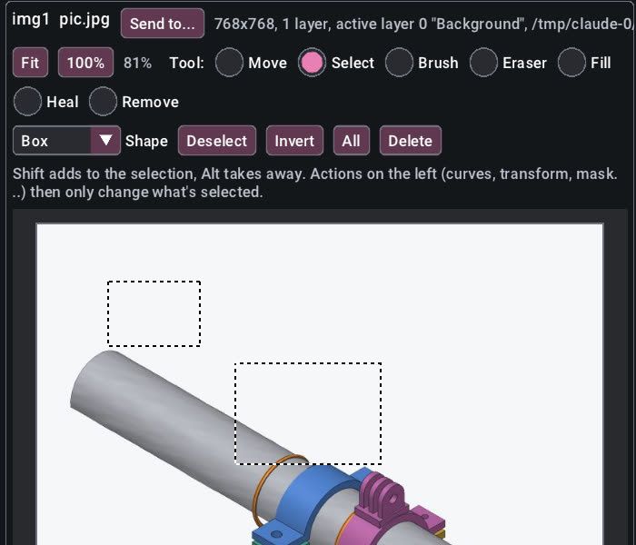

# Photo: editing images

`photo` is the suite's image editor: open, adjust, crop, resize, rotate, select parts of the picture (including the main subject), mask layers, bend tones with curves, free-transform, warp and liquify, retouch, batch-process folders and save. Adjustment layers (levels, curves, hue/saturation, colour balance, black and white, exposure, vibrance, gradient map, selective colour and more) change the look without touching the pixels, and a filter menu covers blurs, sharpening, noise, stylize, render, distort and lens correction. It reads PNG, JPEG, BMP, TGA, GIF, HDR, PNM, layered Photoshop `.psd` and layered OpenRaster (`.ora`), and saves those plus TIFF and WebP. Painting, layer groups, layer styles and text live in [paint](paint.md), which works on the same documents.

Every task below is a command, and the desktop window (see [the window tutorial](gui.md)) runs exactly these commands from its buttons, sliders and search box. Each task is shown three ways:

- **CLI**: a single `wetwaresuite` command, for jobs that read files and write files.
- **Batch**: a script for multi-step edits (see [headless and batch](headless-and-batch.md)).
- **Claude**: a prompt for Claude over MCP and the tools it will call (see [mcp.md](mcp.md)).

New to the CLI? Start with [getting started](getting-started.md).

## Task 1: resize a folder of photos for the web

You have a folder of 6000-pixel camera JPEGs and want light copies for a website.

**CLI.** `photo.batch` does the whole folder in one command. Originals stay as they are; results go to the output folder, which is created if needed:

```sh
$ wetwaresuite photo.batch input_dir=photos output_dir=web max_size=1600 quality=82
processed 3 of 3 images into web
processed: 3
failed: 0
```

`max_size` fits each image within 1600 px on its longest side (portrait and landscape alike) and never enlarges smaller images. Add `recursive=true` to include subfolders (the folder structure is kept), `auto_contrast=true` to give flat photos some punch, or an effect:

```sh
wetwaresuite photo.batch input_dir=photos output_dir=thumbs max_size=300 format=png effect=grayscale
```

Run it again and results that already exist are skipped; pass `overwrite=true` to redo them. A source image is never replaced, even if `output_dir` is the input folder.

**Batch.** Use a script when each photo needs different treatment, or more than `photo.batch` offers, such as a crop:

```text
photo.open path=photos/holiday-1.jpg -> p
photo.crop doc=$p x=500 y=0 width=2000 height=2000
photo.resize doc=$p width=1080
photo.save doc=$p path=square/holiday-1.jpg quality=85
```

The [batch tutorial](headless-and-batch.md#generating-scripts-from-the-shell) shows how to run this for every file with a shell loop.

**Claude.**

> Make web copies of every photo in /home/me/Pictures/trip: longest side 1600 px, JPEG quality 82, into /home/me/Pictures/trip-web.

Claude calls `photo_batch` with `input_dir`, `output_dir`, `max_size=1600` and `quality=82`.

## Task 2: fix an underexposed photo

The picture came out dark and flat.

**Batch.** Work from the gentlest fix to the strongest, and check the result:

```text
# fix-dark.txt
photo.open path=dark.jpg -> pic
# 1. stretch the tones so the darkest pixel is black and the brightest is white
photo.levels doc=$pic auto=true
# 2. brighten by half a stop
photo.adjust doc=$pic kind=exposure amount=0.5
# 3. a little extra colour, mostly in the dull areas
photo.adjust doc=$pic kind=vibrance amount=20
photo.save doc=$pic path=dark-fixed.jpg quality=90
```

```sh
wetwaresuite batch fix-dark.txt
```

Other useful tools for this job:

- `photo.levels doc=$pic black=10 white=240 gamma=1.2` for manual control: pixels at or below `black` become black, at or above `white` become white, and `gamma` above 1 lifts the midtones without touching the extremes.
- `photo.adjust kind=gamma amount=1.3` brightens shadows and midtones only.
- `photo.adjust kind=temperature amount=15` warms a cold indoor shot (negative values cool it down).
- `photo.pick_color doc=$pic x=600 y=400` prints a pixel's colour, handy to check a highlight is not blown (`#ffffffff`).

**CLI.** For a whole folder of dark photos, `photo.batch` has auto contrast built in:

```sh
wetwaresuite photo.batch input_dir=party output_dir=party-fixed auto_contrast=true
```

**Claude.**

> /home/me/Pictures/party.jpg is too dark. Fix the exposure without blowing the highlights, show me a preview, and save it as party-fixed.jpg in the same folder.

Typical calls: `photo_open`, `photo_levels` with `auto=true` and `preview=true`, `photo_adjust` (`kind=exposure` or `gamma`, with `preview=true` to compare), maybe `photo_pick_color` on the brightest area, then `photo_save`. If you do not like a step, say "undo that" and Claude calls `undo`.

## Task 3: crop, straighten and frame a photo

**Batch.**

```text
# frame.txt: crop to the subject, turn it upright, add a cream mat
photo.open path=photos/holiday-2.jpg -> p
# keep a 2000x1500 area starting 500 px from the left, 250 px from the top
photo.crop doc=$p x=500 y=250 width=2000 height=1500
# the camera was on its side: turn 90 degrees counter-clockwise
photo.rotate doc=$p angle=-90
photo.flip doc=$p direction=horizontal
photo.resize doc=$p width=1200
# grow the canvas by 60 px on each side; the new area is transparent
photo.canvas_size doc=$p width=1320 height=1720
# put a cream layer underneath so the border has a colour
paint.layer_add doc=$p name=Mat fill=#f4f1ea
paint.layer_move doc=$p to=0
photo.save doc=$p path=framed.jpg quality=88
```

Notes:

- `photo.rotate` turns by any angle. Quarter turns (90, 180, 270, negative for counter-clockwise) are exact. To straighten a crooked horizon use a small angle with `fit=crop`, which cuts away the empty corners: `photo.rotate doc=$p angle=-2.5 fit=crop`. `fit=expand` (the default) grows the canvas instead and `fit=keep` keeps its size; `background=` colours the new corners.
- `photo.canvas_size` keeps the pixels where `anchor` says (default `center`; also `top-left`, `bottom`, and so on) and fills the new area with transparency. Formats without transparency, such as JPEG, show it as white; the two `paint.layer_*` lines give it a colour instead. Photo and paint work on the same documents, so mixing them is normal.
- Crop, resize, rotate, flip and canvas size apply to every layer, so layers stay aligned.

**Claude.**

> Crop /home/me/scan.jpg to just the photo in the middle, turn it upright, put a 60 px cream border around it and save it as scan-framed.jpg.

Claude calls `photo_open`, `photo_preview` to find the edges, `photo_crop`, `photo_rotate`, `photo_canvas_size`, `paint_layer_add` with `fill`, `paint_layer_move`, `photo_preview` to check, and `photo_save`.

## Task 4: effects

`photo.effect` applies one filter to a layer (or `all_layers=true`). `amount` means something different for each effect:

| kind | amount |
| --- | --- |
| `grayscale`, `invert`, `sepia` | ignored |
| `blur`, `sharpen` | radius in px (try 1 to 3 for sharpen) |
| `threshold` | level 0..255; brighter pixels become white, the rest black |
| `posterize` | number of levels per channel (try 4) |
| `pixelate` | block size in px |
| `noise` | strength 0..100 |

**Batch.**

```text
photo.open path=portrait.jpg -> p
photo.effect doc=$p kind=sepia
photo.effect doc=$p kind=noise amount=8
photo.save doc=$p path=portrait-old.jpg
```

**CLI** (a whole folder): `wetwaresuite photo.batch input_dir=in output_dir=out effect=sharpen effect_amount=1`

**Claude.** "Give /home/me/portrait.jpg an old-photo look and save it as portrait-old.jpg" leads to `photo_open`, `photo_effect` (`sepia`, then `noise`) with previews, and `photo_save`.

## Task 5: check an image and its layers

```text
photo.open path=artwork.ora -> a
photo.info doc=$a
```

```
800x500, 5 layers, active layer 4 "Ink", artwork.ora
  4: Ink (normal, opacity 100%, active)
  3: Hills (normal, opacity 100%)
  2: Sun (screen, opacity 90%)
  1: Layer 1 (normal, opacity 100%)
  0: Background (normal, opacity 100%)
```

Layers are listed top first and numbered from 0 at the bottom. Edits such as `photo.adjust` apply to the active layer unless you pass `layer=` or `all_layers=true`. To work with layers (add, blend modes, merge), see [paint](paint.md).

## Task 6: sharper resizing, and how fast is my computer?

**Choosing a resize filter.** `photo.resize` has four ways to work out the new pixels. You only need to pick one when the default doesn't look right:

| Filter | Looks like | Use it for |
| --- | --- | --- |
| `bilinear` (default) | smooth | everyday resizing; when shrinking a lot (more than half) it automatically averages whole areas so there is no shimmer or jagged edges |
| `area` | smooth, a little soft | making small thumbnails from big photos |
| `lanczos` | crisp | photos you care about, shrinking or enlarging: edges and text stay sharp. It's a bit slower than the others |
| `nearest` | blocky | pixel art and icons, where you want hard square pixels |

**CLI.**

```sh
wetwaresuite photo.resize doc=$p width=1600 filter=lanczos
```

**Batch.**

```text
photo.open path=poster.png -> p
photo.resize doc=$p percent=50 filter=lanczos
photo.save doc=$p path=poster-half.png
```

**Claude.**

> Shrink poster.png to half size, keeping it as sharp as possible.

Claude calls `photo_open`, then `photo_resize` with `percent=50` and `filter=lanczos`, then `photo_save`.

**Speed test.** `photo.benchmark` makes a test picture in memory (nothing is opened or saved) and times the heavy operations: blur, the resize filters, blending three layers, a colour adjustment and the zoom-out copies the window keeps (the mipmap pyramid). Each time is the best of three runs. It's handy for comparing two computers, or for seeing what a big canvas will feel like before you start:

```sh
$ wetwaresuite photo.benchmark size=4096
4096x4096 px on 8 threads, sse2:
  blur (radius 8) 210.4 ms
  resize to half, bilinear 31.2 ms
  ...
```

(Your numbers will differ.) `size` is the test picture's width and height (default 2048); `threads=1` shows how fast it is on one CPU core, and the default `threads=0` uses all of them. The picture operations split their work across every core, and the result is exactly the same whatever the number of threads.

The busiest loops also use the CPU's vector instructions (SSE2 on Intel/AMD, NEON on ARM, which every 64-bit PC and Mac has), so they work on a whole pixel at once. `simd=false` runs the plain one-value-at-a-time loops instead, and `compare=true` times both and shows the speed-up, e.g. `blend 3 layers 94.4 ms (scalar 164.4 ms, 1.74x)`. Both kinds of loop give exactly the same picture, byte for byte.

**Big pictures and undo.** Undo only remembers the parts of a picture an edit changed (in small 64x64 squares, or the exact area of a brush stroke), not the whole picture each time. So even on a very large canvas, hundreds of brush strokes take only a few megabytes of undo memory. Edits that change the size or the layer list (resize, crop, canvas size, adding or removing a layer) still remember the whole picture for that one step.

## Task 7: retouching (remove spots, blend in, erase objects)

Three commands clean up pictures. They work entirely on your computer, with no internet and no AI needed, and each one is a single undo step.

| You want to | Use | How it works, in plain words |
| --- | --- | --- |
| hide a spot, a pimple, dust on the lens or a scratch | **Healing brush** (`photo.heal`) | borrows texture from a clean spot you point at, then matches it to the colour and brightness around the blemish, so there's no visible edge |
| paste part of one picture into another so it looks like it belongs | **Seamless clone** (`photo.clone_seamless`) | keeps the detail of the pasted part but lets it take on the colours and light of where it lands |
| make something disappear: a person in the background, a sign, a power line, a date stamp | **Remove object** (`photo.remove_object`) | fills the gap with small pieces copied from around it, continuing lines and patterns into the hole |

### Marking the area

All three need to know *where*. Coordinates are pixels from the top-left corner of the picture.

- **Rectangle** (`shape=rect`, the default): `x` and `y` of the top-left corner plus `width` and `height`.
- **Ellipse** (`shape=ellipse`): the same four numbers describe the box the ellipse fits in. Good for round spots.
- **Brush stroke** (`shape=stroke`): a list of points `x1,y1,x2,y2,...` along the line, and a `radius` in pixels. Good for scratches, wires and hairs. One point (`points=120,80`) makes a single round dab.

Make the area a little bigger than the thing you're fixing: a few pixels of margin all round give the best result.

### In the window: just paint over it

The easiest way: no numbers at all. Open your picture (**Open a file** on the home screen). Above the picture you'll see the tools **Move, Select, Brush, Eraser, Fill, Heal, Remove**, then the retouch brushes **Clone, Dodge, Burn, Sponge, Smudge, Blur** (see [paint, Task 8](paint.md#task-8-retouch-brushes-clone-dodge-burn-sponge-smudge-blur-colour-replace)). Hold the mouse still over any of them to read what it does.

**Heal: make a spot, pimple or scratch disappear**

1. Click **Heal**.
2. Set **Size** so the circle under your mouse is a little bigger than the spot. (Scroll the mouse wheel over the picture to zoom in first; it helps.)
3. Paint over the spot: press, drag over it, let go. A light blue line shows where you painted. When you let go, the window shows **Working...** for a moment and the spot is gone.

That fills the spot smoothly from the colours around it, which is perfect for skin, sky and other smooth areas. For textured areas (grass, fabric, a brick wall) tell it where to copy texture from:

4. Hold **Alt** (**Option** on a Mac) and click a clean spot nearby that looks like what should be there. If you use a pen or a touch screen, press **Pick source** instead, then tap the clean spot.
5. Now paint over the blemish. A white circle shows where the texture is being copied from; it moves along with your brush, staying the same distance away (just like the clone or healing brush in other photo editors).
6. To go back to smooth filling, press **Forget source**.

If the window says the spot to copy from is too close to the edge, Alt+click a spot further inside the picture.

**Remove: make a whole object disappear**

1. Click **Remove**.
2. Set **Size**, then paint over the thing you want gone (a person in the background, a sign, a wire) in one go. It turns see-through red so you can see what you've covered. Cover it completely, with a little margin.
3. Not right? Press **Clear** and paint again (or just paint again: the new stroke replaces the old one).
4. Press **Remove**. The window shows **Working...**, then the red area is filled with picture from around it.

Tick **Remove when I let go** to skip step 4: it removes as soon as you finish painting.

Remove works on small and medium areas (about 60000 pixels, roughly 245 by 245). If you paint a bigger area, the window tells you so in plain words; remove the thing in a few smaller parts instead.

**Every heal stroke and every Remove is one step.** Press **Ctrl+Z** to take back just the last one, and **Ctrl+Y** to redo it.

### In the window: with exact numbers

Prefer to type the area in?

1. Press **Ctrl+K** and type `heal`, `remove` or `seamless`. Pick **Healing brush**, **Remove object** or **Seamless clone**.
2. Fill in the area: choose the **shape**, then the position and size. For a healing brush, also fill in **from x** and **from y**: a clean spot nearby that has the right kind of texture (skin next to the pimple, sky next to the dust spot). Leave them on **Automatic** to fill smoothly from the edges instead, which is fine for spots on smooth areas.
3. Press **Run**. Not happy? Press **Ctrl+Z**, change the numbers, and run again.

Seamless clone has no painting tool yet; use it this way.

### On the command line and in scripts

```text
# retouch.txt
photo.open path=portrait.jpg -> p
# a spot at about (412, 300): heal it with skin texture from 30 px to its right
photo.heal doc=$p shape=ellipse x=402 y=290 width=20 height=20 from_x=442 from_y=300
# a scratch across the sky: a brush stroke, filled smoothly
photo.heal doc=$p shape=stroke points=100,80,260,95,410,90 radius=4
# a tourist in the background: content-aware fill
photo.remove_object doc=$p x=820 y=410 width=90 height=210
photo.save doc=$p path=portrait-clean.jpg
```

```sh
wetwaresuite batch retouch.txt
```

Seamless clone with two pictures: put the moon from `moon.jpg` into the sky of `night.jpg`.

```text
photo.open path=night.jpg -> night
photo.open path=moon.jpg -> moon
photo.clone_seamless doc=$night source_doc=$moon from_x=40 from_y=40 width=180 height=180 to_x=900 to_y=120
photo.save doc=$night path=night-with-moon.jpg
```

`from_x`, `from_y`, `width` and `height` pick the part of the source to copy; `to_x`, `to_y` say where its top-left lands. The pasted part is an ellipse unless you pass `shape=rect`. Leave out `source_doc` to copy within the same picture (for example, to duplicate a cloud).

### With Claude

> Remove the dust spot near the top-left of /home/me/scan.jpg and the wire across the sky, then save it as scan-clean.jpg.

Claude calls `photo_open`, `photo_preview` to find the spot and the wire, `photo_heal` for the spot (with an ellipse and a clean `from_x`/`from_y` nearby), `photo_remove_object` with `shape=stroke` along the wire, `photo_preview` again to check, and `photo_save`.

### Tips and limits

- **Healing brush** works on any size (up to about 2000x2000 pixels), and brush-sized areas take a few milliseconds. It keeps the edges of the area exactly as they were, so the borrowed texture can't leave a seam. If the result looks blotchy, the spot you borrowed from had a different texture; pick another `from_x`/`from_y`.
- **Remove object** is for small and medium things: up to 60000 pixels (about 245x245). Bigger areas would take too long, so you get a plain message asking you to select less. Remove a big object in a few overlapping parts instead. A 100x100 pixel area takes a fraction of a second.
- `patch` (default 9) is the size of the pieces Remove object copies. Use 5 to 7 for fine detail, 13 to 21 for coarse textures like gravel or foliage.
- All three work on the active layer (or `layer=`), and `preview=true` attaches a picture of the result.
- Each result says how many pixels changed (`pixels`); the healing brush and seamless clone also report `iterations` and `converged` (whether the blending finished fully; it practically always does).

## Task 8: selections, masks, curves and free transform

A **selection** is the part of the picture your next edits change. While something is selected, adjustments, effects, curves, colour balance, painting and filling only touch the inside; the rest stays as it was. Soft (feathered) edges blend in.

**In the window.** Pick the **Select** tool above the picture, choose **Box**, **Oval**, **Lasso** or **Wand**, and drag (or click, for the wand). Hold **Shift** to add to the selection and **Alt** to take away. The selection shows as a moving dashed outline. **Deselect** (Ctrl+D), **Invert** (Ctrl+Shift+I), **All** (Ctrl+A) and **Delete** are next to the shapes. Then run any action on the left, such as Curves or Adjust colours, and it only changes what's selected. Adjustments and filters preview live, like Photoshop's dialogs: the picture changes as you drag a slider, and **Apply** keeps it (Ctrl+Z or closing the form drops it; untick **Live preview** to compare with the original).



**Batch.** Brighten only the sky, warm the midtones, then put the subject on its own layer and turn it a little:

```text
photo.open path=beach.jpg -> p
# the wand takes the blue sky, joined to the pixel at 40,20
photo.select doc=$p shape=wand x=40 y=20 tolerance=40
photo.select_modify doc=$p action=feather amount=6
photo.curves doc=$p preset=brighten
photo.select doc=$p shape=none
photo.color_balance doc=$p midtones=12,0,-18
# lasso around the person, copy them to a new layer, tilt it 5 degrees
photo.select doc=$p shape=lasso points=420,300,610,280,650,700,400,720
photo.copy_to_layer doc=$p
photo.select doc=$p shape=none
photo.transform doc=$p angle=5 scale=110
photo.save doc=$p path=beach.ora
```

**Layer masks** hide part of a layer without erasing it, so you can change your mind later. Select what should stay visible, then `photo.mask action=add` (it takes the selection). `action=invert` flips it, `disable`/`enable` turn it off and on, `apply` bakes it in and `delete` throws it away. A **clipping mask** (`photo.clip`) makes a layer show only where the layer below has pixels, like a texture inside a shape:

```text
photo.select doc=$p shape=ellipse x=100 y=100 width=400 height=300
photo.mask doc=$p action=add layer=1
photo.clip doc=$p layer=2
```

**Curves** take points as input,output pairs from 0 to 255: `points=0,0,64,48,192,210,255,255` is a gentle S that adds contrast. `channel=red` (or green, blue) bends one colour only. Presets: `contrast`, `strong_contrast`, `brighten`, `darken`, `fade`, `invert`.

**Free transform** (`photo.transform`) rotates by any angle, scales, skews and moves the selected pixels, or the whole layer when nothing is selected. `corners=` gives perspective instead: where the top-left, top-right, bottom-right and bottom-left corners of the selection's box go, and `from=` says where those corners are now. Straighten a poster photographed at an angle by giving its four corners as `from` and a rectangle as `corners`, then crop to it:

```text
photo.open path=poster.jpg -> p
# the poster's corners in the photo (read them off photo_preview or the window)
photo.transform doc=$p from=212,140,1010,96,1060,860,180,790 corners=150,100,1050,100,1050,800,150,800
photo.crop doc=$p x=150 y=100 width=900 height=700
```

**Claude.**

> In /home/me/portrait.jpg, make the background behind the person darker and a bit blue, but don't touch the person.

Claude calls `photo_open`, `photo_preview` to see the picture, `photo_select` (lasso or wand around the person, then `invert`), `photo_select_modify` to feather, `photo_curves` with `preset=darken`, `photo_color_balance`, `photo_preview` to check, and `photo_save`.

Notes:

- Selections are part of the undo history: Ctrl+Z (or `undo`) brings back the previous selection.
- Selections aren't saved in files. Layer masks and clipping are saved in `.ora` (other apps that open the `.ora` show those layers unmasked); flattened formats like PNG and JPEG show the result.
- Crop, resize, rotate, flip and canvas size move the selection and masks along with the pixels.

## Task 9: adjustment layers

An **adjustment layer** changes the look of every layer below it without touching their pixels, so you can change it, hide it, fade it, mask it or delete it later. Put it in a group, or set `clip=true`, to change only some layers.

| `type` | Settings |
| --- | --- |
| `brightness_contrast` | `brightness`, `contrast` -100..100 |
| `levels` | `black`, `white`, `gamma`, `out_black`, `out_white`, `channel` (`rgb`, `red`, `green`, `blue`) |
| `curves` | `points` (input,output pairs 0..255) or `preset`, `channel` |
| `exposure` | `exposure` (stops), `offset`, `gamma` |
| `vibrance` | `vibrance`, `saturation` -100..100 |
| `hue_saturation` | `hue` (degrees), `saturation`, `lightness`, `range` (`master`, `reds`, `yellows`, `greens`, `cyans`, `blues`, `magentas`), `colorize` |
| `color_balance` | `shadows`, `midtones`, `highlights` (each cyan-red, magenta-green, yellow-blue), `preserve_luminosity` |
| `black_white` | `reds`, `yellows`, `greens`, `cyans`, `blues`, `magentas` (%), `tint`, `tint_color` |
| `photo_filter` | `color` (warming `#ec8a00`, cooling `#006dff`), `density`, `preserve_luminosity` |
| `channel_mixer` | `red`, `green`, `blue` (each: from red %, green %, blue %, constant %), `monochrome` |
| `invert` | none |
| `posterize` | `levels` 2..255 |
| `threshold` | `level` 1..255 |
| `gradient_map` | `colors` from shadows to highlights, `reverse` |
| `selective_color` | `range` (the colours above plus `whites`, `neutrals`, `blacks`), `cyan`, `magenta`, `yellow`, `black` -100..100, `method` (`relative`, `absolute`) |

**Batch.**

```text
# grade.txt
photo.open path=poster.png -> p
photo.adjustment_layer doc=$p type=curves preset=contrast
photo.adjustment_layer doc=$p type=hue_saturation saturation=-30 range=reds name="Calmer reds"
# with a selection, the adjustment layer gets a mask: only the oval brightens
photo.select doc=$p shape=ellipse x=100 y=100 width=300 height=200
photo.adjustment_layer doc=$p type=exposure exposure=0.7
photo.select doc=$p shape=none
photo.adjustment_layer doc=$p type=gradient_map colors=#1b1b3a,#d1495b,#ffe9a8 opacity=40
# change them later: only the settings you give change
photo.adjustment_edit doc=$p layer=4 opacity=60
photo.adjustment_edit doc=$p layer=2 hue=20
paint.layer_set doc=$p layer=3 visible=false
photo.info doc=$p
photo.save doc=$p path=graded.ora
```

`photo.info` lists them with their settings:

```
800x500, 5 layers, active layer 2 "Calmer reds", poster.png
  4: gradient_map (gradient_map adjustment, normal, opacity 60%) [colors=#1b1b3a,#d1495b,#ffe9a8]
  3: exposure (exposure adjustment, normal, opacity 100%, masked) [exposure=0.7]
  2: Calmer reds (hue_saturation adjustment, normal, opacity 100%, active) [hue=20 range=reds saturation=-30]
  1: curves (curves adjustment, normal, opacity 100%) [preset=contrast]
  0: Background (normal, opacity 100%)
```

- `photo.adjustment_edit` takes the same settings; `type=` switches to another adjustment and `reset=true` starts from the defaults. A setting that belongs to another type is refused with a message saying which type it is for.
- Adjustment layers take blend modes, opacity, masks (`photo.mask`) and clipping like any layer. `paint.layer_merge_down` on one applies it to the layer below; `paint.flatten` applies them all.
- `photo.apply_adjustment` applies the same adjustments straight to a layer's pixels (inside the selection when there is one), for when you don't need to change it later: `photo.apply_adjustment doc=$p type=black_white reds=60 yellows=80 tint=true tint_color=#a07850`.
- They're saved in `.ora`. A `.psd` can't hold them: they're saved as empty hidden layers and the save result says so in a `note:`.

**Claude.**

> Open /home/me/street.jpg and give it a moody look I can still tweak: more contrast, cooler shadows, a bit less saturation. Save it as street.ora.

Claude calls `photo_open`, `photo_adjustment_layer` three times (`curves`, `color_balance` with `shadows`, `vibrance` or `hue_saturation`), `photo_preview`, maybe `photo_adjustment_edit` to fine-tune, and `photo_save`.

**In the window.** In the **Layers** section on the right, pick a type from **Add adjustment...**. It's added above the active layer (only inside the selection, if there is one) and its settings appear below the layer list: drag a slider or change a box and the picture updates when you let go. Use the layer's **Blend**, **Opacity**, **Clip to below** and eye box like any other layer's.

## Task 10: filters (blur, sharpen, noise, stylize, render, distort)

Each filter works on the active layer (or `layer=`, or `all_layers=true`), only inside the selection when there is one, as one undo step.

| Command | `kind` | What it does |
| --- | --- | --- |
| `photo.blur` | `gaussian` (`radius`), `motion` (`angle`, `distance`), `spin` (`amount` degrees), `zoom` (`amount` 0..100) | spin and zoom turn around or streak out from `center_x`, `center_y` |
| `photo.sharpen` | `unsharp_mask` (`amount` %, `radius`, `threshold`), `high_pass` (`radius`) | high pass leaves only fine detail on gray: put it on a copy set to `overlay` |
| `photo.noise` | `add` (`amount`, `distribution`, `monochrome`, `seed`), `median` (`radius`), `despeckle`, `dust_scratches` (`radius`, `threshold`) | |
| `photo.stylize` | `emboss` (`angle`, `height`, `amount`), `find_edges`, `oil_paint` (`radius`) | |
| `photo.clouds` | | soft cloud noise between `from` and `to`, `scale`, `seed`; `blend=difference` for difference clouds |
| `photo.displace` | | moves pixels by a map (`map_layer` or `map_path`): red pushes sideways, green up and down, by up to `scale_x`/`scale_y` px |
| `photo.lens_correction` | | `distortion` (negative fixes barrel bulging), `vignette` (positive brightens dark corners), `chromatic` (removes colour fringes) |
| `photo.warp` | | bend smoothly: `preset` (`arc`, `bulge`, `wave`, `flag`, `rise`, `twist`) with `bend` -100..100, or your own grid (`cols`, `rows`, `moves`) |
| `photo.liquify` | | push pixels with a brush along `points`: `mode` `push`, `bloat`, `pucker`, `twirl_right`, `twirl_left`; `size`, `pressure` |

**Batch.**

```text
# filters.txt
photo.open path=poster.png -> f
photo.blur doc=$f kind=motion angle=30 distance=25
photo.sharpen doc=$f kind=unsharp_mask amount=150 radius=2 threshold=4
photo.noise doc=$f kind=add amount=12 monochrome=true
photo.noise doc=$f kind=despeckle
photo.stylize doc=$f kind=oil_paint radius=4
photo.lens_correction doc=$f distortion=-20 vignette=-40
photo.warp doc=$f preset=arc bend=25
# swell the star (one point = hold the brush still), then push the text sideways
photo.liquify doc=$f mode=bloat points=400,140 size=160 pressure=60
photo.liquify doc=$f mode=push points=400,380,460,380 size=80
photo.save doc=$f path=filtered.png

# a texture from nothing: clouds, then emboss them
photo.new width=400 height=300 -> g
photo.clouds doc=$g from=#203060 to=#d0e0ff scale=150 seed=7
photo.stylize doc=$g kind=emboss angle=120
photo.save doc=$g path=clouds.png
```

A warp grid has `(cols+1) x (rows+1)` control points spread evenly over the image, and `moves` gives a `dx,dy` for each one, row by row from the top-left: with `cols=1 rows=1`, `moves=0,0,0,0,-40,0,40,0` keeps the top edge and pulls the bottom corners outwards.

Run it with `wetwaresuite-image batch filters.txt`, or one filter on its own from the CLI: `wetwaresuite-image photo.blur ...` only changes a document in memory, so filters always go in a batch script (open, filter, save) or a Claude session.

**Claude.**

> Make /home/me/car.jpg look fast: a motion blur along the road, but keep the car sharp. Then add a bit of film grain.

Claude calls `photo_open`, `photo_select` around the car and `invert`, `photo_blur` with `kind=motion` and the road's `angle`, `photo_select` with `shape=none`, `photo_noise` with `kind=add monochrome=true`, `photo_preview` and `photo_save`.

**In the window.** Every filter is in the **Photo** menu (the common ones in its **Filters** section and on the ribbon), or press **Ctrl+K** and type its name (`blur`, `sharpen`, `noise`, `emboss`, `oil`, `clouds`, `lens`, `warp`, `liquify`). Fill in the form and press **Run**; **Ctrl+Z** takes it back. Liquify and the custom warp grid take their points as typed numbers; there's no on-canvas liquify brush yet.

## Task 11: select subject and refine edge

`photo.select_subject` selects the main thing in the picture: everything unlike the colours around the edges, joined up and with its holes filled. It works best on a plain or simple background (a product shot, a portrait against a wall). `photo.refine_edge` then makes the selection's edge follow the picture, so hair, fur and soft edges come out cleaner: `radius` is how far it looks (px), `smooth` rounds the edge off, `contrast` 0..100 hardens it and `shift` -100..100 grows or shrinks it. `target=mask` refines a layer mask instead.

```text
# cutout.txt: lift a product off its white background onto a new layer
photo.open path=mug.jpg -> m
photo.select_subject doc=$m tolerance=40
photo.refine_edge doc=$m radius=6 smooth=2 contrast=20
photo.copy_to_layer doc=$m
photo.select doc=$m shape=none
paint.layer_set doc=$m layer=0 visible=false
photo.save doc=$m path=mug-cutout.png
```

`select_subject` takes `mode` (`replace`, `add`, `subtract`, `intersect`) like `photo.select`, and reports the box and how much of the picture it took (`coverage`). If it took too much or too little, change `tolerance` (how different from the background a colour must be).

**Claude.** *"Cut the dog out of /home/me/dog.jpg onto a transparent background."* Claude calls `photo_open`, `photo_select_subject`, `photo_preview` to check, `photo_refine_edge`, `photo_copy_to_layer`, hides the background with `paint_layer_set` and saves a PNG.

**In the window.** Press **Ctrl+K**, type `subject` and run **Select subject**; the dashed outline shows what it took. Then run **Refine edge** the same way, or add a mask from the selection with **Add mask** in the **Layers** section.

## Saving

The extension of `path` picks the format:

| Extension | Keeps layers | Notes |
| --- | --- | --- |
| `.ora` | yes, everything | OpenRaster; keeps groups, masks, clipping, styles and editable text, shape and adjustment layers. Opens in the suite, Krita, GIMP and MyPaint |
| `.psd` | yes | Photoshop; keeps layers, groups, masks, blend modes, opacity and clipping (also opens in GIMP, Krita and Photopea). Styles are drawn into the pixels, text and shape layers become pixels and adjustment layers become empty hidden layers: the result lists each as a `note:` |
| `.png` | no | lossless, keeps transparency |
| `.jpg` / `.jpeg` | no | `quality` 1..100 (default 90); transparency becomes white |
| `.webp` | no | `quality` 1..99 is lossy, `quality=100` is lossless; keeps transparency |
| `.tif` / `.tiff` | no | lossless (Deflate), 8-bit RGB or RGBA |
| `.bmp`, `.tga`, `.ppm` | no | |

Opening also reads TIFFs from scanners and cameras (1 to 16-bit and float, gray, RGB, palette or CMYK, uncompressed, LZW, PackBits or Deflate, strips or tiles; the first page of a multi-page file) and still WebP. JPEG-compressed TIFFs and animated WebP aren't read. Other formats (AVIF, HEIC) go through [convert](convert.md): save a PNG, then `wetwaresuite convert.file input=out.png output=out.avif`.

In a CLI run, `photo.preview` (and `preview=true`) only reports the size of the PNG it made; previews are meant for Claude. To look at a result yourself, save it.

## Command reference

All commands take `doc` (the id of an open image, such as `img1`) unless noted. `preview=true` attaches a 512 px PNG of the result, which Claude sees as an image.

### photo.open
Open an image file as a new document and return its id. Not undoable.

| Parameter | Type | Required | Default | Description |
| --- | --- | --- | --- | --- |
| `path` | string | yes | | image file: png, jpg, bmp, tga, gif, psd, hdr, pnm/ppm/pgm, ora |

Returns `doc`, `width`, `height`, `layers`.

### photo.new
Create a blank image. Not undoable.

| Parameter | Type | Required | Default | Description |
| --- | --- | --- | --- | --- |
| `width` | integer | yes | | 1..30000 px |
| `height` | integer | yes | | 1..30000 px |
| `background` | string (colour) | no | `#ffffff` | fill colour; `transparent` for none |

### photo.info
Size, layers (index, name, blend, opacity, visibility) and active layer. Read-only.

| Parameter | Type | Required | Description |
| --- | --- | --- | --- |
| `doc` | string | yes | image id |

Returns `width`, `height`, `layers`, `active_layer`.

### photo.preview
Render all visible layers to a PNG. Read-only.

| Parameter | Type | Required | Default | Description |
| --- | --- | --- | --- | --- |
| `doc` | string | yes | | image id |
| `max_size` | integer | no | 512 | longest side in px (16..4096) |

### photo.save
Save to a file; the extension picks the format. Not undoable.

| Parameter | Type | Required | Default | Description |
| --- | --- | --- | --- | --- |
| `doc` | string | yes | | image id |
| `path` | string | yes | | output file (`.ora`, `.png`, `.jpg`, `.jpeg`, `.bmp`, `.tga`, `.ppm`); the folder must exist |
| `quality` | integer | no | 90 | JPEG quality 1..100 |

Returns `path`, `bytes`.

### photo.close
Close a document; unsaved changes are lost.

| Parameter | Type | Required | Description |
| --- | --- | --- | --- |
| `doc` | string | yes | image id |

### photo.resize
Scale the whole image (all layers).

| Parameter | Type | Required | Default | Description |
| --- | --- | --- | --- | --- |
| `doc` | string | yes | | image id |
| `width` | integer | no | | new width; with no height, keeps the aspect ratio |
| `height` | integer | no | | new height; with no width, keeps the aspect ratio |
| `percent` | number | no | | scale by a percentage instead, e.g. 50 (wins over width/height) |
| `filter` | `bilinear`, `area`, `lanczos` or `nearest` | no | `bilinear` | `bilinear` is smooth and quick (and averages whole areas when shrinking more than 2x); `area` always averages; `lanczos` is the sharpest; `nearest` keeps hard pixel edges, good for pixel art |
| `preview` | boolean | no | false | attach a preview |

Give at least one of `width`, `height` or `percent`.

### photo.crop
Keep a rectangle, in pixels from the top-left.

| Parameter | Type | Required | Description |
| --- | --- | --- | --- |
| `doc` | string | yes | image id |
| `x` | integer | yes | left edge |
| `y` | integer | yes | top edge |
| `width` | integer | yes | width to keep (at least 1) |
| `height` | integer | yes | height to keep (at least 1) |
| `preview` | boolean | no | attach a preview |

### photo.canvas_size
Change the canvas without scaling; new area is transparent.

| Parameter | Type | Required | Default | Description |
| --- | --- | --- | --- | --- |
| `doc` | string | yes | | image id |
| `width` | integer | yes | | new canvas width (1..30000) |
| `height` | integer | yes | | new canvas height (1..30000) |
| `anchor` | `center`, `top-left`, `top`, `top-right`, `left`, `right`, `bottom-left`, `bottom`, `bottom-right` | no | `center` | where the existing image sits |
| `preview` | boolean | no | false | attach a preview |

### photo.rotate
Rotate clockwise by any angle. Quarter turns are exact; other angles are resampled smoothly.

| Parameter | Type | Required | Default | Description |
| --- | --- | --- | --- | --- |
| `doc` | string | yes | | image id |
| `angle` | number | yes | | degrees clockwise; negative for counter-clockwise |
| `fit` | `expand`, `keep`, `crop` | no | `expand` | for angles that aren't quarter turns: grow the canvas, keep its size, or cut away the empty corners (straighten) |
| `background` | colour | no | `transparent` | colour for the new corners |
| `preview` | boolean | no | false | attach a preview |

### photo.flip
Mirror the whole image.

| Parameter | Type | Required | Description |
| --- | --- | --- | --- |
| `doc` | string | yes | image id |
| `direction` | `horizontal` or `vertical` | yes | which way to flip |
| `preview` | boolean | no | attach a preview |

### photo.adjust
Tonal or colour adjustment.

| Parameter | Type | Required | Default | Description |
| --- | --- | --- | --- | --- |
| `doc` | string | yes | | image id |
| `kind` | `brightness`, `contrast`, `saturation`, `hue`, `exposure`, `gamma`, `temperature`, `vibrance` | yes | | what to adjust |
| `amount` | number | yes | | brightness, contrast, saturation, vibrance, temperature: -100..100; hue: degrees; exposure: stops (0.5 = half a stop brighter); gamma: 0.1..10 (1 = unchanged) |
| `layer` | integer | no | active layer | layer index, 0 = bottom |
| `all_layers` | boolean | no | false | apply to every layer |
| `preview` | boolean | no | false | attach a preview |

### photo.levels
Remap tones, or auto contrast.

| Parameter | Type | Required | Default | Description |
| --- | --- | --- | --- | --- |
| `doc` | string | yes | | image id |
| `black` | number | no | 0 | input black point 0..255 |
| `white` | number | no | 255 | input white point 0..255 |
| `gamma` | number | no | 1 | midtone gamma; above 1 is brighter |
| `auto` | boolean | no | false | auto contrast instead of manual levels |
| `layer` | integer | no | active layer | layer index |
| `all_layers` | boolean | no | false | apply to every layer |
| `preview` | boolean | no | false | attach a preview |

### photo.effect
Apply a filter (see the table in task 4 for `amount`).

| Parameter | Type | Required | Default | Description |
| --- | --- | --- | --- | --- |
| `doc` | string | yes | | image id |
| `kind` | `grayscale`, `invert`, `sepia`, `threshold`, `posterize`, `blur`, `sharpen`, `pixelate`, `noise` | yes | | which effect |
| `amount` | number | no | 0 | strength |
| `layer` | integer | no | active layer | layer index |
| `all_layers` | boolean | no | false | apply to every layer |
| `preview` | boolean | no | false | attach a preview |

### photo.pick_color
Read one pixel. Read-only.

| Parameter | Type | Required | Description |
| --- | --- | --- | --- |
| `doc` | string | yes | image id |
| `x` | integer | yes | x in px |
| `y` | integer | yes | y in px |
| `layer` | integer | no | read this layer instead of the flattened image |

Returns `color` (`#rrggbbaa`), `r`, `g`, `b`, `a`.

### photo.benchmark
Time blur, resize (bilinear, area, lanczos), 3-layer blending, a colour adjustment and the mipmap pyramid on a generated test image (best of 3 runs). Read-only; nothing is opened or saved.

| Parameter | Type | Required | Default | Description |
| --- | --- | --- | --- | --- |
| `size` | integer | no | 2048 | test image width and height in px, 16..16384 |
| `threads` | integer | no | 0 | threads to use; 0 = all CPU cores |
| `simd` | boolean | no | true | use the SSE2/NEON loops; false = the plain scalar loops |
| `compare` | boolean | no | false | also time every operation on the scalar loops |

Returns `blur_ms`, `resize_bilinear_ms`, `resize_area_ms`, `resize_lanczos_ms`, `composite_ms`, `adjust_ms`, `pyramid_ms`, `size`, `threads` and `simd` (`sse2`, `neon` or `scalar`); with `compare=true` also `blur_scalar_ms`, `composite_scalar_ms` and so on.

### photo.batch
Process every image in a folder. Does not use open documents; not undoable.

| Parameter | Type | Required | Default | Description |
| --- | --- | --- | --- | --- |
| `input_dir` | string | yes | | folder with source images |
| `output_dir` | string | yes | | folder for results, created if missing; must differ from `input_dir` |
| `format` | `png`, `jpg`, `bmp`, `tga`, `ppm`, `ora` | no | `jpg` | output format |
| `max_size` | integer | no | 0 | fit within this many px on the longest side; 0 keeps the size |
| `quality` | integer | no | 90 | JPEG quality 1..100 |
| `auto_contrast` | boolean | no | false | apply auto contrast |
| `effect` | effect kind (as `photo.effect`) | no | | optional effect |
| `effect_amount` | number | no | | effect strength |
| `recursive` | boolean | no | false | include subfolders |
| `overwrite` | boolean | no | false | replace results that already exist (sources are never replaced) |

Returns `processed` and `failed` counts. Fails if no images are found.

### photo.select
Choose the part of the picture that edits change.

| Parameter | Type | Required | Default | Description |
| --- | --- | --- | --- | --- |
| `doc` | string | yes | | image id |
| `shape` | `rect`, `ellipse`, `lasso`, `wand`, `color`, `layer`, `all`, `none`, `invert` | yes | | how to select |
| `x`, `y` | number | for rect, ellipse, wand | | top-left corner, or the pixel the wand (or colour) starts from |
| `width`, `height` | number | for rect, ellipse | | size of the box |
| `points` | number list | for lasso | | outline as x,y pairs |
| `tolerance` | integer | no | 32 | wand/color: how different a pixel may be (0..255 per channel) |
| `contiguous` | boolean | no | true | wand: only pixels joined to the start |
| `color` | colour | no | | color: the colour to select (default: the pixel at x,y) |
| `fuzz` | integer | no | 0 | color: extra range where pixels fade out |
| `sample` | `image`, `layer` | no | `image` | wand/color look at the whole picture or one layer |
| `mode` | `replace`, `add`, `subtract`, `intersect` | no | `replace` | how it combines with the current selection |
| `feather` | number | no | 0 | soften the new shape's edge, px |
| `antialias` | boolean | no | true | smooth edges on ellipses and lassos |
| `layer` | integer | no | active | the layer for `shape=layer` and `sample=layer` |
| `preview` | boolean | no | false | attach a preview |

Returns `selected`, `x`, `y`, `width`, `height` (the box around the selection) and `coverage` (0..1).

### photo.select_modify
`action` = `grow`, `shrink`, `feather` or `border`, `amount` in px.

### photo.fill_selection
Fill the selection (or the whole layer) with `color` at `opacity` (0..100) on `layer`.

### photo.delete_selected
Make the selected pixels of `layer` transparent.

### photo.copy_to_layer
Copy the selected pixels of `layer` to a new layer above it; `cut=true` moves them, `name=` names the new layer. The new layer becomes active.

### photo.crop_selection
Crop the image to the box around the selection.

### photo.mask
Layer masks. `action` = `add` (with `from` = `selection` (default), `reveal_all`, `hide_all` or `transparency`), `invert`, `enable`, `disable`, `apply`, `delete` or `select` (load the mask as the selection). `layer` picks the layer.

### photo.clip
Clip `layer` to the layer below it (`on=false` unclips).

### photo.curves
| Parameter | Type | Required | Default | Description |
| --- | --- | --- | --- | --- |
| `doc` | string | yes | | image id |
| `points` | number list | one of these | | input,output pairs 0..255, at least two |
| `preset` | `contrast`, `strong_contrast`, `brighten`, `darken`, `fade`, `invert` | one of these | | a ready-made curve |
| `channel` | `rgb`, `red`, `green`, `blue` | no | `rgb` | which channel |
| `layer`, `all_layers`, `preview` | | no | | as for photo.adjust |

### photo.color_balance
`shadows`, `midtones`, `highlights`: three numbers each, -100..100, for cyan(-)/red(+), magenta(-)/green(+), yellow(-)/blue(+). `preserve_luminosity` (default true) keeps the brightness. Takes `layer`, `all_layers`, `preview`.

### photo.transform
| Parameter | Type | Required | Default | Description |
| --- | --- | --- | --- | --- |
| `doc` | string | yes | | image id |
| `angle` | number | no | 0 | rotate clockwise, degrees |
| `scale` | number | no | 100 | percent, both ways |
| `scale_x`, `scale_y` | number | no | | percent, one way (override `scale`) |
| `skew_x`, `skew_y` | number | no | 0 | slant, degrees |
| `move_x`, `move_y` | number | no | 0 | px |
| `pivot_x`, `pivot_y` | number | no | middle of the selection or layer | point to turn and scale around |
| `corners` | number list | no | | perspective: 8 numbers, where the box's top-left, top-right, bottom-right and bottom-left go |
| `from` | number list | no | the box's corners | perspective: where those four corners are now |
| `smooth` | boolean | no | true | bilinear; false = nearest (pixel art) |
| `layer` | integer | no | active | layer to transform |
| `preview` | boolean | no | false | attach a preview |

### photo.adjustment_layer
Add an adjustment layer above `layer` (default the active one). Takes `type` (required), `name`, `clip`, `opacity` and the settings for that type (see Task 9). With a selection, the layer is masked to it. Undoable.

### photo.adjustment_edit
Change the adjustment layer `layer`: `type`, `reset`, `opacity` and any settings for its type. Only what you pass changes.

### photo.apply_adjustment
Apply an adjustment straight to the pixels of `layer` (or `all_layers=true`), inside the selection when there is one. Takes `type` and the same settings.

### Filters
`photo.blur`, `photo.sharpen`, `photo.noise`, `photo.stylize`, `photo.clouds`, `photo.displace`, `photo.lens_correction`, `photo.warp` and `photo.liquify` take `layer`, `all_layers` and `preview`, plus:

| Command | Parameters (default) |
| --- | --- |
| `photo.blur` | `kind` (`gaussian`), `radius` (4), `angle` (0), `distance` (20), `amount` (10), `center_x`, `center_y` (middle) |
| `photo.sharpen` | `kind` (`unsharp_mask`), `amount` (100), `radius` (2), `threshold` (0) |
| `photo.noise` | `kind` (`add`), `amount` (10), `distribution` (`gaussian`), `monochrome` (false), `radius` (2), `threshold` (20), `seed` (1) |
| `photo.stylize` | `kind` (required: `emboss`, `find_edges`, `oil_paint`), `angle` (135), `height` (2), `amount` (100), `radius` (4) |
| `photo.clouds` | `from` (`#000000`), `to` (`#ffffff`), `scale` (128), `seed` (1), `blend` (`normal`), `opacity` (100) |
| `photo.displace` | `map_layer` or `map_path`, `scale_x`, `scale_y` (10), `wrap` (false) |
| `photo.lens_correction` | `distortion`, `vignette` -100..100, `chromatic` -10..10 (all 0) |
| `photo.warp` | `preset` (`none`), `bend` (30), `cols`, `rows` (4), `moves` |
| `photo.liquify` | `points` (required), `mode` (`push`), `size` (60), `pressure` (50) |

### photo.select_subject
Select the main subject. `tolerance` (1..255, default 40), `mode` (`replace`, `add`, `subtract`, `intersect`). Returns the box and `coverage`.

### photo.refine_edge
Make the selection's (`target=selection`) or the mask's (`target=mask`, of `layer`) edge follow the picture: `radius` (4), `smooth` (0), `contrast` (0..100, 0), `shift` (-100..100, 0).

### Area parameters (photo.heal and photo.remove_object)

| Parameter | Type | Required | Default | Description |
| --- | --- | --- | --- | --- |
| `shape` | `rect`, `ellipse`, `stroke` | no | `rect` | shape of the area |
| `x`, `y` | integer | for rect/ellipse | | top-left of the area (or of the ellipse's box) |
| `width`, `height` | integer | for rect/ellipse | | size of the area |
| `points` | number list | for stroke | | `x1,y1,x2,y2,...` along the brush stroke |
| `radius` | number | no | 10 | brush radius in px (stroke) |

### photo.heal
Healing brush: hide a blemish with texture from a clean spot, matched to the colours around it (Poisson image editing). Undoable.

| Parameter | Type | Required | Default | Description |
| --- | --- | --- | --- | --- |
| `doc` | string | yes | | image id |
| area parameters | | yes | | see above |
| `from_x`, `from_y` | integer | no | | clean spot the middle of the area borrows texture from; leave out to fill smoothly from the edges |
| `layer` | integer | no | active layer | layer index |
| `preview` | boolean | no | false | attach a preview |

Returns `pixels`, `iterations` and `converged`.

### photo.clone_seamless
Paste a rectangle or ellipse from an open image (or the same one) so it blends into its new place. Undoable.

| Parameter | Type | Required | Default | Description |
| --- | --- | --- | --- | --- |
| `doc` | string | yes | | image to paste into |
| `source_doc` | string | no | same as `doc` | image to copy from |
| `source_layer` | integer | no | its active layer | layer of the source to copy |
| `from_x`, `from_y` | integer | yes | | top-left of the area to copy, in the source |
| `width`, `height` | integer | yes | | size of the area |
| `to_x`, `to_y` | integer | yes | | where the top-left lands in `doc` |
| `shape` | `ellipse`, `rect` | no | `ellipse` | shape of the pasted area |
| `layer` | integer | no | active layer | layer of `doc` to paste into |
| `preview` | boolean | no | false | attach a preview |

### photo.remove_object
Content-aware fill: erase an area and fill it from its surroundings (exemplar-based inpainting). At most 60000 pixels. Undoable.

| Parameter | Type | Required | Default | Description |
| --- | --- | --- | --- | --- |
| `doc` | string | yes | | image id |
| area parameters | | yes | | see above |
| `patch` | integer | no | 9 | size of the copied pieces, 3..31 px |
| `layer` | integer | no | active layer | layer index |
| `preview` | boolean | no | false | attach a preview |

Returns `pixels`.
