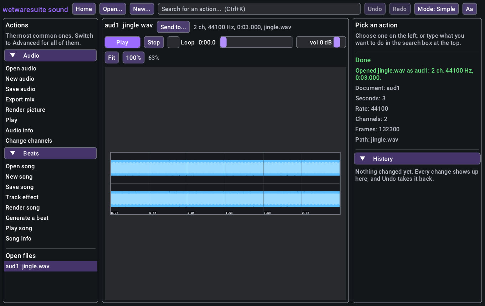

# Playback: hear what you're working on

Every tool that makes sound can play it through your speakers: audio clips and projects (`audio.play`), songs (`beats.play`) and video timelines (`cut.play`). Playback is live: it starts at once, and you can pause, resume, seek, loop and change the volume while it plays. It works the same from the window, the command line, a batch script and Claude over MCP.

It's built on [miniaudio](https://miniaud.io) (public domain), which is compiled into the suite, so there's nothing to install. It uses WASAPI on Windows, CoreAudio on macOS and PulseAudio, PipeWire or ALSA on Linux. If there's no sound card (a server, docker, CI), it plays silently: the playhead still moves in real time, so scripts and Claude behave the same, and every answer says `(no sound device, playing silently)`.

Each task below is shown four ways:

- **Window**: the play bar in the sound and video apps.
- **CLI**: single `wetwaresuite` commands.
- **Batch**: a script, for listening between edits (see [headless and batch](headless-and-batch.md)).
- **Claude**: a prompt for Claude over MCP and the tools it calls (see [mcp.md](mcp.md)).

The outputs below come from real runs on a machine with no sound card, which is why they say "playing silently". On your computer the `device` line names your speakers.

## How playback works

**One player.** The whole program has one player. Starting something new stops whatever was playing, and the transport commands (pause, stop, seek...) control it whichever tool started it, so `audio.stop` also stops a song that `beats.play` started. Every sound tool has the same transport commands under its own name (`audio.pause`, `beats.pause`, `cut.pause`), so each app has them.

**What plays.**

| command | plays | needs |
| --- | --- | --- |
| `audio.play doc=aud1` | an open clip, as it is now (edits included) | |
| `audio.play project=proj1` | a project's mix (tracks, gain, pan, mute/solo, ducking, envelopes) | |
| `audio.play path=song.mp3` | a file, without opening it | ffmpeg for formats beyond WAV/MP3/FLAC/Ogg |
| `beats.play song=song1` | the arrangement, or `start_bar`/`bars` of it, or one `track` | |
| `cut.play doc=cut1` | the timeline's sound: audio tracks plus the video clips' own audio | ffmpeg |

Every play command also takes `start` and `end` (seconds), `loop` (repeat start..end until stopped), `volume` (dB, kept for later plays) and `wait` (block until it ends, at most 600 seconds; ignored when looping).

**Returns at once.** A play command answers straight away with the playhead (`playing`, `position`, `start`, `end`, `length`, `loop`, `volume_db`, `source`, `device`, `silent`), so Claude and scripts carry on while it plays. `<tool>.playhead` reads it again at any time.

**On the command line** the program stays open until the sound has finished, so `wetwaresuite audio.play path=a.wav` is heard instead of being cut off when the program exits. The same goes for the end of a batch script. Ctrl+C stops it. A looping play doesn't hold the program open, because it would never end.

## Task 1: listen to a file

**Window.** Open a sound file in the sound app (`wetwaresuite-sound`, or double-click it). The play bar sits above the waveform:



- **Play / Pause** (or the Space bar) starts and pauses. Pressing Play after the end starts again from the beginning.
- **Stop** stops and puts the playhead back at the start.
- **Loop** repeats the sound until you stop it.
- The **seek bar** shows where it is; drag it to jump. The time shows next to it.
- **vol** changes how loud it plays (it doesn't change the file).
- On a clip's waveform the playhead is a line, and clicking the waveform moves it there.

The same bar appears over audio projects, songs in beats and timelines in the video app.

**CLI.**

```sh
$ wetwaresuite audio.play path=jingle.wav start=1 end=1.5 volume=-6
playing jingle.wav at 0:01.000 of 0:03.000 (no sound device, playing silently)
playing: true
paused: false
position: 1
start: 1
end: 1.5
length: 3
loop: false
volume_db: -6
source: jingle.wav
device: silent (no sound device)
silent: true
```

The command returns after the half second has played.

**Claude.**

> Play the second second of jingle.wav, a bit quieter.

Claude calls `audio_play` with `path=jingle.wav start=1 end=2 volume=-6`. It answers as soon as the sound starts; Claude can't hear it, so it tells you what it started and asks what you think.

## Task 2: listen between edits

Batch scripts can play a version, wait, change something and play it again, so you hear the before and after.

**Batch.**

```text
audio.open path=jingle.wav -> a
audio.play doc=$a end=1
audio.wait
audio.gain doc=$a db=-12
audio.play doc=$a end=1 wait=true
```

```sh
$ wetwaresuite batch listen.txt
opened jingle.wav as aud1: 2 ch, 44100 Hz, 0:03.000
...
playing aud1 at 0.000 s of 0:03.000 (no sound device, playing silently)
...
playback finished; stopped aud1 at 0:01.000 of 0:03.000 (no sound device, playing silently)
...
gain -12.0 dB
...
played aud1; stopped aud1 at 0:01.000 of 0:03.000 (no sound device, playing silently)
```

`audio.wait` (or `wait=true` on the play command) holds the script until the sound ends. Without it, the next play would cut the first one off. `audio.wait timeout=5` gives up after five seconds.

**Claude.** In an MCP session documents stay open, so this is just a conversation:

> Open interview.wav and play the first ten seconds. ... Now take the hiss out and play the same bit again.

Claude calls `audio_open`, `audio_play` with `end=10`, then (after you answer) `audio_noise_profile`, `audio_denoise` and `audio_play` again. `audio_play` plays the document as it is now, so you hear the change straight away. `undo` and another `audio_play` gives you the before.

## Task 3: loop a section while you work on it

**Window.** Tick **Loop**, press **Play**, and keep editing: run any action from the right-hand panel, then press Play again to hear the new version on loop.

**CLI and batch.** Looping is mostly for the window and for Claude, since a one-shot command would exit straight away. In a batch script, loop and then stop after a while:

```text
beats.open path=house.beats.json -> s
beats.play song=$s bars=2 loop=true
beats.wait timeout=8
beats.stop
```

`beats.wait` returns after eight seconds because a looping play never finishes; `beats.stop` ends it.

**Claude.**

> Loop the first two bars of my house beat while we work on the bass.

Claude calls `beats_play` with `bars=2 loop=true`, then edits (`beats_pattern_notes`, `beats_track_set`...) and calls `beats_play` again after each change so the loop has the new notes. `beats_loop on=false` lets the current pass finish and stop; `beats_stop` stops at once.

## Task 4: play a song or a video edit

**CLI.**

```sh
$ wetwaresuite beats.generate genre=house bars=4 save=house.beats.json
made song1: house in C minor at 124 bpm, 4 bars: drums (4 lanes), bass, chords, melody; ...
$ wetwaresuite beats.play input=house.beats.json bars=1
playing house at 0.000 s of 0:04.060 (no sound device, playing silently)
...
```

`beats.play` mixes the song the same way `beats.render` does (all its `start_bar`, `bars`, `track`, `tail` and `limit` options work), then plays it. `track=bass` plays just the bass, ignoring mute and solo.

For video, `cut.play` mixes the timeline's sound with ffmpeg the way `cut.render` would (transitions, fades, clip volume), then plays it:

```text
cut.open path=short.wwcut -> c
cut.play doc=$c start=10 end=20 wait=true
```

**Claude.** "Play the chorus of song1" calls `beats_play` with the chorus bars; "let me hear the edit from 0:10" calls `cut_play` with `start=10`.

## Task 5: pick the speakers

```sh
$ wetwaresuite audio.devices
default
Speakers (Realtek High Definition Audio)
USB Headset
```

```text
audio.output_device name="USB Headset"
audio.play path=jingle.wav wait=true
```

`audio.output_device name=default` goes back to the system's own choice. The window always uses the system default.

## Reference

The play commands:

| command | what it does | key parameters |
| --- | --- | --- |
| `audio.play` | play a clip, a project's mix or a file | `doc`, `project` or `path`, plus the play params |
| `beats.play` | play a song | `song` or `input`, `start_bar`, `bars`, `track`, `tail`, `limit`, plus the play params |
| `cut.play` | play a timeline's sound (needs ffmpeg) | `doc`, plus the play params |

The play params: `start` (0), `end` (-1 = the end), `loop` (false), `wait` (false, max 600 s), `volume` (dB).

The transport, under each of `audio.`, `beats.` and `cut.` (they all control the same player):

| command | what it does | key parameters |
| --- | --- | --- |
| `pause` / `resume` | hold and carry on from the same spot | |
| `stop` | stop | |
| `seek` | move the playhead, playing or paused | `seconds` |
| `playhead` | where it is: playing, paused, position, range, loop, volume, device | |
| `volume` | playback volume (doesn't change the audio) | `db` (-60..12) |
| `loop` | loop the playing range on or off | `on` (true) |
| `wait` | block until playback ends | `timeout` (600, max 600) |
| `devices` | list output devices | |
| `output_device` | play through a named device | `name` |

`WETWARESUITE_AUDIO=null` forces silent playback (handy in tests).

## Limitations

- **Plays a copy.** A play command copies the sound when it starts, so an edit made while it plays is heard on the next play, not mid-play. Long files take a moment to copy before they start.
- **Songs and timelines are mixed first.** `beats.play` renders the song and `cut.play` runs ffmpeg before the first note, so long arrangements take a moment to start; use `bars=` or `start`/`end` to play part of them. Editing a song doesn't change a loop that's already playing until you play again.
- **No recording or MIDI input yet,** and no live effects: you hear exactly what `render`/`export` would write.
- **Claude can't hear.** It starts and stops playback for you and judges the sound from measurements and pictures.
- **Up to 8 channels** go to the speakers; a mono sound plays on both sides. The device's own sample rate is used and miniaudio converts to it.
- **One sound at a time.** Starting a new play stops the old one; there's no mixing of separate plays (use an audio project for that).
- **MCP over stdin:** when the client disconnects, the server exits and playback stops with it.
