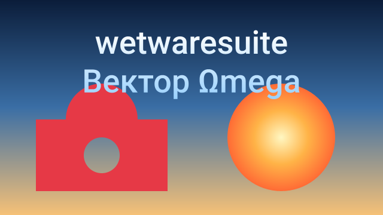

# vector tutorial: drawing with commands

`vector` is the suite's Illustrator/Inkscape-style drawing tool. It is built
headless first: every drawing action is a command you can type, put in a
script, or let Claude call over MCP. This tutorial goes from your first
rectangle to a complete logo, then shows how Claude drives the same commands.

You don't need to know SVG beforehand. Everything here was run against the
real tool, and the outputs shown are what it prints.

## contents

1. [the five ideas you need](#1-the-five-ideas-you-need)
2. [setting up](#2-setting-up)
3. [one-shot commands](#3-one-shot-commands)
4. [your first drawing, step by step](#4-your-first-drawing-step-by-step)
5. [a full batch script: a logo](#5-a-full-batch-script-a-logo)
6. [path data, the pen tool in text form](#6-path-data-the-pen-tool-in-text-form)
7. [styling, moving, stacking](#7-styling-moving-stacking)
8. [text, gradients and combining shapes](#8-text-gradients-and-combining-shapes)
9. [opening existing SVG, PDF, AI and EPS files](#9-opening-existing-svg-pdf-ai-and-eps-files)
10. [exporting](#10-exporting)
11. [the pen tool and anchors](#11-the-pen-tool-and-anchors)
12. [path operations](#12-path-operations)
13. [pathfinder, shape builder and live paint](#13-pathfinder-shape-builder-and-live-paint)
14. [clipping and opacity masks](#14-clipping-and-opacity-masks)
15. [strokes and appearance](#15-strokes-and-appearance)
16. [layers, groups, align and arrange](#16-layers-groups-align-and-arrange)
17. [artboards, guides, grid and symbols](#17-artboards-guides-grid-and-symbols)
18. [type: area text, text on a path, styles](#18-type-area-text-text-on-a-path-styles)
19. [image trace](#19-image-trace)
20. [in the window](#20-in-the-window)
21. [letting Claude draw over MCP](#21-letting-claude-draw-over-mcp)
22. [command reference](#22-command-reference)
23. [troubleshooting](#23-troubleshooting)

## 1. the five ideas you need

**Documents have ids.** `vector.new` and `vector.open` give back an id like
`vec1`. Every later command names the document it works on with `doc=vec1`.

**Shapes have ids too.** Every shape you add gets an id like `s1`, `s2`, ...
in the order you add them. You can also give a shape a `name=` and use that
name wherever a shape id is expected (`shape=sun`).

**Coordinates are pixels from the top-left.** `x` grows to the right, `y`
grows *downwards*. On an 800x600 canvas the bottom-right corner is `800,600`.

**Shapes stack bottom first.** The first shape you add is at the bottom; each
new shape is drawn on top. `vector.reorder` changes that. Groups and layers
are shapes too: what's inside them stacks among itself (section 16).

**Every edit can be undone.** Adding, styling, moving, deleting, reordering
and even closing a document are single undo steps. Reading commands
(`vector.info`, `vector.preview`, `vector.save`) don't touch the history.

Colours are written as `#rrggbb` (`#ff0000`), `#rrggbbaa` with alpha
(`#ff000080` is half-transparent red), `#rgb`, `rgb(255,0,0)`, a name like
`red`, `orange`, `white`, or `none` for no paint at all.

## 2. setting up

Build the suite once (see the README for compilers):

```sh
cmake -S . -B build -DCMAKE_BUILD_TYPE=Release
cmake --build build --config Release
```

The umbrella binary is `build/apps/wetwaresuite/wetwaresuite`. To keep the commands
below short, either add that folder to your `PATH` or make an alias:

```sh
alias wetwaresuite="$PWD/build/apps/wetwaresuite/wetwaresuite"
```

Check that the vector commands are there, and ask for help on one:

```sh
wetwaresuite list vector
wetwaresuite help vector.add_rect
```

`help` prints every parameter with its type, whether it's required, and its
default, for example:

```
vector.add_rect: Add Rectangle
Add a rectangle (optionally with rounded corners) on top of the drawing. Returns the new shape id.

usage: vector.add_rect doc=<string> x=<number> y=<number> width=<number> height=<number> [radius=<number>] [fill=<string>] ...
```

Parameters are always written `key=value`. Put quotes around a value that has
spaces in it: `d="M10 10 L90 90"`, `path="my drawing.svg"`.

## 3. one-shot commands

`wetwaresuite run <command> key=value ...` runs a single command and exits
(`wetwaresuite <command> ...` without `run` does the same):

```sh
wetwaresuite run vector.new width=800 height=600
```

```
created vec1 (800x600, 0 shapes)
vec1
doc: vec1
width: 800
height: 600
shapes: 0
```

Each one-shot run starts with nothing open, so the document above is gone as
soon as the command finishes. One-shots are for jobs that fit in one command.
The most useful one is `vector.convert`, which turns an SVG file into a PNG
(or JPEG, BMP, TGA, PPM, or a cleaned-up SVG) without opening it first:

```sh
wetwaresuite run vector.convert input=logo.svg output=logo.png
wetwaresuite run vector.convert input=logo.svg output=logo@2x.png scale=2
wetwaresuite run vector.convert input=logo.svg output=logo-600.png width=600
wetwaresuite run vector.convert input=logo.svg output=thumb.jpg scale=0.25 quality=80
```

For anything with more than one step, use a batch script.

## 4. your first drawing, step by step

A batch script is a text file with one command per line. Make a file called
`first.txt`:

```text
vector.new width=200 height=200 -> pic
vector.add_rect doc=$pic x=50 y=50 width=100 height=100 fill=red
vector.save doc=$pic path=first.png
```

and run it:

```sh
wetwaresuite batch first.txt
```

What happened, line by line:

1. `vector.new width=200 height=200` made a 200x200 white canvas. The
   `-> pic` at the end saved its id (`vec1`) in a variable called `pic`.
2. `doc=$pic` was replaced by `doc=vec1` before the command ran. A red
   100x100 square went in the middle (its top-left corner is at 50,50).
3. `vector.save` rendered the drawing to `first.png`.

You can also pipe a script in instead of making a file:

```sh
echo 'vector.new width=200 height=200 -> pic
vector.add_ellipse doc=$pic cx=100 cy=100 rx=80 fill=orange stroke=black stroke_width=4
vector.save doc=$pic path=circle.svg' | wetwaresuite batch
```

Leaving out `ry` on `vector.add_ellipse` gives a circle.

The batch rules, all in one place:

| rule | example |
| --- | --- |
| one command per line | `vector.add_rect doc=$pic x=0 y=0 width=10 height=10` |
| `#` starts a comment (at the start of a line or after a space) | `# the background` |
| `-> name` saves the result: the doc id for new/open, the shape id for add/duplicate | `vector.add_rect ... -> box` |
| `$name` is replaced by the saved value | `shape=$box` |
| `undo` and `redo` work as commands | `undo` |
| `echo text` prints text | `echo done` |
| the script stops at the first failing line | add `--keep-going` to carry on |

## 5. a full batch script: a logo

This script draws a badge with a mountain range, a sun and a caption bar. Save
it as `logo.txt`:

```text
# logo.txt: a badge with a mountain, a sun and a caption bar
# one command per line; "-> name" saves the result, "$name" uses it

vector.new width=400 height=400 background=none -> logo

# the round badge
vector.add_ellipse doc=$logo cx=200 cy=200 rx=180 fill=#1d2b53 stroke=#ffa300 stroke_width=8 name=badge

# the sun, slightly see-through
vector.add_ellipse doc=$logo cx=270 cy=150 rx=40 fill=#ffa300 opacity=0.9 name=sun

# two mountains; the second is a copy of the first, moved and recoloured
vector.add_polygon doc=$logo points=80,290,170,150,260,290 fill=#29adff name=peak -> peak
vector.duplicate doc=$logo shape=$peak dx=90 dy=10 -> peak2
vector.style doc=$logo shape=$peak2 fill=#83769c
vector.transform doc=$logo shape=$peak2 scale=0.8

# a snow cap drawn with path data (relative commands)
vector.add_path doc=$logo d="M170 150 l-30 46 l15 -8 l15 10 l15 -10 l15 8 z" fill=white name=snow

# a caption bar with rounded corners, then put the sun behind the mountains
vector.add_rect doc=$logo x=90 y=300 width=220 height=40 radius=20 fill=#ff004d -> bar
vector.reorder doc=$logo shape=sun to=back
vector.reorder doc=$logo shape=sun to=up

# a wavy line under the caption bar
vector.add_path doc=$logo d="M125 352 q19 -12 38 0 t38 0 t38 0 t38 0" fill=none stroke=#ffa300 stroke_width=4

vector.info doc=$logo
vector.save doc=$logo path=logo.svg
vector.save doc=$logo path=logo.png scale=2
```

Run it:

```sh
wetwaresuite batch logo.txt
```

You get `logo.svg` (a real SVG you can open in Inkscape, Illustrator or a
browser) and `logo.png` at 800x800, because `scale=2` renders two pixels per
unit. The background outside the badge is transparent because of
`background=none`.

Things worth noticing in the script:

- **Captures hold shape ids too.** `-> peak` saved `s3`, so `shape=$peak`
  means `shape=s3`. `-> peak2` saved the id of the copy (`s4`).
- **Names work like ids.** `shape=sun` finds the ellipse named `sun`.
- **Points are a flat list.** `points=80,290,170,150,260,290` is the three
  corners (80,290), (170,150) and (260,290). Spaces or semicolons work as
  separators too, if you quote the value.
- **Transforms add up.** The copy was moved by `dx=90 dy=10` when it was
  duplicated, then scaled by 0.8 around its own centre.
- **Reordering is relative.** `to=back` put the sun under everything, then
  `to=up` moved it one step up, so it sits on the badge but behind the peaks.

`vector.info` describes every shape bottom to top, with its bounding box on
the canvas after transforms:

```
vec1: 400x400, background none, 7 shapes (bottom first)
s1 ellipse "badge" cx=200 cy=200 rx=180 ry=180 fill=#1d2b53 stroke=#ffa300 stroke_width=8 bounds=20,20 360x360
s2 ellipse "sun" cx=270 cy=150 rx=40 ry=40 fill=#ffa300 stroke=none opacity=0.9 bounds=230,110 80x80
s3 polygon "peak" points=80,290 170,150 260,290 fill=#29adff stroke=none bounds=80,150 180x140
s4 polygon "peak copy" points=80,290 170,150 260,290 fill=#83769c stroke=none transform=(move 90,10 scale 0.8,0.8) bounds=188,174 144x112
s5 path "snow" d="M170 150 l-30 46 l15 -8 l15 10 l15 -10 l15 8 z" fill=#ffffff stroke=none bounds=140,150 60x48
s6 rect "rect 6" x=90 y=300 w=220 h=40 radius=20 fill=#ff004d stroke=none bounds=90,300 220x40
s7 path "path 7" d="M125 352 q19 -12 38 0 t38 0 t38 0 t38 0" fill=none stroke=#ffa300 stroke_width=4 bounds=125,346.05 152x11.901
```

Try changing things and running it again: swap colours, add `rotate=-10` to
the `vector.transform` line, or put `undo` on its own line after any command
to see that step disappear.

## 6. path data, the pen tool in text form

`vector.add_path` takes SVG path data in `d=`. It's a list of commands, each
a letter followed by numbers. **Uppercase letters use absolute coordinates;
lowercase letters are relative to where the pen currently is.**

| command | numbers | what it does |
| --- | --- | --- |
| `M x y` / `m dx dy` | 2 | move the pen without drawing (starts a new piece) |
| `L x y` / `l` | 2 | straight line |
| `H x` / `h` | 1 | horizontal line |
| `V y` / `v` | 1 | vertical line |
| `C x1 y1 x2 y2 x y` / `c` | 6 | cubic curve with two control points |
| `S x2 y2 x y` / `s` | 4 | smooth cubic: the first control point mirrors the last one |
| `Q x1 y1 x y` / `q` | 4 | quadratic curve with one control point |
| `T x y` / `t` | 2 | smooth quadratic: the control point mirrors the last one |
| `A rx ry rotation large sweep x y` / `a` | 7 | elliptical arc to x,y |
| `Z` / `z` | 0 | close the piece back to where it started |

Some examples to paste into a script (each needs a `doc=`):

```text
# a triangle
vector.add_path doc=$d d="M50 10 L90 90 L10 90 Z" fill=teal

# the same triangle with relative moves
vector.add_path doc=$d d="M50 10 l40 80 h-80 z" fill=teal

# a heart from two arcs and two curves
vector.add_path doc=$d d="M50 30 A20 20 0 0 1 90 30 Q90 60 50 90 Q10 60 10 30 A20 20 0 0 1 50 30 Z" fill=crimson

# a ring: a second piece inside the first makes a hole
vector.add_path doc=$d d="M30 50 a20 20 0 1 0 40 0 a20 20 0 1 0 -40 0 Z M40 50 a10 10 0 1 0 20 0 a10 10 0 1 0 -20 0 Z" fill=gold

# an open wave: no fill, just an outline
vector.add_path doc=$d d="M10 50 q10 -20 20 0 t20 0 t20 0 t20 0" fill=none stroke=navy stroke_width=3
```

Arcs explained: `A rx ry rotation large sweep x y` draws part of an ellipse
with radii rx, ry from the pen to x,y. Two ellipses (and four arcs) can join
two points; `large=1` picks the longer way round and `sweep=1` picks the
clockwise one. If the radii are too small to reach, they're scaled up.

Fills use the **even-odd** rule: a point is filled when a line from it to
outside crosses the outline an odd number of times. That's why a piece
inside another piece becomes a hole.

Numbers can be written compactly like other SVG tools write them:
`M10-5L.5.5` is `M 10 -5 L 0.5 0.5`. Bad path data is refused with the
position of the problem, so nothing broken gets added.

## 7. styling, moving, stacking

All of these take `doc=` and `shape=` (an id like `s3` or a name). Add
`preview=true` to any edit to get a PNG of the result back (handy over MCP).

**Style.** Change only what you pass:

```text
vector.style doc=$d shape=s2 fill=none stroke=#000 stroke_width=3
vector.style doc=$d shape=sun opacity=0.5 name=pale-sun
vector.style doc=$d shape=s4 visible=false
```

`opacity` fades the whole shape, fill and outline together. To fade only the
fill, give it an alpha colour: `fill=#ff000080`.

**Transform.** Moves, turns and scales add on to what's already there:

```text
vector.transform doc=$d shape=s1 dx=20 dy=-10     # 20 right, 10 up
vector.transform doc=$d shape=s1 rotate=45        # 45 degrees clockwise around its centre
vector.transform doc=$d shape=s1 scale=1.5        # 150% around its centre
vector.transform doc=$d shape=s1 scale_x=2        # stretch sideways
vector.transform doc=$d shape=s1 reset=true       # back to how it was drawn
```

**Align** a shape's bounding box to the canvas (several shapes, artboards
and key shapes are in section 16):

```text
vector.align doc=$d shape=title horizontal=center vertical=top margin=20
```

**Stacking order:**

```text
vector.reorder doc=$d shape=s5 to=front   # top of the pile
vector.reorder doc=$d shape=s5 to=back    # bottom
vector.reorder doc=$d shape=s5 to=up      # one step up
vector.reorder doc=$d shape=s5 to=down    # one step down
```

**Duplicate and delete:**

```text
vector.duplicate doc=$d shape=s2 dx=30 -> copy   # the copy sits just above the original
vector.delete doc=$d shape=$copy
```

**Canvas.** Resize it or change the background (shapes stay put):

```text
vector.canvas doc=$d width=1024 height=512 background=#eeeeee
```

## 8. text, gradients and combining shapes



That picture comes from this script (`wetwaresuite batch scene.txt`):

```text
vector.new width=640 height=360 -> d
vector.add_rect doc=$d x=0 y=0 width=640 height=360 name=sky
vector.gradient doc=$d shape=sky colors=#0b1d3a,#3a6ea5,#f6c177 angle=90
vector.add_ellipse doc=$d cx=470 cy=230 rx=90 name=sun
vector.gradient doc=$d shape=sun type=radial colors=#fff7c2,#ffb347,#ff6b35
vector.add_rect doc=$d x=60 y=200 width=220 height=120 fill=#e63946 name=body
vector.add_ellipse doc=$d cx=170 cy=200 rx=60 fill=#e63946 name=dome
vector.boolean doc=$d op=union shapes=body,dome name=house
vector.add_ellipse doc=$d cx=170 cy=260 rx=30 name=hole
vector.boolean doc=$d op=subtract shapes=house,hole
vector.add_text doc=$d text="wetwaresuite\nВектор Ωmega" x=320 y=90 size=54 anchor=middle fill=white name=title
vector.gradient doc=$d shape=title colors=#ffffff,#9ad1ff angle=90
vector.save doc=$d path=scene.svg
vector.save doc=$d path=scene.png
```

**Text.** `vector.add_text` puts words on the canvas. `x`, `y` is where the
first line's baseline starts; `\n` starts a new line.

```text
vector.add_text doc=$d text="Big Sale" x=400 y=120 size=72 anchor=middle fill=#222 -> t
vector.set_text doc=$d shape=$t text="Bigger Sale" letter_spacing=4
```

- `font=sans` (the default) is a font built into wetwaresuite, so the text
  looks the same on every computer. It covers Latin, Greek and Cyrillic.
- `font=serif`, `font=mono`, or a family like `font=Arial` use a font
  installed on the computer, with `bold=true` / `italic=true` if it has those
  faces. `font=C:/Fonts/MyFont.ttf` (or `.otf`) uses that file. Letters the
  font lacks fall back to the built-in font.
- `anchor` is `start` (left, default), `middle` or `end` (right).
- `letter_spacing` adds px between letters (negative squeezes them);
  `line_height` is the gap between lines, times the size (1.2).

Text stays editable: `vector.set_text` changes only what you pass, and the
SVG file keeps it as real `<text>`. If you're sending the SVG somewhere that
may not have the font, turn it into outlines first:

```text
vector.to_path doc=$d shape=$t
```

`vector.to_path` works on any shape: rectangles, ellipses and polygons become
editable path data too.

**Gradients.** `vector.gradient` fills a shape with a colour ramp.

```text
vector.gradient doc=$d shape=sky colors=navy,skyblue angle=90         # top to bottom
vector.gradient doc=$d shape=bar stops=0:red,0.2:gold,1:green         # pick each position
vector.gradient doc=$d shape=sun type=radial colors=white,orange cx=0.3 cy=0.3 radius=0.8
vector.gradient doc=$d shape=sun remove=true                          # back to a flat fill
```

`colors` spreads the colours evenly; `stops` gives each one a position from 0
to 1. `angle` is the direction of a linear gradient: 0 runs left to right, 90
top to bottom, 45 corner to corner. Positions (`cx`, `cy`, `radius`) are
fractions of the shape's own box, so the gradient moves and scales with it.
Gradients save to SVG as `linearGradient` / `radialGradient`.

**Combining shapes.** `vector.boolean` merges filled shapes into one path:

| `op` | keeps |
| --- | --- |
| `union` | everything covered by any shape |
| `subtract` | the first shape with the others cut out |
| `intersect` | only where they all overlap |
| `exclude` | what's covered by an odd number of shapes (the overlap becomes a hole) |

The result takes the first shape's colours and its place in the stacking
order. The originals are removed; add `keep=true` to leave them. Shapes are
combined where they're drawn, so moved and rotated shapes work as you'd
expect. Curves become many short straight lines, and outlines (strokes) aren't
counted, only filled areas.

## 9. opening existing SVG, PDF, AI and EPS files

```text
vector.open path=drawing.svg -> d
vector.info doc=$d
vector.open path=poster.pdf page=2        # PDF pages, and Illustrator .ai files (PDF inside)
vector.open path=logo.eps                 # EPS / PS
```

The SVG importer reads the parts of SVG that describe shapes:

- `rect` (with `rx`/`ry` rounded corners), `circle`, `ellipse`, `line`,
  `polyline`, `polygon`, `path`
- groups (`g`), kept as groups; Inkscape layers (and this tool's) come back
  as layers. Styles pass down to the shapes inside
- `fill`, `stroke`, `stroke-width`, `opacity`, `fill-opacity`,
  `stroke-opacity`, `display`, `visibility`, line caps, joins, dashes and
  `fill-rule`, as attributes or in `style="..."`
- `transform` with `translate`, `rotate`, `scale`, `matrix`, `skewX`/`skewY`
  (skewed shapes become paths, so they look right)
- `width`/`height` in px, mm, cm, in, pt, plus `viewBox` scaling
- `text` with `tspan` lines, `font-size`, `font-family`, `font-weight`,
  `font-style`, `text-anchor`, `letter-spacing` and `textPath`
- `linearGradient` and `radialGradient` fills (with `href` to share stops)
- `clipPath` and `mask`, `symbol` and `use`, arrowhead markers

Images, unknown filters and anything else inside `<defs>` are skipped rather
than failing the whole file. A pattern fill from another program turns into
its fallback colour, or grey. Imported shapes keep their `id` (or Inkscape
label) as their name.

Files saved by `vector.save` open again exactly: ids, names, layers, symbols,
artboards, guides, swatches, text styles, stroke options, appearance items
and effects all come back.

PDF and AI pages come in as paths, text and colours, with their clipping;
EPS files are read by a small PostScript interpreter (paths, fills, strokes,
colours, transforms), which covers what drawing programs write.

## 10. exporting

```text
vector.save doc=$d path=out.svg               # real SVG
vector.save doc=$d path=out.pdf               # vector PDF (a page per artboard)
vector.save doc=$d path=out.eps               # vector EPS
vector.save doc=$d path=out.png               # 1 pixel per unit
vector.save doc=$d path=out@3x.png scale=3    # 3x resolution
vector.save doc=$d path=out.jpg quality=85    # JPEG; transparent areas become white
vector.save doc=$d path=page.png artboard=2   # one artboard (name or number); artboard=all for each
vector.convert input=art.ai output=art.svg    # convert without opening
```

The extension picks the format: `svg`, `pdf`, `eps`, `png`, `jpg`/`jpeg`,
`bmp`, `tga`, `ppm`. Saving as SVG also remembers the path on the document.
In PDF and EPS, shapes, gradients, clipping paths and opacity masks stay
vectors; effects, patterns and freeform gradients are drawn into the page as
pictures.

`vector.preview doc=$d size=256` gives back a PNG without writing a file. The
CLI only reports its size; over MCP Claude actually sees the image.

## 11. the pen tool and anchors

Every path is a row of **anchors**. Each anchor has two **handles**: the
`in` handle steers the curve arriving at it, the `out` handle the curve
leaving it. A handle sitting on its anchor means "no handle" (a straight
segment). An anchor is a **corner** (handles independent or pulled in),
**smooth** (handles in line, so the curve doesn't kink) or **symmetric**
(in line and the same length).

**Draw with the pen.** `vector.pen` takes the anchors one by one, separated
by `;`:

```text
vector.new width=300 height=200 -> d
# x,y is a corner; x,y,out_x,out_y is a smooth anchor (the in handle mirrors the out one)
vector.pen doc=$d nodes="20,150; 150,40,220,40; 280,150" stroke=navy stroke_width=4 -> arch
# x,y,in_x,in_y,out_x,out_y sets both handles yourself
vector.pen doc=$d nodes="20,180; 150,180,100,120,200,195; 280,180" -> wave
# smooth=true runs smooth curves through plain points (tension 0..1)
vector.pen doc=$d nodes="20,100; 80,60; 140,110; 200,60; 260,100" smooth=true stroke=teal
vector.pen doc=$d nodes="100,20; 140,60; 100,100; 60,60" closed=true fill=gold stroke=none
```

**See the anchors.** `vector.nodes` numbers them from 0 (across all the
subpaths of the shape) and gives their type, on the canvas:

```text
vector.nodes doc=$d shape=$arch
```

```text
s1: 3 anchors in 1 subpath
subpath 0 (open)
  0 corner at 20,150 in 20,150 out 20,150
  1 symmetric at 150,40 in 80,40 out 220,40
  2 corner at 280,150 in 280,150 out 280,150
```

**Edit them.** These all take the anchor number as `node=` (several:
`node=0,2`). A rectangle, ellipse or polygon turns into a path the first
time you edit its anchors.

```text
vector.add_node doc=$d shape=$arch x=80 y=80            # a new anchor on the curve nearest 80,80
vector.add_node doc=$d shape=$arch node=0 t=0.5         # ...or halfway along the segment after anchor 0
vector.delete_node doc=$d shape=$arch node=1
vector.move_node doc=$d shape=$arch node=1 dx=0 dy=-20  # moves the anchor and its handles
vector.move_node doc=$d shape=$arch node=1 part=out x=240 y=20   # one handle; the other turns to match
vector.move_node doc=$d shape=$arch node=1 part=out x=240 y=80 corner=true   # break the pair
vector.convert_node doc=$d shape=$arch node=1 type=corner      # pull the handles in: a sharp point
vector.convert_node doc=$d shape=$arch node=1 type=smooth      # or symmetric
```

## 12. path operations

```text
vector.new width=300 height=200 -> d
vector.add_polyline doc=$d points=20,20,80,60,140,20 name=left
vector.add_polyline doc=$d points=280,20,220,60,160,20 name=right
vector.join doc=$d shape=left with=right    # nearest ends meet; right becomes part of left
vector.join doc=$d shape=left               # join an open path's own two ends (close it)
vector.close_path doc=$d shape=left closed=false   # open a closed path at its start
vector.split doc=$d shape=left node=2       # scissors at an anchor (or x= y= for the nearest point)
vector.reverse doc=$d shape=left            # flip the direction (arrowheads swap ends)
vector.simplify doc=$d shape=left tolerance=1.5   # fewer anchors, fitted curves (after tracing or freehand)
vector.smooth doc=$d shape=left tension=0.5       # every anchor smooth
```

`vector.split` on a closed shape opens it there; on an open path it makes a
second shape and returns its id as `other`.

**The knife.** `vector.cut` slices filled shapes along a line (`line=` is
x,y pairs; the line runs on past its ends, so it cuts right across). Each
shape it crosses becomes separate pieces with its style:

```text
vector.add_rect doc=$d x=40 y=40 width=120 height=80 fill=tomato -> r
vector.cut doc=$d shapes=$r line=100,20,80,140 -> halves
```

**Offset path** makes a new shape a set distance outside (or, negative,
inside) the original. It goes behind the original unless `place=front`:

```text
vector.add_rect doc=$d x=200 y=40 width=60 height=60 radius=10 fill=teal -> r2
vector.offset doc=$d shape=$r2 distance=8 join=round -> halo
vector.style doc=$d shape=$halo fill=#ffd70080
```

**Outline stroke** turns an outline into a filled shape that looks the same,
caps, joins, dashes, arrowheads and width profile included. The original
keeps its fill (if it has none, the new shape replaces it):

```text
vector.add_line doc=$d x1=20 y1=180 x2=280 y2=180 stroke=black stroke_width=12 -> l
vector.stroke_style doc=$d shape=$l cap=butt end_arrow=triangle
vector.outline_stroke doc=$d shape=$l
```

## 13. pathfinder, shape builder and live paint

`vector.boolean` (section 8) merges or cuts shapes. Three more tools work
with the **regions** that overlapping shapes make:

```text
vector.new width=300 height=200 -> d
vector.add_ellipse doc=$d cx=110 cy=100 rx=70 fill=#ff6b6b -> a
vector.add_ellipse doc=$d cx=190 cy=100 rx=70 fill=#4dabf7 -> b
```

- **Divide** cuts them into every separate region (here three: left, the
  overlap, right). Each region takes the style of the topmost shape over it:

  ```text
  vector.divide doc=$d shapes=$a,$b
  ```

- **Shape builder** merges the regions under `merge=` points into one shape
  and deletes the regions under `erase=` points; the rest stay as separate
  regions:

  ```text
  vector.shape_builder doc=$d shapes=$a,$b merge=60,100,150,100 erase=240,100
  ```

- **Compound path** puts shapes into one path where overlaps make holes;
  **break apart** separates a path into one shape per piece again
  (`holes=true` keeps holes inside their outer shape, so an O stays an O):

  ```text
  vector.compound doc=$d shapes=$a,$b -> ring
  vector.break_apart doc=$d shape=$ring
  ```

**Live paint.** `vector.paint_region` fills the area enclosed around a point,
like a paint bucket for line art. The lines don't have to be joined; they
just have to cross or touch. The fill goes under the lines:

```text
vector.new width=200 height=200 -> d
vector.add_line doc=$d x1=20 y1=40 x2=180 y2=40 stroke=black stroke_width=3
vector.add_line doc=$d x1=20 y1=160 x2=180 y2=160 stroke=black stroke_width=3
vector.add_line doc=$d x1=40 y1=20 x2=40 y2=180 stroke=black stroke_width=3
vector.add_line doc=$d x1=160 y1=20 x2=100 y2=180 stroke=black stroke_width=3
vector.paint_region doc=$d x=80 y=100 fill=#ffd43b
```

A point outside every enclosed area (or right on a line) is an error, so you
never flood the whole canvas by mistake.

## 14. clipping and opacity masks

A **clipping mask** shows shapes only inside another shape. The clipping
shape is the topmost one you list (or name it with `clip=`); it isn't drawn.
The shapes go into a new group, whose id comes back:

```text
vector.new width=200 height=200 -> d
vector.add_rect doc=$d x=0 y=0 width=200 height=200 -> photo
vector.gradient doc=$d shape=$photo colors=#ff922b,#845ef7 angle=45
vector.add_ellipse doc=$d cx=100 cy=100 rx=80 -> window
vector.clip doc=$d shapes=$photo,$window -> clipped
vector.release_clip doc=$d shape=$clipped      # undo it later (the clip shape stays, unpainted)
```

An **opacity mask** fades shapes by another shape's brightness: white shows,
black hides, greys and gradients fade:

```text
vector.add_rect doc=$d x=0 y=0 width=200 height=200 fill=white -> fade
vector.gradient doc=$d shape=$fade colors=white,black angle=90
vector.mask doc=$d shapes=$photo,$fade
```

Both survive saving: SVG writes real `clipPath` and `mask` elements, PDF
writes clipping paths and soft masks.

## 15. strokes and appearance

The examples in this section use this drawing:

```text
vector.new width=400 height=200 -> d
vector.add_polyline doc=$d points=20,40,120,40,160,100 stroke=black stroke_width=8 name=wire
vector.add_rect doc=$d x=200 y=30 width=150 height=120 fill=#ffe066 stroke=black stroke_width=6 name=card
vector.add_ellipse doc=$d cx=100 cy=150 rx=40 fill=#74c0fc name=dot
```

**Stroke options.** `vector.stroke_style` sets how outlines are drawn; only
what you pass changes:

```text
vector.stroke_style doc=$d shape=wire cap=butt join=miter miter_limit=4
vector.stroke_style doc=$d shape=wire dash=12,6 dash_offset=3     # dash=none for solid
vector.stroke_style doc=$d shape=card align=inside                 # or outside (closed shapes)
vector.stroke_style doc=$d shape=wire start_arrow=circle end_arrow=triangle arrow_scale=1.5
vector.stroke_style doc=$d shape=wire profile=taper                # taper_start, taper_end, bulge, pinch
vector.stroke_style doc=$d shapes=wire,card width=3 color=navy     # several shapes at once
vector.stroke_style doc=$d shape=wire reset=true                   # plain round line again
```

Caps are `butt`, `round` or `square`; joins `miter`, `round` or `bevel`;
arrowheads `none`, `triangle`, `open`, `circle`, `square` or `bar`. New
shapes start with round caps and joins; SVG files from other programs keep
theirs.

**Several fills and outlines.** `vector.appearance` stacks extra fills and
strokes on one shape, like Illustrator's Appearance panel. `under` puts an
item below the shape's own fill; `dx`/`dy` offset it:

```text
vector.add_text doc=$d text=POP x=20 y=120 size=96 fill=#ff6b6b -> t
vector.appearance doc=$d shape=$t add="stroke color=#1a1a2e width=14 under; fill color=#1a1a2e dx=6 dy=6 under"
vector.appearance doc=$d shape=$t remove=0      # drop the first item
vector.appearance doc=$d shape=$t clear=true
```

**Effects** draw with the shape (SVG filters; rasterised into PDF):

```text
vector.effect doc=$d shape=$t type=drop_shadow dx=6 dy=6 radius=4 color=#00000080
vector.effect doc=$d shape=$t type=outer_glow color=gold radius=10
vector.effect doc=$d shape=$t add="inner_shadow dx=2 dy=2; blur radius=1"
vector.effect doc=$d shape=$t remove=blur        # or an index; clear=true removes all
```

The effects are `drop_shadow`, `inner_shadow`, `outer_glow`, `inner_glow` and
`blur`. They work on groups too.

**Blend modes and opacity** are on `vector.style`:

```text
vector.style doc=$d shape=dot blend=multiply opacity=0.8   # screen, overlay, darken, lighten, ...
vector.style doc=$d shape=card fill_rule=nonzero           # overlapping subpaths fill instead of making holes
```

**Patterns** fill with a repeating mark in two colours:

```text
vector.pattern doc=$d shape=card type=stripes color=navy background=white size=12 angle=45 weight=0.3
vector.pattern doc=$d shape=card type=dots color=white background=none size=10   # see-through between dots
vector.pattern doc=$d shape=card remove=true
```

Types: `stripes`, `dots`, `grid`, `checker`, `hatch`.

**More gradients.** `target=stroke` puts the gradient on the outline;
`type=freeform` blends colour points placed anywhere on the shape (fractions
of its box):

```text
vector.gradient doc=$d shape=card target=stroke colors=red,gold
vector.gradient doc=$d shape=card type=freeform points="0.1,0.1,#ff6b6b 0.9,0.2,#ffd43b 0.5,0.9,#4dabf7"
```

**Global swatches.** Name a colour once, paint shapes with it, then change
the swatch and every shape using it follows:

```text
vector.swatch doc=$d name=brand color=#e8590c
vector.swatch doc=$d name=brand shapes=dot,card           # fills; target=stroke for outlines
vector.swatch doc=$d name=brand color=#1971c2             # dot and card turn blue
vector.swatch doc=$d                                      # list the swatches
```

## 16. layers, groups, align and arrange

**Layers** are named groups shown in the layers list. New shapes go into
the current layer; a new layer becomes current:

```text
vector.new width=300 height=200 -> d
vector.add_layer doc=$d name=Background -> bg
vector.add_rect doc=$d x=0 y=0 width=300 height=200 fill=#f1f3f5 name=paper
vector.add_layer doc=$d name=Art -> art
vector.add_rect doc=$d x=20 y=30 width=40 height=40 fill=tomato name=a
vector.add_ellipse doc=$d cx=120 cy=80 rx=25 fill=gold name=b
vector.add_polygon doc=$d points=200,40,240,110,160,110 fill=teal name=c
vector.add_layer doc=$d name=Details parent=$art        # a sublayer
vector.current_layer doc=$d layer=$art
vector.layers doc=$d
vector.style doc=$d shape=$bg visible=false             # hide a layer (and everything in it)
vector.style doc=$d shape=$bg visible=true
vector.lock doc=$d shape=$bg                            # locked: clicks and edits pass it by
vector.lock doc=$d shape=$bg locked=false
vector.move_to doc=$d shapes=a,b into=Details           # into=none for the top level
vector.move_to doc=$d shapes=a,b into=$art
```

`vector.delete doc=$d shape=Details` deletes a layer with everything in it.

**Groups** move, scale, fade and take effects as one. Clicking a shape in
the window picks its group:

```text
vector.group doc=$d shapes=a,b,c name=logo -> g
vector.transform doc=$d shape=$g dx=40 rotate=15
vector.ungroup doc=$d shape=$g
```

**Arrange** works among the shapes beside it (inside its group or layer):
`vector.reorder doc=$d shape=b to=front` (or `back`, `up`, `down`).

**Transform several shapes.** With `shapes=` everything turns and scales
around the centre of the whole selection; `each=true` uses each shape's own
centre; `origin_x`/`origin_y` set the pivot. Skew and flip too:

```text
vector.transform doc=$d shapes=a,b rotate=90
vector.transform doc=$d shapes=a,b scale=0.5 each=true
vector.transform doc=$d shape=c flip=horizontal
vector.transform doc=$d shape=c skew_x=20
vector.transform doc=$d shape=c scale=2 origin_x=0 origin_y=0
```

**Align and distribute.** One shape aligns to the canvas; several align to
their selection box, an artboard or a key shape (which stays put):

```text
vector.align doc=$d shapes=a,b,c horizontal=left
vector.align doc=$d shapes=a,b,c vertical=middle to=key key=b
vector.align doc=$d shape=a horizontal=center to=artboard artboard=1
vector.distribute doc=$d shapes=a,b,c                     # equal gaps across
vector.distribute doc=$d shapes=a,b,c axis=vertical by=centers
vector.distribute doc=$d shapes=a,b,c gap=12              # exactly 12 px apart
```

**Repeat** makes copies in a grid, round a centre, or mirrored, and puts
them in a group with the original:

```text
vector.repeat doc=$d shape=a mode=grid rows=3 columns=4 gap_x=8 gap_y=8
vector.add_ellipse doc=$d cx=150 cy=60 rx=8 ry=25 fill=pink name=petal
vector.repeat doc=$d shape=petal mode=radial count=12 cx=150 cy=100
vector.add_polygon doc=$d points=150,150,120,190,150,190 fill=navy name=half
vector.repeat doc=$d shape=half mode=mirror axis=vertical x=150
```

**Picking by position** (what the window's Pick tool uses):

```text
vector.hit doc=$d x=150 y=60                       # shape= the shape under it, select= what a click picks
vector.select_area doc=$d x=0 y=0 width=150 height=100   # shapes wholly inside (touch=true: touching)
vector.bounds doc=$d shape=c                       # x, y, width, height on the canvas
```

## 17. artboards, guides, grid and symbols

**Artboards** are named page areas on one canvas (the canvas grows to hold
them). Each exports on its own and becomes a page in PDF:

```text
vector.new width=100 height=100 -> d
vector.add_artboard doc=$d name=front x=0 y=0 width=400 height=300
vector.add_artboard doc=$d name=back x=440 y=0 width=400 height=300
vector.artboards doc=$d
vector.save doc=$d path=card.pdf artboard=all           # a two-page PDF
vector.save doc=$d path=card.png artboard=all scale=2   # card-front.png and card-back.png
vector.save doc=$d path=back.svg artboard=back          # just that area
vector.remove_artboard doc=$d artboard=back
```

**Guides, grid and snapping.** The window's Pick tool snaps to what's on;
`vector.snap` answers where a point would land:

```text
vector.guides doc=$d x=200,400 y=150
vector.grid doc=$d size=10 snap_grid=true snap_guides=true snap_points=true
vector.snap doc=$d x=203 y=148
```

**Symbols** are reusable artwork. Making one replaces the shapes with an
instance; place more instances anywhere; redefine the symbol and every
instance changes; expand an instance to edit it on its own:

```text
vector.add_ellipse doc=$d cx=30 cy=30 rx=20 fill=gold -> sun
vector.add_line doc=$d x1=30 y1=0 x2=30 y2=8 stroke=gold stroke_width=3 -> ray
vector.symbol doc=$d name=sun shapes=$sun,$ray -> first
vector.place_symbol doc=$d name=sun x=200 y=40 -> second
vector.transform doc=$d shape=$second scale=1.5
vector.expand_symbol doc=$d shape=$first
```

SVG keeps symbols as `<symbol>` with `<use>` instances.

## 18. type: area text, text on a path, styles

**Area text** wraps inside a box (`x`,`y` is the box's top-left) and can run
in columns. `vector.set_text` reports when the text overflows the box:

```text
vector.add_text doc=$d text="Long text wraps at the edge of its box, word by word." x=20 y=20 size=18 box_width=200 box_height=120 -> body
vector.set_text doc=$d shape=$body columns=2 column_gap=16 box_width=400 align=justify
```

**Text on a path** follows any path or shape and moves with it:

```text
vector.add_path doc=$d d="M20 250 C 120 150, 220 350, 380 250" fill=none stroke=none -> curve
vector.add_text doc=$d text="along the curve" x=0 y=0 size=24 on_path=$curve path_offset=10 -> label
vector.set_text doc=$d shape=$label on_path=none x=20 y=280   # back to a straight line
```

**Case:** `case=upper`, `lower`, `title` or `small_caps` changes how the
words are drawn without changing them.

**Text styles** are named character and paragraph settings. Text following
a style changes when the style does:

```text
vector.text_style doc=$d name=heading font=serif size=32 bold=true fill=navy case=title
vector.text_style doc=$d name=body from=$body              # copy a text shape's settings
vector.set_text doc=$d shape=$body style=heading           # follow a style
vector.add_text doc=$d text="Chapter one" x=20 y=300 style=heading
vector.text_style doc=$d name=heading size=28              # every heading follows
```

**Outline text** with `vector.to_path`: the letters become a path, so the
file no longer needs the font.

## 19. image trace

`vector.trace` turns a bitmap into filled paths:

```text
vector.trace doc=$d path=sketch.png                          # black and white, by threshold
vector.trace doc=$d path=sketch.png threshold=100 smooth=0.5
vector.trace doc=$d path=photo.jpg colors=8 min_area=20 x=0 y=0 width=400
```

`colors=2` traces the dark parts (darker than `threshold`); more colours
sort the picture into that many and trace each. `smooth` goes from pixel
corners (0) to curves (1), `tolerance` is how far the curves may stray in
px, `min_area` drops specks, `ignore_white` leaves white areas empty. The
paths land in one group, placed at `x`,`y` and scaled to `width`. Follow
with `vector.simplify` for fewer anchors.

## 20. in the window

Open a drawing in `wetwaresuite-draw` (or the suite). The canvas toolbar has
two drawing tools next to **Move**:

1. **Pick.** Click a shape to pick it (a click inside a group picks the
   group). A box with eight handles appears.
   - Drag the shape to move it. It snaps to the grid, guides and anchors
     when `vector.grid` turned snapping on.
   - Drag a corner or edge handle to resize; the opposite side stays put.
     Hold Shift on a corner to keep the proportions.
   - Arrow keys nudge by 1 px (Shift: 10 px); Delete removes it.
   - The toolbar buttons align it to the canvas (left, centre, right, top,
     middle, bottom), bring it to the front or send it to the back,
     duplicate or delete it.
2. **Anchors.** Click a path to show its anchors (squares) and handles
   (dots). Drag an anchor to move it, or a handle to bend the curve; hold
   Alt while letting go to break a smooth pair. Alt+click on the path adds
   an anchor. Rectangles and ellipses become paths the first time you do.

Every drag is one command (`vector.transform` or `vector.move_node`), so
Undo takes it back and the history shows it. Everything else in this
tutorial is in the command search (Ctrl+K): type "shape builder", "offset",
"symbol" and fill in the form.

## 21. letting Claude draw over MCP

The same commands are MCP tools. Register the suite with Claude Code:

```sh
claude mcp add wetwaresuite -- "$PWD/build/apps/wetwaresuite/wetwaresuite" mcp
```

or only the vector tools (a shorter tool list for Claude to read):

```sh
claude mcp add wetwaresuite-vector -- "$PWD/build/apps/wetwaresuite/wetwaresuite" mcp --tools vector
```

For Claude Desktop, put the same command in its config file
(`claude_desktop_config.json`), or let the hub print it for you with
`hub mcp-config`:

```json
{
  "mcpServers": {
    "wetwaresuite": { "command": "/full/path/to/build/apps/wetwaresuite/wetwaresuite", "args": ["mcp"] }
  }
}
```

**Tool names are command ids with dots turned into underscores:**
`vector.add_rect` is the tool `vector_add_rect`, `vector.new` is
`vector_new`. Parameters are the same names; point lists are JSON arrays of
numbers. The server also adds four tools of its own: `undo`, `redo`,
`history` and `documents` (lists what's open).

Now you can just ask:

> Draw me a 512x512 app icon: a rounded dark blue square with a white
> lightning bolt in the middle. Show me a preview, then save it as
> icon.svg and icon.png at 2x.

Behind the scenes Claude makes calls like these:

```json
{"name": "vector_new", "arguments": {"width": 512, "height": 512, "background": "none"}}
```

which returns `{"doc": "vec1", "width": 512, "height": 512, "shapes": 0}` as
structured content, then

```json
{"name": "vector_add_rect", "arguments": {"doc": "vec1", "x": 32, "y": 32, "width": 448, "height": 448, "radius": 96, "fill": "#1d2b53"}}
{"name": "vector_add_polygon", "arguments": {"doc": "vec1", "points": [280, 80, 160, 280, 250, 280, 220, 432, 352, 220, 262, 220], "fill": "white", "preview": true}}
```

Each add returns `{"shape": "s1"}` (then `s2`, ...). With `preview: true` the
result includes the rendered PNG, so Claude can see the bolt and fix it, for
example with `vector_transform` (`{"doc": "vec1", "shape": "s2", "dx": -8}`)
or by calling `undo` and trying again. Finally:

```json
{"name": "vector_save", "arguments": {"doc": "vec1", "path": "icon.svg"}}
{"name": "vector_save", "arguments": {"doc": "vec1", "path": "icon.png", "scale": 2}}
```

Tips for working with Claude:

- Ask it to call `vector_info` when you want to talk about specific shapes;
  the ids and bounding boxes make "move the sun left a bit" unambiguous.
- Ask for `preview=true` (or `vector_preview`) after big changes so it checks
  its own work.
- Paths in `vector_open`/`vector_save` are relative to where the server was
  started; use full paths if in doubt.
- You can hand it an existing file: "open ~/art/logo.svg, make the red parts
  teal and export a 1024px PNG".

## 22. command reference

`wetwaresuite help <command>` shows every parameter. In short (shape commands
take `doc` and `shape`, adds take `doc`; ✓ = undoable):

| command | what it does | main parameters |
| --- | --- | --- |
| `vector.new` | new drawing, returns `doc` | `width` (800), `height` (600), `background` (white) |
| `vector.open` | open SVG, PDF, AI or EPS, returns `doc` | `path`, `page` (1) |
| `vector.save` | write svg/pdf/eps/png/jpg/bmp/tga/ppm | `doc`, `path`, `scale` (1), `quality` (90), `artboard` |
| `vector.convert` | a drawing file to another format in one step | `input`, `output`, `page`, `scale`, `quality` |
| `vector.close` ✓ | close a drawing | `doc` |
| `vector.info` | list the canvas and every shape | `doc` |
| `vector.preview` | PNG of the drawing | `doc`, `size` (512) |
| `vector.canvas` ✓ | resize the canvas, change the background | `width`, `height`, `background` |
| `vector.add_rect` ✓ | rectangle, returns `shape` | `x`, `y`, `width`, `height`, `radius` |
| `vector.add_ellipse` ✓ | ellipse or circle | `cx`, `cy`, `rx`, `ry` (= rx) |
| `vector.add_line` ✓ | straight line | `x1`, `y1`, `x2`, `y2` |
| `vector.add_polygon` ✓ | closed shape through points | `points` (x,y,x,y,...) |
| `vector.add_polyline` ✓ | open line through points | `points` |
| `vector.add_path` ✓ | shape from SVG path data | `d` |
| `vector.style` ✓ | fill, stroke, width, opacity, blend, fill rule, name, visible | any of those |
| `vector.transform` ✓ | move, rotate, scale, skew, flip one or several shapes | `shape`/`shapes`, `dx`, `dy`, `rotate`, `scale`, `scale_x`, `scale_y`, `skew_x`, `skew_y`, `flip`, `each`, `origin_x`, `origin_y`, `reset` |
| `vector.align` ✓ | align to canvas, artboard, selection or key shape | `shape`/`shapes`, `horizontal`, `vertical`, `to`, `key`, `artboard`, `margin` |
| `vector.distribute` ✓ | equal spacing | `shapes`, `axis`, `by`, `gap` |
| `vector.reorder` ✓ | stacking order among siblings | `to` = front, back, up, down |
| `vector.duplicate` ✓ | copy (with what's inside) just above, returns `shape` | `dx`, `dy`, `name` |
| `vector.delete` ✓ | remove a shape (groups with their contents) | |
| `vector.pen` ✓ | path from anchors and handles | `nodes`, `closed`, `smooth`, `tension` |
| `vector.nodes` | list anchors and handles | |
| `vector.add_node` ✓ | add an anchor | `x`,`y` or `node`,`t` |
| `vector.delete_node` ✓ | remove anchors | `node` |
| `vector.move_node` ✓ | move an anchor or handle | `node`, `part`, `x`,`y` or `dx`,`dy`, `corner` |
| `vector.convert_node` ✓ | corner / smooth / symmetric | `node`, `type` |
| `vector.join` ✓ | join open paths or close one | `with` |
| `vector.split` ✓ | scissors, returns `other` | `node` or `x`,`y` |
| `vector.cut` ✓ | knife across filled shapes | `line`, `shapes` |
| `vector.simplify` ✓ | fewer anchors | `tolerance`, `corner_angle` |
| `vector.smooth` ✓ | smooth every anchor | `tension` |
| `vector.offset` ✓ | offset path, returns `shape` | `distance`, `join`, `place` |
| `vector.outline_stroke` ✓ | outline to filled shape | |
| `vector.reverse` ✓ / `vector.close_path` ✓ | path direction / open-closed | `closed` |
| `vector.compound` ✓ / `vector.break_apart` ✓ | compound paths | `shapes` / `holes` |
| `vector.divide` ✓ | every overlap region | `shapes` |
| `vector.shape_builder` ✓ | merge and erase regions | `shapes`, `merge`, `erase` |
| `vector.paint_region` ✓ | live-paint bucket | `x`, `y`, `fill`, `shapes` |
| `vector.clip` ✓ / `vector.release_clip` ✓ | clipping mask | `shapes`, `clip` |
| `vector.mask` ✓ / `vector.release_mask` ✓ | opacity mask | `shapes`, `mask` |
| `vector.stroke_style` ✓ | caps, joins, dashes, arrows, align, profile | see section 15 |
| `vector.appearance` ✓ | extra fills and strokes | `add`, `set`, `remove`, `clear` |
| `vector.effect` ✓ | shadows, glows, blur | `type` or `add`, `remove`, `clear` |
| `vector.pattern` ✓ | pattern fill | `type`, `color`, `background`, `size`, `angle`, `weight` |
| `vector.swatch` ✓ | global colours | `name`, `color`, `shapes`, `target`, `remove` |
| `vector.add_layer` ✓, `vector.current_layer` ✓, `vector.layers` | layers | `name`, `parent` / `layer` |
| `vector.group` ✓ / `vector.ungroup` ✓ | groups | `shapes`, `name` |
| `vector.lock` ✓, `vector.move_to` ✓ | lock, move into a layer | `locked` / `into` |
| `vector.repeat` ✓ | grid, radial, mirror copies | `mode`, ... |
| `vector.hit`, `vector.select_area`, `vector.bounds` | picking by position | `x`, `y` / box |
| `vector.add_artboard` ✓, `vector.remove_artboard` ✓, `vector.artboards` | artboards | `name`, `x`, `y`, `width`, `height` |
| `vector.guides` ✓, `vector.grid` ✓, `vector.snap` | guides, grid, snapping | |
| `vector.symbol` ✓, `vector.place_symbol` ✓, `vector.expand_symbol` ✓ | symbols | `name`, `shapes`, `x`, `y` |
| `vector.text_style` ✓ | named text styles | `name`, font settings, `from`, `shapes` |
| `vector.trace` ✓ | image trace, returns the group | `path`, `colors`, `threshold`, `smooth`, ... |
| `vector.add_text` ✓ | text, returns `shape` | `text`, `x`, `y`, `size` (48), `font` (sans), `bold`, `italic`, `anchor`, `letter_spacing`, `line_height`, `box_width`, `box_height`, `columns`, `column_gap`, `align`, `on_path`, `path_offset`, `case`, `style` |
| `vector.set_text` ✓ | change a text shape | any `add_text` parameter |
| `vector.gradient` ✓ | gradient fill or outline | `type` (linear/radial/freeform), `target`, `colors` or `stops`, `points`, `angle`, `cx`, `cy`, `radius`, `remove` |
| `vector.boolean` ✓ | union, subtract, intersect, exclude, returns `shape` | `op`, `shapes` (s1,s2,...), `keep`, `name` |
| `vector.to_path` ✓ | turn any shape (text too) into path data | |

Every add command also takes `fill`, `stroke`, `stroke_width`, `opacity`,
`name` and `preview`. Defaults: closed shapes are filled black with no
outline; lines and polylines have a 2px black outline and no fill.

## 23. troubleshooting

**`no open vector document called 'vec1'`.** Each `wetwaresuite run` starts
fresh, so a document made in one run isn't there in the next. Put the steps
in one batch script, or use MCP, where documents stay open until closed.

**`unknown parameter 'colour'`.** The names are `fill` and `stroke`. Run
`wetwaresuite help vector.add_rect` to see them all.

**`'blurple' isn't a colour`.** Use a hex code (`#5865f2`), `rgb(...)`, or
a basic name (red, green, blue, orange, purple, pink, ...).

**`points must be x,y pairs`.** The list needs an even count of numbers,
with at least 3 points for a polygon and 2 for a polyline.

**`s3 is locked`.** The shape or the layer it's in is locked: `vector.lock
doc=$d shape=<layer> locked=false`.

**`vector.cut` says the line doesn't cut.** The knife only cuts filled
areas, and the line is extended past its ends: check it really crosses the
shape (`vector.bounds`).

**`vector.paint_region` says the point isn't enclosed.** There's a gap
between the lines around it. Make the lines cross (extend them a little) or
join them with `vector.join`.

**My shape vanished after `vector.reorder` / `vector.style`.** Something is
on top of it, or it's hidden (`visible=false`), or it's the same colour as
the background. `vector.info` shows the order and whether a shape is
`hidden`.

**`vector.boolean` left nothing.** The shapes don't overlap the way the
operation needs (for example, `intersect` on shapes that don't touch).
`vector.info` shows each shape's `bounds`.

**My text looks different in another program.** That program doesn't have
the font. Run `vector.to_path` on the text before saving to bake the letters
in.

**The PNG looks small or blurry.** Save with `scale=2` (or more). SVG output
never loses quality.

**My JPEG has a white background I didn't ask for.** JPEG can't store
transparency, so transparent areas are flattened onto white. Use PNG to keep
transparency, or set the colour you want: `vector.canvas doc=$d background=black`.
